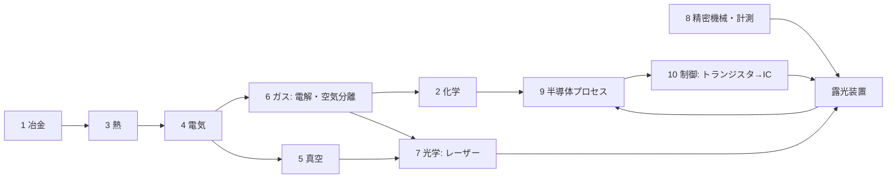

# TECH_TREE.md — 何もない世界から EUV 露光装置までの技術ツリー（依存関係）

ROADMAP は「時間順」、このファイルは「前提→結果」。設計の抜け探し・進捗ツリー・Agent への指示単位に使う。
ノードID: [幹-番号]。状態: ✅実装済 🔧実装中 ❓未着手 ⛔バニラに材料がない（新鉱石等で解決する）
年: 各ノードの「年: 1866（1866〜67） ⚠️」＝代表年（西暦、紀元前はマイナス）・（範囲）・⚠️＝諸説・未確認（REFERENCES の △ と同じ）。本物欄から取った（2026-10-20、技術ネットワーク ①）。tools/gen_tree_views.py が読み、docs/tech_network.json に書き出す
種類: 「種類: モノ」＝人が知っている完成品・サービス（ランドマーク）。ネットワーク図で大きなアイコンにし、選ぶと使われている技術（祖先）が光る（2026-10-20、34個）
理解: 「理解: [2-39]…」＝作るのには要らないが「なぜそうなるか」を後で分かった科学（例：パン・酒と発酵の科学）。前提には数えない（2026-10-20、技術ネットワーク）。前提欄の別ルートは「A or B」（or の前後に空白）、1つの案に複数要るときは「[A]+[B]」

遊び方: 「遊び方: 重/軽/実験/作品」＝そのノードをどう遊ぶか（DESIGN「すべてのノードを遊べるようにする」、2026-10-20）。重＝機械を作って動かす、軽＝作業台・かまどのレシピ、実験＝ミニ実験で発見、作品＝作って置いて動かせるモノ。複数可（例：重＋作品）。「見るだけ」のノードは作らない。各ノードに順次付ける（実装するノードには必ず付ける）

## 10本の幹（＋幹0）
0 生存・道具 ／ 1 冶金 ／ 2 化学 ／ 3 熱（炉と温度）／ 4 動力・電気 ／ 5 真空 ／ 6 ガス ／ 7 光学 ／ 8 精密機械・計測 ／ 9 半導体プロセス ／ 10 制御・計算（ブートストラップ）

## 枝（🌿）のルール
- 幹（EUVへのクリティカルパス）で作った部品だけで作れる技術は「枝」としてノード化してよい（白熱電球・電信・写真・X線管・マグネトロン・LED など）
- 枝は EUV への前提にならない。実装は章の仕上げ・息抜き・全章完成後に差し込む。見積もりは幹の +20〜30%
- 幹の部品から派生しないもの（農業・医薬・輸送・建築材）も幹11以降として追加してよい（方針A）。ただし実装は背骨優先
- 枝ノードは [B-番号] 🌿 と書き、前提に幹ノードを列挙する。章ゴールの「製品」は枝として扱う
- 枝の一覧はファイル末尾の「## 枝（🌿）一覧」（[B-01]〜）。幹11〜15 と重なるものは幹側に統合し、枝には参照だけ残す

## 判明している「抜け」（バニラにない前提）⛔
- 塩素：岩塩鉱 → 電解（クロルアルカリ）→ Cl2/HCl/NaOH。Si精製・GeCl4蒸留・洗浄に必須
- フッ素：蛍石 CaF2 + 硫酸 → フッ酸[2-10] → KF·HF 電解でF2[6-14]。エッチング・石英加工・エキシマレーザーに必須
- 空気分離：圧縮＋冷却で液体空気 → N2/O2/Ar/Kr。エキシマレーザー・パージ・雰囲気
- 硝酸：硝石 or アンモニア（ハーバー法=H2+N2+高圧+鉄触媒）→ 硝酸。CP-4エッチング液
- アルミニウム：ボーキサイト + 電解（ホール・エルー法、氷晶石=フッ素）。配線・装置筐体 → [1-24][1-29]
- スズ：錫石。EUV光源（Snプラズマ）・はんだ → [1-22][1-30]
- モリブデン：輝水鉛鉱。EUV多層膜ミラー（Mo/Si）→ [1-23][1-31]
- 銀：方鉛鉱の副産物（灰吹法）。写真・接点 → [1-32]
- ホウ素：ホウ砂（砂漠の蒸発岩）。Si の p型ドーパント（背骨）・耐熱ガラス → [1-33]→[1-36]（Mg還元。Mg は[1-39]）
- 希土類・ネオジム：強力磁石（リニアモーターステージ）。実装は v1.0 → [1-19][1-35]
- ヘリウム：天然ガス由来。検漏・冷却。→ 不要な設計で回避 [6-15]

## EUV までのクリティカルパス（幹をまたぐ最短の鎖）
鉱石→鉄・銅 → 水車/蒸気 → 発電 → 電解(H2, Cl2) → 電気炉 → Si(シーメンス法, 塩素が必要) → CZ結晶 → ウェハー
→ 真空ポンプ → 真空管 → トランジスタ → IC → マイコン（制御）
→ ガラス→溶融石英→研磨→干渉計（計測）→ ステージ
→ 空気分離(Ar/Ne/Kr) + 蛍石→フッ酸→F2 → エキシマレーザー[7-20] → ArF液浸
→ CO2レーザー + Sn + 多層膜ミラー(Mo/Si) + ターボ分子ポンプ(超高真空) → EUV

## 2段階の執筆
- ① 骨格：全16幹の依存関係を先に。1ノード5〜7行、へえは1つでよい。全体がそろったら検査（切れ・循環・抜け）
- ② 肉付け：幹ごと・何度でも。へえを4段階に、ミニ実験、人物エピソード。実装でそのノードを触るときに一緒にやるのが基本
- へえの4段階（lang: .note1〜.note4 ／ 表示: 通常 / Shift / ガイドブック / ガイドタブ深掘り）
  へえ①子ども：1文、身近な物とつなぐ ／ へえ②学生：原理＋数字 ／ へえ③大人：歴史・人物・産業のつながり ／ へえ④ガチ：式・論文・反例・「本当はもっと複雑」

## ノードの書式（厳守。1ノード＝SDKへの1指示）
### [幹-番号] 名前 状態
前提: [..] 状態, [..] 状態   （全部✅で実装可）
本物: 原理・反応式・年・人名
入力/出力: ゲーム内の材料 → 生成物（電力は W で）
ゲーム: クラス名・パッケージ・既存テンプレの何を参考にするか
省略: 本物との差（ガイドブックに書く内容）
へえ: ①子ども ②学生 ③大人 ④ガチ（骨格段階は①だけでよい。肉付けで4つそろえる）
テスト: TEST_QUEUE に書く確認項目
（任意）実験: ゲーム内で試せる小さな失敗 ／ 人物: 名前・年・ゆかりの品 ／ 間違い: 当時の誤った説

## ノード一覧（章ごとに追記していく）
### [1-01] 石炭灰からのゲルマニウム ✅ ／ へえ①: 石炭を燃やした灰に、ゲルマニウムが集まっていることがある
年: 1930（1886〜1930） ／ 前提: かまど ／ 入力: 石炭 ／ 原理: 一部の石炭にGeが濃縮 ／ ゲーム: coal_ash → germanium_concentrate ／ 省略: 産地限定

## 幹2 化学
### [2-02] カリ（炭酸カリウム K2CO3 → 水酸化カリウム KOH）✅（K2CO3）／🔧（KOH）  遊び方: 軽 ／ **実装（2026-10 IMP2-01）**: 原木（燃える木）→たき火（30秒、空気中で燃やしきる）→ 木灰 wood_ash、木灰×4＋水バケツ（バケツは戻る）→ 灰汁 lye、灰汁 →かまど（煮詰める）→ 炭酸カリウム potash。フリントガラスの調合原料の融剤をソーダ→カリに（レイヴンズクロフトの鉛ガラス）。**KOH（苛性化）は未実装 🔧**：作業台では副産物の方解石を出せないので、使い道（[6-01] のアルカリ電解質など）が出たときに機械か反応ブロックで作る（potash.placeholder）。CHEMISTRY K1〜K3、REFERENCES O3 ／ テスト: potash
年: -2800（-2800〜-2500） ⚠️ ／ 前提: 原木（燃やして木灰）, 水, かまど系（煮詰め）, 石灰（[0-10]生石灰 CaO に水→[0-11]消石灰 Ca(OH)2）／ 本物: 木灰を水に浸して上澄み（灰汁＝あく）を取り、鍋で煮詰めると K2CO3（"pot ash"＝鍋の灰、potassium の語源）。古代から石けん・ガラスの原料。灰を使った最古級の記録は、紀元前2800年頃のバビロンの粘土の円筒に「灰を脂と煮た」とあるもの（石けんの最古の証拠と同じ記録 ⚠️、[2-09]）。シュメール・ギルスの粘土板には約4500年前に羊毛を洗った記録⚠️。これに消石灰を加えると K2CO3 + Ca(OH)2 → 2KOH + CaCO3↓（苛性化）で KOH ができ、古代〜中世の石けん作りでも使われた ／ 入力/出力: 木灰+水+熱 → 炭酸カリウム ／ 炭酸カリウム+消石灰+水 → 水酸化カリウム + 方解石(CaCO3) ／ ゲーム: 2段のレシピ（煮詰めは炉系、苛性化はクラフトか反応ブロック。クラス構成は着手時に決定）／ 省略: 灰汁の濃度管理、木の種類による収率差、KOH が空気中の CO2 を吸って K2CO3 に戻る現象 ／ へえ: カリウム（potassium）の名前は「鍋の灰（pot ash）」から ／ テスト: 木灰+水+熱で炭酸カリウム、消石灰を足すと KOH と方解石が出る
用途: [6-01]電解槽のアルカリ電解質（KOH）、[6-14]フッ素ガスの KF 原料（KOH/K2CO3 + HF → KF）
### [2-10] フッ酸（フッ化水素）✅  遊び方: 重 ／ **実装（2026-10 IMP4-01）**: 鉛のレトルト lead_retort（鉛×4＋鉛の瓶＋かまど＋れんが×3、燃料式・電気なし、ガラスを使わない）。蛍石1＋硫酸1（ガラス瓶は機械の上に戻る＝Vessel.returnEmpty）＋空の鉛の瓶1 → フッ酸 hydrofluoric_acid（Reg.contained、鉛の瓶。相性表でガラス瓶は禁止）1＋石こう calcium_sulfate 1（10秒）。HF を吸わせる水：水バケツ1杯で4回（空のバケツが戻る）。水がないと止まる。量は記号的・濃さは省略（placeholder）。GHS：どくろ・腐食性（note2）。CHEMISTRY F9〜F10、REFERENCES F3 ／ テスト: lead_retort_hf, vessels ／ ID: lead_retort, hydrofluoric_acid, calcium_sulfate ／ 元の記述↓
年: 1771 ／ 前提: [1-21]蛍石 ⛔→❓, [2-01]硫酸✅（本物は濃硫酸＝接触法） or [6-12]鉛室法の硫酸, 加熱（かまど系）, 耐フッ酸容器＝[1-27]鉛 ❓ ／ 本物: CaF2 + H2SO4 → 2HF↑ + CaSO4（副産物は石こう）。1771 シェーレが蛍石を硫酸で処理して「フッ素酸」を得た（ガラスのレトルトが侵食されたことで性質に気付いた）。工業では200〜250℃のロータリーキルン。HF気体を水に吸わせたものがフッ酸 ／ 入力/出力: 蛍石+硫酸+熱 → フッ酸×1 + 石こう(CaSO4)×1 ／ ゲーム: 加熱型の反応ブロック（既存の炉 BE を参考、クラス構成は着手時に決定）。フッ酸はガラス瓶に入れられない→鉛の容器アイテム（[1-27]が前提）／ 省略: 濃硫酸と希硫酸の区別、HFガスの吸収塔 ／ へえ: フッ酸はガラスを溶かすので、ガラス瓶には入れられない ／ テスト: 蛍石+硫酸+熱でフッ酸と石こうが出る、熱なしでは止まる
用途: SiO2エッチング（[9-06]、BHF=緩衝フッ酸）、[6-14]フッ素ガスの原料、石英加工
容器の格上げ（**決定**）: 鉛[1-27]（最初）→ グッタペルカ（19世紀のフッ酸瓶。アカテツ科の樹液。**決定：[2-29]ゴムの木の樹液で近似**。本物は別種（グッタペルカノキ、トランス型ポリイソプレンで硬い）とツールチップに注記）/ ポリエチレン[2-37] → テフロン[2-38]（最上位）。白金[1-20]/[1-18] も可（高価・少量向け）。ガラス瓶は不可（溶ける）

## 幹3 熱（炉と温度）
### [3-10] アチソン炉 ✅
年: 1896 ／ 前提: [4-12]✅, [4-06]蒸気タービン✅ or [4-14]蒸気発電（500kW は蒸気発電なら約10台、DECISIONS Q310-1）, [1-07]黒鉛✅ ／ 本物: 炭素に直接大電流を流し、炭素そのものを発熱体にする抵抗炉。約2500℃。アチソンが1896年に人造黒鉛の製法として特許化（1891年に同じ炉で SiC=カーボランダムを発見）／ 入力/出力: 石炭 or 木炭×4 + 砂×1 + 500kW（2500℃に達してから60秒）→ 人造黒鉛 synthetic_graphite×2 ／ ゲーム: acheson_furnace（ConsumerMachineBlock＋AchesonFurnaceBlockEntity。温度モデル：入る電力−逃げる熱、500kW で 2600℃ に落ち着く。電力不足は「電力不足！最高≈X℃」と表示）。耐火れんが×5＋黒鉛棒（電極）×2＋銅ケーブル×2＋鋼。人造黒鉛→高純度ボート（粘土黒鉛ボートを置換、CHEMISTRY #18✅）／ 省略: 炉の大きさ（本物は十数m）と1回数日の時間、副産物 SiC・CO、電極の消耗。砂の「触媒」はアチソン自身の説を採用（現代は不要とわかっている、note4）／ へえ①: 炭を電気で焼きすぎると黒鉛になる ／ テスト: acheson_furnace（炭素なし→0W、50kW→約280℃で止まる、500kW→942tick で 2500℃→黒鉛2）

## 幹4 動力・電気
### [4-01] 水車発電機 ✅
年: 1878 ／ 前提: [4-04]（磁鉄鉱→磁石, 銅コイル）／ 本物: ファラデー電磁誘導。流量×落差。初期の発電所は水力（1878年 英国クラッグサイド邸でアームストロングが水力の電気でアーク灯をともした。「世界初の水力発電所」ではなく「初めて水力の電気で照明された家」）／ ゲーム: 流水1面500W ／ へえ①: 流れる水の量と落ちる高さが大きいほど、たくさん発電できる
### [4-02] 蒸気機関（ニューコメン・ワット）✅（2026-10-20：発電は [4-14] 蒸気発電に分けた。ゲームの蒸気機関ブロックはそのまま） ／ 種類: モノ
年: 1776（1712〜1776） ／ 前提: [1-09]銑鉄（鋳物のシリンダー） ／ 本物: 1712 ニューコメンの大気圧機関（炭鉱の排水）、ワット1776。熱効率は約2〜5%（ニューコメン機関は約1%、ワットの分離凝縮器で数倍に改善）／ ゲーム: 石炭+水→50kW ／ へえ①: 最初の蒸気機関は、炭鉱の水をくみ出すためのものだった
### [4-03] 銅ケーブル ✅ ／ 年: 1882
本物: I²R損失。太線と高電圧で減らす。1882年9月4日 エジソンのパール街発電所が、銅の導体を地下の管に通して送電を始めた ／ ゲーム: 1ホップ1%（簡易）／ **ネットワーク方式（2026-10 タスク06）**: ケーブルは貯めない導体。つながったケーブル群＝1ネットワーク（CableNetwork）、毎tick 発電機→機械、不足は電池が放電、余りは電池を充電（電池どうしは流さない）。損失＝最長経路のケーブル本数×1%、通過上限 1MW/ネットワーク（超えた要求は按分）。CHEMISTRY #96〜98 ／ テスト: cable_chain_delivers, cable_loss_per_hop, cable_ten_hops500k_w, cable_share_over_limit ／ へえ①: 電線を流れる電気の一部は熱になって失われる。太い線と高い電圧で減らす
### [4-04] ダイナモ・天然磁石 ✅ ／ 年: 1831
本物: ファラデー1831。整流子付きダイナモは直流を出す（電解に直流が要る点で重要） ／ へえ①: 磁石のそばでコイルを回すと、電気が生まれる
### [4-05] 自励式発電機 ✅  **実装（2026-10 タスク04）**: self_excited_dynamo（鋼＋誘導コイル×4、磁石なし）。水車・蒸気機関に持って右クリックで積み替え＝出力2倍（蒸気機関は石炭も2倍速＝石炭1個 1.5MJ は同じ）。壊すとダイナモが落ちる。CHEMISTRY #89〜90 ／ テスト: self_excited_dynamo
年: 1866（1866〜67） ／ 前提: [4-04]✅, [1-26]鋼 ／ 本物: 1866年12月 ヴァーリーが特許出願、1867年1月 ジーメンスとホイートストンが王立協会で発表（ほぼ同時）。鉄心の残留磁気で自分を励磁、永久磁石不要 ／ 入力/出力: 鉄心+コイル×4 → 発電機部品（出力2倍）／ ゲーム: dynamo の上位アイテム ／ へえ: 磁石なしで発電できる
### [4-06] 蒸気タービン ✅  **実装（2026-10 タスク04）**: steam_turbine（鋼×6＋自励式ダイナモ＋耐火れんが×2＋バケツ）。500kW、石炭1個18秒＝熱効率30%（石炭1個＝30MJ の約束、蒸気機関は5%）。水はバケツ（1杯＝石炭2個）か横の水源から取水し続ける。GUI は蒸気機関と共通。旋盤[8-01]❓は placeholder で省略。ケーブル容量を 20→50kJ（1MW/ホップと一致）に修正。CHEMISTRY #91〜93 ／ テスト: steam_turbine, turbine_powers_acheson
年: 1884 ／ 前提: [4-02]✅, [1-26]鋼, [8-01]旋盤 ／ 本物: パーソンズ1884。回転が速く発電に最適、MW級。現代の復水式蒸気タービン火力で熱効率30%級（最新鋭は40%超）／ 入力/出力: 石炭+水 → 500kW ／ 省略: 多段タービン・復水器 ／ テスト: アチソン炉が動く ／ へえ①: 羽根車を蒸気で速く回す。回転が速いので発電にいちばん向いている
### [4-07] 鉛蓄電池 ✅  **実装（2026-10 タスク04）**: lead_acid_battery（鉛×3＋硫酸＋ガラス×4＋銅ケーブル）。容量1MJ、~~正面＝放電端子、ほか5面＝充電~~→**タスク06：全面で充放電**（ネットワークが充電/放電を決める。直接隣の機械へも放電）、充電は85%が貯まる、どちらも最大10kW、放電中に点灯、右クリックで残量。**壊しても残量はアイテムに残る**（データコンポーネント battery_energy、タスク06）。アンチモン格子・自己放電・電圧は省略（placeholder）。CHEMISTRY #94〜95・#97・#99 ／ テスト: lead_acid_battery, battery_on_network, battery_keeps_charge
年: 1859 ／ 前提: [1-27]鉛(方鉛鉱), [2-01]硫酸✅ ／ 本物: プランテ1859。Pb+PbO2+H2SO4。極板の格子は純鉛だと柔らかいので [1-43]アンチモンを数%混ぜて硬くした（任意の上位素材）／ ゲーム: 蓄電ブロック(1MJ)。energy/SimpleEnergyStorage ／ へえ: 車のバッテリーと同じ
### [4-08] 電動モーター ✅ ／ 年: 1821（1821〜1873）
本物: ダイナモの逆。1821年9月 ファラデーの電磁回転（大事な一歩だが、すぐ実用にはならなかった）、1873年 ウィーン万博でグラムの発電機がモーターとして回った。アイテムとして実装済み ／ へえ①: モーターは発電機の逆。電気を流すと回る
### [4-09] 高周波発振器 ✅  **実装（2026-10 タスク02）**: hf_oscillator（真空管×2＋誘導コイル＋ライデン瓶 leyden_jar＋銅ケーブル＋鉄×4）。旧・仮 hf_power_supply を削除し、帯域精製炉レシピを差し替え。CHEMISTRY #22✅・#77〜78 ／ テスト: hf_oscillator_replaces_placeholder
年: 1913（1912〜13） ／ 前提: [5-02]真空管 ／ 本物: 真空管発振回路（1910年代）。誘導加熱の電源 ／ ゲーム: hf_power_supply（仮）を置換 ／ へえ: トランジスタを作る装置が真空管で動いていた
### [4-10] 変圧器 ✅（v0.4 の電気の土台、S-007 で実装）
**実装（2026-10 A、S-007）**: transformer（鋼×6＋誘導コイル×2＋銅ケーブル、energy/TransformerBlockEntity）。後ろ＝入力・前＝出力、各面の電圧の段はその面のケーブル（銅ケーブル＝低圧／高圧の電線 [4-35]＝高圧）で昇圧・降圧。交流の網でしか働かない、効率 98%。**遊び方**：なぜ交流か＝変圧器が使えるのは交流だけ（直流の網では動かない） ／ テスト: highVoltageTransmission・acDcAndRectifier ／ ID: transformer ／ 元の記述→ 年: 1885 ／ 前提: [4-05], 鉄心 ／ 本物: 交流で電圧を変える。1885年 ガンツ社のジペルノフスキー・ブラーティ・デーリが閉じた鉄心の変圧器（ZBD）を出願。送電損失を減らす ／ ゲーム: voltage 欄を使い始める ／ へえ①: 交流なら、電圧を上げたり下げたりできる。高い電圧で送ると失う電気が減る
### [4-11] 整流器 ✅（S-007 で実装）
**実装（2026-10 A、S-007）**: 水銀整流器 rectifier（ソーダ石灰ガラス×4＋黒鉛棒＋水銀＋銅ケーブル、energy/RectifierBlockEntity）。後ろ＝交流の入力・前＝直流の出力、効率 95% ⚠️。**前提の訂正（年どおり、network_proposals Y-2）**：1902 クーパー・ヒューイットの水銀整流器（[1-45] 水銀✅・ガラス）を入れ、[5-02] 真空管（1904 フレミングの二極管）は「or」の別の道。⚠️ 真空に封じる工程は省略。**遊び方**：なぜ整流器か＝電解槽（電気分解）は直流だけ、交流の網からは動かない ／ テスト: acDcAndRectifier ／ ID: rectifier ／ 元の記述→ 年: 1902（1902〜1904） ／ 前提: [5-02]真空管 or [9-05]Geダイオード ／ 本物: 交流→直流。1902年 クーパー・ヒューイットの水銀整流器が最初の電力用の静止形整流器（真空管の整流器はフレミングの二極管 1904）。電解・イオン注入の高電圧直流に必要 ／ へえ①: 交流を直流に変える。電気分解には直流が要る
### [4-12] 電気炉（抵抗加熱）✅
年: 1890（1890年代） ⚠️ ／ 前提: [1-07]黒鉛✅, [4-14]蒸気発電 or [4-01]水車発電機（タービン 4-06 は前提から外した：必要電力 5kW は蒸気発電で足りる。タスク06 決定、DECISIONS Q412-1） ／ 本物: 黒鉛棒に電流を流し、ジュール熱（電気抵抗で出る熱）で加熱する抵抗炉。ニクロム線は Ni/Cr が要るので使わない。1500℃級に届き、Si の融点 1414℃ を超えられる。「最初の黒鉛抵抗炉」の年は特定できない⚠️（早い例はモアッサンの電気炉 1892 と、アチソンの黒鉛芯の炉：SiC 特許 1893・炉の特許 1896）／ ゲーム: 1500℃級の汎用炉。[3-10]アチソン炉の前提 ／ 省略: 黒鉛は高温の空気中で燃える（酸化する）ので、本物は不活性ガスや真空中で使う ／ へえ: ニクロムなしでも黒鉛の棒で発熱体が作れる ／ **実装（2026-10 タスク03）**: electric_furnace（ConsumerMachineBlock＋ElectricFurnaceBlockEntity）。耐火れんが×6＋黒鉛棒×2（新アイテム graphite_rod：黒鉛3→2本、★近似 ピッチ省略）＋銅ケーブル＋鋼。5kW×10秒で 耐火れんが成形品→耐火れんが／粘土黒鉛ボート成形品→黒鉛ボート。水素炉[1-28]のレシピが電気炉を要求（近似注記を外した）。CHEMISTRY #79〜82 ／ へえ①: 燃やさずに電気で温める。燃料の煙が入らない ／ テスト: electric_furnace

### [4-13] ボルタ電池 ✅⚠️  遊び方: 実験＋軽 ／ **実装（2026-10 IMP3、S-005、A と決めた形：GeneratorBlockEntity・直流）**: ボルタの電堆 voltaic_pile（銅6＋羊毛3、block/ChemicalCellBlockEntity、client/ChemicalCellScreen）：亜鉛のインゴット＋塩 → 5 W（亜鉛と塩1つで2分）、使うほど下がる（分極、30% まで）。新しい亜鉛でもとにもどる。ダニエル電池 [4-36] とくらべる実験。電力はゲームの値。CHEMISTRY（4_power）、REFERENCES C48 ／ テスト: chemical_cells ／ 元の記述→ ❓  年: 1800 ／ 前提: [1-13]亜鉛, [1-03]銅, [0-16]塩田（塩水） ／ 本物: 1800 アレッサンドロ・ヴォルタ。銅と亜鉛の円板を、塩水をしみこませた布をはさんで何十段も積む（電堆）。初めて電気が「流れ続けた」。同じ年にニコルソンとカーライルがこれで水を電気分解し、1820 エルステッドが電流で磁針が振れるのを見つけた ／ へえ①: 最初の電池は、銅と亜鉛のお皿を塩水の布ではさんで積み重ねた
### [4-14] 蒸気発電 ✅（2026-10-20 [4-02] から分けた。ゲームの蒸気機関ブロックは [4-02] と [4-14] をまとめたもの。実装・アイテムはそのまま）  年: 1882（1880〜1882） ／ 前提: [4-02]蒸気機関, [4-04]ダイナモ ／ 本物: 1882 エジソンのパール・ストリート発電所（ニューヨーク）とホルボーン高架橋発電所（ロンドン）で、蒸気機関で回したダイナモの電気を街に配った ／ へえ①: 1882年、蒸気で作った電気が初めて街の明かりになった
### [4-15] リチウムイオン電池 ❓  遊び方: 重（充放電する電池ブロック）／ 年: 1991（1985〜1991） ／ 前提: [1-42]リチウム, [1-07]黒鉛（負極）, [4-07]鉛蓄電池（二次電池の考え方） ／ 本物: 1985 吉野彰の原型、1991 ソニーが量産（TECH_TREE [B-10] の記述より。2019 ノーベル化学賞）。リチウムイオンが正極と黒鉛の負極のあいだを行き来する。存命の人は人物に載せない ／ MC: 軽くて大容量の電池 → EV（[P-03]）・スマホ [B-10] ／ へえ①: 充電とは、リチウムのイオンを黒鉛のすき間にしまい込むこと （IMP-24 で追加、network_proposals N-3）
### [4-16] アーク灯（炭素のアークの明かり）❓  遊び方: 作品（置くと光る明かり）／ 年: 1808 ⚠️（デービーがアークを見せた年。実用のアーク灯の年は出典で確かめる） ／ 前提: [4-13]ボルタ電池 or [4-04]ダイナモ, [1-07]黒鉛（炭素棒） ／ 本物: 2本の炭素棒のあいだにアーク（電気の火花）を飛ばして光らせる。アーク炉 [3-15] と同じ原理の電気の明かり。ハータ・エアトンが、アーク灯のシューという音は炭素と酸素の反応が原因と示した（1899、network_proposals W-1） ／ MC: 明るい照明ブロック（炭素棒が減る）／ へえ①: 電気の明かりは、電球より先に「火花」で始まった （IMP-24 で追加、network_proposals N-9）
### [4-17] ステッピングモーター ❓  年: 1919（1919〜1950） ⚠️ ／ 前提: [4-08]電動モーター, [10-01]電磁石 ／ 本物: 電気のパルスを1回送るごとに決まった角度だけ回るモーター。数を数えるだけで回った角度が分かるので、位置を決めるのに使う（3Dプリンター・プリンター・工作機械）。1919年にイギリスのC・L・ウォーカーが可変リラクタンス型の特許を取り、1936年にマリウス・ラヴェ（フランス）が時計用の原理を考えたとされ、工業的な生産は1950年ごろから ⚠️ ／ MC: 未定（実装の前に相談） ／ へえ①: 電気を1回送るたびに、カチッと決まった角度だけ回る（S-001 で追加。出典：Nidec「History of the Motor」、Wikipedia「Marius Lavet」）
### [4-18] 電気のファン（扇風機・冷却ファン） ❓  年: 1882 ／ 前提: [4-08]電動モーター ／ 本物: 1882年、アメリカのスカイラー・ウィーラーが電動モーターの軸に2枚羽根のプロペラを付けて電気の扇風機を作り、1880年代後半に売り出された。パソコンの冷却ファンも同じしくみで、今は直流のブラシレスモーター（磁石が回り、電子回路で電流を切り替える）を使う ／ MC: 未定（実装の前に相談） ／ へえ①: 最初の電気扇風機は、モーターにプロペラを付けただけだった（S-002 で追加。出典：Wikipedia「Schuyler Wheeler」、ETHW「Schuyler Wheeler」）
### [4-19] スイッチング電源 ❓  年: 1970（1960年代後半〜1977） ⚠️ ／ 前提: [4-10]変圧器, [4-11]整流器, [9-04]トランジスタ（速いオン・オフ） ／ 本物: コンセントの交流を直流に直し、トランジスタで1秒に何万回もオン・オフして小さな変圧器で電圧を下げ、また直流に整える電源。オン・オフを速くすると変圧器が小さく軽くなり、熱で捨てる電気も減る。1960年代後半〜1970年代半ばに、速く大電流をさばけるトランジスタが安くなってコンピュータに広まった（1969年の DEC PDP-11/20 など）。特定の発明者はいない（[9-41] パワー半導体の年 1980 との関係は proposals Y-4） ／ MC: 未定（実装の前に相談） ／ へえ①: スマホの充電器が小さいのは、電気を1秒に何万回も入れたり切ったりして変圧器を小さくしているから（S-002 で追加。出典：righto.com「Apple didn't revolutionize power supplies」、Wikipedia「Switched-mode power supply」）
### [4-20] 振動モーター（片寄ったおもり） ❓  年: 1980（1970年代〜1990年代） ⚠️ ／ 前提: [4-08]電動モーター, [1-28]タングステン（重いおもり） ／ 本物: 小さな直流モーターの軸に、片寄ったおもり（重いタングステン合金が多い）を付けて回すと、重心がぐるぐる回って本体ごとゆれる。ポケットベルで音の代わりに知らせる「バイブ」として広まり（1970年代の特許があるが、広まった年は資料で揺れる ⚠️）、携帯電話にも入った。今のスマホは、ばねに付けたおもりを電磁石で前後にゆらす方式（リニア振動アクチュエータ）が多い ／ MC: 未定（実装の前に相談） ／ へえ①: おもりが片側にだけ付いているから、回ると本体ごとブルブルゆれる（S-003 で追加。出典：Google Patents US4794392、Wikipedia「Vibrating alert」）
### [4-21] ブラシレス DC モーター ❓  年: 1962（1962〜1980年代） ／ 前提: [4-08]電動モーター, [9-04]トランジスタ, [4-04]磁石 ／ 本物: ふつうの直流モーターは、ブラシという接点がこすれて電流の向きを切り替えるので、すり減って火花も出る。1962年、T・G・ウィルソンと P・H・トリッキーが、ブラシの代わりにトランジスタの回路で電流を切り替える「固体整流の直流機」を考えた。磁石が回る側にあり、コイルは止まっているので長持ちで静か。1970〜80年代に強い磁石とパワー MOSFET・IGBT が安くなって広まり、エアコン・冷蔵庫・パソコンのファン・電気自動車に使われる ／ MC: 未定（実装の前に相談） ／ へえ①: パソコンのファンやエアコンのモーターには、こすれてすり減る部品が入っていない（S-004 で追加。出典：en.wikipedia.org、technav.ieee.org）
### [4-22] 誘導モーター（交流モーター） ❓  年: 1888（1885〜1888） ／ 前提: [4-08]電動モーター, [10-01]電磁石, [4-10]変圧器 ／ 本物: 向きの違う2組のコイルに、タイミング（位相）をずらした交流を流すと、磁石の向きがくるくる回る『回転磁界』ができる。中の金属の筒（かご形の回転子）には電磁誘導で電流が流れ、磁界に引っぱられて回る。ブラシ（こすれる接点）がいらず丈夫なので、扇風機・洗濯機・工場・エレベーターの主役になった。イタリアのガリレオ・フェラリスが1885年に考え1888年3月にトリノ科学アカデミーで発表、ニコラ・テスラも同じ1888年5月1日に特許を取った。どちらが先かは今も議論がある ／ MC: 未定（実装の前に相談） ／ へえ①: 誘導モーターの回る部分には電線がつながっていないのに、見えない『回る磁石』に引っぱられて回っている。（S-004 で追加。出典：ethw.org、en.wikipedia.org、patents.google.com）
### [4-23] 横流ファン（クロスフローファン） ❓  年: 1893（1891〜1893） ⚠️ ／ 前提: [4-02]蒸気機関, [4-18]電気のファン ／ 本物: 細長い円筒のまわりに小さな曲がった羽根をたくさん並べた羽根車で、空気は筒の横から入り、筒の中を横切って反対側から出る。筒の中にできる渦がこの流れを助ける。長さをのばせば幅の広い平たい風が作れるので、タワーファンやエアコンの室内機の中に使われている。フランスのポール・モルティエが鉱山の換気用に考えた（1891年・1892年と書く資料もある）。今も設計は経験にたよる部分が多い ／ MC: 未定（実装の前に相談） ／ へえ①: エアコンの室内機の中には、ちくわのような細長い羽根車が入っていて、横に広い風を出している。（S-004 で追加。出典：patents.google.com、research.unipd.it）
### [4-24] 羽根のない扇風機（空気の増幅） ❓  年: 2009（1981〜2009） ／ 前提: [4-21]ブラシレス DC モーター, [4-18]電気のファン ／ 本物: 台の中のモーターと羽根車で空気を吸い、輪っかの中の細いすき間から薄く速く吹き出す。輪の断面は飛行機の翼のような形で、吹き出した風がその面に沿って流れ（コアンダ効果）、輪の後ろやまわりの空気を引きこんで前へ送る。羽根が見えないので指を入れても安全で、風のむらも少ない。輪にすき間のある羽根のない扇風機の考えは1981年に日本の東京芝浦電気（今の東芝）が特許を出していたが、製品にしたのは2009年のダイソン ／ MC: 未定（実装の前に相談） ／ へえ①: 羽根のない扇風機は、本当は台の中に羽根があり、輪から出る風がまわりの空気を引っぱって何倍にもふやしている。（S-004 で追加。出典：designingbuildings.co.uk、arxiv.org）
### [4-25] 回生ブレーキ ❓  年: 1897（1890年代〜1908） ⚠️ ／ 前提: [4-08]電動モーター, [4-05]自励式発電機, [4-07]鉛蓄電池 ／ 本物: モーターは回されると発電機になる。減速するときにモーターで発電して、動く力を電気として電池や架線に戻すのが回生ブレーキ。1890年代のパリでルイ・アントワーヌ・クリエジェが、前輪ごとのモーターに回生用の巻線を付けた電気自動車を作った（始めた年は1894年と1897年の説がある）。路面電車では1903〜08年にレイワースの特許で広まった ／ MC: 未定（実装の前に相談） ／ へえ①: 電気自動車はブレーキをかけると、そのとき作った電気で電池を少し充電できる。（S-004 で追加。出典：en.wikipedia.org、en.wikipedia.org、Science Museum Group「Electric brougham motor car (Kriéger, 1904)」・Grace's Guide「J. S. Raworth」（https://collection.sciencemuseumgroup.org.uk/objects/co8038670/electric-brougham-motor-car-electric））
### [4-26] EV の急速充電 ❓  年: 2010（2006〜2014） ／ 前提: [9-41]パワー半導体とインバータ, [4-15]リチウムイオン電池, [4-11]整流器, [14-11]自動車 ／ 本物: 家のコンセントの交流は車の中の充電器で直流にするが、急速充電は外の大きな機械が直流を直接電池に入れる。東京電力が自動車会社と2006〜2009年に実験した方式をもとに、2010年3月に CHAdeMO 協議会ができた（会社名は歴史の例）。第1世代は最大 500V・125A。車と充電器が通信して、電池の状態に合わせて電流を決める。世界には CCS など別の規格もある ／ MC: 未定（実装の前に相談） ／ へえ①: 急速充電では、充電器と車が話し合いながら「今はこれくらいの電流」と決めている。（S-004 で追加。出典：en.wikipedia.org、www4.tepco.co.jp）
### [4-27] 誘導コイル（電池から高い電圧の火花を作る） ❓  年: 1836（1834〜1851） ／ 前提: [10-01]電磁石, [4-13]ボルタ電池 ／ 本物: 鉄心に、太い線を少し巻いた一次コイルと、細い線をたくさん巻いた二次コイルを重ね、一次の電流を断続器で何度も急に切ると、電磁誘導で二次側に何万ボルトもの高い電圧が出て火花が飛ぶ。1836年、アイルランドのメイヌースの司祭で科学者のニコラス・カランが最初の誘導コイルを作り（IEEE マイルストーン）、同じころアメリカのチャールズ・グラフトン・ペイジも独立に作った。1851年ごろハインリッヒ・ルームコルフが改良して売り出し、実験室に広まった。ヘルツの電波の実験（[15-06]）やレントゲンの X 線の発見（[B-03]）の火花・放電はこれで作った ／ MC: 未定（実装の前に相談） ／ へえ①: 電池1つから、雷のような何万ボルトの火花を作れる（O-006 で追加。出典：IEEE Milestones「Callan's Pioneering Contributions 1836」、Wikipedia「Induction coil」）
### [4-28] 乾電池（マンガン乾電池） ❓  年: 1896（1866〜1896） ／ 前提: [4-13]ボルタ電池, [1-13]亜鉛（缶）, [1-07]黒鉛（炭素棒）, [2-21]アンモニア水（塩化アンモニウム） ／ 本物: 1866年、フランスのジョルジュ・ルクランシェが、亜鉛と二酸化マンガンと塩化アンモニウムの水溶液の電池を作った（液がこぼれる湿電池）。1886年、ドイツのカール・ガスナーが液を石こうなどでペーストにして、こぼれない乾電池にした。日本でも屋井先蔵が1887年ごろ独自に乾電池を作ったとされる（年は資料で揺れる ⚠️）。1896年、アメリカのナショナル・カーボン社が、家庭で使える大きさの「コロンビア乾電池」を売り出した（ACS 化学遺産）。亜鉛の缶がマイナス、まん中の炭素棒がプラスで、液をこぼさずに持ち歩ける電池になった ／ MC: 未定（実装の前に相談） ／ へえ①: 「乾」電池でも中は完全に乾いているわけではなく、しめったペーストが入っている（O-009 で追加。出典：ACS「Columbia Dry Cell Battery」、ACS「Columbia Dry Cell Battery」（化学遺産）（https://www.acs.org/education/whatischemistry/landmarks/drycellbattery.html））
### [4-29] ガスタービンとジェットエンジン ❓  年: 1939（1937〜1939） ／ 前提: [4-06]蒸気タービン（羽根と回転体）, [6-03]圧縮機, [1-37]ニッケル（高温に耐える羽根） ／ 本物: 空気を圧縮機で押しこみ、燃料を燃やした熱いガスでタービンを回す。タービンの力の一部で圧縮機を回し、残りで発電機を回すのがガスタービン、後ろへ噴き出すガスの反動で進むのがジェットエンジン。1937年にイギリスのフランク・ホイットルが試運転し、ドイツのハンス・フォン・オハインも互いを知らずに独立に作った（1939年に初飛行）。1939年、スイスのブラウン・ボベリ社がノイシャテルで発電用のガスタービンを動かした（ASME ランドマーク）。今の火力発電所の多くと旅客機のエンジンはこのしくみ。効率は熱力学（[I-02]）で決まる ／ MC: 未定（実装の前に相談） ／ へえ①: 旅客機のエンジンの前の大きなファンも、後ろのタービンが回している（O-010 で追加。出典：ASME Landmark #135「Neuchâtel Gas Turbine」、日本機械学会「機械遺産 No.007」）
### [4-30] 三相交流送電 ❓  年: 1891（1885〜1895） ／ 前提: [4-22]誘導モーター（回転磁界）, [4-10]変圧器 ／ 本物: 3本の電線に少しずつずれた交流を流すと、モーターの中に回る磁界ができ（[4-22]）、同じ太さの電線で多くの電気を送れる。1891年、ドイツの AEG のミハイル・ドリヴォ＝ドブロヴォルスキーとオスカー・フォン・ミラーらが、ラウフェンからフランクフルトまで約175km、変圧器で電圧を上げて三相交流を送った（IEEE マイルストーン）。回転磁界を考えたフェラリスは特許を取らずに公開していた。今の発電所から家までの送電と、工場のモーターのほとんどは三相交流 ／ MC: 未定（実装の前に相談） ／ へえ①: 電柱の上の電線が3本ずつ並んでいるのは、三相交流だから（O-011 で追加。出典：IEEE Milestones「Rotating Fields and Early Induction Motors」、Wikipedia「Mikhail Dolivo-Dobrovolsky」）
### [4-31] 原子力発電 ❓  年: 1951（1951〜1957） ／ 前提: [4-14]蒸気発電, [4-06]蒸気タービン ／ 本物: ウランの原子核が分かれる（核分裂）ときに出る熱で水を沸かし、そこから先はふつうの蒸気発電と同じように蒸気タービンで発電機を回す。1951年12月20日、アメリカのアイダホ州の実験炉 EBR-I が初めて原子力で電気を作り、電球をともした（ASME ランドマーク #39）。1957年にはペンシルベニア州のシッピングポートで本格的な規模の原子力発電所が動いた（ASME ランドマーク #47）。二酸化炭素を出さずに大きな電気を作れる一方、1979年のスリーマイル島、1986年のチェルノブイリ、2011年の福島第一の事故があり、事故への備えと、使い終わった燃料の処分が大きな課題になっている ／ MC: 未定（実装の前に相談） ／ へえ①: 最初の原子力発電がともしたのは、4つの電球だった ⚠️（O-011 で追加。出典：ASME Landmark #39「EBR-I」、ASME Landmark #47「Shippingport」、Wikipedia「Nuclear power」）
### [4-32] 高圧直流送電（HVDC） ❓  年: 1954（1929〜1970） ／ 前提: [4-11]整流器（水銀アークバルブ）, [15-03]海底ケーブル, [4-10]変圧器 ／ 本物: 交流を直流に変えて送り、向こう側でまた交流にもどす送電。長い海底ケーブルでは交流よりむだが少ない。スウェーデンの ASEA のウノ・ラムが25年かけて大きな電力を扱える水銀アークバルブを作り、1954年、本土とゴットランド島の間を約96km の海底ケーブルでつなぎ、20MW・100kV の直流送電を始めた（IEEE マイルストーン）。1970年には半導体のサイリスタのバルブが加わった。今は遠くの大きな発電所や海の上の風力発電所と町を結ぶのに使われる ／ MC: 未定（実装の前に相談） ／ へえ①: 海の底のケーブルで遠くへ電気を送るときは、交流より直流の方がむだが少ない（O-011 で追加。出典：IEEE Milestones「Gotland High Voltage Direct Current Link, 1954」、ETHW「Uno Lamm」）
### [4-33] 水車タービン（フランシス・ペルトン・カプラン） ❓  年: 1827（1827〜1929） ／ 前提: [8-01]旋盤 ／ 本物: 昔の水車より速く回り、水の力をむだなく取り出せる羽根車の水車。1827年にフランスのブノワ・フルネロンが最初の実用的な水車タービンを作り、1849年にアメリカのジェームズ・フランシスが今も一番多く使われるフランシス水車を、1880年ごろレスター・ペルトンが高い所から落ちる細い水の勢いで回すペルトン水車を（ASME ランドマーク #157）、1913年にオーストリアのヴィクトール・カプランが羽根の角度を変えられるカプラン水車を考えた（ASME ランドマーク #57）。水力発電所の発電機（[4-01]）を回すのはこのタービン水車 ／ MC: 未定（実装の前に相談） ／ へえ①: 水力発電所の水車は、昔の木の水車とはちがう、金属の羽根車のタービン（O-011 で追加。出典：ASME Landmark #57「Kaplan Turbine」・#157「Pelton Waterwheel」、Wikipedia「Water turbine」）
### [4-34] 交流発電機（オルタネーター）✅  年: 1882（1878〜1886）⚠️ ／ 前提: [4-05]自励式ダイナモ✅（励磁機）, [4-27]誘導コイル or [4-09]のコイル✅, [1-26]鋼✅ ／ 本物: 止まったコイルの中で電磁石を回し、＋と−が入れかわる電気（交流）を出す。1880年代に交流の電灯（ガンツ社・フェランティ・ウェスティングハウス）で広まり、変圧器 [4-10] とともに遠くへ送る電気の本流に ⚠️（実用の最初の年は出典で確かめる） ／ **実装（2026-10 A、S-007）**: alternator（自励式ダイナモ＋鋼×4＋誘導コイル×4）。水車・蒸気機関・タービンに持って右クリックで積み替え → その発電機が交流を出す（出力は自励式と同じ）。積んであった自励式ダイナモは戻る。太陽電池は直流だけ。周波数・同期は扱わない（S-007 決定 2-A）。**遊び方**：交流と直流の発電機を同じ網につなぐと流れない ／ テスト: acDcAndRectifier ／ ID: alternator ／ へえ①: 発電所の発電機は全部これ。電圧が1秒に50回（東日本）か60回（西日本）入れかわる
### [4-35] 高圧送電 ✅  年: 1886 ⚠️ ／ 前提: [4-10]変圧器✅, [4-03]銅ケーブル✅, [2-14]ガラス（碍子）✅ ／ 本物: 1886 スタンレーがグレート・バリントンの町を、高い電圧で送って変圧器で下げた交流で照らした。同じ電力なら電圧を10倍にすると電流 1/10、電線の損失 I²R は 1/100 ／ **実装（2026-10 A、S-007）**: high_voltage_line（銅ケーブル×3＋ソーダ石灰ガラス（碍子）→ 3、energy/HighVoltageLineBlockEntity）。電圧の段1（約2000V ⚠️ゲームの値）：1本 0.01%（銅ケーブルの 1/100）、網あたり 10MW。銅ケーブルとはつながらず、機械は直接つなげない（変圧器だけ）。**遊び方**：なぜ高い電圧で送るか＝同じ本数でも損失が 1/100、遠くの発電所から送れる ／ テスト: highVoltageTransmission ／ ID: high_voltage_line ／ へえ①: 送電線が高い鉄塔にあるのは、電圧が高いほど空気を通して放電しやすく、地面から離す必要があるから
### [4-36] ダニエル電池 ✅  遊び方: 実験＋軽 ／ 年: 1836 ／ 前提: [4-13]ボルタ電池, [2-12]硫酸銅, [0-03]土器（素焼きの仕切り） ／ **実装（2026-10 IMP3、S-005）**: ダニエル電池 daniell_cell（ソーダ石灰ガラス6＋銅＋土器のつぼ、block/ChemicalCellBlockEntity）：亜鉛のインゴット＋硫酸銅 → 10 W で一定（分極しない）。CHEMISTRY（4_power）、REFERENCES C48 ／ テスト: chemical_cells ／ 本物: 1836 ジョン・フレデリック・ダニエル。Zn｜ZnSO4‖CuSO4｜Cu、約1.1V。正極で銅が出るので水素の泡がたまらない。電信の電源 ／ へえ①: 液を2つに分けたら、電池の力が落ちなくなった
## 幹6 ガス・電解
### [6-01] 電解槽（水→H2+O2）✅
年: 1800 ／ 前提: [4-01]✅ or [4-13]ボルタ電池, [1-07]黒鉛✅ or [1-03]銅（初期の電極は金属線）, 電解質＝[2-01]硫酸✅ or [2-02]KOH ❓（どちらか一方で可）／ 本物: 2H2O→2H2+O2。純水はほぼ電気を通さない（イオンが少ない）ので電解質を入れる。電解質は硫酸 or KOH（アルカリなら黒鉛陽極の消耗が少ない）。黒鉛電極。直流が必要（ダイナモは直流）／ 入力/出力: 水バケツ+硫酸 or KOH(消耗せず)+5kW → H2×2, O2×1（[6-02]に貯める）。現在の実装は硫酸のみ、KOH は [2-02] 実装後に電解質スロットへ追加 ／ ゲーム: energy/ 消費側テンプレ（新規）。ElectrolyzerBlock BE/Menu/Screen ／ 省略: 隔膜、黒鉛陽極の消耗（本物は陽極で出た酸素が黒鉛を酸化して CO2 にし、電極が少しずつ減る。ゲームでは電極は減らない）／ へえ: 純水は電気をほとんど通さない ／ テスト: 電気なしで止まる、水を入れるとH2が溜まる
実装メモ: energy/ConsumerBlockEntity（消費側の共通土台）＋ block/Electrolyzer*。1回=水2mol相当=約572kJ（5kW×115秒）。H2/O2 は袋詰めアイテム hydrogen_gas/oxygen_gas。[6-02]ガスホルダーが隣から自動で吸う。高圧ボンベは[6-03]
### [6-02] ガスホルダー（低圧貯蔵）✅
年: 1812 ／ 前提: 鉄（バニラ） ／ 本物: 19世紀のガス灯用ガスタンク（水封式）。水を張った槽に底なしの鉄のベルをかぶせ、ガスが入るとベルが浮く。ガス圧＝ベルの重さ÷面積（数kPa）で圧縮不要。1812 ロンドンのガス・ライト・アンド・コーク社 ／ 入力/出力: 鉄インゴット×7＋水バケツ → ガスホルダー。中身：袋詰めガス（1袋≈1mol）を最大1000mol（≈24.5m³）、1種類だけ ／ ゲーム: block/GasHolderBlock・GasHolderBlockEntity・GasHolderMenu・block/GasType（種類の列挙。将来 Cl2[6-05]・N2/Ar[6-07] を足す）、client/GasHolderScreen（貯蔵量バー）。電気は使わない（BlockEntity 直継承、GUI は電解槽を踏襲）。隣接6方向の電解槽の H2/O2 出口から同じ種類を自動で吸う（10tick ごと）。左スロット＝袋を吸い込む、右スロット＝1袋ずつ出てくる ／ 省略: ベルの上下・水の蒸発・水素の透過/溶解、圧力の表示 ／ へえ: ①ガス灯の時代のガスタンクは水でふたをしていた ②圧力はベルの重さ÷面積 ③ロンドンのキングス・クロスに骨組みが残り公園・住宅に ④水素は金属のすき間からも逃げる ／ テスト: TEST_QUEUE「[6-02] ガスホルダー」
実験: 水素と酸素を同じホルダーに入れると爆鳴気（2H2+O2→2H2O）で「ドン」と鳴り中身が空になる。ブロックと人は無傷（音と煙のみ）
実装メモ: hydrogen_gas/oxygen_gas は「袋詰め」アイテムとして残し仮ラベルを外した（2026-10 決定）
### [6-03] 圧縮機 ✅ ／ **実装（2026-10 タスク01）**: 圧縮機（鋼×7＋モーター＋銅ケーブル、ConsumerMachineBlock）を 50mol 以上入ったガスホルダーの隣に置く → 空ボンベ×1＋50mol＋5kW×124秒（620kJ＝等温圧縮 nRT·ln150）→ 水素ボンベ/酸素ボンベ（種類別アイテム、約150気圧）。袋詰めは低圧運搬用に残す。CHEMISTRY #63〜66 ／ 省略: 多段圧縮と中間冷却、ボンベからホルダーへ戻す（減圧）操作は未実装 ／ へえ①: 1880年代に高圧ボンベができてガスを持ち運べるようになった ／ テスト: compressor_fills_cylinders
年: 1880 ／ 前提: [4-08]✅, [1-26]鋼 ／ 本物: ピストン圧縮（1880年代に高圧ボンベ実用化）／ 入力/出力: ガス+電力 → ボンベ（鉄×6の空ボンベに充填）／ ゲーム: 容器システムの本体。[6-07]空気分離の前提
### [6-04] 岩塩鉱 ✅ ／ 年: -1500 ⚠️
**実装（2026-10 タスク09）**: 新鉱石 rock_salt_ore（砂漠＋荒野の y0〜48 の石を置換、size 24×3回）→ ツルハシで岩塩 rock_salt（シルクタッチでブロック）→ 作業台 → 塩 salt（NaCl、1→1。不純物除去は placeholder）。CHEMISTRY #117〜118、DECISIONS Q904-1〜2 ／ テスト: ore_rock_salt, rock_salt
本物: 蒸発岩層（古い海の跡）。地下の塩層・砂漠。最古の岩塩採掘は紀元前4500年頃（アゼルバイジャン・ナヒチェヴァンのドゥズダグ、出土土器の型式による推定）。年 -1500 はハルシュタット（オーストリア）の青銅器時代の採掘（最古の証拠は紀元前15世紀） ／ ゲーム: 新鉱石。乾燥バイオーム地下 ／ へえ: 岩塩は「石になった海」
### [6-05] クロルアルカリ電解 ✅
**実装（2026-10 タスク09）**: 電解槽の第2モード（左下のスロットに塩を入れると切り替わる）。水バケツ＋塩×2＋5kW×128秒（約640kJ/mol-Cl2）→ 水素×1（陰極の出口）＋塩素×1（陽極の出口＝水モードの酸素と同じ口）＋水酸化ナトリウム×2（新しい出口）。塩素はガスホルダー・圧縮機・塩素ボンベ（黄）に対応、水素と混ぜると塩素爆鳴気。隔膜は省略（electrolyzer.placeholder）。CHEMISTRY #121〜123、DECISIONS Q905-1〜5 ／ テスト: chlor_alkali, chlorine_holder_and_cylinder
年: 1890（1890〜1892） ／ 前提: [6-01], [6-04]岩塩 or [0-16]海塩（**決定：どちらの NaCl でも可**）／ 本物: 2NaCl+2H2O→Cl2+H2+2NaOH（1890年代）。隔膜で分ける ／ 入力/出力: 塩水（岩塩 or 海塩を水に溶かす）+電力 → 塩素ボンベ, 水素, 水酸化ナトリウム ／ 省略: 隔膜/水銀/イオン交換膜の違い ／ へえ: 塩から塩素と苛性ソーダが同時にできる
### [6-06] 塩酸 ✅
**実装（2026-10 タスク09）**: 新ブロック塩酸合成炉 hcl_burner（酸水素バーナー＋石英管＋MOD ガラス×2＋耐火れんが×2。電気なし）。H2 1mol＋Cl2 1mol＋水 1/4 バケツ（5秒）→ 塩酸 hydrochloric_acid ×1（HCl 2mol、約25%）。ガスは袋・ボンベ・隣のガスホルダーから、両方そろうときだけ開栓。空ボンベ・空バケツは出口へ。CHEMISTRY #124〜125、DECISIONS Q906-1〜4 ／ テスト: hcl_burner
年: 1900 ⚠️ ／ 前提: [6-05] ／ 本物: クロルアルカリ法で得た Cl2 と H2 を H2+Cl2→2HCl（燃焼）→水に溶かす。20世紀初め、クロルアルカリの発達に続いてこの合成塩酸が重要な製法になった（今の塩酸は大部分が塩素化反応の副生） ／ 入力/出力: 塩素+水素（[6-05]の生成物）+水 → 塩酸 ／ ゲーム: Ge精鉱の浸出を硫酸→塩酸に置換可、GeCl4蒸留[1-34]の前提 ／ 省略: 隔膜法/水銀法の違い（[6-05]側） ／ へえ①: 水素を塩素の中で燃やすと塩化水素になり、水に溶かすと塩酸になる
### [6-07] 空気分離（リンデ法）✅  **実装（2026-10 タスク12）**: air_separation_unit（鋼×4＋銅×4＋圧縮機、ConsumerBlockEntity）。電力だけ（材料は空気）：5kW×16秒で空気10mol → N2 7.808・O2 2.095・Ar 0.093 mol（mmol で端数を持ち越して袋に。Ar は約108mol で1袋）。GasType に NITROGEN・ARGON（袋・ねずみ色のボンベ）、GasSource で隣のガスホルダーが自動で吸う、圧縮機でボンベ。段階解禁はせず1台にまとめた（DECISIONS Q1207-1）。CHEMISTRY #136〜138 ／ テスト: air_separation ／ 元の記述→
年: 1895（1895〜1910） ／ 前提: [6-03], 銅の熱交換器 ／ 本物: 1895 リンデが空気の液化に成功（圧縮→膨張で冷却＝ジュール・トムソン効果）。1902〜 リンデの精留塔（何段も蒸留を繰り返す塔）で O2/N2 を分離。Ar の実用的な取り出しは1910年頃。Kr(1.1ppm)・Ne(18ppm) は微量なので[6-08]で大型装置が要る ／ 入力/出力: 電力 → N2, O2, Ar（Kr/Ne は[6-08]）／ ゲーム: 段階解禁にするなら 液化→精留(O2/N2)→Ar の順 ／ へえ: 空気を液体にして「蒸留」する
### [6-08] 希ガス精製（Kr・Ne）✅（v0.4）
年: 1898 ／ 遊び方: 重 ／ **実装（2026-10 IMP2、INBOX O-018。幹6 は担当がいないので前提として C が作った）**: 希ガスの精留塔 rare_gas_column（block/RareGasColumnBlockEntity、空気分離装置[6-07]＋鋼×4＋銅×2、2kW・5秒）。酸素1袋＋窒素1袋（液体空気の酸素のたまり・窒素の上の抜けない気体の近似）→ Kr 31・Xe 4・Ne 63 mmol を貯め、1000mmol で1袋（Kr は 32回、Ne は 16回、Xe は 250回で1袋）。ガスの種類 GasType に NEON・KRYPTON・XENON（袋・ボンベ、ガスホルダーにも入る）。⚠️ 本物の空気は Kr 1.1ppm・Xe 0.09ppm・Ne 18ppm（ゲームは数千倍に濃くした）。1898 ラムゼーとトラヴァースが液体空気から Ne・Kr・Xe を発見。ID: rare_gas_column, neon_gas, krypton_gas, xenon_gas, neon_cylinder, krypton_cylinder, xenon_cylinder。CHEMISTRY G5、REFERENCES O59 ／ テスト: rare_gases ／ 前提: [6-07]大型化 ／ 本物: Kr は空気の1.1ppm（KrFレーザーの発光ガス）、Ne は18ppm（ArF/KrFレーザーの緩衝ガス＝発光ガスを薄めて放電を安定させる役）。どちらも空気分離装置の副産物として取る ／ 入力/出力: 電力（大量）→ Kr, Ne ／ へえ: エキシマレーザーのガスの大半はネオン
### [6-09] ハーバー・ボッシュ法（アンモニア）✅⚠️  遊び方: 重 ／ **実装（2026-10 IMP3、S-005）**: 鉄の触媒 iron_catalyst（磁鉄鉱2＋カリ＋アルミナ、ミタッシュ）。ハーバー・ボッシュの反応塔 haber_bosch_reactor（鋼6＋圧縮機＋銅ケーブル、20kW、block/HaberBoschReactorBlockEntity、ふつうの画面）：窒素1＋水素3 → アンモニア ammonia_gas 2（触媒は減らない、ないと動かない）。アンモニア2＋硫酸 → 硫酸アンモニウム ammonium_sulfate ×4（化学肥料、item/FertilizerItem：耕地 → 窒素の多い耕地 [0-05]）、＋水＋瓶 → アンモニア水 [2-21]。1回で全部反応（本物は約15%＋循環）。ハーバーの毒ガスは失敗の記録として note4（作り方は入れない）。CHEMISTRY HB1、REFERENCES C47 ／ テスト: haber_bosch
年: 1913 ／ 前提: [6-01]H2, [6-07]N2, [6-03]高圧, 磁鉄鉱触媒✅ ／ 本物: N2+3H2→2NH3、200気圧400℃、触媒は磁鉄鉱を還元した鉄（1913）／ へえ: 触媒の原料が磁鉄鉱
### [6-10] 硝石床（硝酸カリウム）❓
年: 1750 ／ 前提: 骨粉/腐肉, 石灰 ／ 本物: 有機物+石灰を数か月堆積、細菌の硝化でKNO3（18世紀の火薬原料）／ ゲーム: 堆肥ブロックが時間で硝石に ／ へえ: 硝石は細菌が作る
### [6-16] 天然硝石の採取 ✅  遊び方: 軽 ／ **実装（2026-10 IMP2-02、[6-11] 硝酸の前提）**: 新しいブロック「硝石土」nitre_earth_block（鍾乳石の洞窟＝石灰岩の洞窟だけ、鍾乳石ブロックを置き換える。y−40〜80、大きさ8・12回。やわらかい土でシャベル）→ 硝石土 nitre_earth×2。硝石土×4＋木灰[2-02]＋水バケツ → 硝石の浸出液（バケツは戻る）→かまど（煮つめる）→ 硝石 saltpeter（KNO3）。木灰の K2CO3 で Ca(NO3)2 を KNO3 に変え CaCO3 を沈める（省略は placeholder）。工業の材料としてだけ（火薬の配合は作らない＝DESIGN「危ない技術の扱い」）。家畜小屋の土・硝石床[6-10] は後日。ID: nitre_earth_block, nitre_earth, nitre_liquor, saltpeter。CHEMISTRY G1〜G2、REFERENCES O19 ／ テスト: ore_nitre_earth, saltpeter_from_nitre_earth, ore_biome_rules ／ 元の記述→  年: 1250（850〜1600） ／ 前提: なし（家畜小屋の土から取るなら家畜化 0-17 のあと） ／ 本物: 古い壁・洞窟・家畜小屋の床の土には、尿や糞が細菌で分解されてできた硝酸カリウム（硝石 KNO3）が白くふき出す。土を水に浸して煮つめ、木灰（K2CO3）を加えて結晶にした。中国で9〜10世紀ごろの火薬（808年の道教の文書が最古の処方とされ、1044年『武経総要』がまとまった処方の最古）、ヨーロッパでは13世紀ごろから（ロジャー・ベーコンの処方、1250〜1267年頃）。18世紀に人工の硝石床 [6-10] で増産、のちにチリ硝石・ハーバー・ボッシュ法 [6-09] ／ へえ①: 火薬の原料は、古い家畜小屋の土からとれた
### [6-11] 硝酸 ✅
遊び方: 軽 ／ **実装（2026-10 IMP2-02、写真 [B-02]・銀鏡 [7-05] 段階2・IMP4 のエッチングの材料）**: 硝石[6-16]＋硫酸[2-01]（瓶）＋空のガラス瓶＋石英の蒸留器[1-34]（戻る）→ 硝酸 nitric_acid（ガラス瓶入り、Vessel.ALLOWED に1行）、硫酸の空き瓶が戻る。銀の粒[1-32]＋硝酸 → 硝酸銀 silver_nitrate（空き瓶が戻る）。年は監査 V-43 に合わせ「最初の処方は13世紀末〜14世紀初め、グラウバーの硝石＋硫酸は17世紀中ごろ（1648年は出典未確認⚠️）」。蒸留の加熱・KHSO4・NO の気体は省略（placeholder）。工業の材料としてだけ（DESIGN「危ない技術の扱い」）。ID: nitric_acid, silver_nitrate。CHEMISTRY G3〜G4、REFERENCES O20 ／ テスト: nitric_acid_and_silver_nitrate ／ 元の記述→ 年: 1300（1300〜1648） ⚠️ ／ 前提: [6-16]+[2-43] or [6-16]+[2-01] or [6-10]+[2-01] or [6-10]+[2-43]（硝石＝天然硝石 or 硝石床、酸＝ばん油 or 硫酸。中世・グラウバー法1648） or [6-09]+白金触媒（オストワルト法）／ 本物: KNO3+H2SO4→HNO3。最初期の硝酸の処方は偽ゲーベル文書群の『De inventione veritatis』（13世紀末〜14世紀初め）。17世紀中ごろ（1648年頃⚠️）、グラウバーが硝石＋硫酸で硝酸を作る方法を記した ／ ゲーム: 最初はグラウバー法。CP-4エッチング液の材料 ／ へえ①: 硝石に硫酸をかけると、硝酸が出てくる
### [6-12] 鉛室法硫酸 ❓
年: 1746 ／ 前提: [1-27]鉛, [6-11]硝酸, SO2✅ ／ 本物: 1746ロバック。鉛張りの部屋でSO2+NO2+H2O→H2SO4。最初の工業的硫酸 ／ ゲーム: 現在の「SO2+水」の省略を置換 ／ へえ: 硫酸工場が鉛でできていた理由
### [6-13] 接触法硫酸（濃硫酸）❓
年: 1831（1831〜1915） ／ 前提: SO2✅, [1-20]白金（※[6-12]は技術的な前提ではないので外した。歴史順では鉛室法1746が先、接触法1831が後）／ 本物: SO2→SO3 を白金触媒（1831）、後にV2O5（1915）。濃硫酸・発煙硫酸 ／ 省略: V2O5（バナジウムは範囲外→白金で統一） ／ へえ①: 白金などの触媒を使うと、とても濃い硫酸が作れる
### [6-14] フッ素ガス（F2）✅
年: 1886 ／ 遊び方: 重（事故あり） ／ **実装（2026-10 IMP2、INBOX O-018）**: 炭酸カリウム[2-02]＋フッ酸[2-10]（E）→ フッ化カリウム potassium_fluoride。フッ素の電解槽 fluorine_cell（block/FluorineCellBlockEntity・client/FluorineCellScreen、ニッケル[1-37]（D）×6＋銅＋銅ケーブル＝モネル風の槽、2kW・10秒）：KF（電解質、減らない）＋黒鉛[1-07]の陽極（減らない）＋フッ酸（鉛の瓶は上に戻る）＋空のボンベ → 1回で水素1袋、5回でフッ素のボンベ fluorine_cylinder 1本。フッ素は袋（ゴム）を侵すので、フッ化物の膜で守られる鋼のボンベに直接詰める（Vessel の表は変えていない）。**事故**（DESIGN⑥）：水素の出口がいっぱいだと陽極と陰極のガスが混ざって反応し、貯めていたフッ素を失って止まる（地形は壊れない）。工業の材料としてだけ。量・条件の細部は書かない。GHS：酸化性ガス・高圧ガス・急性毒性（吸入）・皮膚腐食性。ID: potassium_fluoride, fluorine_cell, fluorine_cylinder。CHEMISTRY G6、REFERENCES O60 ／ テスト: fluorine_cell ／ 前提: [2-10]フッ酸 ❓, [2-02]カリ ❓（KOH/K2CO3 + HF → KF）, [1-07]黒鉛✅（陽極）, [4-04]ダイナモ✅（直流）, [6-02]ガスホルダー ❓ ／ 本物: HF そのものは電気をほぼ通さないので、KF を溶かして電解する。1886 モアッサンが無水HF+KHF2 を白金のU字管で低温電解して単離（1906 ノーベル化学賞）。現代は溶融 KF·2HF（約100℃）を炭素陽極・鋼/モネル製セルで電解：陽極 2F⁻→F2、陰極 2H⁺→H2 ／ 入力/出力: フッ酸+KF+電力（W は実装時に決定）→ F2×1, H2×1 ／ ゲーム: [6-01]電解槽（energy/ConsumerBlockEntity）を参考にした別ブロック ／ 省略: セル材質（モネル=Ni-Cu合金は範囲外）、陽極効果、F2の不動態化した配管 ／ へえ: フッ素は単離するまでに何人もの化学者が中毒になった「最も危険な元素」 ／ テスト: 電気なしで止まる、KF がないと動かない
用途: [7-20]エキシマレーザーの発光ガス（ArF・KrF）

## 仮ノード（参照されているが未記述。1行だけ。着手時に正式な書式へ展開する）
### [1-07] 黒鉛 ✅  本物: 変成岩中の天然黒鉛（脈状黒鉛。黒鉛るつぼは1840年代に普及（ディクソン、米墨戦争のころ）、特許は1850年）／ ゲーム: 黒鉛鉱石 → 黒鉛（CHEMISTRY #17）／ 用途: 電極[6-01]、黒鉛ボート、発熱体[4-12] ／ 年: 1850 ／ へえ①: 鉛筆の芯と同じ黒鉛は、熱に強いるつぼの材料にもなった
### [2-01] 硫酸 ✅  本物: 接触法 2SO2+O2→2SO3, SO3+H2O→H2SO4 ／ ゲーム: SO2+水 → 硫酸（SO3酸化を省略、CHEMISTRY #4b）／ 置換予定: [6-12]鉛室法 → [6-13]接触法 ／ 年: 1831（1831〜1915） ／ へえ①: 二酸化硫黄に酸素をくっつけて水に吸わせると、硫酸になる
### [5-01] 真空ポンプ → 幹5 の節へ移動（[5-01] 手押しピストンポンプ）
### [5-02] 真空管 → 幹5 の節へ移動
### [7-20] エキシマレーザー → 幹7 の節へ移動
### [8-01] 旋盤 ✅  遊び方: 重 ／ **実装（2026-10 IMP2-01、[5-04] の前提）**: 旋盤 lathe（鋼×2＋送りねじ＋鉄×2＋モーター、電気 750W、block/LatheBlockEntity）。鋼のインゴット → 回転ポンプのローター pump_rotor（30秒）。削れる物は LatheBlockEntity.product に1行ずつ足す。動力は電気モーター⚠️（本物は人力・水車・蒸気）。ID: lathe, pump_rotor。CHEMISTRY P1、REFERENCES O14 ／ テスト: lathe ／ 元の記述→  年: 1797（1797〜1800） ／ 前提: [1-26]鋼 or [1-11]るつぼ鋼 ／ 本物: ヘンリー・モーズリーの全金属製ねじ切り旋盤（1797〜1800頃。刃物台を送りねじで動かし、人の手の震えを除いた＝精密機械の母）／ 用途: [4-06]蒸気タービン、[8-02]以降の幹8 全体、[5-04][5-07] ／ へえ①: 刃物を送りねじで動かす旋盤が、人の手のふるえを取り除いた
### [9-05] Geダイオード（点接触）❓  年: 1940 ／ 前提: [1-01]Ge✅（Ge 単結晶は[9-07]）, [1-28]W線（針）／ 本物: Ge結晶に細い金属針を立てた点接触ダイオード。1940年代のレーダー検波器として量産、点接触トランジスタ(1947)の直接の祖先 ／ 用途: [4-11]整流器 ／ へえ①: ゲルマニウムに細い針を立てた部品が、レーダーの電波をとらえた
### [9-06] 酸化膜エッチング（HF）✅  遊び方: 軽 ／ **実装（2026-10 IMP4-01）**: エッチング槽 etch_tank（鉛×7、電気・燃料なし、室温）。酸化膜つきの板×8＋フッ酸1（空の鉛の瓶は上に戻る）→ シリコンの板×8（純度・ドーパントを受け継ぎ、膜は消える）。時間＝膜の厚さ÷20nm/秒（ゲームの値）。現像ずみの加工中ウェハー（process_wafer）1〜8枚 → レジストのない所に窓が開く（ChipOps.etchOxide、LITHO_DESIGN §5）。CHEMISTRY F11、REFERENCES F4 ／ テスト: etch_tank ／ ID: etch_tank ／ 元の記述→  年: 1957 ／ 前提: [2-10]フッ酸✅ ／ 本物: SiO2+6HF→H2SiF6+2H2O。Si 本体はほぼ溶かさず酸化膜だけ溶かす（選択性）。実務は NH4F で緩衝した BHF。1957 ラスロップとナル（米陸軍）が SiO2 に穴を開けた（ベル研の窓開けは1955年から。液が HF だったかは未確認⚠️） ／ ゲーム: 第3章のウェハー状態機械の1工程（酸化→レジスト→露光→現像→**エッチング**）／ へえ: 酸化膜が溶けきると表面が水をはじく（撥水）ので、終わりが目で分かる

## 新たに必要な鉱石ノード（輸入品なしのため）
### [1-20] 白金（砂白金）✅  遊び方: 軽 ／ **実装（2026-10 IMP4-01、[2-19] 過酸化水素の白金陽極の前提）**: 砂鉄 iron_sand をシルクタッチ以外で掘ると約3%で砂白金 platinum_grain（ルートテーブルに1つ）。産地（コロンビア・ウラルの川）は近似（placeholder）。CHEMISTRY F24、REFERENCES F12 ／ テスト: placer_platinum, block_drops ／ ID: platinum_grain ／ 元の記述→  年: 1748 ／ 前提: 砂鉄✅ ／ 本物: 漂砂鉱床に自然白金が微量（ウラル・コロンビア）。1748年 ウジョアの『Relación Histórica』がヨーロッパで最初の記述（ウッドは1741年頃に試料を調べ、英国の医師ブラウンリッグに報告していた）／ ゲーム: 砂鉄のドロップに低確率で白金粒 ／ 用途: 触媒[6-13][6-11]、電極、熱電対 ／ へえ①: 白金は川の砂の中に、金属のまま少しだけまじっている
### [1-21] 蛍石 CaF2 ✅  遊び方: 軽 ／ **実装（2026-10 IMP4-01、[2-10] の前提）**: 新しい鉱石 fluorite_ore（方鉛鉱と同じ帯 Y −16〜64、石・深層岩、count 4・size 6＝方鉛鉱より少ない、石のツルハシ以上、シルクで鉱石ブロック）→ 蛍石 fluorite（c:raw_materials/fluorite）。鉱脈の形は省略（placeholder）。CHEMISTRY F5、REFERENCES F1 ／ テスト: ore_fluorite, ore_biome_rules ／ ID: fluorite, fluorite_ore ／ 元の記述→  本物: 熱水鉱脈（方鉛鉱・閃亜鉛鉱と共生）。1530年 アグリコラ『ベルマヌス（Bermannus）』で融剤「fluores」として初めて活字に／ ゲーム: 方鉛鉱と同じ帯 ／ 用途: フッ酸[2-10]（蛍石+硫酸）、氷晶石、エキシマレーザーの CaF2 窓[7-20] ／ 年: 1530（1529〜1530） ／ へえ①: 蛍石は、方鉛鉱や閃亜鉛鉱といっしょに鉱脈で見つかる
### [1-22] 錫石 SnO2 ✅  遊び方: 軽 ／ **実装（2026-10 IMP2-01、[1-30] の前提）**: 新しい鉱石「錫石の鉱石」cassiterite_ore（花崗岩だけを置き換える、y−10〜70、大きさ5・3回、鉄のツルハシ以上）→ 錫石 cassiterite。漂砂（川の砂）は省略。ID: cassiterite_ore, cassiterite。CHEMISTRY M3 ／ テスト: ore_cassiterite ／ 元の記述→  本物: 花崗岩系の熱水・漂砂（コーンウォール、マレーシア）。錫青銅の最初の証拠は紀元前3000年頃の近東・バルカン（どこで錫を掘ったかは未解明）／ ゲーム: 鉄マンガン重石と同じ花崗岩帯 ／ 用途: はんだ、EUV光源 ／ 年: -3000 ／ へえ①: スズの鉱石は、花こう岩の近くや川の砂から取れる
### [1-23] 輝水鉛鉱 MoS2 ⛔→❓  本物: 斑岩銅鉱床の副産物。1778年 シェーレが黒鉛でも鉛を含むものでもないと示し、新しい金属の酸化物（モリブデン酸）を得た ／ ゲーム: 銅鉱石の近く ／ 用途: EUV多層膜ミラー ／ 年: 1778 ／ へえ①: モリブデンの鉱石は、銅の鉱山のついでに取れる
### [1-24] ボーキサイト ✅  遊び方: 軽 ／ **実装（2026-10 IMP4-01、[1-29] アルミ→[9-25] Al 配線の前提）**: 新しい鉱石 bauxite_ore（ジャングル・サバンナだけ、Y 56〜90 の土・粗い土・石を置き換え、木のツルハシ可、シルクで鉱石ブロック）→ ボーキサイト bauxite（c:raw_materials/bauxite）。地表の層（ラテライト）の形は省略（placeholder）。CHEMISTRY F12、REFERENCES F5 ／ テスト: ore_bauxite, ore_biome_rules ／ ID: bauxite, bauxite_ore ／ 元の記述→  本物: 熱帯の風化残留土。1821年 ベルティエがレ・ボー近くで発見、名前は村から ／ ゲーム: ジャングル/サバンナの地表付近 ／ 用途: アルミ（ホール・エルー法=電解+氷晶石） ／ 年: 1821 ／ へえ①: アルミの原料ボーキサイトは、熱い国で岩が風化してできた土
### [1-25] モナザイト（希土類）⛔→❓  本物: 漂砂鉱床（砂鉄と共産）。1829年 ブライトハウプトが命名（模式産地はウラルのイリメニ山地）／ ゲーム: 砂鉄の副産物 ／ 用途: ネオジム磁石（ステージ）。分離は溶媒抽出を簡略化 ／ 年: 1829 ／ へえ①: モナザイトは、砂鉄といっしょに砂の中から取れる
### [1-26] 鋼（ベッセマー転炉）✅
年: 1856 ／ 前提: 鉄（バニラの鉄インゴット＝銑鉄の近似）, [4-02]✅（送風の動力。ゲームでは電力→[4-08]✅モーター）／ 本物: 1856 ヘンリー・ベッセマー。溶けた銑鉄（C約4%）の底から空気を吹き込み、C+O2→CO2（炉内は主に 2C+O2→2CO、炉口で CO が燃える）で炭素を C約0.1〜0.5% まで抜く。燃料なし：Si と C が燃える熱で溶けたまま。炎の色で終点が分かる（①Si の赤い火花→②C のボイル＝白く長い炎→③フレームドロップ）。1856 マシェットのスピーゲルアイゼン（脱酸・加炭）で実用化 ／ 入力/出力: 鉄インゴット×1 ＋ 20kW×20秒（送風）→ 鋼インゴット×1。転炉＝鉄×6＋粘土×2＋電動モーター ／ ゲーム: block/BessemerConverterBlock・BessemerConverterBlockEntity（energy/ConsumerBlockEntity 継承、電解槽が見本）・BessemerConverterMenu、client/BessemerConverterScreen（バーの色＝炎の色、下の行に段階）。ModItems.STEEL_INGOT、タグ c:ingots/steel ／ 省略: 銑鉄を溶かす工程（本物は高炉から溶けたまま運ぶ）、転炉を傾ける操作、スピーゲルアイゼン（Mn 未実装）、リンが抜けない問題（酸性内張り。→塩基性は[3-08]トーマス法）、内張りは粘土の突き固めで近似（本物は珪石質耐火物。[3-12]耐火れんが実装後に置換）、送風の電力は本物（1トンあたり約15MJ）よりずっと小さい ／ へえ: ①鉄に空気を吹き込むだけで鋼になる。炎の色で終わりがわかる ②銑鉄4%→鋼0.1〜0.5%、燃料なし ③ベッセマー1856・ケリー、鋼が安くなりレールと橋が鋼に ④マシェットのスピーゲルアイゼン、リン問題→トーマス1878 ／ テスト: TEST_QUEUE「[1-26] 鋼」
用途: タービン[4-06]・圧力容器・旋盤[8-01]・圧縮機[6-03]
⚠️ 注記（決定）：バニラの鉄インゴットは本来「錬鉄」（ブルームを鍛えたもの、炭素≈0）なので、本当はベッセマー転炉は効かない（燃やす炭素も Si もない＝温度を保てない）。今は暫定で「銑鉄の近似」として受け付ける。**[1-09]高炉の実装時に『銑鉄』アイテムを出し、転炉は銑鉄のみ受け付けるように変更**する。錬鉄（バニラ鉄）＋木炭→**[1-11]るつぼ鋼**を正しい代替ルートとして追加予定
### [1-27] 鉛（方鉛鉱）✅  年: -4000（-4400〜-3800） ⚠️ ／ 前提: 方鉛鉱✅（CHEMISTRY #27）, かまど系 ／ 本物: 焙焼 2PbS+3O2→2PbO+2SO2 → 炭素還元 PbO+C→Pb+CO。融点327℃で古代から製錬。ヨーロッパ最古の方鉛鉱の処理は紀元前4400〜4300年（ルーマニア・ピエトレレ）。近東ではそれ以前（後期新石器）から鉛利用の例があり、最古の鉛の像はアビドスの紀元前3800年頃 ／ 用途: [4-07]鉛蓄電池、[6-12]鉛室、[2-10]フッ酸容器、[1-32]銀 ／ **実装（2026-10 タスク01）**: 方鉛鉱（原石）→かまど（焙焼）→ 一酸化鉛 litharge → かまど（燃料の C/CO で還元）→ 鉛インゴット（#c:ingots/lead）。CHEMISTRY #55〜57 ／ 省略: ~~焙焼の SO2 は未回収~~ → [3-06]反射炉で回収（タスク07。かまどでは今も逃げる）、銀は注記のみ（[1-32]）／ へえ①: 昔の水道管と活字の金属。体に悪い ／ テスト: lead_from_galena
### [1-28] タングステン線 ✅  年: 1910 ／ 前提: 鉄マンガン重石✅（CHEMISTRY #26）, [6-01]H2✅ ／ 本物: (Fe,Mn)WO4→WO3→H2還元でW粉→焼結→線引き（1910 クーリッジの延性W）／ 用途: [5-02]真空管、[B-01]白熱電球、[9-05]針 ／ **実装（2026-10 タスク01）**: 鉄マンガン重石＋炭酸ナトリウム →かまど（ソーダ融解）→ タングステン酸ナトリウム ＋塩酸 → タングステン酸 →かまど→ 三酸化タングステン（**2026-10 タスク09 で本物化、仮は削除。CHEMISTRY #126〜128**）→ **水素炉**（新ブロック hydrogen_furnace、ConsumerBlockEntity。WO3×1＋H2×3＋3kW×30秒 → W粉）→ 水素炉（W粉×2＋H2×1＋10kW×20秒、通電焼結 → 焼結棒）→ 作業台 → タングステン線×4。水素は袋 or 隣のガスホルダーから自動補充。CHEMISTRY #58〜62 ／ 省略: （2026-10 タスク03 で電気炉[4-12]✅、水素炉＝電気炉＋水素管として正式化、placeholder 削除）スエージング・ダイス線引き（tungsten_wire.placeholder）、粉のプレス ／ へえ①: 融点3400℃で溶かせないので粉を焼き固める ／ テスト: tungsten_hydrogen_furnace, hydrogen_furnace_pulls_from_holder
### [1-29] アルミニウム（ホール・エルー法）✅  遊び方: 重 ／ **実装（2026-10 IMP4-01、[9-25] Al 配線の前提）**: ホール・エルー電解槽 hall_heroult_cell（鋼×5＋黒鉛棒＋耐火れんが×2＋銅ケーブル、100kW）。アルミナ2 → アルミニウム aluminium_ingot 1（約1kg、540秒＝15kWh、c:ingots/aluminum）。浴＝氷晶石1で16回、陽極＝黒鉛棒1で2回（燃えて減る）。排ガス・電流電圧・ポットラインは省略（placeholder）。CHEMISTRY F16、REFERENCES F8 ／ テスト: hall_heroult ／ ID: hall_heroult_cell, aluminium_ingot ／ 元の記述→  年: 1886 ／ 前提: [1-24]ボーキサイト, [6-05]NaOH（バイヤー法1888でアルミナ Al2O3 を取り出す）, 氷晶石 Na3AlF6（天然はグリーンランドのみ→合成＝[2-10]HF+Al(OH)3+NaOH）, [1-07]黒鉛電極, 直流の大電流 ／ 本物: 1886 ホール（米）とエルー（仏）が独立に発明。約960℃で溶かした氷晶石にアルミナを溶かして電解 2Al2O3+3C→4Al+3CO2（陽極の炭素が燃えて減る）。1kg に約15kWh ／ 用途: 配線（初期IC）、装置筐体、蒸着源 ／ へえ: それまでアルミは金より高く、ナポレオン3世が来賓用の食器にした
### [1-30] 錫（スズ）製錬 ✅  遊び方: 軽 ／ **実装（2026-10 IMP2-01、[1-05] の前提）**: 錫石[1-22] →かまど（溶鉱炉なら半分の時間）→ スズのインゴット tin_ingot（c:ingots/tin）。燃料の C/CO で還元（#38 と同じ近似）。ID: tin_ingot。CHEMISTRY M4、REFERENCES O8 ／ テスト: tin_from_cassiterite ／ 元の記述→  年: -3000 ／ 前提: [1-22]錫石 ⛔→❓, 木炭 or 石炭, かまど系 ／ 本物: SnO2+2C→Sn+2CO。青銅器時代（紀元前3000年頃）から。融点232℃と低い ／ 用途: はんだ（Sn-Pb）、EUV光源（Sn液滴にレーザーを当ててプラズマ化）／ へえ: 5000年前の青銅の材料が、最先端の EUV の光源になる
### [1-31] モリブデン製錬 ❓  年: 1781 ／ 前提: [1-23]輝水鉛鉱 ⛔→❓, [6-01]H2✅, 焙焼炉（かまど系）／ 本物: 焙焼 2MoS2+7O2→2MoO3+4SO2 → 水素還元 MoO3+3H2→Mo+3H2O。1781 イェルムが初めて金属を得た。粉末を固める（W[1-28]と同じ粉末冶金）／ 用途: EUV 多層膜ミラー（Mo/Si を約40対）／ 省略: 粉末冶金の焼結条件 ／ へえ: 焙焼で出る SO2 は硫酸[2-01]の原料に回せる
### [1-32] 銀（方鉛鉱の副産物）✅  遊び方: 軽 ／ **実装（2026-10 IMP2-01、[5-14] 蒸着の金属として）**: 骨粉 →かまど→ 骨灰（リン酸カルシウム）×4 → 灰吹き皿。鉛インゴット×8＋灰吹き皿 → 灰吹きの調合 →溶鉱炉（空気を吹きつけて約1000℃、10秒）→ 銀の粒（皿が PbO を吸う）。銀の粒×9 ⇔ 銀インゴット（c:ingots/silver）。方鉛鉱はすべて銀を含む扱い⚠️（鉛8つで粒1つ＝約1.4%、本物は 0.01〜1%程度）。ID: bone_ash, cupel, cupel_charge, silver_nugget, silver_ingot。CHEMISTRY M7〜M9、REFERENCES O13 ／ テスト: silver_cupellation ／ 元の記述→  年: -3000 ／ 前提: [1-27]鉛(方鉛鉱) ❓, かまど系 ／ 本物: 銀を含む方鉛鉱から鉛を製錬 → 灰吹法（キューペレーション、紀元前3000年頃〜）：溶けた鉛に空気を当てて PbO にし、骨灰の皿に吸わせると銀だけ残る。1850 パークス法（亜鉛で銀を抜き出す）／ 用途: [B-02]写真（AgI・AgNO3）、接点・導電ペースト ／ へえ: 石見銀山も灰吹法で銀を取り出していた
### [1-33] ホウ素（ホウ砂）✅  **実装（2026-10 タスク12）**: 新鉱石 borax_deposit（砂漠だけ・y56〜76 の砂/砂岩、トロナより少ない、木のツルハシでホウ砂、シルクでブロック）→ ホウ砂＋硫酸 → ホウ酸×2（1個＝2mol）→ かまど → 三酸化二ホウ素 B2O3（1個＝1mol、Si の p型ドーパント・[2-15] の材料）。単体ホウ素は [1-36] のまま。Na2SO4 は捨てる（boric_acid.placeholder）。CHEMISTRY #139〜141 ／ テスト: ore_borax, boron_chain ／ 元の記述→  年: 1808 ／ 前提: 新鉱石ホウ砂（砂漠の干上がった塩湖の蒸発岩。ゲーム: 砂漠バイオームの地表付近）, [2-01]硫酸✅ ／ 本物: ホウ砂 Na2B4O7·10H2O + H2SO4 → ホウ酸 H3BO3 → 加熱で B2O3。単体は1808 ゲイ=リュサック/テナールとデービー ／ 用途: p型ドーパント（Si に B を入れると正孔ができる）、ホウケイ酸ガラス（耐熱ガラス・実験器具）／ 単体ホウ素は[1-36]で作る（背骨）／ へえ: ホウ砂は昔から金属のろう付けの「フラックス」として使われた
### [6-15] ヘリウム 回避（実装しない）  本物: 天然ガスに数%含まれるものを液化分離（1903 カンザスで発見）。用途は検漏（He リークディテクター）・極低温冷却 ／ ゲーム: バニラに天然ガスがないため不要な設計にする。検漏は「圧力上昇（ビルドアップ）法」、冷却は水・液体窒素[6-07]で代替 ／ へえ: ヘリウムは太陽で先に見つかった（1868 日食の分光）。地球では放射性崩壊で地下に溜まったものしか取れない ／ 年: 1903

## 幹0 生存・道具（下書き。1行書式。着手時に正式な書式へ展開する）
年代は「おおよそ」。MC＝マインクラフトでの対応（バニラで足りるか／新規が必要か）
### [0-01] 打製石器 ✅⚠️  遊び方: 実験＋軽 ／ **実装（2026-10 IMP3-01）**: たたき石（砂利から10%、火打ち石が出なかったとき。作業台で戻る）で打ち欠く。実験＝たたき石で右クリック：もう片方の手の火打ち石 → フリントの剥片×2、黒曜石ブロック → 黒曜石の剥片（ブロックは残る）、丸石・花こう岩など粒の粗い石 → 刃にならない（何も減らない）。軽＝作業台：火打ち石＋たたき石 → 剥片×2、火打ち石×3＋たたき石 → ハンドアックス。剥片＝小さな刃物（剣扱い、耐久 32／黒曜石 16）、ハンドアックス＝柄のない斧（耐久 80）。修理は火打ち石・黒曜石（タグ knapping_stones）。バニラの石の道具（丸石＋棒）は「柄を付けた石器」（着柄 約50万年前⚠️）として扱う。ID: hammerstone, flint_flake, obsidian_flake, hand_axe。CHEMISTRY S1〜S3、REFERENCES S1 ／ テスト: knapping ／ 元の記述→  年: -2600000（-3300000〜-2600000） ⚠️ ／ 前提: なし ／ 本物: 確実な最古の例は約260万年前のオルドワン石器（エチオピア・ゴナ）：剥片と石核。約330万年前のロメクウィ（ケニア）は年代・人工かどうかに議論あり⚠️。両面を打ち欠いたハンドアックス（アシュール石器）は約170万年前から（コキセレイ 約176万年前）。石を石で打ち欠き、貝殻状に割れる鋭い縁を作る（フリント・黒曜石はガラス質で割れ口が鋭い）／ MC: MOD の打製石器（柄なし）＋バニラの石の道具＝柄付き ／ へえ①: 石を石でたたいて割ると、ナイフのように鋭いふちができる。確かな証拠は260万年前（330万年前という説も⚠️） ／ 種類: モノ
### [0-02] 火起こし ✅  **決定（2026-10 タスク07、DECISIONS Q700-1）: バニラの火打ち石と打ち金・かまどの火で足りるとして ✅（新規アイテムなし）**  年: -1000000 ／ 前提: [0-01] ／ 本物: 火の利用は約100万年前（ワンダーワーク洞窟）。摩擦熱（弓錐）で木を発火点（約300℃）へ／火打石で鋼を削り、飛んだ鉄粉が空気中で酸化発熱する ／ MC: バニラの火打ち石と打ち金で可（※黄鉄鉱式はバニラに黄鉄鉱がないので扱わない） ／ へえ①: 木と木をこすると熱くなって、やがて火がつく
### [0-03] 土器 ✅⚠️  遊び方: 軽＋実験 ／ **実装（2026-10 IMP3-01）**: 粘土玉×5（作業台、鉢の形）→ 生の土器 →たき火30秒（野焼き）／かまど10秒（窯 [0-15]）→ 土器。実験＝生の土器＋水バケツ → 粘土玉×5（バケツは戻る）、焼いた土器＋水 → 何もできない（不可逆な脱水）。使い道：塩田 [0-16] の煮つめ釜（大釜の代わり、salt_pan_earthenware）。乾燥・焼きむらは省略（placeholder）。バニラの粘土玉→レンガ・植木鉢はそのまま。ID: raw_clay_pot, earthenware_pot。CHEMISTRY S4〜S5、REFERENCES S2 ／ テスト: pottery ／ 元の記述→  年: -20000 ／ 前提: [0-02], 粘土 ／ 本物: 約2万年前（中国・仙人洞）、縄文土器 約1万6500年前。粘土鉱物（カオリナイト等）は約500〜600℃で結晶水が抜け、二度と水で戻らない（不可逆な脱水）／ MC: バニラの粘土玉→レンガ・植木鉢・飾り壺で可 ／ へえ①: 粘土は焼くと、もう水で元に戻らない。2万年前の人もそれを知っていた ／ 種類: モノ
### [0-04] 農耕（麦）✅⚠️  遊び方: 実験 ／ **実装（2026-10 IMP3-01）**: 野生のヒトツブコムギ wild_einkorn（作物、種＝ブロックのアイテム。草を素手などで壊すと、種が出なかったとき 5%）。熟したまま放っておくと穂が落ちて芽に戻る（ランダムtick ごと 25%、収穫なし＝脱粒）。熟したうちに刈ると種＋10% で「穂が落ちない」変異の種＝ヒトツブコムギ（栽培種）einkorn。栽培種は熟しても落ちず、刈ると麦（バニラの小麦）＋種。block/EinkornCropBlock。パン小麦との違いは placeholder に明記（刈った穂＝バニラの小麦の近似）。ID: wild_einkorn, einkorn。CHEMISTRY S7〜S8、REFERENCES S4 ／ テスト: einkorn_domestication ／ 元の記述→  年: -9500 ／ 前提: [0-01] ／ 本物: 約1万1500年前、肥沃な三日月地帯でヒトツブコムギ・エンマーコムギ・大麦を栽培化（穂が落ちない変異株を選び続けた）／ MC: バニラの小麦で可 ／ へえ①: 穂が落ちにくい麦を選んで育て続けたのが、畑の始まり
### [0-05] 豆（窒素固定）✅⚠️  遊び方: 実験 ／ **実装（2026-10 IMP3-01、O-003 の決定）**: エンドウ pea（作物、種＝豆。草から 3%）。熟すと下の耕地が「窒素の多い耕地」nitrogen_farmland（3回分、block/NitrogenFarmlandBlock＝FarmlandBlock を継承、タグ supports_crops・grows_crops）。上の作物（豆以外）を耕地のランダムtick ごとに 50% でもう1段育てる＝豆なしの耕地より速い。作物が熟すたびに1回分使い、3回でふつうの耕地に戻る。豆の後と豆なしを並べて比べる輪作の実験。ID: pea, nitrogen_farmland。CHEMISTRY S16〜S17、REFERENCES S8 ／ テスト: pea_rotation ／ 元の記述→  年: -9500 ⚠️ ／ 前提: [0-04] ／ 本物: レンズ豆・エンドウも麦と同時期・同地域で栽培化。根粒菌が N2→NH3 に変え、畑が痩せにくい（輪作の根拠）／ MC: バニラに豆類なし → 新規作物（エンドウ等）が必要 ／ 伏線: [6-09]ハーバー法＝人工の窒素固定 ／ へえ①: 豆の根には空気の中の窒素を肥料に変える菌がいて、畑がやせにくい
### [0-06] 織物（亜麻）✅⚠️  遊び方: 実験＋軽 ／ **実装（2026-10 IMP3-01）**: 亜麻 flax（作物、種＝ブロックのアイテム。草から 4%）→ 熟すと亜麻の茎×2＋種。実験＝茎を水の中に投げこむと 1分で浸水した茎（ItemEntity の mixin＋item/Retting。陸の上では変わらない）。浸水した茎＋たたき石（戻る）→ 亜麻の繊維（浸けていない茎は不可）→ 繊維×2 → リネンの糸（手で撚る）→ 糸×4 → リネン。浸水の日数・浸けすぎ・ブレーキング〜ハックリング・織機は省略（placeholder）。共通ファイルの変更：mixins.json に1行。ID: flax, flax_stalks, retted_flax, flax_fiber, linen_thread, linen_cloth。CHEMISTRY S9〜S11、REFERENCES S5 ／ テスト: flax_to_linen ／ 元の記述→  年: -8000（-30000〜-8000） ／ 前提: [0-04] ／ 本物: 亜麻布は約9000〜1万年前（ナハル・ヘマル、層の年代は紀元前8210〜7780年）、亜麻繊維自体は約3万年前の痕跡（ズズアナ洞窟）。茎を水に浸けて腐らせ（レッティング＝ペクチンを微生物が分解）繊維を取り出す ／ MC: バニラの糸はクモ由来なので代用不可 → 新規作物「亜麻」＋亜麻繊維・リネン ／ へえ①: 亜麻の茎を水につけて腐らせると、布にする糸がとれる
### [0-07] 羊毛と紡錘車 ✅⚠️  遊び方: 実験＋軽 ／ **実装（2026-10 IMP3-01）**: 紡錘車＝人類最古のはずみ車。紡錘（棒だけ）＝棒1本、土の紡錘車＝粘土玉 →たき火/かまど、石の紡錘車＝石＋たたき石（戻る）＋火打ち石（きり）、紡錘＝棒だけの紡錘＋紡錘車（タグ spindle_whorls）。実験＝もう片方の手に亜麻の繊維かほぐした羊毛を持って右クリックを押す：棒だけは 1秒で止まり糸1本、紡錘車つきは 4秒回り糸4本（材料比は繊維2 → 糸1 で同じ。途中で離すと回った分だけ）。item/SpindleItem。羊毛ブロック（バニラの毛刈り、#minecraft:wool）→ ほぐした羊毛×4 → 紡錘で毛糸。ID: raw_clay_whorl, earthenware_whorl, stone_whorl, spindle_shaft, spindle, carded_wool, woolen_yarn。CHEMISTRY S12〜S14、REFERENCES S6 ／ テスト: spindle_whorl ／ 元の記述→  年: -4000（-10000〜-4000） ⚠️ ／ 前提: [0-06] ／ 本物: 羊の家畜化は約1万年前、羊毛用の羊は紀元前4000年頃に西南アジアで現れ、南東ヨーロッパには約1000年遅れて広がった（間接証拠による）。紡錘車＝はずみ車の慣性で撚り（より）をかけ続ける ／ MC: バニラの羊・羊毛で可。紡錘車は新規アイテム（任意） ／ へえ①: こまのように回る「はずみ車」で、毛をよって糸にした
### [0-08] 木工（石斧・ほぞ組み）✅⚠️  遊び方: 軽 ／ **実装（2026-10 IMP3-01）**: ハンドアックス [0-01]＋砂（研磨剤）＋水バケツ（戻る）＋棒（柄）→ 磨製石斧（耐久 200、速さ 4.5＝石の斧 4 より少し速い、修理は火打ち石・黒曜石）。砂なし・水なしでは研げない。研ぐ時間・石の選び方は省略（placeholder）。ほぞ組みは へえ（ライプツィヒ近郊の井戸枠）のみ。板材・作業台はバニラのまま。ID: polished_stone_axe。CHEMISTRY S6、REFERENCES S3 ／ テスト: polished_stone_axe ／ 元の記述→  年: -9000（-9000〜-5000） ⚠️ ／ 前提: [0-01] ／ 本物: 新石器時代の磨製石斧（研いだ刃は欠けにくい。年 -9000 は新石器時代の始まりの慣例の年で、磨製石斧の始まりを示す出典はない⚠️。旧石器にもごく例外的な例があり、中欧には紀元前6千年紀半ばに現れる）、ほぞ組みの木製井戸枠 約7000年前（ドイツ・ライプツィヒ近郊、線帯文土器文化、年輪で紀元前5206〜5098年） ／ MC: バニラの作業台・板材・木の道具で可 ／ へえ①: 石の斧を研ぐと、欠けにくい刃になる
### [0-09] 車輪 ✅⚠️  遊び方: 軽 ／ **実装（2026-10 IMP3-01、O-003 の決定）**: 板材×3＋磨製石斧（作業台で戻るが耐久 −10、item/PolishedStoneAxeItem）→ 木の車輪 wooden_wheel。荷車 [0-13] に使う。「回る物」の流れ：紡錘車 [0-07] → ろくろ [0-19] → 車輪。年の出典：ウルクの絵文字 紀元前3500〜3350年、リュブリャナ湿原の車輪 紀元前3130年ごろ⚠️（Wikipedia「Wheel」）。ID: wooden_wheel。CHEMISTRY S19、REFERENCES S9 ／ テスト: potters_wheel_and_wheel ／ 元の記述→  年: -3500 ／ 前提: [0-08], [0-19]ろくろ ／ 本物: 約紀元前3500年メソポタミア。現存最古級はリュブリャナ湿原の車輪（紀元前3150年頃⚠️）。ろくろ（陶工の回転台）が先行したとされる ／ MC: 新規アイテム「木の車輪」 ／ へえ①: 車輪より先に、焼き物を作る回転台（ろくろ）があった ／ 種類: モノ
### [0-10] 石灰焼成（生石灰）✅  **実装（2026-10 タスク07）**: minecraft:calcite →かまど（10秒）／溶鉱炉（5秒）→ quicklime（生石灰）。凝灰岩・石は不可。かまどでは CO2 は未回収（placeholder）。**追記（IMP2 O-019）**：反射炉[3-06]で焼くと煙道に CO2 の袋（[7-14] CO2 レーザーのガス）。CHEMISTRY #100 ／ テスト: lime_from_calcite ／ へえ①: 貝殻を焼くとできる。壁の漆喰の元 ／ 元の記述→  年: -9000（-9000〜-7000） ／ 前提: [0-02], [0-15]窯 or [3-01]たき火（野焼きの穴で焼く） ／ 本物: CaCO3→CaO+CO2（約900℃）。焼いた石灰のしっくいは約1万2000年前のナトゥーフ文化（イスラエル、ナハル・エイン・ゲヴ II）が最古級、ギョベクリ・テペ（紀元前9500年頃〜）にも焼いた石灰のテラゾー床。レバントの先土器新石器B期（約1万年前）に広まる（チャタル・ヒュユクの壁は主に泥灰土＝マールなので例から外した）。貝殻も CaCO3 ／ MC: バニラの方解石（calcite）を焼く→新規アイテム「生石灰」。貝殻はバニラにオウムガイの殻しかないので使わない
### [0-11] 消石灰・漆喰 ✅  **実装（2026-10 タスク07）**: 生石灰＋水バケツ →作業台→ slaked_lime（消石灰）。耐火れんが[3-12]の結合材を粘土→消石灰に戻した。**漆喰（plaster）アイテムは未作成**（用途ノード [6-10][12-01] 着手時に作る、DECISIONS Q700-2）。CHEMISTRY #101〜102 ／ テスト: lime_from_calcite, refractory_brick ／ 元の記述→  年: -7000 ／ 前提: [0-10] ／ 本物: CaO+H2O→Ca(OH)2（強く発熱）、空気中で Ca(OH)2+CO2→CaCO3 に戻って固まる。ローマはポッツォラーナ（火山灰）を混ぜて水中でも固まるコンクリートに ／ MC: 新規アイテム「消石灰」「漆喰」。用途: [2-02]苛性化、[6-10]硝石床 ／ へえ①: 消石灰は空気の中の二酸化炭素を吸って、石にもどって固まる
### [0-12] 木炭（炭焼き）✅  **実装（2026-10 タスク15）**: ノード仕様どおりバニラの木炭（原木→かまど）を木炭とし、へえ①〜④と省略（炭窯の酸欠）を lang に付けた。GeO2 の還元・リンづくりの炭素。CHEMISTRY #148、REFERENCES M1 ／ テスト: charcoal ／ 年: -30000（-30000〜-5000） ⚠️ ／ 前提: [0-02]✅ ／ 本物: 木を空気を絞って加熱（乾留、約400〜700℃）すると水分・揮発分が抜け炭素80〜90%に。洞窟壁画の顔料として約3万年前から（ショーヴェ洞窟）、銅の製錬（紀元前5000年頃〜、セルビア・ベロヴォデ）とともに燃料として重要に⚠️ ／ MC: バニラの木炭で可（炭窯の酸欠は省略）。冶金[1-03]以降の還元剤・燃料 ／ へえ①: 木を空気の少ないところで焼くと、炭素の多い炭が残る
### [0-13] 荷車 ✅  遊び方: 軽 ／ **実装（2026-10 IMP3-01、決定どおり）**: 進捗のみ（エンティティは作らない）。進捗タブ「家畜化」の「牛の家畜化」の下に「牛が引く荷車」：木の車輪 [0-09] を手に入れると達成（説明がへえ①）。advancement domestication/cart ／ テスト: domestication ／ 元の記述→  年: -3500（-3500〜-3000） ／ 前提: [0-09], 家畜（牛）／ 本物: 紀元前3500〜3000年、牛に引かせる四輪車（メソポタミア・中欧）。車軸と車輪の摩擦が課題（獣脂で潤滑）／ MC: **決定：進捗（アドバンスメント）のみ。エンティティは作らない**（車輪[0-09]を作ると達成） ／ へえ①: 牛に引かせた四輪の車。車軸には動物の脂を塗ってすべらせた
### [0-14] 水運（丸木舟・帆）✅⚠️  遊び方: 実験＋作品 ／ **実装（2026-10 IMP3-01、O-004 の決定＝案③）**: バニラのボートは変えない。丸木舟 dugout_canoe（原木5＋磨製石斧、entity/DugoutCanoe＝ChestBoat を継承、荷物入れ27マス、描画は client/SurvivalClient）。石材の荷 stone_load（石4＋ロープ [0-18]、item/HeavyLoadItem）：持ち物にあると歩くのが遅い（荷の数で鈍化1〜4段）、舟・乗り物に乗っている間は遅くならない＝同じ荷を陸と水で運んで比べる実験。帆は未実装。出典：ペッセの丸木舟 紀元前8040〜7510年ごろ⚠️（Wikipedia「Pesse canoe」）。ID: dugout_canoe, stone_load。CHEMISTRY S20〜S21、REFERENCES S10 ／ テスト: dugout_canoe ／ 元の記述→  年: -8000 ／ 前提: [0-08] ／ 本物: 丸木舟 約紀元前8000年（オランダ・ペッセ）、帆は紀元前3500年頃エジプト⚠️。重い鉱石・石材は陸より水で運ぶ方が桁違いに楽 ／ MC: **決定：バニラのボートを「本物」として認める**（丸木舟・帆の近似。新規不要） ／ へえ①: 重い石や鉱石は、陸よりも水に浮かべて運ぶほうがずっと楽
### [0-15] 窯（高温の焼成炉）✅  **決定（2026-10 タスク06）: バニラのかまど（≈1000℃）・溶鉱炉（≈1450℃）を窯の近似として扱う（CHEMISTRY #37・#52）。専用の窯ブロックは作らない**  年: -6000（-6000〜-3500） ⚠️ ／ 前提: [0-03] ／ 本物: 野焼き（〜800℃）→ 囲った窯で 1000℃超。最古級の焼成レンガは中国・城頭山（大渓文化）の紀元前4400年頃。メソポタミアでも紀元前5千年紀とする記述があるが未確認、西アジアでの普及は紀元前3500年頃⚠️。窯の高温が銅製錬（約1085℃で溶融）を可能にした ／ MC: バニラのかまど・溶鉱炉ブロックを「窯」として可。幹3[熱]の起点 ／ へえ①: 火を壁で囲うと、野焼きより熱くなる。その熱で銅が溶かせるようになった
### [0-16] 塩田（海塩とにがり）✅  **実装（2026-10 タスク09）**: 新ブロック salt_pan（砂×3＋粘土玉×2＋大釜）。海・浜バイオーム＋横に水＋真上に空（高さマップ、ガラスは可）＋雨でない で、1分に塩1・塩8ごとににがり bittern 1。右クリックで受け取り、塩64/にがり16で停止。燃料は省略（placeholder）。CHEMISTRY #119〜120、DECISIONS Q904-3〜6 ／ テスト: salt_pan ／ 元の記述→  年: -6000 ／ 前提: [0-03]土器（煮詰め釜）or 鉄の釜 ／ 本物: 海水（塩分約3.5%）を砂に撒いて天日で濃くし（揚げ浜式・入浜式）、かん水を釜で煮詰めると NaCl が先に結晶する。残った母液が「にがり（苦汁）」＝ MgCl2 が主成分（ほかに MgSO4・KCl）。日本では縄文晩期の製塩土器から、能登の揚げ浜式は今も続く ／ 入力/出力: 時間（晴れ）→ かん水 → 煮詰め → 海塩（NaCl）+ にがり（MgCl2）／ MC: **決定：新ブロック「塩田」。海・浜バイオームでのみ動く**（これで「海水」を区別する）。雨天は止まる案⚠️ ／ 用途: [1-39]マグネシウム（にがりの電解）、豆腐の凝固剤（枝候補）、海塩＝NaCl（**決定：[6-05]クロルアルカリへ入れてよい**）／ へえ①: 豆腐を固める「にがり」から、飛行機の金属マグネシウムが取れる

### [0-17] 家畜化（牛・羊・山羊）✅⚠️  遊び方: 実験 ／ **実装（2026-10 IMP3-01、O-004 の決定＝②＋①）**: 新しい動物（オーロックスなど）は作らない。プレイヤーが繁殖させた牛・羊・山羊の子に世代（親の大きい方＋1、エンティティのタグ semilab_gen_N）を付け（mixin/AnimalBreedingMixin → entity/Domestication）、最初の繁殖で進捗「家畜化のはじまり」、3世代目でその動物の「家畜化」（進捗タブ domestication、説明がへえ）。バニラの牛・羊・山羊のスポーンエッグに へえ①〜④。囲いの判定は省略。CHEMISTRY S22、REFERENCES S11 ／ テスト: domestication ／ 元の記述→  年: -8000（-9000〜-8000） ／ 前提: [0-04]農耕 ／ 本物: 約1万年前、肥沃な三日月地帯で羊・山羊、続いて野生のオーロックスから牛が家畜になった。囲って育て、乳・肉・毛・力（犂や荷車を引く）を得る ／ へえ①: 牛のご先祖は、肩の高さ2m近い野生のオーロックス
### [0-18] ロープ（綱）✅⚠️  遊び方: 軽 ／ **実装（2026-10 IMP3-01）**: リネンの糸×3（[0-06]、手か紡錘 [0-07]）→ ロープ（作業台、撚りの段は1回にまとめた placeholder）。使い道は滑車 [8-19]・クレーン [P-01] ができたとき。出典：撚りひもはアブリ・デュ・マラ（約4万1000〜5万2000年前、ネアンデルタール人、Hardy ほか 2020 Sci Rep）⚠️。年 -7000 はそのまま（前提 [0-06] より古くなるので、年をどうするかはネットワーク担当へ）。ID: rope。CHEMISTRY S15、REFERENCES S7 ／ テスト: rope ／ 元の記述→  遊び方: 軽 ／ 年: -41000（-52000〜-41000） ／ 前提: なし（人類最古のひもは、木の樹皮の内側の繊維を手で撚っただけ。織物より古い。ゲームのロープの材料は織物ノードのリネンの糸＝ゲームの都合） ／ 本物: 繊維をより合わせて長く強い綱にする。人類最古の撚りひもは、フランスのアブリ・デュ・マラで見つかった約4万1000〜5万2000年前の3本撚りのひも（長さ約6mm、針葉樹の樹皮の内側の繊維。ネアンデルタール人が作った。Hardy ほか 2020、Scientific Reports）。撚る向きを2段で変える作り方は今のロープと同じ（出典：CNRS「Neanderthal cord weaver」、NPR 2020-04-10）。ゲームのロープは、リネンの糸（織物ノード、約1万年前）から作る ／ MC: 繊維 → ロープ（作業台）。滑車 [8-19]・クレーン（[P-01]）に使う ／ へえ①: 細い繊維も、より合わせると重い物を吊れる （IMP-24 で追加、network_proposals N-2）
### [0-19] ろくろ（陶工の回転台）✅⚠️  遊び方: 実験＋軽 ／ **実装（2026-10 IMP3-01、O-003 の決定で追加）**: 石×3（重い円盤＝はずみ車）＋紡錘（棒だけ、軸）＋板材×3 → ろくろ potters_wheel（ブロック、block/PottersWheelBlock）。粘土玉を持って右クリック → 粘土玉3つで生の土器（作業台の手作りは5つ）＝回る円盤で薄く均一な壁を引き上げられる。ID: potters_wheel。CHEMISTRY S18、REFERENCES S9 ／ テスト: potters_wheel_and_wheel ／ 年: -4500 ⚠️（-4500〜-3500） ／ 前提: [0-03]土器, [0-07]紡錘車（はずみ車） ／ 本物: 最古とされるろくろはククテニ・トリピリア文化（ウクライナ、紀元前5千年紀の中ごろ）⚠️。西アジアのゆっくり回す回転台は紀元前3500年ごろ、ウルクの石のろくろは紀元前3129年ごろ、けって速く回すろくろ（はずみ車の原理）は紀元前3千年紀の中〜後半（Wikipedia「Potter's wheel」「Wheel」）。日本には5世紀ごろ須恵器とともに ／ へえ①: 車輪より先に、焼き物を作る回転台（ろくろ）があった ／ 種類: モノ
## 幹1 冶金（下書き。1行書式。既存ノード [1-01][1-07][1-20]〜[1-33] はそのまま。番号は空きを使用）
既存の対応：鉛=[1-27] 銀(灰吹法)=[1-32] 錫=[1-30] 錫石=[1-22] アルミ=[1-29] ボーキサイト=[1-24] W=[1-28] Mo=[1-31] 白金=[1-20] モナザイト=[1-25] ホウ素=[1-33] 鋼(ベッセマー)=[1-26] Ge=[1-01]
### [1-02] 自然銅 ❓  年: -8000 ／ 前提: [0-01] ／ 本物: 紀元前8000年頃（アナトリア）。地表に金属のまま出る銅を叩いて成形。叩くと硬くなり（加工硬化）、加熱すると柔らかく戻る（焼きなまし）／ MC入手: **決定：バニラ銅鉱石を掘ると低確率で「自然銅」がドロップ**（鉱床上部の酸化帯に出る自然銅の表現）。新規の鉱石生成はしない ／ へえ①: 地面に金属のまま出ている銅があった。たたくと硬くなり、熱すると柔らかく戻る
### [1-03] 銅の製錬（孔雀石）✅  遊び方: 軽 ／ **実装（2026-10 IMP2-01、[7-07] の前提）**: 新しい鉱石「孔雀石の鉱石」malachite_ore（オーバーワールドの浅い石 y40〜110、大きさ7・4回、石のツルハシ以上）→ 孔雀石 malachite →かまど（溶鉱炉なら半分の時間）→ 銅インゴット（バニラ）。燃料の C/CO で還元（#38 と同じ近似）。バニラの銅鉱石＝黄銅鉱 [1-04] はそのまま。ID: malachite_ore, malachite。CHEMISTRY M1、REFERENCES O7 ／ テスト: copper_from_malachite, ore_malachite ／ 元の記述→  年: -5000 ／ 前提: [0-15]窯, [0-12]木炭 ／ 本物: 紀元前5000年頃（セルビア・ベロヴォデ）。孔雀石 Cu2CO3(OH)2 →加熱→ 2CuO+CO2+H2O、CuO+C→Cu+CO（炭素還元、約1100℃）／ MC入手: 新規鉱石「孔雀石」（浅い層・銅鉱石の上部＝酸化帯） ／ へえ①: 緑色の石（孔雀石）を炭と焼くと、銅が出てくる
### [1-04] 銅の製錬（黄銅鉱）❓  年: 1880 ／ 前提: [1-03] ／ 本物: CuFeS2 を焙焼→硫化銅の「マット」→空気を吹いて Fe を酸化しスラグへ、S を SO2 へ（1880 マネス転炉）。現代の銅の大半はこの硫化鉱から ／ MC入手: **決定：バニラ銅鉱石＝黄銅鉱 CuFeS2 の近似**（CHEMISTRY #34）。バニラかまどでの精錬＝るつぼ炉の近似（本物は約1100〜1200℃で可、CHEMISTRY #38）。副産物 SO2 → [2-01]硫酸 ／ へえ①: 今の銅のほとんどは、硫黄と結びついた鉱石から空気を吹きつけて取り出す
### [1-05] 青銅 ✅  遊び方: 軽 ／ **実装（2026-10 IMP2-01、[7-05] の前提）**: 銅インゴット×8＋スズのインゴット×1 →（作業台）→ 青銅の地金の調合×9 →かまど（溶鉱炉なら半分の時間）→ 青銅インゴット bronze_ingot（Sn 約11%、c:ingots/bronze）。ID: bronze_charge, bronze_ingot。CHEMISTRY M5〜M6、REFERENCES O9 ／ テスト: bronze ／ 元の記述→  年: -3000 ／ 前提: [1-03], [1-30]錫 ❓ ／ 本物: 紀元前3000年頃。Cu+Sn約10%。融点が下がり（約950℃）鋳造しやすく、純銅よりずっと硬い（合金化で原子の並びが乱れ、すべりにくい）。近東ではそれ以前（銅器時代、紀元前4500〜3000年頃）の主な金属はヒ素銅 ／ MC入手: 合金化（銅インゴット+錫） ／ へえ①: 銅にスズを1割まぜると、溶けやすいのに硬い青銅になる ／ 種類: モノ
### [1-06] 塊鉄炉（ブルーマリー）✅  遊び方: 実験（ふいごを踏んで温度を上げる） ／ **実装（2026-10 IMP-33・INBOX O-003）**: 塊鉄炉 bloomery（粘土5＋れんが、燃料式・電気なし、block/BloomeryBlockEntity）。鉄の原石（赤鉄鉱の近似）か砂鉄＋木炭（石炭は不可）。木炭の火だけでは約800℃、横のふいご [3-04] を踏みつづけると最高約1300℃、1100℃以上の間だけ還元（30秒/個、ゲームの値）→ ブルーム iron_bloom。ブルーム＋たき石（戻る）→ 鉄インゴット（錬鉄）。温度計つきの画面。バニラのかまどの鉄の精錬（#38）は近似として残す。起源の地は「アナトリア周辺など」とぼかし、特定の国の発明・独占とはしない（O-003）。CHEMISTRY B1〜B3、REFERENCES M4 ／ テスト: bloomery ／ 年: -1200（-1400〜-1200） ⚠️ ／ 前提: [0-12]木炭, [0-15]窯, ふいご ／ 本物: 紀元前1200年頃（アナトリア周辺⚠️。インド・アナトリア・カフカスのいずれかとする説もあり、インドの鉄器は放射性炭素で紀元前1400年）。Fe2O3+3CO→2Fe+3CO2 を約1200℃で。鉄の融点1538℃に届かないので、溶けないスポンジ状の鉄（海綿鉄＝ブルーム）にスラグが混じる ／ MC入手: **決定：バニラ鉄鉱石＝赤鉄鉱 Fe2O3 の近似**（CHEMISTRY #35）、砂鉄✅（たたら製鉄も同系統）。バニラかまどでの鉄精錬＝塊鉄炉の近似（本物も約1200℃で海綿鉄が得られる、CHEMISTRY #38） ／ へえ①: 昔の炉では鉄は溶けず、スポンジのようなかたまりで出てきた
### [1-08] 鍛鉄（錬鉄）✅  遊び方: 軽 ／ **実装（2026-10 IMP・INBOX O-004）**: 塊鉄炉 [1-06] のブルーム →（かまどで熱し直す 5秒）→ 赤熱したブルーム hot_iron_bloom → ＋たき石（戻る）→ 鉄インゴット（鍛鉄＝錬鉄、炭素0.1%未満）。冷えたブルームは叩けない。熱しては叩くを何度もくり返すのは省略（1回、placeholder）。年・起源は [1-06] と同じ扱い。CHEMISTRY B3・B4、REFERENCES M6 ／ テスト: bloomery ／ 年: -1200（-1400〜-1200） ⚠️ ／ 前提: [1-06] ／ 本物: 赤熱したブルームを叩いてスラグを絞り出す。炭素0.1%未満で柔らかく粘る。浸炭（木炭と加熱して表面に炭素を入れる）＋焼入れで刃物に ／ MC入手: ブルーム→ハンマー作業→鍛鉄 ／ へえ①: 赤く焼けた鉄をたたくと、まじったかすが絞り出される
### [1-09] 高炉（銑鉄）✅  遊び方: 重（最初のマルチブロック） ／ **実装（2026-10 IMP-33・INBOX O-003）**: 高炉の炉床（湯口）blast_furnace_hearth＝制御ブロック、まわりを れんが（焼いた粘土）で 3×3×4、2段目の4面に羽口 tuyere（焼いた粘土の管）、中は空気（machine/MultiblockPattern、20 tick に1回判定、4方向）。羽口の外のふいご [3-04]（水車ふいごでずっと）の風で約1500℃、1400℃以上で 鉄の原石か砂鉄＋木炭（＋4個ごとに石灰石＝方解石の近似）→ 銑鉄 pig_iron（＋スラグ）、20秒/個（ゲームの値）。組み上がっていないと動かず、画面に「あと N か所（れんが）」、画面を開くと足りない場所に粒子。転炉 [1-26] は銑鉄だけを受け付ける（#46 の近似を消した）。CHEMISTRY P1〜P4、REFERENCES M5 ／ テスト: blast_furnace, multiblock_pattern ／ 年: -450（-450〜1350） ／ 前提: [1-06], 水車ふいご ／ 本物: 中国は紀元前5世紀頃、欧州は14世紀。炉を高くし強く送風すると、炭素が溶け込んで融点が約1150℃に下がり鉄が液体で出る（銑鉄、C約4%）。硬いが脆い→鋳物 ／ MC入手: マルチブロック炉（幹3）。石灰石[0-10]をフラックス（スラグ化剤）に ／ へえ①: 炉を高くして風を強く送ると、鉄が溶けて流れ出てくる
### [1-10] コークス高炉 ✅  遊び方: 軽 ／ **実装（2026-10 IMP・INBOX O-004）**: 高炉 [1-09] の燃料にコークス coke（E の [2-20] ガス工場のレトルト）を入れられる（木炭と同じく銑鉄が出る）。塊鉄炉は木炭だけのまま。コークスの強さで炉を大きくできた話はへえと CHEMISTRY に（ゲームの炉の大きさは 3×3×4 のまま）。CHEMISTRY P5、REFERENCES M7 ／ テスト: blast_furnace ／ 年: 1709 ／ **メモ（IMP4-01）**: コークスのアイテム coke は [2-20] ガス工場のレトルトで先に作った（content/Metallurgy の COKE）。高炉での使い道は [1-09] 高炉（マルチブロック）の後 ／ 前提: [1-09] ／ 本物: 1709 エイブラハム・ダービー1世。石炭を蒸し焼きにしたコークスで木炭を置換（森林枯渇の解決）／ MC入手: バニラ石炭→新規「コークス」。副産物コールタール → [2-20]（回収には[3-19]副産物回収式コークス炉） ／ へえ①: 森の木が足りなくなって、石炭を蒸し焼きにしたコークスで鉄を作るようになった
### [1-11] るつぼ鋼 ✅  年: 1740 ／ 遊び方: 軽 ／ **実装（2026-10 IMP2、INBOX O-010）**: 粘土×5＋耐火れんが[3-12]（砕いて焼粉＝グロッグの近似）→ 生のるつぼ →溶鉱炉→ 耐火粘土のるつぼ clay_crucible。るつぼ＋鍛鉄（鉄インゴット[1-08]）×2＋木炭 → るつぼの仕込み →溶鉱炉（20秒）→ るつぼ鋼 crucible_steel×2（C 約1%、焼入れで硬くなる → [8-05] ゲージブロック・時計のばね）。かまどでは溶けない。⚠️ 本物は浸炭した「ふくれ鋼」をコークスの火（約1550℃）で溶かした（ここでは鍛鉄＋木炭を一緒に入れる＝インドのウーツ鋼のやり方に近い）、るつぼは本物は3回ほど使えた（ここでは1回で割る）、溶鉱炉＝バニラの溶鉱炉で温度は近似。ID: raw_crucible, clay_crucible, crucible_charge, crucible_steel。CHEMISTRY CS1〜CS2、REFERENCES O39 ／ テスト: crucible_steel ／ 元の記述→ 前提: [1-08], [1-10], [1-07]黒鉛るつぼ✅ or [0-03]土器（粘土るつぼ） ／ 本物: 1740頃 ベンジャミン・ハンツマン（シェフィールド）。鉄を密閉るつぼで完全に溶かし、炭素量の均一な鋼に（時計ばね用）。それ以前のウーツ鋼（インド）も同系統 ／ MC入手: 少量・高品質の鋼。精密部品（幹8）向け ／ へえ①: 鉄をふたをしたるつぼで完全に溶かすと、むらのない鋼になる。時計のばねに使われた
### [1-12] 平炉（ジーメンス・マルタン法）＝工程 ❓  年: 1864 ／ 前提: [1-09]銑鉄, [3-18]蓄熱式炉（設備） ／ 本物: 1864 ピエール・マルタン（仏）が、シーメンスの蓄熱式炉[3-18]（設備＝1856 ジーメンス）を使って銑鉄とくず鉄を一緒に溶かし鋼にする「工程」を確立。くず鉄も溶かせ、成分を時間をかけて調整できる ／ ※書き分け：炉そのもの（設備）は[3-18]、鋼を作るやり方（工程）がこの[1-12] ／ MC入手: 大量・成分調整可能な鋼。[1-26]の上位 ／ へえ①: くず鉄もいっしょに溶かして、時間をかけて鋼の中身を整えられる炉
### [1-13] 亜鉛（蒸留法）❓  年: 1150 ／ 前提: 閃亜鉛鉱✅（CHEMISTRY #15 仮）, [0-12]木炭 ／ 本物: ZnO+C→Zn+CO の温度（約1000℃）が亜鉛の沸点907℃より高く、普通の炉では蒸気で逃げる→冷やして凝縮させる「蒸留製錬」。インド・ザワール（12世紀〜19世紀初めに操業）、中国（明）、欧州は1738 ウィリアム・チャンピオンの特許 ／ MC入手: 既存の閃亜鉛鉱→亜鉛（#15 の「2段を1段に」を解消する工程） ／ へえ①: 亜鉛はふつうの炉では気体になって逃げてしまうので、冷やして集めた
### [1-14] バイヤー法（アルミナ）✅  遊び方: 重 ／ **実装（2026-10 IMP4-01）**: バイヤー法の溶解釜 bayer_digester（鋼×7＋銅ケーブル、2kW）。ボーキサイト2 → 水酸化アルミニウム aluminium_hydroxide 1＋赤泥 red_mud 1（30秒）。液＝NaOH1＋水バケツ1で4回（使い回し、空のバケツが戻る）。水酸化アルミニウム →かまど/溶鉱炉→ アルミナ alumina。加熱は電気（本物は蒸気の圧力釜）・量は記号的（placeholder）。ガリウム [1-44] はまだ。CHEMISTRY F13〜F14、REFERENCES F6 ／ テスト: bayer_process ／ ID: bayer_digester, aluminium_hydroxide, alumina, red_mud ／ 元の記述→  年: 1888 ／ 前提: [1-24]ボーキサイト✅, [6-05]NaOH✅ ／ 本物: 1888 カール・ヨーゼフ・バイヤー。Al(OH)3+NaOH→NaAl(OH)4 で溶かし、鉄分（赤泥）をろ過、冷やして Al(OH)3 を析出→焼いて Al2O3 ／ MC入手: ボーキサイト+NaOH → アルミナ+赤泥（＋母液から副産物 [1-44]ガリウム）。[1-29]の前段 ／ へえ①: ボーキサイトを水酸化ナトリウムで溶かし、鉄分の赤い泥をこして、アルミナを取り出す
### [1-15] 金属シリコン（アーク炉）✅  遊び方: 重 ／ **実装（2026-10 タスク15）**: アーク炉で 珪石×2＋木炭か石炭×1（Q1515-2）＋12kWh（500kW×86.4秒）→ metallurgical_silicon（純度 98%＝Purity.METALLURGICAL、1個≈1kg）。CO と SiO の煙は回収しない（placeholder）。CHEMISTRY #150〜151、REFERENCES 1 ／ テスト: arc_furnace_silicon ／ 元の記述→  年: 1900 ／ 前提: [3-15]アーク炉✅, [4-06]蒸気タービン✅, [1-07]黒鉛電極✅, [1-46]珪石✅, [0-12]木炭✅ ／ 本物: SiO2+2C→Si+2CO、約2000℃のアーク炉。純度98〜99%（冶金グレード）。電気炉による工業生産は20世紀初め（1900年頃）〜（年の決め手はない） ／ MC入手: ~~バニラの石英（ネザー）を SiO2 源に~~ → [1-46] 珪石（タスク13）。半導体には純度不足→[1-16][1-17]へ ／ へえ①: シリコンは「石」と「炭」と「たくさんの電気」から作る
### [1-16] トリクロロシラン合成・蒸留 ✅  遊び方: 重 ／ **実装（2026-10 タスク22）**: トリクロロシラン反応器（block/TrichlorosilaneReactorBlockEntity、合成と蒸留の2モード）。合成 10kW×60秒：金属シリコン×1＋乾いた塩化水素ガス×3 → trichlorosilane×1（粗 99%）＋水素ガス×1。蒸留1段 20kW×30秒：不純物 1/10（「9」が1つ増える、最大 11N＝9段）。乾いた HCl は塩酸合成炉の水なしモード（H2 1＋Cl2 1 → hydrogen_chloride_gas×2）。量は記号的（Q22-1）。CHEMISTRY #152〜155、REFERENCES 2 ／ テスト: trichlorosilane_reactor, hcl_burner ／ 元の記述→  年: 1953（1953〜1959） ／ 前提: [1-15]✅, [6-06]塩酸(HCl)✅ ／ 本物: Si+3HCl→SiHCl3+H2（約300℃）。1953年はワッカーのエンクが超高純度 Si の研究を始めた年（シーメンス法の基本特許 DE 1061593 は1956年出願・1959年公開）。SiHCl3 は沸点32℃の液体なので、蒸留を繰り返して不純物（B・P の塩化物）を分ける。これが超高純度の鍵 ／ MC入手: 蒸留塔ブロック（[1-34]と共通化を検討） ／ へえ①: シリコンをいったん32℃で沸騰する液体に変えて、蒸留できれいにする ／ **副産物 SiCl4（2026-10 IMP2、S-001）**: 合成4回ごとに四塩化ケイ素1つ（出口 SLOT_SICL4。本物も合成の1〜2割が SiCl4）→ 合成石英 [7-15]・エピタキシー [9-30]
### [1-17] シーメンス法（多結晶シリコン）✅  遊び方: 重 ／ **実装（2026-10 タスク22）**: シーメンス炉（block/SiemensReactorBlockEntity、500kW×648秒＝90kWh/kg、US 8,398,946 の比較例）。9N 以上に蒸留した trichlorosilane×1＋水素ガス×1 → polysilicon×1（純度は TCS と同じ 9N〜11N、Purity.ELEVEN_N）＋塩化水素ガス×3（[1-16] の1回分にちょうど戻る）。種棒（スリムロッド）と予熱は省略（placeholder）。CHEMISTRY #156〜157、REFERENCES 3 ／ テスト: siemens_reactor ／ 元の記述→  年: 1956（1953〜1959） ／ 前提: [1-16]✅, [6-01]H2✅, [6-05]塩素✅, 電力 ／ 本物: 1950年代半ば シーメンス社が開発（基本特許 DE 1061593 は1956年6月出願・1959年公開。ワッカーは1958年にライセンスを受けて量産）。通電で約1100℃にした細いSi棒の上で SiHCl3+H2→Si+3HCl、棒が太っていく。純度 11N（99.999999999%）級 ／ MC入手: 多結晶シリコン → CZ結晶[9-08]・FZ[9-09]・ウェハー[9-12]へ。副産物 HCl は[1-16]に戻せる ／ へえ①: 熱した細いシリコンの棒が、ガスの中でどんどん太っていく
### [1-18] 白金精製（王水）✅  遊び方: 軽 ／ **実装（2026-10 IMP4-01、[2-19] の前提）**: すべて作業台・かまど。アンモニア水＋塩酸 → 塩化アンモニウム ammonium_chloride（瓶2本戻る）。砂白金2＋塩酸3＋硝酸1（王水、IMP2 の硝酸）＋空のガラス瓶 → 塩化白金酸の液 chloroplatinic_acid（ガラス瓶）。＋塩化アンモニウム2 → 塩化白金酸アンモニウム（黄色い沈殿）→ かまど → 白金海綿 platinum_sponge、2つ → 白金の圧粉 → 溶鉱炉（白熱で焼結・ウォラストン）→ 白金のインゴット platinum_ingot（c:ingots/platinum）。仲間の金属（Pd・Ir など）を分ける段は省略（placeholder）。CHEMISTRY F25〜F29、REFERENCES F13 ／ テスト: platinum_refining ／ ID: ammonium_chloride, chloroplatinic_acid, ammonium_chloroplatinate, platinum_sponge, platinum_compact, platinum_ingot ／ 元の記述→  年: 1800 ／ 前提: [1-20]砂白金 ❓, [6-06]塩酸 ❓ or [6-04]+[6-12]（グラウバー法：食塩＋硫酸）, [6-11]硝酸 ❓ ／ 本物: 王水（HCl:HNO3=3:1）で溶かし H2PtCl6 に→NH4Cl で (NH4)2PtCl6 を沈殿→加熱で白金スポンジ。1800年頃 ウォラストンが粉末を圧縮・鍛造して加工可能に（粉末冶金の始まり）／ MC入手: 砂白金→白金インゴット ／ へえ①: 白金の粉を押し固めてたたくと、加工できる金属になった
### [1-19] 希土類分離 ❓  年: 1940（1940〜1947） ／ 前提: [1-25]モナザイト ❓, [2-01]硫酸✅ or [6-05]NaOH ❓ ／ 本物: モナザイト (Ce,La,Nd,Th)PO4 を濃硫酸 or NaOH で分解→希土類は化学的性質がそっくりなので、溶媒抽出（有機溶媒と水の間の分配のわずかな差を何百段も繰り返す）で分離。1940年代 アイオワ州立大エイムズ研究所（スペディング）のイオン交換（最初のイオン交換分離の論文は1947年 JACS）。溶媒抽出はこれとは別の流れ ／ MC入手: モナザイト→Nd酸化物 ほか ＋ **副産物「放射性廃棄物（トリウム含有残渣）」**アイテム。燃料にはしない・捨て場所を考えさせる（鉛容器[1-27]に入れて保管、素手で持つとツールチップで警告）／ へえ④: モナザイトは Th を数%含み、Th-232（半減期約140億年）の娘核種ラジウム・ラドンが出る。マレーシア・ブキメラ（三菱化成系の工場。1982年操業、1985年提訴、1992年閉鎖命令、1994年閉鎖）の残渣問題、今も続くライナス社の残渣保管問題（2026年3月の決定で残渣の発生は2031年までに終えるが、すでにある残渣の保管は残る）のように「希土類は取れても放射性の残りものをどうするか」が本物の未解決課題。中国が希土類の大半を担う理由の一つでもある ／ へえ①: 希土類は性質がそっくりなので、わずかな違いを何百回もくり返して分ける
### [1-34] 四塩化ゲルマニウム蒸留精製 ✅  **実装（2026-10 タスク09）**: GeO2＋塩酸×2 → 粗GeCl4 ＋石英の蒸留器（石英管×2＋溶融石英＋MODガラス、作業台で使っても戻る）→ GeCl4 ＋水バケツ → 高純度GeO2 → 水素炉（＋H2×2、3kW×20秒）→ 還元Ge（chloride_route 付き）→ 帯域精製で 10N。硫酸ルート（精鉱＋硫酸→GeO2→木炭 or 水素炉）は残し 9N まで。CHEMISTRY #129〜133、DECISIONS Q934-1〜6 ／ テスト: ge_cl4_route（ほか zone_refining_purity・zone_refiner_power_and_boat を GeCl4 経由の Ge に更新） ／ 元の記述→  年: 1948 ⚠️ ／ 前提: [6-06]塩酸 ✅, 石英ガラス器具 ／ 本物: GeO2+4HCl→GeCl4+2H2O。GeCl4 は沸点83℃の液体なので蒸留で他の塩化物から分け、水で加水分解 GeCl4+2H2O→GeO2+4HCl して高純度 GeO2 に ／ ゲーム: CHEMISTRY #2・#5 の「精製炉が肩代わり／硫酸で代替」の省略を解消する工程 ／ ※タスクでは [1-29] 指定だったが、[1-29]はアルミで使用済みのため [1-34] に変更 ／ へえ①: ゲルマニウムを83℃で沸騰する液体に変えて、蒸留できれいにする
### [1-35] ネオジム磁石 ❓（実装は v1.0＝EUVステージ）  年: 1982（1982〜84） ／ 前提: [1-72]粉末冶金（焼結）, [1-19], 鉄, [1-33]ホウ素 ❓ ／ 本物: 1982〜84 佐川眞人（住友特殊金属）と GM が独立に発明。Nd2Fe14B。Nd 金属はフッ化物/酸化物の溶融塩電解で得る ／ MC入手: 露光装置ステージのリニアモーター用。磁鉄鉱の天然磁石[4-04]で足りるなら省略可 ／ へえ①: ネオジム・鉄・ホウ素でできた磁石。日本とアメリカでほぼ同時に生まれた
### [1-36] 単体ホウ素（Mg還元）❓【背骨】  年: 1892 ／ 前提: [1-33]ホウ素(B2O3) ❓, [1-39]マグネシウム ❓ ／ 本物: B2O3+3Mg→2B+3MgO（1892 モアッサン、純度約90%）。高純度は BCl3 の水素還元 2BCl3+3H2→2B+6HCl ／ 用途: **Si の p型ドーパント（第2章で必須）**。B は III族で価電子が1つ足りず、Si に入ると正孔（ホール）ができる。Ge の p型[CHEMISTRY #10]はインジウムだが、Si ではホウ素が主役 ／ ゲーム: 第2章の Si ドーピングの入力 ／ へえ①: マグネシウムに酸素を奪わせて、ホウ素を取り出す
### [1-37] ニッケル ✅⚠️  遊び方: 重 ／ **実装（2026-10 IMP3、S-004：範囲は D、Q3-8①）**: 新鉱石 ペントランド鉱 pentlandite_ore（オーバーワールドの深い所 -60〜0、鉄のツルハシ）→ 原石＋砂 → 鈹の仕込み →かまど → ニッケルの鈹 →かまど（焙焼）→ 酸化ニッケル →＋水素 → 粗ニッケル。コークス2＋酸素 → 一酸化炭素2。粗ニッケル＋CO4 → ニッケルカルボニル（item/NickelCarbonylItem：もれると吐き気＋弱体化＝事故）→かまど（約200℃）→ ニッケル nickel（1890 モンド法）。スラグ・SO2・CO の回収は省略。GHS を note に。CHEMISTRY NI1、REFERENCES C36 ／ テスト: nickel_mond, ore_pentlandite ／ 元の記述→ ❓⚠️（範囲要検討）  年: 1751（1751〜1890） ／ 前提: 新鉱石（ペントランド鉱 or ガーニエライト）, [1-10]コークス ／ 本物: 1751 クロンステットが単離。1890 モンド法 Ni+4CO→Ni(CO)4（約50℃で気体化）→約200℃で分解して純Ni ／ 用途候補: モネル（F2セル[6-14]）、ステンレス、ニクロム。**優先度低**。ステンレス（Fe-Cr-Ni）は幹5の真空容器で必要になったら着手（[1-40]と同時） ／ へえ①: ニッケルは一酸化炭素と気体になり、熱するとまた純粋なニッケルにもどる
### [1-38] 氷晶石の合成 ✅  遊び方: 軽 ／ **実装（2026-10 IMP4-01）**: 作業台で フッ酸3（鉛の瓶が3本戻る）＋水酸化アルミニウム1＋水酸化ナトリウム3 → 氷晶石 cryolite 1（フッ酸1瓶＝HF 2 とすると 6:1:3 の比どおり）。槽で沈殿させる工程は省略（placeholder）。CHEMISTRY F15、REFERENCES F7 ／ テスト: cryolite_synthesis ／ ID: cryolite ／ 元の記述→  年: 1886 ⚠️ ／ 前提: [2-10]フッ酸 ❓, [1-14]アルミナ/Al(OH)3, [6-05]NaOH ❓ ／ 本物: 天然氷晶石はグリーンランド・イヴィグトゥートのみ（1987枯渇）。合成: 6HF+Al(OH)3+3NaOH→Na3AlF6+6H2O ／ MC入手: [1-29]ホール・エルー法の電解浴 ／ へえ①: 天然の氷晶石はグリーンランドでしか取れず、いまは化学で作る
### [1-39] マグネシウム ✅⚠️  遊び方: 実験＋重 ／ **実装（2026-10 IMP3、O-018、決定(b) ダウ法）**: にがり [0-16] 2＋塩化水素の袋 → 塩化水素の中のにがり →かまど → 無水の塩化マグネシウム（実験＝にがりをそのまま焼くと加水分解して酸化マグネシウム）。マグネシウムの電解槽 magnesium_cell（鋼6＋黒鉛棒＋銅ケーブル、10kW、block/MagnesiumCellBlockEntity、ふつうの画面）：無水 MgCl2 → マグネシウム magnesium＋塩素の袋。石灰で沈殿 → 塩酸で溶かす段は省略（決定どおり）。ピジョン法 (a) は未実装。CHEMISTRY MG1、REFERENCES C40 ／ テスト: magnesium_dow ／ 元の記述→ ❓  年: 1941 ／ 前提: (a) ピジョン法＝ドロマイト（⛔新鉱石）＋フェロシリコン（[3-15]アーク炉で Si+Fe）＋[5-01]真空（後日）, または (b) ダウ法＝海水＋[0-11]消石灰＋[6-06]塩酸＋電解 ／ 本物: (a) 1941 ロイド・ピジョン（カナダ）：2(MgO·CaO)+Si→2Mg↑+Ca2SiO4、約1200℃・真空で Mg を蒸気として取り出し凝縮 ／ (b) 1916 ダウ社がかん水から、1941 テキサス州フリーポートで海水から：Mg2++Ca(OH)2→Mg(OH)2↓+Ca2+ → Mg(OH)2+2HCl→MgCl2+2H2O → 溶融塩電解 MgCl2→Mg+Cl2（Cl2 は HCl に戻して再利用）／ MC入手: **決定：(b) を先に。海水は [0-16]塩田 で区別する**（塩田のにがり MgCl2 → 乾燥 → 溶融塩電解。にがりは最初から濃い MgCl2 なので「石灰で沈殿→塩酸で溶かす」段は省略可⚠️。本物は脱水時に MgCl2 が加水分解しないよう HCl 雰囲気で乾かす＝[6-06]）。(a) ピジョン法は後：**決定：新鉱石「ドロマイト」CaMg(CO3)2 を山岳バイオームの岩として追加**（[3-08]トーマス転炉の塩基性内張りにも使う）／ 用途: [1-36]ホウ素の還元剤、Al合金（ジュラルミン系）、[3-12]マグネシアれんが(MgO) ／ へえ: 海水 1L に Mg は約1.3g。第二次大戦の航空機用 Mg は海から取った
### [1-40] クロム ✅  年: 1797 ／ 遊び方: 軽 ／ **実装（2026-10 IMP2、INBOX O-015）**: 新鉱石 クロム鉄鉱 chromite_ore（かんらん岩・蛇紋岩の近似として深層岩だけ、Y−64〜0、ModWorldGen.RULES に1行）→ chromite。クロム鉄鉱×2＋炭酸ナトリウム[2-03]×2＋生石灰（焙焼の仕込み）→溶鉱炉（空気で酸化する焙焼）→ クロム酸ナトリウム×2 → [2-07] 重クロム酸カリウム →かまど（熱で分解）→ 酸化クロム(III) Cr2O3 ＋ アルミ[1-29]×2＋耐火粘土のるつぼ[1-11] → テルミットの仕込み →溶鉱炉（点火の近似）→ クロム×2（Cr2O3+2Al→2Cr+Al2O3）。⚠️ 焙焼の鉄の酸化物・分解でできる K2CrO4・Al2O3 のかすは省略、テルミットは本物は点火だけで外の炉は要らない（ゲームは溶鉱炉で着火の近似）、テルミットは工業の還元（レールの溶接・金属の製錬）だけ。ID: chromite, chromite_ore, chromite_roast_charge, sodium_chromate, chromium_oxide, thermite_charge, chromium。CHEMISTRY CR1〜CR4、REFERENCES O46 ／ テスト: chromium・oreChromite ／ 元の記述→ 前提: クロム鉄鉱 FeCr2O4（⛔新鉱石：かんらん岩・蛇紋岩帯）, [2-07]重クロム酸, [1-29]アルミニウム ❓（テルミット法） or [0-12]木炭（ヴォークランの炭素還元） ／ 本物: 1797 ヴォークランが紅鉛鉱から発見。テルミット法（1894〜95年 ハンス・ゴルトシュミットが炭素を含まない Cr を得た。特許 DRP 96317 は1895年3月13日、論文は1898年）Cr2O3+2Al→2Cr+Al2O3（約2000℃まで自己発熱、外部の炉不要）／ MC入手: **決定：新鉱石「クロム鉄鉱」OK（中優先）**。クロム鉄鉱→[2-07]→Cr2O3→Al粉と点火 ／ 用途: [7-12]クロムマスク（第3章・背骨）、[5-14]蒸着源、ステンレス（Fe-18Cr-8Ni、[1-37]と同時）、ニクロム線 ／ へえ: テルミットは線路のレールを現場で溶接するのに今も使われる
### [1-41] チタン（クロール法）✅⚠️  遊び方: 重 ／ **実装（2026-10 IMP3、O-018、決定どおり砂鉄の副産物）**: 砂鉄を掘ると 10% でチタン鉄鉱 ilmenite（Metallurgy.init の MODIFY_DROPS）。チタン鉄鉱＋木炭＋塩素3 → 粗い四塩化チタン →＋石英の蒸留器 → 四塩化チタン titanium_tetrachloride。＋マグネシウム [1-39] 2＋アルゴンの袋 [6-07] → クロールの仕込み →かまど → 塩の混ざったスポンジ →＋蒸留器（真空蒸留）→ スポンジチタン titanium_sponge、無水 MgCl2 が作業台に残る（[1-39] の電解へ戻る循環）。真空アーク再溶解・FeCl3・CO は省略。GHS を note に。CHEMISTRY TI1、REFERENCES C41 ／ テスト: titanium_kroll ／ 元の記述→ ❓  年: 1940（1791〜1940） ／ 前提: チタン鉄鉱 FeTiO3（**決定：砂鉄✅の副産物**として低確率ドロップ。浜の砂鉄には実際に含まれる）, [6-05]塩素 ❓, [1-39]マグネシウム ❓, [0-12]木炭（塩化の還元剤）, [5-11]密閉容器＋[6-07]Ar 雰囲気 ／ 本物: 1791 グレゴールが砂鉄の中に新元素を発見（メナカン石）。1940 ヴィルヘルム・クロール（ルクセンブルク）：FeTiO3 を炭素と塩素で TiCl4（沸点136℃の液体、蒸留で精製）→ アルゴン中で溶けた Mg で還元 TiCl4+2Mg→Ti+2MgCl2（約800〜900℃）→ 「スポンジチタン」。MgCl2 は電解して Mg と Cl2 に戻す（[1-39]b と同じ循環）／ 入力/出力: チタン鉄鉱+塩素+炭素 → TiCl4 → +Mg → スポンジチタン+MgCl2 ／ 用途: [5-08]イオンポンプの陰極（ゲッター）、[7-21]ULE ガラスの TiO2、[7-17]多層膜ミラー基板 ／ 省略: Ti は高温で O2・N2 と反応するので真空アーク再溶解でインゴット化する工程 ／ へえ①: 砂鉄にまじっている黒い粒から、飛行機の骨組みの金属がとれる
### [1-42] リチウム ❓（**優先度：低**）  年: 1817 ／ 前提: 新鉱石リチア輝石 LiAlSi2O6（**決定：花崗岩ペグマタイト**。ゲーム: 花崗岩の中のまれな鉱脈）, [2-01]硫酸✅, [2-06]ソーダ灰 ／ 本物: 1817 アルフェドソン（ベルセリウスの研究室）がペタル石から発見、1855 ブンゼンとマティーセンが溶融 LiCl の電解で金属を得た。工業：リチア輝石を約1050℃で焼いて（α→β 型、硫酸に溶けやすくなる）硫酸焙焼 → Li2SO4 を水で抽出 → Na2CO3 で Li2CO3 を沈殿 ／ 入力/出力: リチア輝石+硫酸+ソーダ灰 → 炭酸リチウム ／ 用途: [B-10]スマホのリチウムイオン電池（1985 吉野彰の原型、1991 ソニーが量産。2019 ノーベル化学賞：グッドイナフ・ウィッティンガム・吉野）／ 省略: 現代の主流は塩湖のかん水（チリ・アタカマ）の天日濃縮だが、バニラに塩湖がないので鉱石ルートのみ ／ へえ①: リチウムは水に浮くほど軽い金属
### [1-43] アンチモン ✅⚠️  遊び方: 軽 ／ **実装（2026-10 IMP3、S-002：前提が足りないので D が作る）**: 輝安鉱 stibnite_ore（方鉛鉱と同じ帯、オーバーワールド -16〜64、方鉛鉱の半分）→ 原石 stibnite →かまど（焙焼）→ 三酸化アンチモン antimony_trioxide →かまど（還元）→ アンチモン antimony。鉄で硫黄を奪う道は入れない（ビリングッチョ 1540 の記述は監査 V-21 で不明 ⚠️）。＋塩素 → 五塩化アンチモン（[2-38] の触媒）。CHEMISTRY（1_metallurgy）、REFERENCES C21 ／ テスト: antimony_from_stibnite, ore_stibnite ／ 元の記述→ ❓（**優先度：中**）  年: -3000（-3000〜1540） ／ 前提: 新鉱石輝安鉱 Sb2S3（**決定：方鉛鉱✅と同じ熱水鉱脈の帯**に生成）, 鉄, かまど系 ／ 本物: 輝安鉱の粉は少なくとも紀元前3000年から、古代エジプトなどでアイシャドウ（コール）に使われた。製錬：融点が低い（約550℃）ので加熱して溶け出させ（溶離）、鉄で硫黄を奪う Sb2S3+3Fe→2Sb+3FeS（1540年ヴェネツィア刊のビリングッチョ『ピロテクニア』にアンチモンの章がある。鉄で硫黄を奪う方法がそこに書かれているかは未確認で、鉄による方法は17世紀の文献と結びつけられることが多い⚠️）。または焙焼 Sb2S3→Sb2O3 → 炭素還元 ／ 入力/出力: 輝安鉱+鉄 → アンチモン+硫化鉄 ／ 用途: 活字合金 Pb-Sb-Sn（[15-02]活版印刷）、鉛蓄電池の極板（Pb-Sb 格子で硬くする、[4-07]）、初期 Ge の n型ドーパント（V族、[9-11]。CHEMISTRY #9 の「実際は Sb/As」を本物にできる）／ へえ①: アンチモンは水と同じく、固まるときに少しふくらむ（だから活字の角がくっきり出る）
### [1-44] ガリウム（バイヤー法の副産物）❓  年: 1871（1871〜1875） ／ 前提: [1-14]バイヤー法 ❓ ／ 本物: 1871 メンデレーエフが「エカアルミニウム」として予言、1875 ルコック・ド・ボアボードランが閃亜鉛鉱の分光で発見。Ga は Al と性質が似ていてボーキサイトに微量含まれ、バイヤー法の NaAl(OH)4 母液に溜まる → 電解 or イオン交換で回収（現代の Ga の大半がこのルート）／ 入力/出力: バイヤー法の母液（副産物）→ ガリウム ／ 用途: [B-07]LED（GaAsP・GaN）／ へえ①: ガリウムは手のひらの体温（融点約30℃）で溶ける
### [1-45] 水銀（辰砂の焙焼）✅  **実装（2026-10 タスク02、[5-10] の前提として）**: minecraft:cinnabar →作業台→ cinnabar_dust×2 →かまど→ mercury（stack 16）。容器・冷却器・SO2 回収は省略（placeholder）。CHEMISTRY #51 ／ テスト: mercury_gauge ／ 元の記述→  年: -500 ⚠️ ／ 前提: 辰砂（バニラ minecraft:cinnabar ブロック。26.3 に実在を確認済み・建材系のみで水銀アイテムは無い）, [0-15]窯（かまど）, ガラス瓶 ／ 本物: 辰砂 HgS を空気中で約600℃に加熱（焙焼）すると HgS+O2→Hg+SO2。水銀は沸点357℃なので蒸気で出てきて、冷やすと液体の水銀に戻る（レトルト蒸留。古代ギリシャ・ローマ・中国から。水銀そのものはエジプト・クルナの墓（紀元前15〜16世紀）から見つかり、文字に残る最古の取り出し方はテオフラストス（紀元前4世紀）の、辰砂を酢と銅の乳鉢ですりつぶす方法（焼く方法ではない）。年 -500 を支える出典は見つかっていない⚠️。スペインのアルマデン鉱山は2000年以上掘られた）／ 入力/出力: 辰砂ブロック → 砕いて辰砂の粉 → かまど → 水銀（ガラス瓶入り）＋副産物 SO2（→[2-01]硫酸へ）／ ゲーム（**実在ID・2026-10 レジストリで確認**）: 原料は minecraft:cinnabar（26.3 のバニラにブロック・アイテムとも実在。GameTest vanilla_elements_exist のログ [VANILLA] が根拠）。同じ系統の実在ID：polished_cinnabar・cinnabar_bricks と各 _slab/_stairs/_wall（建材の派生。原料には使わない＝加工済みの石材扱い）。MOD 側で cinnabar_dust（辰砂の粉）・mercury（水銀・ガラス瓶入り）を新規追加する。かまど＝[0-15] ／ 用途: [5-03]水銀柱、[5-15]シュプレンゲルポンプ、[5-05]水銀拡散ポンプ、[7-10]水銀ランプ、[13-13]体温計、[B-02a]ダゲレオタイプ、[5-04]①水銀封止 ／ 省略: 水銀蒸気の毒性は警告のみ（素手で持つとツールチップで警告）、レトルトの冷却器 ／ へえ①: 体温計の中身。触ってはいけない ／ へえ②: 常温で液体の金属は水銀だけ（ガリウム[1-44]は体温で溶ける）
### [1-46] 珪石（石英鉱脈）✅  **実装（2026-10 タスク13）**: 新鉱石 quartz_vein（オーバーワールド全体の石・深層岩、y−56〜96、大きさ12・1チャンク10回。石のツルハシ以上）→ 珪石 vein_quartz（SiO2）。[7-02] 酸水素バーナーの入力をネザークォーツ → 珪石に変更し、MOD のレシピからネザークォーツを外した（化学ルール1）。精製（粉砕・酸洗い）は省略（vein_quartz.placeholder）。CHEMISTRY #19・#109・#143〜144、SOURCES ／ テスト: ore_quartz_vein, quartz_vein_drops, oxyhydrogen_fused_quartz ／ 年: -2500（-3000〜-2000） ⚠️ ／ 前提: なし（地質）／ 本物: 熱水が岩の割れ目に SiO2 を沈めた石英脈。人が水晶（石英の結晶）を使った歴史は古く、中石器時代末の刃物、紀元前4千年紀・3千年紀のビーズ（イラン）までさかのぼる。年 -2500 は紀元前3千年紀のビーズ・印章の代表値⚠️。地殻の約12%が石英。高純度の石英（水晶・ペグマタイトの石英、スプルースパインは不純物100ppm未満）が溶融石英・石英るつぼの原料 ／ 入力/出力: 石英鉱脈 → 珪石 ／ 用途: [7-02]溶融石英、[1-15]金属シリコン、[8-15]水晶振動子、[3-12]珪石れんが ／ へえ①: 岩の割れ目を白い石英がうめた脈

### [1-47] 天然磁石（磁鉄鉱）❓  年: -600（-600〜1088） ⚠️ ／ 前提: なし（磁鉄鉱の鉱石・砂鉄。ゲームでは v0.2a の磁鉄鉱と磁石アイテム） ／ 本物: 磁鉄鉱 Fe3O4 の一部は自然に磁石になっている（雷の大電流で磁化したと考えられている）。紀元前6世紀ごろギリシャのタレスが鉄を引きつける石を記した⚠️、中国の司南（漢代⚠️）、1088 沈括の磁針 ／ へえ①: 最初の磁石は掘り出した石だった
### [1-48] 純酸素転炉（LD 転炉） ❓  年: 1952（1949〜1953） ／ 前提: [1-26]鋼（転炉）, [6-07]空気分離（純粋な酸素）, [3-12]耐火れんが ／ 本物: 溶けた銑鉄に、空気ではなく純粋な酸素を吹きつけて炭素を燃やし、短い時間で鋼にする。スイスのロベルト・ドゥラーの研究をもとに、オーストリアの VÖEST が1949年に工夫し、1952年11月にリンツ、1953年5月にドナヴィッツで30トンの転炉が動き始めた（LD はリンツ・ドナヴィッツの頭文字）。ベッセマー転炉と平炉に代わり、2000年には世界の鋼の約6割がこの方法 ／ MC: 未定（実装の前に相談） ／ へえ①: 空気の代わりに酸素を吹くと、鋼が数十分でできる（S-001 で追加。出典：Wikipedia「Basic oxygen steelmaking」、レオーベン大学「70 Years of LD-Steelmaking」）
### [1-49] 電炉製鋼 ❓  年: 1900 ／ 前提: [3-15]アーク炉, [1-26]鋼（鉄くず） ／ 本物: 鉄くず（スクラップ）を黒鉛の電極のアークの熱で溶かして鋼を作る。1900年10月、ポール・エルーがフランスのラ・プラで製鋼用のアーク炉を動かした（特許1899年）。鉄鉱石からではなく鉄くずから作れるので、鋼のリサイクルの中心 ／ MC: 未定（実装の前に相談） ／ へえ①: 古い鉄くずを、電気の火花で溶かして新しい鋼にする（S-001 で追加。出典：Techniques de l'Ingénieur「History of the arc furnace」、Wikipedia「Electric arc furnace」）
### [1-50] 連続鋳造 ❓  年: 1950（1930〜1960） ⚠️ ／ 前提: [1-26]鋼, [1-03]銅（水で冷やす銅の型） ／ 本物: 溶けた鋼を、底の開いた水冷の銅の型に流しこみ、外側が固まったものを下から引き出し続けて、長い板や棒をそのまま作る（インゴットを作って切り落とす無駄が減る）。1930年代にジークフリート・ユングハンスが研究を始め、まずマグネシウム・非鉄金属に使われ、鋼では1950年代に工業化したとされる（最初の鋼の工場の年は未確認 ⚠️） ／ MC: 未定（実装の前に相談） ／ へえ①: 鋼を止めずに流し続けて、型から長い板を引き出す（S-001 で追加。出典：encyclopedia.pub「Continuous casting」、MDPI Metals review (continuous casting history, Junghans 1930s, CONCAST 1950s)（https://www.mdpi.com/2075-4701/12/5/862））
### [1-51] 圧延（熱間・冷間） ❓  年: 1783 ／ 前提: [1-08]鍛鉄 ／ 本物: 回る2本のロールの間に金属を通して、薄く・長くのばす。1783年、ヘンリー・コートが溝付きのロールで鉄の棒を作る特許を取り、ハンマーでたたくよりずっと速く作れるようになった（同じころのコートのパドル法と組み合わせ、1786年頃カイファースファ製鉄所で初めて本格的に使われた）。熱いまま延ばす熱間圧延と、冷えてから延ばして表面と寸法を整える冷間圧延がある ／ MC: 未定（実装の前に相談） ／ へえ①: 2本の回るローラーの間を通すと、鉄がぐんぐん薄く長くなる（S-001 で追加。出典：Wikipedia「Rolling (metalworking)」、ERIH「Henry Cort」）
### [1-52] 押出し（アルミの形材） ❓  年: 1894（1894〜1904） ⚠️ ／ 前提: [1-29]アルミニウム, [1-26]鋼（型） ／ 本物: 熱した金属を、強い力で型の穴から押し出して、同じ形の断面の長い材料（形材）を作る（ところてんと同じ）。1894年、アレクサンダー・ディック（ロンドン）が水圧の横型の押出し機で銅・真ちゅうを押し出した（実験は1892〜93年）。アルミの押出し機は1904年ごろ（アメリカ）とされる ⚠️。窓のサッシや、3Dプリンターの骨組みのアルミのレールはこの方法 ／ MC: 未定（実装の前に相談） ／ へえ①: ところてんのように押し出すと、同じ形の長いアルミの棒ができる（S-001 で追加。出典：Wikipedia「Extrusion」、Grace's Guide「Extruded Metal Co」）
### [1-53] フェライト（酸化物の磁石の材料） ❓  年: 1930（1930〜1937） ／ 前提: [1-13]亜鉛（酸化亜鉛）, [3-12]耐火れんが（焼き固める炉） ／ 本物: 鉄の酸化物に亜鉛・マンガン・ニッケルなどの酸化物を混ぜて焼き固めた、電気を通しにくい磁性体。1930年、東京工業大学の加藤与五郎と武井武が発明した（特許出願1930・登録1932）。1935年に作られた TDK が1937年ごろ磁心として製品にし、最初は無線機の高周波のコイル・トランスに使われた（IEEE マイルストーン「フェライトの開発と応用 1930-1945」）。電気を通しにくいので、高い周波数でも渦電流（鉄心の中をぐるぐる流れて熱になる電流）が少ない。コアメモリの小さな輪（[10-08]）、ラジオのアンテナ棒、磁気テープの仲間。磁石になるしくみ（フェリ磁性）はルイ・ネールが説明した（1970年ノーベル物理学賞） ／ MC: 未定（実装の前に相談） ／ へえ①: 冷蔵庫に貼る黒いマグネットも、焼き物でできたフェライトの磁石（O-005 で追加。出典：IEEE Milestones、東京工業大学「フェライトの発明」、Wikipedia「Ferrite (magnet)」）
### [1-54] インバー（温度で伸び縮みしない合金） ❓  年: 1896 ／ 前提: [1-37]ニッケル, [1-26]鋼 ／ 本物: 鉄に約36% のニッケルを混ぜると、温度が変わってもほとんど伸び縮みしない合金になる。1896年、国際度量衡局（BIPM）のシャルル・エドゥアール・ギヨームが、メートル原器（[8-22]）の安い写しになる金属を探すうちに見つけた（1920年ノーベル物理学賞）。測量の基線尺や巻尺、温度で狂わない時計の部品（ギヨームてんぷ）に使われた。温度による伸びを小さくするという考えは、超低膨張ガラス（[7-21]）と同じ ／ MC: 未定（実装の前に相談） ／ へえ①: 鉄にニッケルを混ぜるだけで、夏も冬も長さがほとんど変わらない金属になる（O-005 で追加。出典：Nobel Prize「Physics 1920」、Nobel Prize「Physics 1920 Guillaume」（https://www.nobelprize.org/prizes/physics/1920/guillaume/facts/））
### [1-55] 合成ダイヤモンド（超高圧） ❓  年: 1954（1900年代〜1954） ／ 前提: [1-07]黒鉛, [1-37]ニッケル（溶媒の金属） ／ 本物: 黒鉛を約5万気圧・1500℃ほどの高い圧力と温度にすると、炭素の並びが変わってダイヤモンドになる（高い圧力ではダイヤモンドの方が安定）。パーシー・ブリッジマンは1900年代から超高圧の装置を作り、高圧の物理を開いた（1946年ノーベル物理学賞）。1954年12月、アメリカの GE がベルト型のプレスで、鉄やニッケルを溶媒にして再現性のある合成に成功した（ASME ランドマーク #198）。スウェーデンの ASEA は1953年2月に先に合成していたが公表しなかった。今の工業用のダイヤモンド（ウェハーを切る刃や研磨の粉）の大部分は合成 ／ MC: 未定（実装の前に相談） ／ へえ①: 工場で使うダイヤモンドのほとんどは、黒鉛をぎゅっと押して作った合成ダイヤモンド（O-010 で追加。出典：ASME Landmark #198、Nobel Prize「Physics 1946」、GIA、Wikipedia「Synthetic diamond」）
### [1-56] 蒸気ハンマー ❓  年: 1842（1839〜1842） ／ 前提: [4-02]蒸気機関, [1-08]鍛鉄 ／ 本物: 蒸気の力で重いハンマーを持ち上げて打ち下ろし、人の腕では打てない大きな鉄や鋼の塊を鍛える機械。1839年にイギリスのジェームズ・ナスミスが設計し、その図を見たフランスのシュナイダー社（ル・クルーゾ）のフランソワ・ブルドンが1840年ごろ最初の実機を作った（どちらが先かには争いがある）。1842年にナスミスが特許を取った。船の軸や大砲・機関車の大きな部品を作れるようになり、1876年のル・クルーゾの蒸気ハンマーは打撃100トン（ASME ランドマーク）。日本には1865年に横須賀製鉄所へ輸入された（機械遺産 No.058） ／ MC: 未定（実装の前に相談） ／ へえ①: 人の腕では打てない大きな鋼の塊も、蒸気で動くハンマーなら100トンの力でたたける（O-010 で追加。出典：ASME Landmark #69「Creusot Steam Hammer」、日本機械学会「機械遺産 No.058」、Wikipedia「Steam hammer」）
### [1-57] 炭素繊維 ❓  年: 1961（1958〜1961） ／ 前提: [1-07]黒鉛, [3-10]アチソン炉（黒鉛化の高温） ／ 本物: 細い繊維を、空気を断って高い温度で焼くと、黒鉛の層が並んだ、軽くてとても強い炭素の繊維になる。1958年、アメリカのユニオン・カーバイドのロジャー・ベーコンがレーヨンから高性能の炭素繊維を作り、1961年、日本の大阪工業技術試験所の進藤昭男がアクリル繊維（PAN）から作る方法を発明した（今の主流）。鉄より軽くて強いので、飛行機の胴体や翼、釣りざお、テニスのラケット、自転車に使われる ／ MC: 未定（実装の前に相談） ／ へえ①: 炭素繊維は、鉄の4分の1ほどの重さで、鉄より強い ⚠️（O-011 で追加。出典：Wikipedia「National Historic Chemical Landmarks」、Asia News Network）
### [1-58] 伸線（ダイスで線を引く） ✅  遊び方: 軽 ／ **実装（2026-10 IMP4-01、S-001 の答え①）**: 引き板 draw_plate（鉄インゴット3＋火打ち石、戻る道具）＋金インゴット → 金線 gold_wire ×8、＋銅インゴット → 銅線 copper_wire ×8。ダイヤモンドのダイス diamond_die（ダイヤモンド＋鉄、戻る）＋金線 → 金のボンディング線 gold_bonding_wire ×8（約25µm、[9-33] に）。段々の穴は1枚にまとめた（placeholder）。CHEMISTRY F45、REFERENCES F22 ／ テスト: wire_drawing ／ ID: draw_plate, diamond_die, gold_wire, gold_bonding_wire, copper_wire ／ 元の記述→  年: 1350（古代〜1893） ⚠️ ／ 前提: [1-08]鍛鉄（よく延びる錬鉄） ／ 本物: 金属の棒を、少しずつ小さくなる穴（ダイス）に次々と通して引っぱり、細く長い線にする。古代は手で引いていたが、14世紀のニュルンベルクで水車の力で引くようになった（年は ⚠️）。のちに硬いダイヤモンドの穴のダイスも使われた。1893年のローブリングの80トンの撚り線機は、何本もの鋼線をより合わせて吊り橋や昇降機のワイヤロープを作った（ASME ランドマーク #139）。電線の銅線、電球のタングステン線、海底ケーブル、チップの金のボンディング線（直径約25µm）もこうして作る ／ MC: 決定（S-001 ①）：引き板とダイヤモンドのダイス ／ へえ①: 電線の銅線は、太い棒を小さな穴に何十回も通して細く引きのばしている（O-012 で追加。出典：Wikipedia「Wire drawing」、ASME Landmark #139）
### [1-59] パドル法（攪錬法） ❓  年: 1784（1783〜1830年代） ／ 前提: [1-09]高炉（銑鉄）, [3-06]反射炉 ／ 本物: 高炉の銑鉄を、燃料と鉄を分けた反射炉で溶かし、職人が長い棒でかき混ぜて（パドル）空気にふれさせ、炭素を燃やして柔らかい錬鉄にする。1784年、イギリスのヘンリー・コートが特許を取った（同じころピーター・オニオンズも似た方法の特許）。石炭の硫黄が鉄に入らないので、木炭を使わずに錬鉄をたくさん作れるようになり、コートの溝付きロールの圧延（[1-51]）と組んで産業革命を支えた。1830年代にジョセフ・ホールが収率を上げた。エッフェル塔もパドル法の錬鉄でできている ／ MC: 未定（実装の前に相談） ／ へえ①: エッフェル塔の鉄は、職人が炉の中の鉄を棒でかき混ぜて作った錬鉄（O-012 で追加。出典：Wikipedia「Puddling (metallurgy)」「Henry Cort」、Britannica「Puddling furnace」・Grace's Guide「Henry Cort」（https://www.britannica.com/technology/puddling-furnace））
### [1-60] 銅の電解精錬 ❓  年: 1869（1865〜1870年代） ／ 前提: [1-03]銅の製錬, [4-05]自励式発電機（大きな直流） ／ 本物: 製錬でできた粗い銅（約99%）を陽極、うすい銅の板を陰極にして硫酸銅の液で電気分解すると、陰極に 99.99% の純粋な銅がつく。不純物の銀や金は陽極の下に泥として沈み、回収できる。1865年にイギリスのジェームズ・バルフォア・エルキントンが特許を取り、1869年にウェールズで最初の工場が動いた。安い大きな直流（発電機）ができてから大規模になった。電線の銅は少しでも不純物があると電気が通りにくくなるので、電解銅が電線の標準になった ／ MC: 未定（実装の前に相談） ／ へえ①: 電線の銅は、電気分解で 99.99% まで純粋にしてある（O-012 で追加。出典：Wikipedia「Copper extraction」「James Balfour Elkington」、OneMine (SME) 'Origins of Electrorefining: the World's First Commercial Electrorefinery'（https://www.onemine.org/documents/origins-of-electrorerefining-birth-of-the-technology-and-the-world-s-first-commercial-electrorefinery））
### [1-61] トーマス法（塩基性転炉） ❓  年: 1878（1877〜1879） ／ 前提: [3-08]転炉, [3-12]耐火れんが（塩基性のれんが）, [0-10]石灰焼成 ／ 本物: ベッセマー転炉は、リンの多い鉄鉱石から作った銑鉄ではもろい鋼しかできなかった。1877〜78年、イギリスのシドニー・ギルクリスト・トーマスと従兄弟のパーシー・ギルクリストが、転炉の内側を焼いたドロマイトなどの塩基性のれんがにして石灰を入れ、リンを石灰と結びつけてスラグに移す方法を作った（1879年にミドルズブラで公開）。ヨーロッパに多いリンの多い鉄鉱石が使えるようになり、リンを吸ったスラグ（トーマスりん肥）は畑の肥料にもなった ／ MC: 未定（実装の前に相談） ／ へえ①: 鉄から取りのぞいたリンのかすが、畑の肥料になった（O-012 で追加。出典：Wikipedia「Gilchrist–Thomas process」「Sidney Gilchrist Thomas」、IOM3「Steel heroes」・Grace's Guide「Percy Gilchrist」（https://www.iom3.org/resource/steel-heroes.html））
### [1-62] ステンレス鋼 ❓  年: 1913（1904〜1913） ／ 前提: [1-40]クロム, [1-37]ニッケル, [1-26]鋼 ／ 本物: 鉄にクロムを約12%以上混ぜると、表面にとても薄いクロムの酸化物の膜ができて、さびなくなる。1904〜06年にフランスのレオン・ギエが鉄とクロムの合金を研究し、1911年にドイツのモンナルツがクロム約12%以上でさびにくくなることを示した。1912年、ドイツのクルップ社のシュトラウスとマウラーがニッケルも入れた「18-8」（磁石につかない・粘り強い）の特許を取り、1913年にイギリスのハリー・ブレアリーが13% クロムの鋼を「さびない鋼」として作った。台所の流し・食器、超高真空の容器、超純水の配管に使われる ／ MC: 未定（実装の前に相談） ／ へえ①: ステンレスがさびないのは、表面に目に見えないほど薄いクロムの膜ができて守っているから（O-012 で追加。出典：Wikipedia「Stainless steel」「Harry Brearley」、Sheffield City Archives「Sources for the Study of Harry Brearley and Stainless Steel」（https://www.sheffield.gov.uk/sites/default/files/docs/libraries-and-archives/archives-and-local-studies/research/Stainless-Steel-and-Harry-Brearley-v-1-1--PDF--578-KB-.pdf））
### [1-63] マンガン添加（スピーゲル）とハドフィールド鋼 ❓  年: 1856（1856〜1882） ／ 前提: [1-26]鋼 ／ 本物: ベッセマー転炉の鋼は、溶けた酸素や硫黄のせいで熱いときに割れやすかった。1856年、イギリスのロバート・マシェットが、マンガンを含む銑鉄（スピーゲル）を最後に加えると、マンガンが酸素と硫黄を取りのぞいて割れなくなることを見つけた（マシェットは特許の更新料を払えず報酬を得られず、のちにベッセマーが年金を出した）。1857年にはマシェットの鋼でレールが作られた。1882年、ロバート・ハドフィールドがマンガンを約12% 入れた、たたかれるほど硬くなる鋼（ハドフィールド鋼）を作った ／ MC: 未定（実装の前に相談） ／ へえ①: ほんの少しのマンガンを加えるだけで、割れやすかった鋼が丈夫になった（O-012 で追加。出典：Wikipedia「Robert Forester Mushet」「Mangalloy」、Grace's Guide 'Robert Mushet'（https://www.gracesguide.co.uk/Robert_Mushet））
### [1-64] 金の製錬（アマルガム法・青化法） ❓  年: 1887（1554〜1887） ／ 前提: [1-45]水銀 ／ 本物: 岩の中のわずかな金を取り出す方法。1554年ごろ（1554〜57年と資料で揺れる ⚠️）、メキシコのパチューカでバルトロメ・デ・メディナが、くだいた銀の鉱石に塩や硫酸銅と水銀を混ぜて、銀を水銀に溶かしこむ（アマルガム）パティオ法を広めた（金も水銀で同じように取れる）。1887年、スコットランドのマッカーサーとフォレスト兄弟が、うすいシアン化物の液で金を溶かし出す青化法を作り、少ない金しか含まない鉱石からも取れるようになった。水銀もシアン化物も毒なので、川や土の汚染が問題になり、扱いが厳しく決められている。チップのワイヤーボンディングの金線や、電子部品の接点のめっきに使われる ／ MC: 未定（実装の前に相談） ／ へえ①: 金の鉱石1トンの中に、金は数グラムしか入っていないことが多い ⚠️（O-012 で追加。出典：Wikipedia「MacArthur–Forrest process」「Patio process」、Mining Foundation of the Southwest「Bartolomé de Medina」（https://miningfoundationsw.org/Bartolome_de_Medina））
### [1-65] 高速度鋼（ハイス） ❓  年: 1900（1868〜1900） ／ 前提: [1-40]クロム, [1-26]鋼 ／ 本物: タングステン（約18%）やクロム（約4%）を入れて特別な熱処理をした鋼で、刃先が赤く熱くなっても硬さを失わず、速く削れる。1868年にロバート・マシェットがタングステン入りの「自硬鋼」を作り、1898〜1900年にアメリカのフレデリック・テイラーとマンセル・ホワイトが高い温度での熱処理を見つけて、1900年のパリ万博で赤く熱した刃で削り続けるのを見せた。旋盤で削る速さが数倍になり、工作機械が作り直された。1930年代にはタングステンの代わりにモリブデンを使うハイスもできた ／ MC: 未定（実装の前に相談） ／ へえ①: ハイスの刃は、赤く光るほど熱くなっても切れ味が落ちない（O-012 で追加。出典：Wikipedia「High-speed steel」「Robert Forester Mushet」、Knife Steel Nerds「The History of the First Tool Steel」・West Yorkshire Steel「A History of High Speed Steel」（https://knifesteelnerds.com/2018/03/22/the-history-of-the-first-tool-steel/））
### [1-66] タンタル（延性タンタルとバリア膜） ❓  年: 1903（1802〜1905） ／ 前提: なし ／ 本物: とても融点が高く（約3000℃）さびにくい金属。1802年、スウェーデンのアンデシュ・エーケベリが見つけた。1903年、ドイツのジーメンス・ハルスケ社のヴェルナー・フォン・ボルトンが延ばせる純粋なタンタルを作り、1905年にタンタルのフィラメントの電球が売られた（炭素→タンタル→タングステンと電球の線が進んだ）。今はチップの銅配線（[9-36]）で、銅がシリコンへしみこむのを止める薄い膜（Ta・TaN）や、小さなコンデンサーに使われる ／ MC: 未定（実装の前に相談） ／ へえ①: 電球の線は、炭素→タンタル→タングステンと、熱に強い物へ代わっていった（O-012 で追加。出典：Wikipedia「Tantalum」「Werner von Bolton」、Deutsche Biographie 'Bolton, Werner'（https://www.deutsche-biographie.de/sfz5200.html））
### [1-67] 浮遊選鉱（浮選） ❓  年: 1905（1877〜1905） ／ 前提: なし ／ 本物: 細かくくだいた鉱石を水に入れ、油や薬を加えて泡を立てると、金属の硫化物の粒は泡にくっついて浮かび、いらない岩の粒は沈む。1877年にドイツのベッセル兄弟が黒鉛で、1898年にイギリスのフランシス・エルモアが油を使う方法を始め、1905年にミネラルズ・セパレーション社がオーストラリアのブロークンヒルで泡を使う浮選を実用にした。銅が1% もない鉱石からでも精鉱が作れるようになり、閃亜鉛鉱と方鉛鉱を分けたり、輝水鉛鉱を集めたりするのにも使う ／ MC: 未定（実装の前に相談） ／ へえ①: 鉱石の中の金属の粒は、泡にくっついて浮かび上がる（O-012 で追加。出典：Wikipedia「Froth flotation」、Fuerstenau, Jameson, Yoon 編『Froth Flotation: A Century of Innovation』（SME, 2007））
### [1-68] 永久磁石鋼（KS鋼・MK鋼） ❓  年: 1917（1916〜1934） ⚠️ ／ 前提: [1-37]ニッケル, [1-26]鋼 ／ 本物: それまでの磁石の鋼よりずっと強く、長く磁力を保つ鋼。1917年、東北帝国大学の本多光太郎と高木弘が、コバルト・タングステン・クロムを入れた KS 鋼を作った（1916年とする資料もある ⚠️）。1931年、東京帝国大学の三島徳七が、鉄・ニッケル・アルミニウムの MK 鋼を作り、のちのアルニコ磁石のもとになった（日本の十大発明家）。1934年には新 KS 鋼もできた。天然磁石よりずっと強い人工の磁石は、スピーカー・発電機・計器に使われ、のちのネオジム磁石（[1-35]）へ続く ／ MC: 未定（実装の前に相談） ／ へえ①: 日本の研究者が作った磁石の鋼は、当時世界でいちばん強い磁石だった（O-012 で追加。出典：Wikipedia「Kotaro Honda」、コトバンク「MK鋼」、特許庁「日本の十大発明家 三島徳七」）
### [1-69] 浸炭・窒化（表面だけを硬くする） ❓  年: 1923（古代〜1923） ／ 前提: [6-09]ハーバー・ボッシュ法（アンモニア）, [1-26]鋼 ／ 本物: 鋼の表面に炭素や窒素を外からしみこませ、表面だけを硬く、中は粘り強くする。炭素をしみこませる浸炭は古代からある。1913年にアメリカのアドルフ・マクレットがアンモニアで窒素を入れる方法の特許を取り（出願は1908年）、1923年、ドイツのクルップ社のアドルフ・フライが窒化鋼を作った。歯車・玉軸受・エンジンのクランク軸などに使われる。表面から原子をしみこませるのは、半導体の熱拡散（[9-16]）と同じしくみ ／ MC: 未定（実装の前に相談） ／ へえ①: 歯車の表面だけを硬くして、中は割れにくく粘り強くしている（O-012 で追加。出典：Wikipedia「Nitriding」「Carburizing」、D. Pye『Practical Nitriding and Ferritic Nitrocarburizing』(ASM International, 2003)）
### [1-70] ジルコニウム・ハフニウム（ヨウ化物法と分離） ❓  年: 1925（1923〜1945） ／ 前提: [1-28]タングステン線（熱した W 線の上に析出させる） ／ 本物: ジルコニウムとハフニウムは性質がとても似ていて、長く区別できなかった。1923年、コペンハーゲンでディルク・コスターとゲオルク・ド・ヘヴェシーが、X線の分光（[I-42]）でハフニウムを見つけた。1925年、オランダのファン・アルケルとデ・ブールが、金属をヨウ素と反応させて気体にし、熱したタングステンの線の上で分けて純粋な金属を析出させる方法（ヨウ化物法）を作った。1945年以後はチタンと同じクロール法でジルコニウムを作る。2007年ごろから、チップのトランジスタのゲートの絶縁膜に酸化ハフニウム（high-k）が使われている ／ MC: 未定（実装の前に相談） ／ へえ①: ハフニウムは、X線で元素を調べる方法ができてから、やっと見つかった（O-012 で追加。出典：Wikipedia「Hafnium」「Crystal bar process」）
### [1-71] 熱処理（焼入れ・焼戻し・焼なまし）と恒温変態図 ❓  年: 1930（古代〜1930） ／ 前提: [1-26]鋼, [3-09]熱電対（温度を測る） ／ 本物: 鋼を赤く熱してから水や油で急に冷やす（焼入れ）と、硬い組織（マルテンサイト）になる。少し温め直す（焼戻し）と粘りが出て、ゆっくり冷ます（焼なまし）と柔らかくなる。焼入れは古代からあり、1890年代にマルテンスやオスモンドが組織に名前を付けた。1930年、アメリカのエドガー・ベインとエドマンド・ダヴェンポートが、温度と時間で組織がどう変わるかを表す図（恒温変態図）を作り、狙った硬さを計算で決められるようになった。熱で原子を動かして欠陥を直す考えは、半導体のアニール（[9-29]）と同じ ／ MC: 未定（実装の前に相談） ／ へえ①: 同じ鋼でも、冷やす速さを変えるだけで硬さがまったく変わる（O-012 で追加。出典：Wikipedia「Quenching」「Isothermal transformation diagram」、Davenport & Bain「Transformation of austenite at constant subcritical temperatures」Trans. AIME 90 (1930)（https://doi.org/10.1007/BF02643420））
### [1-72] 粉末冶金と熱間静水圧プレス（HIP） ❓  年: 1955（1820年代〜1955） ／ 前提: [1-28]タングステン線（粉を固めて焼く） ／ 本物: 金属の粉を型で固めて、溶けない温度で焼き固める（焼結）。溶かせないほど融点の高い金属でも形にできる。1820年代にイギリスのウィリアム・ハイド・ウォラストンが白金の粉から延びる白金を作り、1910年にクーリッジがタングステンの粉から電球の線を作った（[1-28]）。1955年、アメリカのバテル研究所が、高温の中で四方から同じ圧力をかけて粉や部品のすき間をなくす熱間静水圧プレス（HIP）を作った（ASME ランドマーク #103）。ネオジム磁石も焼結で作る ／ MC: 未定（実装の前に相談） ／ へえ①: とても溶けにくい金属は、粉を固めて焼いて形にする（O-012 で追加。出典：Wikipedia「Powder metallurgy」「Hot isostatic pressing」、ASME Landmark #103）
### [1-73] めっき鋼板（トタン・ブリキ） ❓  年: 1837（17世紀〜1837） ／ 前提: [1-13]亜鉛, [1-30]錫, [1-08]鍛鉄 ／ 本物: 鉄の板の表面を、ほかの金属でおおってさびを防ぐ。錫をかぶせたブリキは中世のボヘミアで作られはじめ、1620年ごろザクセンへ広まり、1720年代にウェールズで大量に作られるようになった。1837年、フランスのスタニスラス・ソレルが、溶けた亜鉛に鉄をひたす亜鉛めっき（トタン）の特許を取った。亜鉛は鉄より先にさびて鉄を守る（犠牲防食）。缶詰の缶（ブリキ）や、屋根・バケツ（トタン）に使われる ／ MC: 未定（実装の前に相談） ／ へえ①: トタンの亜鉛は、自分が先にさびて中の鉄を守っている（O-012 で追加。出典：Wikipedia「Hot-dip galvanization」「Tinplate」、1911 Encyclopædia Britannica「Tin-plate and Terne-plate」・Galvanizers Association「The potted history of galvanizing」（https://en.wikisource.org/wiki/1911_Encyclop%C3%A6dia_Britannica/Tin-plate_and_Terne-plate））
### [1-74] 超硬合金（炭化タングステン） ❓  年: 1923（1923〜1926） ／ 前提: [1-28]タングステン線（タングステンの粉末冶金）, [3-15]アーク炉 ／ 本物: 炭化タングステンの細かい粉をコバルトで焼き固めた、ダイヤモンドの次に近いほど硬い材料。1923年、ドイツのオスラム社のカール・シュレーターらが、電球のタングステン線を引くダイスの研究から作り、1926年にクルップ社が「ヴィディア」（ダイヤのような、の意味）として売り出した。旋盤やドリルの刃物を、ハイスよりさらに速く削れるようにした ／ MC: 未定（実装の前に相談） ／ へえ①: 超硬合金の名前「ヴィディア」は、ドイツ語で「ダイヤモンドのような」という意味（O-012 で追加。出典：Wikipedia「Cemented carbide」「Tungsten carbide」、Sandvik Coromant 'Celebrating 100 years of cemented carbide' / 三菱マテリアル 超硬の歴史（https://www.mmhm.co.jp/en/carbide/history.html））
### [1-75] 真空脱ガス（二次精錬） ❓  年: 1959（1956〜1959） ／ 前提: [1-26]鋼 ／ 本物: 溶けた鋼を真空の容器に吸い上げて、溶けこんだ水素や窒素を抜く。鋼の中の水素は、あとで細かい割れ（水素割れ）の原因になる。1956年にドイツでドルトムント・ヘルデ法（DH 法）、1959年にルールシュタール社とヘレウス社の RH 法ができた。大きな鍛造品やレール、薄い鋼板の品質を上げる、転炉のあとの仕上げ（二次精錬）の中心 ／ MC: 未定（実装の前に相談） ／ へえ①: 溶けた鋼を真空に吸い上げると、中にかくれていた気体があわになって出てくる（O-012 で追加。出典：Wikipedia「Vacuum degassing」「Secondary steelmaking」、AISE『The Making, Shaping and Treating of Steel』（二次精錬の章））
### [1-76] 直接還元製鉄（ガスや水素で鉄鉱石を還元） ❓  年: 1969（1957〜2020年代） ／ 前提: なし ／ 本物: 高炉を使わず、鉄鉱石を溶かさないまま、天然ガスから作った水素と一酸化炭素で酸素を取って鉄にする（塊鉄炉と同じ「固体のまま還元」の考え）。1957年にメキシコで HYL 法、1969年にミドレックス法ができた。できた還元鉄はアーク炉（[3-15]）で溶かして鋼にする。2020年代には、電気分解（[6-01]）で作った水素だけで還元して、二酸化炭素を出さない製鉄が試されている（試験の段階） ／ MC: 未定（実装の前に相談） ／ へえ①: 水素で鉄を作ると、煙突から出るのは二酸化炭素ではなく水になる（O-012 で追加。出典：Wikipedia「Direct reduced iron」、Midrex Technologies「It All Started in Portland… 50 Years Ago」・VDEh「History of direct reduction」（https://www.midrex.com/tech-article/it-all-started-in-portland-50-years-ago/））
## 幹2 化学（下書き。1行書式。既存 [2-01]硫酸 [2-02]カリ [2-10]フッ酸 はそのまま。番号は空きを使用）
酸の参照先：硫酸＝[2-01]→[6-12]鉛室法→[6-13]接触法 ／ 塩酸＝[6-06] ／ 硝酸＝[6-11]（幹6の既存ノードを使い、幹2には作らない）
系譜の背骨は2本：①フォトレジスト（[2-20]→[2-25]→[2-28]→[2-32]、祖先は[2-31]）＝第3章 ／ ②洗浄（[2-16]→[2-17]→[2-18] ＋ [2-19][2-21] で RCA 洗浄）＝第3章〜

### 無機：ソーダ・石けん・硫黄・石灰
### [2-03] 天然ソーダ（トロナ・ナトロン）✅  **実装（2026-10 タスク08）**: 新ブロック trona_deposit（トロナ堆積）を砂漠バイオームだけ、y52〜76 の砂・砂岩を置き換えて生成（ore feature、size 16×4回/チャンク）。木のツルハシ以上でトロナ（シルクタッチでブロック）。トロナ→かまど→炭酸ナトリウム sodium_carbonate（本物は 2→3、ここでは 1→1、CO2・水蒸気は未回収＝trona.placeholder）。CHEMISTRY #112〜113 ／ テスト: ore_trona, trona_soda ／ へえ①: 古代エジプトのミイラ作りにも使った塩 ／ 元の記述→  年: -2600 ／ 前提: なし ／ 本物: 干上がった塩湖の蒸発岩。トロナ Na2CO3·NaHCO3·2H2O を加熱 2(Na2CO3·NaHCO3·2H2O)→3Na2CO3+CO2+5H2O。古代エジプトはナトロンをミイラ作り（最初の証拠は古王国第4王朝、紀元前2600年頃のヘテプヘレス1世の内臓箱）とガラスに使い、大プリニウス『博物誌』（77年）が記録 ／ MC入手: **決定：新鉱石「トロナ」を砂漠の湖底（干上がった湖の跡＝砂漠の水場の底）に生成**。[1-33]ホウ砂と同じ蒸発岩帯にまとめる
### [2-04] 海藻灰ソーダ（ケルプ・バリラ）✅  遊び方: 軽 ／ **実装（2026-10 IMP2、S-002 の前提）**: 乾燥昆布（バニラ）→たき火（30秒、空気中で燃やしきる）→ 海藻灰 kelp_ash、海藻灰×4＋水バケツ（バケツは戻る）→ 海藻灰の浸出液 kelp_liquor →かまど（煮つめる）→ 炭酸ナトリウム（不純、既存の sodium_carbonate）、または 浸出液＋硫酸（瓶が戻る）→ ヨウ素 iodine（クールトア 1811）。ソーダとヨウ素は同じ浸出液からどちらか1つ⚠️（本物はソーダを先に結晶させ、残りの母液からヨウ素）。ID: kelp_ash, kelp_liquor, iodine。CHEMISTRY C1〜C3、REFERENCES O29 ／ テスト: kelp_ash_and_iodine ／ 元の記述→  年: 1750 ／ 前提: [0-02]火 ／ 本物: 海藻や塩生植物（オカヒジキ類）の灰は Na2CO3 を多く含む（陸の木灰は K2CO3＝[2-02]）。18世紀スペインのバリラ、スコットランドのケルプ産業。1811 クールトアが海藻灰の母液からヨウ素を発見 ／ MC入手: バニラの昆布→乾燥昆布→燃やす→新規「海藻灰」→水で溶かして煮詰め→炭酸ナトリウム（不純）。副産物ヨウ素は[B-02a]へ ／ へえ①: 海藻の灰からソーダがとれた。その灰の液からヨウ素も見つかった
### [2-05] ルブラン法（炭酸ナトリウム）✅  遊び方: 実験＋軽 ／ **実装（2026-10 IMP3、O-014、ソルベー法 [2-06] より古い道）**: 塩2＋硫酸 → 芒硝の仕込み salt_cake_charge →かまど → 芒硝 salt_cake（塩化水素は空へ＝公害）、または＋水バケツ＋瓶（吸収塔、1836 ゴセージ・1863 アルカリ法）→ 塩酸 [6-06]（芒硝は作業台に残る）。芒硝＋方解石＋木炭 → 黒灰の仕込み →かまど → 黒灰 black_ash →＋水 → 炭酸ナトリウム。かすの硫化カルシウム（ガリグー）は名前だけ。年の順の説明（1791 ルブラン → 1861 ソルベー）と公害の教訓を note に。CHEMISTRY P30、REFERENCES C30 ／ テスト: leblanc ／ 元の記述→ ❓  年: 1791 ／ 前提: [6-04]岩塩 ⛔→❓, [2-01]硫酸✅, [0-10]方解石 CaCO3, [0-12]木炭 ／ 本物: 1791 ニコラ・ルブラン。2NaCl+H2SO4→Na2SO4+2HCl↑、Na2SO4+2C+CaCO3→Na2CO3+CaS+2CO2。HCl は当初垂れ流し→1863 英国アルカリ法（初期の大気汚染規制）で回収義務 ／ MC入手: 2段の加熱反応。副産物 HCl→[6-06]、CaS（硫化カルシウムのかす）→[2-11] ／ へえ①: 塩と硫酸からソーダを作る方法。出てきた塩酸のガスは、はじめ空に捨てられた
### [2-06] ソルベー法（アンモニアソーダ法）✅⚠️  遊び方: 実験＋重 ／ **実装（2026-10 IMP3、O-013）**: ソルベー塔 solvay_tower（鉄6＋ガラス＋銅ケーブル＋かまど、5kW、block/SolvayTowerBlockEntity・client/SolvayTowerScreen、工場を1ブロックに）：塩 [6-04] 2＋方解石（石灰石）1 → 炭酸ナトリウム1。アンモニア水 [2-21]（1本＝4単位）は塔の中を回り、16回に1単位だけ失う（画面に循環量と補給までの回数）。副産物の塩化カルシウムは作らず名前だけ（[2-13] は Q1717-8 で保留）。CHEMISTRY P26、REFERENCES C26 ／ テスト: solvay ／ 元の記述→ ❓  年: 1861 ／ 前提: [6-04]岩塩, [2-21]アンモニア, [0-10]石灰 ／ 本物: 1861 エルネスト・ソルベー特許、1865 本格操業。NaCl+NH3+CO2+H2O→NaHCO3↓+NH4Cl、2NaHCO3→Na2CO3+CO2+H2O、2NH4Cl+Ca(OH)2→2NH3+CaCl2+2H2O（NH3 は循環）／ MC入手: 塔型ブロック（[1-16]の蒸留塔と見た目を共通化）。ルブラン法の上位。副産物 CaCl2→[2-13] ／ へえ①: 塩とアンモニアと二酸化炭素からソーダを作る。アンモニアは回収してまた使う
### [2-07] 重クロム酸カリウム ✅  年: 1797 ／ 遊び方: 軽 ／ **実装（2026-10 IMP2、INBOX O-015。[1-40] の前提として C が作った。幹2 だが D はまだ始めていなかった）**: クロム酸ナトリウム×2＋硫酸（瓶が戻る）＋炭酸カリウム[2-02] → 重クロム酸カリウム potassium_dichromate。⚠️ 本物は Na2Cr2O7＋2KCl の複分解（ここでは炭酸カリウムで近似）。GHS：酸化性・急性毒性・皮膚腐食性・感作性・発がん性（区分1B）・変異原性・生殖毒性・水生環境有害。工業の材料としてだけ。ID: potassium_dichromate。CHEMISTRY CR3 ／ テスト: chromium ／ 元の記述→ 前提: クロム鉄鉱（⛔新鉱石）, [2-05] or [2-06]（炭酸ナトリウム）, [2-01]硫酸✅ ／ 本物: ソーダ焙焼 4FeCr2O4+8Na2CO3+7O2→8Na2CrO4+2Fe2O3+8CO2 → 酸性化 2Na2CrO4+H2SO4→Na2Cr2O7+Na2SO4+H2O → KCl で K2Cr2O7。1797 ヴォークランがクロムを発見（chroma＝色）。6価クロムは発がん性（IARC グループ1） ／ MC入手: **決定：クロム鉄鉱 OK（低優先）**。[1-40]クロムと[2-31]重クロム酸ゼラチンの原料 ／ 幹7 との関係: [7-12]クロムマスクの Cr 金属は[1-40]経由（重クロム酸 → Cr2O3 → テルミット） ／ へえ①: クロムの名前はギリシャ語の「色」。いろいろな色の化合物ができるから
### [2-08] 苛性ソーダ（石灰ソーダ法）✅  遊び方: 軽 ／ **実装（2026-10 IMP3、O-013）**: 炭酸ナトリウム＋消石灰＋水バケツ → 水酸化ナトリウム ×2（Gas.SODIUM_HYDROXIDE、電解 [6-05] より前の道）。炭酸カルシウムの沈殿は出さない。CHEMISTRY P26 ／ テスト: solvay ／ 元の記述→ ❓  年: 1892 ／ 前提: [2-04]or[2-05]or[2-06]炭酸ナトリウム, [0-11]消石灰 ／ 本物: Na2CO3+Ca(OH)2→2NaOH+CaCO3↓（KOH の苛性化[2-02]と同じ反応）。1892 カストナー・ケルナー法（[6-05]クロルアルカリ電解）が広まるまでの主流 ／ MC入手: [6-05]より前に NaOH を得る道（[1-14]バイヤー法を前倒しできる） ／ へえ①: ソーダに消石灰をまぜると、苛性ソーダになる
### [2-09] 石けん ✅⚠️  遊び方: 軽 ／ **実装（2026-10 IMP3、O-008、決定どおり獣脂）**: 牛・豚・羊が獣脂 tallow を落とす（60%、Chemistry.init の MODIFY_DROPS）。獣脂3＋水酸化ナトリウム＋水バケツ → 石けんの鍋 →たき火（けん化）→ けん化した脂、＋塩 → 石けん soap×3（塩析：グリセリンを含む液 spent_lye が手元に残る）→ かまど → グリセリン glycerin。NaOH なので固い石けん（KOH の柔らかい石けんは [2-02] KOH 待ち）。ID: tallow, soap_batch, saponified_tallow, soap, spent_lye, glycerin。CHEMISTRY P13、REFERENCES C12 ／ テスト: soap ／ 元の記述→ ❓  年: -2800 ／ 前提: 獣脂（**決定：新アイテム「獣脂」を動物（牛・豚・羊）のドロップに追加**）or 油脂, [2-02]KOH or [2-08]NaOH ／ 本物: けん化 (C17H35COO)3C3H5+3NaOH→3C17H35COONa+C3H5(OH)3（グリセリン）。紀元前2800年頃のバビロンに石けんのような物質の最古の証拠、処方を記したシュメールの粘土板はもっと後（紀元前2500年頃⚠️）、1823 シュヴルールが油脂＝脂肪酸＋グリセリンと解明 ／ MC入手: 鍋で煮る。KOH なら軟らかい石けん、NaOH なら固い石けん ／ 用途: 装置の洗浄（洗浄の入口）、副産物グリセリン ／ へえ①: 油と強いアルカリをまぜると、石けんができる
### [2-11] 硫化水素と硫黄回収 ✅⚠️  遊び方: 実験＋軽 ／ **実装（2026-10 IMP3、O-016、ルブラン法 [2-05] の続き）**: 黒灰を水で洗うとかす alkali_waste（硫化カルシウム、ガリグー）が作業台に残る（craftRemainder）。かす＋塩酸 → 硫化水素の袋 hydrogen_sulfide_gas（item/HydrogenSulfideItem：持っていると時々もれて吐き気＝「事故」、DESIGN 6）。火の上のアルミナの触媒管 [2-36] を硫化水素で右クリック → 硫黄の粉（クラウス法 1883、今もアルミナ触媒）。チャンス法（1882、CO2 でかすから H2S）の代わりに塩酸（実験室の方法、placeholder）。量・条件は書かない。CHEMISTRY P34、REFERENCES C34 ／ テスト: sulfur_recovery ／ 元の記述→ ❓  年: 1777 ／ 前提: [2-05]の CaS かす or FeS（鉄＋硫黄）, [6-06]塩酸 ❓ or [6-04]+[6-12]（グラウバー法：食塩＋硫酸） ／ 本物: 1777 シェーレが記述。FeS+2HCl→FeCl2+H2S（1844頃 キップの装置で実験室の定番）。クラウス法（1883 カール・フリードリッヒ・クラウス）2H2S+O2→2S+2H2O でルブラン法のかすから硫黄を回収 ／ MC入手: ガスアイテム（[6-02]ガスホルダー行き）。用途: 金属の分析（硫化物の沈殿色）、硫黄の再生 ／ 注意: 腐った卵の臭いだが高濃度では嗅覚がまひして気付けない（ゲーム内警告） ／ へえ①: ソーダ工場のかすから、硫黄を取り戻した
### [2-12] 硫酸塩（石こう・硫酸銅）と銅めっき ✅⚠️  遊び方: 実験＋重 ／ **実装（2026-10 IMP3、O-013）**: 孔雀石 [1-03]＋硫酸2＋水 → 硫酸銅 copper_sulfate ×2、消石灰＋硫酸 → 石こう calcium_sulfate。ハニカム（みつろう）＋黒鉛 → 黒鉛を塗ったろうの型 graphite_wax_mould（1840 マレー ⚠️）。めっき槽 electroplating_bath（ソーダ石灰ガラス7＋銅ケーブル、2kW＝約1V・2000A、block/ElectroplatingBathBlockEntity・client/ElectroplatingBathScreen）：銅のインゴット（陽極）＋硫酸銅（減らない）＋型 → 銅の電鋳 copper_electrotype（2F＝193 kC で 63.5 g）。実験＝ファラデーの法則（画面に電流・電気の量・銅の重さ、半分の電気で半分の銅）、硫酸銅がないと電流が流れない。電圧は一定、液の濃さ・添加剤は省略。CHEMISTRY P25、REFERENCES C25 ／ テスト: electroplating ／ 元の記述→ ❓  年: 1838 ／ 前提: [2-01]硫酸✅, 銅, 電気（[4-03]✅）／ 本物: 石こう CaSO4 は[2-10]の副産物。CuO+H2SO4→CuSO4+H2O（濃硫酸なら Cu+2H2SO4→CuSO4+SO2+2H2O）。硫酸銅水溶液の電解で陰極に Cu が析出：1838 ヤコビの電鋳。電気めっきの始まりは、1838年のヤコビの電鋳（めっきで型を写す）と、1840年のエルキントン兄弟の銀めっきの特許（シアン化物の浴）。のちのクロムめっき・チップの銅配線のめっきへ続く ／ MC入手: 硫酸銅→めっき槽（[6-01]電解槽と同系統の BE）／ 伏線: 1997 IBM が IC 配線を Al から Cu の電気めっき（ダマシン法）に替えた ／ へえ①: 硫酸銅の液に電気を流すと、銅が型の形にくっつく
### [2-13] 石灰サイクルと塩化カルシウム（乾燥剤）❓  年: 1808 ／ 前提: [0-10][0-11], [2-06]の副産物 CaCl2 ／ 本物: CaCO3→CaO+CO2→(+H2O)Ca(OH)2→(+CO2)CaCO3 の循環を[0-10][0-11][2-02][2-08]で使い回す。CaCl2 は吸湿性が強く CaCl2+6H2O→CaCl2·6H2O。ソルベー法の大量の副産物が乾燥剤・融雪剤に。1808 デービーが Ca を単離 ／ MC入手: 乾燥剤アイテム（H2・HCl などガスの水分除去） ／ へえ①: 石灰は焼いて、水をかけて、空気でまた石にもどる。ぐるぐる使い回せる
### [2-14] ソーダ石灰ガラス（→幹7）✅  **実装（2026-10 タスク08）**: 砂×6＋炭酸ナトリウム[2-03]＋生石灰[0-10] →（作業台）→ ガラスの調合原料 glass_batch ×6 →かまど（溶鉱炉なら半分の時間）→ soda_lime_glass。真空容器・水銀真空計・ライデン瓶をバニラのガラス→ソーダ石灰ガラスに差し替え（ガラスの近似の placeholder を外した）。窓・建材はバニラのまま（#36）。CHEMISTRY #114〜116 ／ テスト: soda_lime_glass ／ へえ①: 砂だけだと1700℃いるが、ソーダを混ぜると1000℃で溶ける ／ 元の記述→  年: -2500 ／ 前提: [2-03] or [2-04] or [2-05]（炭酸ナトリウム）, [0-10]方解石→生石灰, 砂 ／ 本物: SiO2+Na2CO3→Na2SiO3+CO2（融点を約1700℃→約1000℃に下げる）＋CaO（水に溶けなくする）。組成はおよそ SiO2 72%・Na2O 14%・CaO 10%。紀元前2500〜2000年頃のメソポタミアのビーズ⚠️（まとまった出土は紀元前15〜14世紀から）、大プリニウスがナトロンでガラスができた伝説を記録 ／ MC: **決定：バニラのガラス＝ソーダ石灰ガラスの近似**（窓・建材はバニラのまま。CHEMISTRY #36）。**実験器具（瓶・管・レンズ用の素材）はこのMODの「ソーダ石灰ガラス」（砂+ソーダ+石灰）か[2-15]ホウケイ酸ガラスを必須**にする ／ 用途: 薬品瓶・蒸留器[2-16]、幹7（[7-01]光学ガラス）
### [2-15] ホウケイ酸ガラス（耐熱ガラス）✅⚠️  遊び方: 実験＋軽 ／ **実装（2026-10 IMP3、O-014）**: 砂6＋B2O3 [1-33]＋炭酸ナトリウム → ホウケイ酸ガラスの調合原料 borosilicate_batch ×6 → 溶鉱炉（ふいごの強い火、フリントガラスと同じ。かまどでは溶けない）→ ホウケイ酸ガラス borosilicate_glass。実験＝たき火（直火）にのせるとソーダ石灰ガラスは割れたガラス cracked_glass（カレット、かまどで戻る）になり、ホウケイ酸ガラスは何も起きない（熱膨張が3分の1）。ゲーデの水銀拡散ポンプ [5-05] など熱くなるガラス装置とのつながりを note4 に（⚠️）。アルミナは省略。CHEMISTRY P28、REFERENCES C28 ／ テスト: borosilicate_glass ／ 元の記述→ ❓  年: 1893 ／ 前提: [2-14]の材料, [1-33]ホウ砂/B2O3（※タスク文は 1-36 だが、ガラスに要るのは単体ホウ素ではなくホウ砂/B2O3）, [3-04]ふいご（約1300℃の溶融）／ 本物: 1893 オットー・ショット（イェーナ）が B2O3 を入れて熱膨張を小さくしたガラスを開発、1915 コーニングの「パイレックス」。組成およそ SiO2 80%・B2O3 13%・Na2O 4%・Al2O3 2%。熱膨張係数 約3.3×10⁻⁶/K（ソーダ石灰は約9×10⁻⁶/K）なので急に熱しても割れにくい ／ MC: 砂+ソーダ+ホウ砂 → ホウケイ酸ガラス。加熱を伴う実験器具（フラスコ・蒸留器・真空管の外囲[5-02]）の上位素材 ／ 省略: Al2O3 の少量添加 ／ へえ①: 理科室のビーカーが火にかけても割れないのはホウ素のおかげ

### 水と洗浄の薬品（半導体洗浄の背骨）
### [2-16] 蒸留水 ✅  遊び方: 軽 ／ **実装（2026-10 IMP4-01、O-005 [9-14] 段階1 のすすぎ）**: 作業台で 水バケツ1＋石英の蒸留器（戻る、[1-34] と同じ道具）＋空のガラス瓶3 → 蒸留水 distilled_water（ガラス瓶）3（バケツも戻る）。熱は蒸留器で表す（placeholder）。CHEMISTRY F31、REFERENCES F15 ／ テスト: distilled_water ／ ID: distilled_water ／ 元の記述→  年: 200（100〜300） ／ 前提: かまど系, ガラス or 銅の蒸留器 ／ 本物: H2O(液)→H2O(気)→凝縮。塩類は蒸発しないので残る。アレクサンドリアのマリア（1〜3世紀）の三本腕の蒸留器（トリビコス。伝えたのはゾシモス（300年頃）で、マリアが発明したかは不明）、9〜10世紀のジャービル文書（一人の実在の人物かも議論がある）⚠️ ／ MC入手: 水入りガラス瓶＋熱 → 蒸留水。[2-39]の蒸留と同じ装置 ／ 用途: 電解槽[6-01]（純水はほぼ電気を通さない、の実演）、洗浄の第1段 ／ へえ①: 水を沸かして湯気を冷やすと、塩の残らない水になる
### [2-17] イオン交換 ✅⚠️  遊び方: 実験 ／ **実装（2026-10 IMP3、O-008）**: ベークライト [2-28]＋硫酸 → 陽イオン交換樹脂×2、ノボラック＋安水＋ホルマリン → 陰イオン交換樹脂×2（アミンの代わりにアンモニア、placeholder）。ソーダ石灰ガラス6＋両方の樹脂 → イオン交換塔（ブロック、block/IonExchangeColumnBlock）。蒸留水 [2-16] を持って右クリック → 脱イオン水 deionized_water（8回で飽和）。陽イオン側は硫酸、陰イオン側は NaOH で再生（右クリック）＝どちらが尽きたかを見て再生する実験。ID: cation_exchange_resin, anion_exchange_resin, ion_exchange_column, deionized_water。CHEMISTRY P10、REFERENCES C10 ／ テスト: ion_exchange ／ 元の記述→ ❓  年: 1935 ／ 前提: [2-28]フェノール樹脂, [2-01]硫酸✅（スルホン化・再生）, [2-08]or[6-05]NaOH（再生）／ 本物: 1935 アダムスとホームズ（英）がフェノール・ホルムアルデヒド樹脂でイオン交換体を合成。陽イオン交換 R-SO3H+Na+→R-SO3Na+H+、陰イオン交換 R-OH+Cl-→R-Cl+OH-、出た H+ と OH- が水になる ／ MC入手: 樹脂を詰めた塔ブロック。使うと飽和→酸・アルカリで再生 ／ へえ: ベークライトの親戚が水をきれいにする
### [2-18] 超純水 ✅⚠️  遊び方: 重 ／ **実装（2026-10 IMP3、S-002）**: 木材パルプ [15-01]＋無水酢酸 [2-58] ×2＋酢酸＋硫酸 → 酢酸セルロース cellulose_acetate、2＋アセトン＋水バケツ → 逆浸透膜 ro_membrane（1960 ローブとスリラージャン）。超純水装置 ultrapure_water_system（ポリエチレン4＋水銀ランプの管（紫外線）＋イオン交換塔2＋RO 膜＋銅ケーブル、1kW、block/UltrapureWaterSystemBlockEntity、ふつうの画面）：脱イオン水 [2-17]＋空のポリエチレンの瓶 → 超純水 ultrapure_water（ポリエチレンの瓶、18.2 MΩ·cm）＋ガラス瓶。蒸留水そのままは入らない。膜の目づまり・循環・抵抗率の計測は省略。CHEMISTRY P24、REFERENCES C24 ／ テスト: ultrapure_water ／ 元の記述→ ❓  年: 1970 ⚠️ ／ 前提: [2-16], [2-17], 逆浸透膜＝酢酸セルロース膜（[15-01]木材パルプのセルロース（決定：綿の代わり。綿は新作物が要るため）＋[2-42]酢酸）, 紫外線殺菌（放電管＝幹5以降）／ 本物: 理論上の上限 18.2 MΩ·cm（25℃）。水自身の電離 H2O⇌H++OH-（各 10^-7 mol/L）で決まり、これ以上は上がらない。イオン交換の純水は1950年代から半導体工場向けに工業化され、「超純水」の語は1970年代後半〜80年代初めから⚠️。逆浸透（RO）膜は1960 ローブとスリラージャン（UCLA）の非対称酢酸セルロース膜（表面だけ緻密な薄い層、下は多孔質の支え）が最初の実用品 ／ MC入手: 多段ブロック（蒸留→イオン交換→RO→UV）、抵抗率の表示 ／ 用途: 第3章のウェハー洗浄・リンス ／ へえ①: 超純水は、水そのものがほんの少しイオンに分かれる分しか電気を通さない
### [2-19] 過酸化水素 ✅  遊び方: 重 ／ **実装（2026-10 IMP4-01、O-004）**: 過酸化水素の電解槽 peroxide_cell（鉛×7＋銅ケーブル＋ソーダ石灰ガラス、3kW）。空のガラス瓶1 → 過酸化水素 hydrogen_peroxide（約30%、ガラス瓶）1＋水素1袋（60秒）。水バケツ1で4回・硫酸1で8回（ほとんど戻る）・白金のインゴット（陽極）1で32回。**前提の訂正（IMP4-01）**：電解法（過硫酸）は白金の陽極が要る → [1-20][1-18] 白金を前提に足して先に作った。電解槽 [6-01] の流用はせず専用の槽（黒鉛の陽極では過硫酸にならない）。冷却・真空蒸留は省略（placeholder）。CHEMISTRY F30、REFERENCES F14 ／ テスト: peroxide_cell ／ ID: peroxide_cell, hydrogen_peroxide ／ 元の記述→  年: 1818 ／ 前提: [2-01]硫酸✅, [6-01]電解槽✅（流用）, [1-18]白金✅（陽極）／ 本物: 1818 テナールが BaO2 を酸で処理して発見（バリウムはバニラになし⛔のため不採用）。オーストリア・ヴァイセンシュタイン（地名）に1908年、世界初の過酸化水素工場が建設され、1910年に電解法で生産開始⚠️：2HSO4-→S2O8^2-+2H++2e-、S2O8^2-+2H2O→2HSO4-+H2O2。現在は1936頃 リードルとプフライデラーのアントラキノン法 ／ MC入手: 硫酸の電解 → 過酸化水素 ／ 用途: RCA洗浄（1965 ヴェルナー・カーン、RCA社。1970発表）SC-1/SC-2、ピラニア液（H2SO4+H2O2） ／ へえ①: 過酸化水素は、電気分解でも作れるようになった
### [2-21] アンモニア水 ✅  遊び方: 軽 ／ **実装（2026-10 IMP4-01、O-004）**: アンモニア蒸留器 ammonia_still（鉄×6＋銅＋ソーダ石灰ガラス＋かまど、1kW）。安水4（[2-20] ガス工場のレトルト）＋消石灰1＋空のガラス瓶1 → アンモニア水 ammonia_water（ガラス瓶、Reg.contained）1（20秒）。吸わせる水は水バケツ1杯で4回。ハーバー法 [6-09] は作らない。加熱は電気・CaCl2 の廃液なし（placeholder）。CHEMISTRY F23、REFERENCES F11 ／ テスト: ammonia_still ／ ID: ammonia_still, ammonia_water ／ 元の記述→  年: 1850 ／ 前提: [2-20]の安水 or [6-09]ハーバー法 ／ 本物: NH3+H2O⇌NH4++OH-。19世紀はコークス炉・ガス工場の副産物（安水を石灰で処理 2NH4Cl+Ca(OH)2→2NH3↑+CaCl2+2H2O）、1913 以降はハーバー・ボッシュ法 ／ MC入手: [3-19]副産物回収式コークス炉の出力が先、ハーバー法で量産 ／ 用途: RCA SC-1（NH4OH:H2O2:H2O＝1:1:5、有機物と微粒子を除く）、[2-06]ソルベー法 ／ へえ①: アンモニアは、昔はガス工場のついでに取れた
### [2-22] 王水 ✅⚠️  遊び方: 実験 ／ **実装（2026-10 IMP3、O-013）**: 塩酸 [6-06] ×3＋硝酸 [6-11]＋空のガラス瓶4 → 王水 aqua_regia ×4（item/AquaRegiaItem：持っていると1秒ごとに 1/300 で力を失った王水 spent_aqua_regia に変わる＝作り置き不可）。王水＋金のインゴット＋瓶 → 塩化金酸 chloroauric_acid、＋二酸化硫黄 → 金の粉 gold_powder →かまど → 金。塩酸だけ・硝酸だけでは金は溶けない（レシピなし）。ヘヴェシーのメダルの話を note4 に。チェストの中では力を失わない（近似）。CHEMISTRY P27、REFERENCES C27 ／ テスト: aqua_regia ／ 元の記述→ ❓  年: 1300 ⚠️ ／ 前提: [6-11]硝酸 ❓, [6-06]塩酸 ❓ or [6-04]岩塩（中世は硝酸に食塩・塩化アンモニウムを溶かした） ／ 本物: HCl:HNO3＝3:1。Au+HNO3+4HCl→HAuCl4+NO+2H2O（硝酸が酸化し、塩化物イオンが錯イオンにして溶かし込む。片方だけでは金は溶けない）。13世紀ごろの偽ゲベル文書に記述⚠️ ／ MC入手: 混ぜるだけ（時間で分解する＝作り置き不可のアイテム）／ 用途: [1-18]白金精製、金の回収 ／ へえ: 1940 ヘヴェシーがナチスから守るため、ラウエとフランクのノーベル賞メダルを王水に溶かして棚に置き、戦後に金を取り出して作り直した

### 有機：コールタール→樹脂→フォトレジスト（第3章の背骨）
### [2-20] コールタール ✅  遊び方: 重 ／ **実装（2026-10 IMP4-01、レジスト [2-30][2-32] の材料の入口）**: ガス工場のレトルト gas_retort（耐火れんが×5＋銅＋鉄×2＋かまど、燃料式・電気なし）。石炭8＋燃料1（石炭・木炭・コークス）→ コークス coke ×6 ＋安水 ammoniacal_liquor ×2 ＋コールタール coal_tar ×1（10秒/個。割合はガス工場の典型値を丸めた）。石炭ガスは回収しない（placeholder）。前提は [0-15] 窯（ガス工場のレトルト）の道。コークスの高炉での使い道は [1-10]。分留（ベンゼン・フェノール・ナフタレン・キシレン）は次。CHEMISTRY F6〜F8、REFERENCES F2 ／ テスト: gas_retort ／ ID: gas_retort, coke, coal_tar, ammoniacal_liquor ／ 元の記述→  年: 1792 ／ 前提: [1-10]コークス, [3-19]副産物回収式コークス炉 ❓ or [0-15]窯（ガス工場のレトルトで乾留） ／ 本物: 石炭の乾留（空気なしで約1000℃）→コークス＋石炭ガス＋コールタール＋安水。1792 マードックのガス灯、1812 ロンドンのガス会社で大量に出たタールの使い道として1850年頃から化学工業化 ／ MC入手: コークス炉の副産物（タール・安水→[2-21]・石炭ガス）→ 分留でベンゼン[2-24]・フェノール[2-25]・ナフタレン（[2-32]）・キシレン（[2-30]） ／ へえ①: 石炭を空気なしで焼くと、コークス・ガス・黒いタールが出る
### [2-23] 木材乾留（木酢液・木タール）✅  遊び方: 重 ／ **実装（2026-10 IMP2-01、[7-03] の前提）**: 乾留炉 wood_retort（鉄インゴット×4＋銅インゴット（冷却管）＋かまど＋れんが×3、電気なし、石炭・木炭1個で8本）。原木1（燃える木だけ、ネザーの幹は不可）→ 木炭1、2本ごとに木酢液1、4本ごとに木タール1（10秒/本。割合は FAO の広葉樹の収率を丸めた）。木タール →かまど（煮詰める）→ ピッチ（研磨皿 [7-03]）。燃えるガスは省略（placeholder）。ID: wood_retort, wood_vinegar, wood_tar, pitch。CHEMISTRY W1〜W3、REFERENCES O2 ／ テスト: wood_retort ／ へえ①: ネアンデルタール人は約20万年前に白樺の皮からタールを作った（カンピテッロ）／ 元の記述→  年: 1661 ／ 前提: [0-12]木炭（炭焼きの煙を冷やして回収）／ 本物: 木を乾留すると木炭のほかに木酢液（酢酸 CH3COOH 数%、メタノール〜4%程度）と木タール。1661 ボイルが木の乾留で木精（メタノール）を見つけた ／ MC入手: 炭窯に凝縮器を付けると副産物が出る ／ 用途: [2-26]メタノール、[2-40]アセトン（酢酸カルシウム経由） ／ へえ①: 木を焼くと、炭のほかに酢のにおいの液と、黒いタールが出る
### [2-24] ベンゼン ✅⚠️  遊び方: 実験＋軽 ／ **実装（2026-10 IMP3、O-007）**: 温度で分ける分留の実験：コールタール [2-20] をたき火（弱い火）→ 軽油 light_oil、かまど（強い火）→ 中油 [2-25]。軽油をたき火 → ベンゼン benzene（80℃）、かまど → キシレン xylene（約140℃、ネガ型レジストの溶剤・現像液 [9-21]）。トルエン・キシレンの3異性体は省略（placeholder）。GHS（ベンゼン：発がん性1A）を note に。ID: light_oil, benzene, xylene。CHEMISTRY P6、REFERENCES C8 ／ テスト: benzene_xylene ／ 元の記述→ ❓  年: 1825 ／ 前提: [2-20] ／ 本物: 1825 ファラデーがガス灯の油から発見、1845 ホフマンがコールタール中に確認（1849 マンスフィールドが分留法）。1865 ケクレの環状構造。C6H6 ／ MC入手: タール分留の軽油留分 ／ 注意: 白血病の原因物質（ゲーム内警告。溶剤は後に[2-39][2-40]へ置換）／ へえ: 1856 パーキンがタールからモーブ（初の合成染料）を作り、化学工業が始まった（枝 [B-xx] 候補）
### [2-25] フェノール ✅  遊び方: 軽 ／ **実装（2026-10 IMP3、O-006、タールの中油留分の道）**: コールタール [2-20] →かまど（蒸留）→ 中油 carbolic_oil、＋水酸化ナトリウム → フェノールのナトリウム塩の液 sodium_phenolate、＋硫酸 → フェノール phenol（瓶は戻る）。中油にいきなり酸では不可（酸・塩基で分ける）。ほかの留分・ピッチ・硫酸ナトリウムは省略。ベンゼンのスルホン化（後）は未実装。GHS を note に。ID: carbolic_oil, sodium_phenolate, phenol。CHEMISTRY P3、REFERENCES C6 ／ テスト: phenol ／ 元の記述→ ❓  年: 1834 ／ 前提: [2-20] or ([2-24]+[2-01]+[2-08]) ／ 本物: 1834 ルンゲがコールタールから「石炭酸」として発見、1867 リスターが手術の消毒に使用。合成：C6H6+H2SO4→C6H5SO3H+H2O → C6H5SO3Na+2NaOH→C6H5ONa+Na2SO3+H2O（1890年代〜）、現在はクメン法（1942 ソ連のウドリスら、1944 ホックが独立に発明）／ MC入手: タールの中油留分（先）、ベンゼンのスルホン化（後） ／ へえ①: 石炭のタールから見つかったフェノールは、手術の消毒に使われた
### [2-26] メタノール ✅  遊び方: 軽 ／ **実装（2026-10 IMP3、O-006）**: 木酢液 [2-23] ×4＋消石灰 [0-11] → 石灰を入れた木酢液×4（酢酸を酢酸カルシウムにして蒸発しなくする）→ かまど（蒸留）→ メタノール methanol。石灰なしの木酢液は不可。酢酸カルシウム（アセトンの原料）は回収しない（placeholder）。GHS（引火性・急性毒性・視神経）を note に。ID: limed_wood_liquor, methanol。CHEMISTRY P1、REFERENCES C4 ／ テスト: methanol ／ 元の記述→ ❓  年: 1834（1661〜1923） ／ 前提: [2-23]木酢液 ／（後）[6-01]H2＋CO ／ 本物: 木酢液の蒸留で木精。1923 BASF（ピア、ミッタシュら。7月にロイナで生産開始）が CO+2H2→CH3OH（高圧・触媒）を工業化 ／ MC入手: 木酢液の蒸留 → メタノール ／ 注意: 飲むと失明（ゲーム内警告） ／ へえ①: 木を焼いた液を蒸留すると、メタノール（木精）がとれる
### [2-27] ホルムアルデヒド ✅  遊び方: 実験 ／ **実装（2026-10 IMP3、O-006）**: 触媒ブロック＝銅の網 copper_gauze（銅インゴット4、block/CopperGauzeBlock）。火のついたたき火の上に置いて、メタノールを持って右クリック → ホルマリン formalin。網は減らない（触媒）、冷たい網・火の消えたたき火では反応しない。GHS（急性毒性・腐食性・感作性・発がん性）を note に。ID: copper_gauze, formalin。CHEMISTRY P2、REFERENCES C5 ／ テスト: formaldehyde ／ 元の記述→ ❓  年: 1859 ／ 前提: [2-26], 銅 or 銀の触媒 ／ 本物: 2CH3OH+O2→2HCHO+2H2O（加熱した Cu/Ag 網）。1859 ブートレロフが発見、1867 ホフマンがメタノール酸化で確立 ／ MC入手: 触媒ブロック（銅網）／ 用途: [2-28] ／ へえ①: 熱した銅や銀の網の上で、メタノールを酸素と反応させる
### [2-28] フェノール樹脂（ベークライト）✅⚠️  遊び方: 軽＋実験 ／ **実装（2026-10 IMP3、O-006）**: フェノール [2-25] ×2＋ホルマリン [2-27]＋塩酸（瓶は戻る）→ ノボラックの反応液 →かまど → ノボラック novolac×2（[2-32] ポジ型レジストの主成分）。フェノール＋ホルマリン×2＋水酸化ナトリウム → レゾールの反応液 →かまど → ベークライト bakelite×2（かまどに入れても溶けない＝熱硬化）。触媒なしは不可。**加圧加熱釜（O-011、Q3-5 の答え②）**：加圧加熱釜（オートクレーブ）autoclave（鋼7＋銅ケーブル、10kW、block/AutoclaveBlockEntity・client/AutoclaveScreen：温度モデル＋水の飽和水蒸気圧、安全弁12気圧）。レゾールの反応液 → 150℃・5気圧以上でベークライト×2。水がない・圧力が足りないと泡だらけのベークライト foamy_bakelite（かまど＝大気圧も同じ）。組み合わせは表 AutoclaveBlockEntity.RECIPES（[8-18] 人工水晶・[2-29] 加硫などが1行で足せる）。ノボラックは大気圧のかまどのまま。ID: novolac_mix, novolac, resol_mix, bakelite, foamy_bakelite, autoclave。テスト: autoclave。CHEMISTRY P4〜P5、REFERENCES C7 ／ テスト: phenolic_resin ／ 元の記述→ ❓  年: 1907 ／ 前提: [2-25], [2-27], 酸 or 塩基触媒, 加圧加熱釜 ／ 本物: 1907 ベークランド（特許1909）。フェノール＋ホルムアルデヒドの縮合。酸触媒・フェノール過剰→ノボラック（熱で溶ける線状）／塩基触媒→レゾール（硬化する）。世界初の完全合成プラスチック ／ MC入手: 加圧釜ブロック ／ 用途: 絶縁材・ラジオの筐体（第1章のラジオ外装の本物化）、[2-17]イオン交換、**ノボラックは[2-32]ポジ型レジストの主成分** ／ へえ①: フェノールとホルムアルデヒドから、初めての合成プラスチックができた
### [2-29] ゴム（天然・合成）✅⚠️  遊び方: 実験＋軽 ／ **実装（2026-10 IMP3、O-005、決定どおり）**: ジャングルにゴムの木（rubber_log・rubber_leaves・rubber_sapling、木の生成 rubber_tree／rubber_trees は Chemistry.init で VEGETAL_DECORATION に追加）。剥片 [0-01] で幹を右クリック → ラテックス latex。ラテックス3＋木酢液 [2-23]（酢酸で凝固）→ 生ゴム raw_rubber。生ゴム＋硫黄 [2-01] → 加硫前のゴム →かまど → 加硫ゴム vulcanized_rubber。実験＝生ゴムを持って暑い所（バイオームの気温 0.95 以上：ジャングル・砂漠）へ行くと「べたついた生ゴム」、寒い所（0.15 以下）で「硬くなった生ゴム」に名前が変わる（item/RawRubberItem）。加硫ゴムは変わらない＝グッドイヤーの発見。合成ゴムは未実装。環化ゴム（[2-30] KTFR の土台、O-005-3）：生ゴム＋硫酸＋テレビン油 → 環化前の液 →かまど → 環化ゴム（加硫ゴムは溶けないので不可。Harries 1919 の硫酸法）。感光剤を混ぜてレジストにするのは [2-30]（担当 E）。ID: rubber_log, rubber_leaves, rubber_sapling, latex, raw_rubber, rubber_compound, vulcanized_rubber, cyclized_rubber_mix, cyclized_rubber。CHEMISTRY R1〜R4、REFERENCES C2〜C3 ／ テスト: rubber ／ 元の記述→ ⛔→❓  年: 1839 ／ 前提: ゴムの木（新規の木）, 硫黄（加硫） ／ 本物: 天然ゴム＝ポリイソプレン (C5H8)n。パラゴムノキの樹皮に傷をつけてラテックス（白い樹液）を採る。1839 グッドイヤーが加硫（硫黄で鎖を橋かけ）を発見。合成ポリイソプレンは1950年代（チーグラー・ナッタ触媒）／ MC入手: **決定：新規の木「ゴムの木」をジャングルに生成。幹から樹液（ラテックス）を採取**→ 酸で凝固 → 生ゴム → 硫黄と加熱で加硫ゴム ／ 用途: [2-30]環化ゴム系レジスト、パッキン ／ へえ①: ゴムに硫黄を入れて熱すると、暑くてもべたつかない丈夫なゴムになる
### [2-30] ネガ型フォトレジスト ✅  遊び方: 重 ／ **実装（2026-10 IMP4-01、O-009：KPR で）**: 作業台で ポリケイ皮酸ビニル（D）＋キシレン＋空のガラス瓶 → ネガ型フォトレジスト negative_resist（ガラス瓶、日なたで感光）。塗布機 [9-19] でネガ型に塗り（ChipOps.coat NEGATIVE）、現像槽 [9-21] でキシレンで現像。ビスアジド（KTFR）は作らない（ユーザーの決定）、環化ゴムはレジストのレシピに使わない。増感剤なし（placeholder ⚠️）。GameTest v03_chain_negative（実機の通しで NOT）。CHEMISTRY F43、REFERENCES F21 ／ ID: negative_resist ／  年: 1954 ／ 前提: [2-29]ゴム（KTFR）or ポリビニルアルコール系（KPR）, 感光剤（**決定 2026-10-20：ビスアジドは作らない。KPR＝[2-61] ポリケイ皮酸ビニルで作る**）, 溶剤キシレン（[2-20]）／ 本物: 1954頃 コダックのミンスク：KPR＝ポリケイ皮酸ビニル（光で [2+2] 二量化して橋かけ）。1957〜 KTFR＝環化ゴム＋ビスアジド（光で N2 が抜けたナイトレンがゴム鎖を橋かけ）が1960年代の IC の主力 ／ ※タスク文の「ゴム系＝KPR」は正しくは KTFR。KPR はケイ皮酸系 ／ MC入手: 感光液アイテム ／ 省略: 現像液でレジストが膨潤し、約2μm より細い線が引けない（→[2-32]に交代した理由） ／ へえ①: 光が当たったところだけ固まる材料。IC の模様をうつすのに使われた
### [2-31] 光で固まる膜：アスファルトと重クロム酸ゼラチン（レジストの祖先）✅⚠️  遊び方: 実験 ／ **決定の変更（2026-10-20 ユーザーの決定、INBOX O-005）**: 「ゼラチン系で代替」をやめ、アスファルトを先に作る。原油・石油の蒸留は入れない決定はそのまま（地表に出た天然アスファルトだけ）。重クロム酸ゼラチンは後日 ／ **実装（2026-10 IMP3、O-005）**: 天然アスファルト natural_asphalt（荒野・砂漠の地表近く Y56〜90、ModWorldGen）→ 瀝青 asphalt。剥片 [0-01] でトウヒの丸太を右クリック → 松やに pine_resin →かまど（蒸留）→ テレビン油 turpentine（ラベンダー油の代わりの溶剤、placeholder）。瀝青＋テレビン油 → 感光液、スズ2＋鉛1 → ピューター板3、感光液＋板 → ヘリオグラフの板（ブロック、block/HeliographPlateBlock）。実験＝空の光が強い昼にランダムtick ごとに露光が進む（4段、ガラス越しは届く・ブロックの影では進まない）→ テレビン油で右クリックして洗う：露光しきれば像（ヘリオグラフ）、足りなければ全部溶けて板が戻る＝光の当たった所が残るネガ型レジストと同じ。ID: natural_asphalt, asphalt, pine_resin, turpentine, bitumen_varnish, pewter_plate, heliograph_plate, heliograph。CHEMISTRY H1〜H4、REFERENCES C1 ／ テスト: heliograph ／ 元の記述→ ❓  年: 1826 ／ 前提: アスファルト（⛔→[2-35]原油の残り）or ゼラチン（バニラの骨・革を煮る）＋[2-07]K2Cr2O7 ／ 本物: 1826頃 ニエプス：ユダヤのアスファルトは光で硬くなり、未露光部をラベンダー油で洗い流す＝現存最古の写真は「フォトレジスト」だった。1852 タルボット：重クロム酸ゼラチンは光で Cr(VI)→Cr(III) に還元され、Cr(III) がゼラチンを橋かけして水に溶けなくなる（写真製版）／ MC入手: ゼラチン＋重クロム酸 → 感光膜（枝[B-02]写真と共通）／ へえ: 最初の写真と IC の作り方は同じ原理
### [2-32] ポジ型フォトレジスト（ノボラック/DNQ）✅  遊び方: 軽（日なたで感光するので運び方に気をつける）／ **実装（2026-10 IMP4-01、O-006）**: 作業台で ノボラック（D の [2-28]）＋DNQ（D の [2-57]）＋キシレン（D の [2-24]）＋空のガラス瓶 → ポジ型フォトレジスト positive_resist（ガラス瓶）。日なたで持つと感光して使えない（item/PositiveResistItem、DNQ と同じしくみ）。溶剤はキシレン（本物は酢酸セロソルブなど、placeholder）。⚠️ IC の主力は 1970年代後半から（v0.3 の露光の流れに合わせて先に使う）。現像液 [9-21] は露光 [9-20] の後。CHEMISTRY F38、REFERENCES F19 ／ テスト: spin_coater ／ ID: positive_resist ／ 元の記述→  年: 1940（1940〜1944） ／ 前提: [2-28]ノボラック, DNQ（ジアゾナフトキノン：[2-20]ナフタレン系の原料（2-アミノ-1-ナフタレンスルホン酸）を亜硝酸塩（[6-11]系）でジアゾ化し閉環して作る。ナフタレンを直接ジアゾ化するのではない）, アルカリ現像液（[2-02]KOH or [2-08]NaOH）／ 本物: 1940年代、カレ社のオスカー・ズースがナフトキノンジアジド系のポジ型を発明（複写用ジアゾ感光紙。年は出典で1940〜44年とばらつく）、1970年代後半、AZ 系ポジ型（ヘキスト系の Azoplate 開発・シップレー販売）が投影露光への移行とともに IC の主力に。光で DNQ→（ヴォルフ転位）→インデンカルボン酸、アルカリに溶けるようになる。露光部が溶けるので膨潤せず解像度が高い ／ MC入手: 感光液アイテム（第3章の露光→現像で使う） ／ へえ①: 光が当たったところだけ溶ける材料。もとは図面をコピーする紙のための発明
### [2-33] 化学増幅レジスト ❓（v0.4〜、KrF/ArF 用）  年: 1982 ／ 前提: [2-32], 光酸発生剤, [7-20]エキシマレーザー ／ 本物: 1982 IBM の伊藤洋・ウィルソン・フレシェ。光で出た酸1個が加熱中に何百もの保護基を外す（触媒）→感度が桁違い。t-BOC 保護ポリヒドロキシスチレン ／ MC入手: 幹7・幹9 で詳細化（ここは参照先だけ） ／ へえ①: 光で生まれた酸1つが、何百もの反応を起こす。だから少ない光で模様がうつせる

### 石油化学・溶剤 ⚠️範囲
### [2-35] 原油と蒸留 ⛔⚠️（範囲要検討）  年: 1859 ／ 前提: 原油（⛔バニラになし）／ 本物: 1859 ドレークがペンシルベニアで機械掘りの油井。常圧蒸留でガス・ナフサ・灯油・軽油・重油・アスファルトに分ける ／ MC: **決定：原油は入れない（実装しない）**。エチレンは[2-36]エタノール脱水、[2-31]はゼラチン系で代替 ／ ⚠️ ゲーム内注記：「本物の工業（エチレン・溶剤・プラスチック・真空ポンプ油）はほぼすべて石油から作られている」とガイドに明記する ／ へえ①: 原油を熱して、沸く温度のちがいでガス・灯油・重油などに分ける
### [2-36] エチレン ✅⚠️  遊び方: 実験 ／ **実装（2026-10 IMP3、O-009、決定どおりアルミナ触媒が本流）**: アルミナの触媒管 alumina_catalyst_tube（鉄6＋アルミナ [1-14] ×3、block/AluminaCatalystTubeBlock）を火のついたたき火の上に置き、エタノール [2-39] を持って右クリック → エチレン ethylene_gas（袋、約1mol）＋空のガラス瓶。管は減らない（触媒）、冷たい管では反応しない。水は回収しない。硫酸で脱水する道は未実装。GHS を note に。ID: alumina_catalyst_tube, ethylene_gas。CHEMISTRY P16、REFERENCES C15 ／ テスト: ethylene ／ 元の記述→ ❓  年: 1795 ⚠️ ／ 前提: [2-39]エタノール or [11-10]酒（蒸留した酒）, 触媒＝[1-14]アルミナ Al2O3 ❓（**決定：本流**） or [2-01]硫酸✅ or [6-12]鉛室法の硫酸（それ以前の簡易ルート：濃硫酸で脱水、約170℃） ／ 本物: C2H5OH→C2H4+H2O（アルミナ触媒、約350℃）。初期の工業エチレンはこの経路。1795 オランダの化学者4人組が「油生ガス」として記述⚠️ ／ ⚠️ 本物の工業は石油：現在のエチレンはほぼナフサ（原油の留分）の熱分解。このMODは原油を入れないのでエタノール経由のみ（ブラジル・インドではサトウキビ由来の「バイオエチレン」が実際に工業化されている⚠️）／ MC入手: ガスアイテム → [2-37] ／ へえ①: アルコールから水を取ると、エチレンというガスになる
### [2-37] ポリエチレン ✅  遊び方: 重 ／ **実装（2026-10 IMP3、O-009）**: 高圧の反応釜 high_pressure_reactor（鋼8＋圧縮機 [6-03]、5kW、block/HighPressureReactorBlockEntity、ふつうの画面）。エチレン [2-36] 4袋＋酸素（開始剤、1袋で16回）→ ポリエチレン polyethylene（20秒）。酸素なしでは始まらない（実験）。圧力・温度は数字で扱わない、未反応エチレンの回収・低密度/高密度は省略。ID: high_pressure_reactor, polyethylene。CHEMISTRY P17、REFERENCES C16 ／ テスト: polyethylene ／ 元の記述→ ❓  年: 1933 ／ 前提: [2-36], [6-03]圧縮機 ❓ ／ 本物: 1933 ICI のフォーセットとギブソン：約1400気圧＋微量の O2 で偶然発見。n C2H4→(C2H4)n。第二次大戦のレーダーケーブルの絶縁 ／ MC入手: 高圧釜 ／ 用途: 薬品容器・絶縁 ／ へえ①: ポリエチレンは、とても高い圧力をかけた実験の中で偶然見つかった
### [2-38] PTFE（テフロン）✅⚠️  遊び方: 重 ／ **実装（2026-10 IMP3、O-009 前半・S-002 後半）**: 消石灰＋塩素 → さらし粉、エタノール [2-39]＋さらし粉2＋蒸留器 → クロロホルム chloroform。アンチモン [1-43]＋塩素3 → 五塩化アンチモン antimony_pentachloride（触媒、作業台で減らない）。クロロホルム＋フッ酸 [2-10] ×2＋SbCl5 → R-22 chlorodifluoromethane_gas（スワーツ反応）。熱分解炉 pyrolysis_furnace（鋼6＋白金＋銅ケーブル、8kW、block/PyrolysisFurnaceBlockEntity、ふつうの画面）：R-22 2袋 → TFE tetrafluoroethylene_gas＋塩化水素2袋。加圧加熱釜 [2-28] の表に1行：TFE 4袋 → PTFE ptfe（80℃以上。⚠️ 本物の TFE 自身の圧力・過硫酸の開始剤は扱わない）。CHEMISTRY P18・P23、REFERENCES C17・C22 ／ テスト: chloroform, ptfe ／ 元の記述→  年: 1938 ／ 前提: [2-10]HF, クロロホルム（[2-39]エタノール＋さらし粉＝[6-05]塩素）, 加熱分解炉 ／ 本物: 1938 デュポンのプランケット（冷媒 TFE のボンベが空なのに重く、中で白い粉＝重合していた）。CHCl3+2HF→CHClF2+2HCl、2CHClF2→C2F4+2HCl（約700℃）、n C2F4→(C2F4)n ／ MC入手: HF に侵されない容器・配管 → [2-10]鉛容器の上位 ／ へえ: マンハッタン計画で UF6（腐食性ガス）を扱うのに使われた
### [2-39] エタノール（発酵＋蒸留）✅  遊び方: 実験＋軽 ／ **実装（2026-10 IMP3、O-009、決定どおり野生酵母を果実から）**: スイートベリーかリンゴ＋砂糖＋水バケツ → 野生の酵母 wild_yeast。砂糖3＋酵母＋水バケツ → 酵母入りの砂糖水 sugar_wash。発酵のかめ fermentation_crock（土器 [0-03] ×2＋木のハーフブロック、block/FermentationCrockBlock：仕込む→ランダムティックで3段、泡）→ 発酵した液 fermented_wash ×2＋酵母1（増えて戻る）。発酵した液3＋石英の蒸留器（戻る）＋ガラス瓶 → エタノール ethanol（95.6％、共沸）。小麦（でんぷん）の道・無水エタノールは省略。ID: wild_yeast, sugar_wash, fermented_wash, ethanol, fermentation_crock。CHEMISTRY P15、REFERENCES C14 ／ テスト: ethanol ／ 元の記述→ ❓  年: 1857 ／ 前提: バニラのサトウキビ（砂糖）or 小麦, 酵母（**決定：新アイテム「野生酵母」を果実（リンゴ・スイートベリー等）から得る**。果皮には天然の酵母が付いている）, [2-16]蒸留器 ／ 本物: C6H12O6→2C2H5OH+2CO2。1857 パスツールが酵母の働きと証明、1897 ブフナーが細胞なしの抽出液で発酵（酵素の発見）。蒸留しても 95.6% で止まる（共沸）／ MC入手: 発酵樽ブロック → 蒸留 ／ 用途: 溶剤・洗浄、[2-36]エチレン、[2-38]クロロホルム ／ へえ①: お酒ができるのは酵母のはたらき。でも蒸留しても 95.6% より濃くならない
### [2-40] アセトン ✅  遊び方: 軽 ／ **実装（2026-10 IMP3、O-008、酢酸カルシウムの乾留）**: 酢酸カルシウム [2-42] →かまど → アセトン acetone（炭酸カルシウムは回収しない）。ABE 発酵は未実装。GHS を note に。ID: acetone。CHEMISTRY P12、REFERENCES C11 ／ テスト: acetic_acid ／ 元の記述→ ❓  年: 1915 ／ 前提: [2-23]木酢液＋[0-11]消石灰（酢酸カルシウム）or ABE発酵 ／ 本物: Ca(CH3COO)2→CaCO3+(CH3)2CO（乾留）。1915 ワイツマンがクロストリジウム菌の ABE 発酵を開発（英国の無煙火薬コルダイト用）／ MC入手: 酢酸カルシウムの乾留 ／ 用途: レジスト除去・器具洗浄の溶剤 ／ へえ: ワイツマンは後にイスラエルの初代大統領になった
### [2-41] エポキシ樹脂 ✅⚠️  遊び方: 実験＋軽 ／ **実装（2026-10 IMP3、O-008）**: フェノール [2-25] ×2＋アセトン [2-40]＋塩酸 → ビスフェノールA。グリセリン [2-09]＋塩酸2 → ジクロロヒドリン、＋NaOH → エピクロロヒドリン。BPA＋エピクロロヒドリン2＋NaOH → エポキシ樹脂（未硬化）×2。2液：樹脂＋ノボラック [2-28]（硬化剤、IC の封止材と同じ組み合わせ）→ エポキシ成形材料 →かまど → 硬化したエポキシ（[9-34] 封止の材料）。実験＝硬化剤なしの樹脂は熱しても固まらない、硬化した物は溶けない。危ない物は量・条件を書かず GHS（エピクロロヒドリン発がん性1B）。シリカの粉・カーボンブラックは省略。ID: bisphenol_a, dichlorohydrin, epichlorohydrin, epoxy_resin, epoxy_molding_compound, cured_epoxy。CHEMISTRY P14、REFERENCES C13 ／ テスト: epoxy ／ 元の記述→ ❓  年: 1936（1891〜1936） ／ 前提: [2-25]フェノール＋[2-40]アセトン（→ビスフェノールA）, グリセリン（[2-09]石けんの副産物）＋[6-06]HCl＋[2-08]NaOH（→エピクロロヒドリン）／ 本物: 1891 ディアニンがビスフェノールA を合成。1936〜 ピエール・カスタン（スイス）とシルヴァン・グリーンリー（米）がビスフェノールA＋エピクロロヒドリンの樹脂を開発、アミンで硬化。接着剤・塗料・電子部品の封止 ／ MC入手: 2液（樹脂＋硬化剤）アイテム ／ 用途: [9-34]IC の封止、基板（ガラス布＋エポキシ） ／ へえ①: 2本のチューブを混ぜると固まる接着剤がエポキシ
### [2-42] 酢酸 ✅  遊び方: 実験＋軽 ／ **実装（2026-10 IMP3、O-008、木酢液ルート）**: 石灰を入れた木酢液 [2-26] をたき火で煮つめる → 酢酸カルシウム calcium_acetate（かまどで蒸留するとメタノール）、＋硫酸 → 氷酢酸 acetic_acid×2（瓶は戻る、石こうは省略）。実験＝氷酢酸を寒い所（気温 0.3 以下）に持っていくと「凍った氷酢酸」、暖かい所でとける（item/GlacialAceticAcidItem）。酢 [11-10] のルートは未実装。ID: calcium_acetate, acetic_acid。CHEMISTRY P11、REFERENCES C11 ／ テスト: acetic_acid ／ 元の記述→ ❓  年: 1850 ／ 前提: [11-10]酢 or [2-23]木酢液, [0-11]消石灰, [2-01]硫酸✅, [2-16]蒸留 ／ 本物: 酢は酢酸 約4〜5%（C2H5OH+O2→CH3COOH+H2O、酢酸菌）。濃縮：酢・木酢液に石灰を加えて酢酸カルシウムにし、硫酸で分解 Ca(CH3COO)2+H2SO4→2CH3COOH+CaSO4 → 蒸留で氷酢酸（純度が高いと約17℃で凍る）。19世紀の工業酢酸はこの木酢液ルート（1850年頃、米ニューヨーク州ミルバーンでターンブルが木材乾留→酢酸カルシウム（酢酸石灰）の工場を初めて成功させた） ／ MC入手: 酢（or 木酢液）+消石灰+硫酸 → 酢酸 ／ 省略: 酢酸セルロースの合成には本当は無水酢酸（＋硫酸などの触媒）を使う ／ 用途: [2-18]逆浸透膜（酢酸セルロース）、[B-06]酢酸ビニル、[13-08]無水酢酸 ／ へえ①: 純粋な酢酸は、少し寒い部屋で氷のように凍る

### [2-43] ばん油（緑礬の乾留による古い硫酸）✅⚠️  遊び方: 実験＋軽 ／ **実装（2026-10 IMP3、S-004、Q3-10①）**: 新鉱石 黄鉄鉱 pyrite_ore（オーバーワールド -32〜80）→ 原石 pyrite を水の中に置いて待つ（約2分、陸では変わらない、item/Retting）→ 緑礬 green_vitriol（コッパラス工場の近似）。緑礬＋石英の蒸留器（ガラスのレトルト）＋瓶 → ばん油＝硫酸 sulfuric_acid、ベンガラ colcothar（Fe2O3、研磨の紅）が作業台に残る。年の順：ばん油（900〜1300 ⚠️）→ 鉛室法 [6-12]（1746）→ 接触法 [2-01]（1831）。SO2・酸性の水（公害の教訓は note）は出さない。CHEMISTRY P38、REFERENCES C39 ／ テスト: oil_of_vitriol, ore_pyrite ／ 元の記述→ ❓（[2-01] 硫酸の別ルート）  年: 1300（900〜1300） ⚠️ ／ 前提: [0-15]窯 ／ 本物: 緑礬（FeSO4·7H2O。黄鉄鉱が風化してできる）を焼くと 2FeSO4 → Fe2O3 + SO2 + SO3、SO3 を水に吸わせると H2SO4。とろりとした見た目から「ばん油（oil of vitriol）」。イスラム世界の錬金術師も知っていたと伝わる（確かなのはラーズィーが緑礬を鉱物の分類に入れたことだけで、乾留した人・年は特定できない⚠️）、13世紀ごろのヨーロッパで知られた（ヴァンサン・ド・ボーヴェや偽ゲーベル『完全大全』に言及）。1746 鉛室法 [6-12]・1831 接触法 [2-01] より前の硫酸 ／ へえ①: 昔の硫酸は、緑色の結晶を焼いて作る「油」だった
### [2-44] 赤リン ✅⚠️  遊び方: 実験 ／ **実装（2026-10 IMP3、O-016）**: 白リン（水の瓶）＋窒素の袋 [6-07] → 窒素の中の白リン →かまど（約250℃、窯 [0-15]）→ 赤リン red_phosphorus。実験＝白リンをそのまま（空気の中で）かまどで熱すると燃えて五酸化二リン phosphorus_pentoxide。白リンは水の瓶が要り、赤リンは容器なし。リン顎・安全マッチ（1855）・ベルン条約（1906）を教訓として note4 に。マッチの頭（塩素酸カリウム）は作らない。ゲッター（マリニャーニ ⚠️）は本物欄のまま。CHEMISTRY P33、REFERENCES C33 ／ テスト: red_phosphorus ／ 元の記述→ ❓  年: 1847 ／ 前提: [0-15]窯（空気を断って加熱） ／ 本物: 1847 アントン・シュレッター（ウィーン）が、白リン（v0.1 のリン、CHEMISTRY #8）を空気を断って約250℃に熱すると赤リンになることを見つけた。白リンと違って空気中で自然発火せず、毒も弱い。真空管のゲッター（1894年（伊特許、米特許は1895年）にマリニャーニが薬剤の蒸気で残留ガスを固める化学的真空法を発明。原特許の薬剤はヒ素・硫黄・ヨウ素で、赤リンは後の改良として伝わる⚠️）、安全マッチ（1855） ／ へえ①: マッチ箱のこする面には赤リンが塗ってある
### [2-45] 光で固まる樹脂（光重合・光硬化樹脂）✅⚠️  遊び方: 実験＋軽 ／ **実装（2026-10 IMP3、S-004、Q3-9(a)）**: アセチレン [2-60]×3＋一酸化炭素 [1-37]×3＋水＋ニッケルカルボニル → アクリル酸×3（1939 レッペ法）、グリセリン [2-09]＋アクリル酸3＋硫酸 → グリセリンのトリアクリレート（手が3本の単量体）。アルミ＋塩素3 → 塩化アルミニウム、クロロホルム [2-38]＋塩素 → 四塩化炭素、ベンゼン2＋CCl4＋AlCl3＋水 → ベンゾフェノン（光開始剤、フリーデル・クラフツ 1877）。トリアクリレート3＋ベンゾフェノン＋HMDA [2-51]（アミン）→ 光で固まる樹脂 photopolymer_resin ×3（item/PhotopolymerResinItem：日なたで持つと固まった樹脂 cured_photopolymer に。DNQ と同じ判定）。[P-04] 3D プリンターの材料。CHEMISTRY P37、REFERENCES C38 ／ テスト: photopolymer ／ 元の記述→ ❓  遊び方: 軽 ／ 年: 1981（1981〜1984） ⚠️ ／ 前提: [2-30]ネガ型フォトレジスト（同じ原理）, 感光剤 ／ 本物: 光が当たったところだけ分子どうしがつながって（重合・橋かけ）液体が固まる。**露光のネガ型レジスト [2-30] と同じ原理**（光で分子がつながり、溶けなくなる）。1981 小玉秀男、1984 ハルが光造形（3D プリンター）に使った（ASME の資料、network_proposals N-6）。存命の人は人物に載せない ／ MC: 3D プリンター（[P-04]）の材料 ／ へえ①: チップの回路を描く樹脂と、3D プリンターの樹脂は同じしくみ （IMP-24 で追加、network_proposals N-6）
### [2-46] 透明な電極 ITO（酸化インジウムスズ） ✅⚠️  遊び方: 軽 ／ **実装（2026-10 IMP3、O-015、前提を確かめた：インジウム（[3-06] 焙焼炉）✅・錫 [1-30]✅・ガラス✅・真空蒸着 [5-14]✅）**: インジウム8＋錫 → インジウム錫の合金 indium_tin_alloy ×9。真空蒸着装置（IMP2 の表 EvaporatorBlockEntity.RECIPES に1行）：ホウケイ酸ガラス [2-15]＋合金 → インジウム錫を付けたガラス（不透明な銀色）→かまど（空気で酸化）→ ITO ガラス ito_glass。金属を付けてから酸化する初期の方法で、今のスパッタリング [9-26] は未実装。抵抗・透明さの数字は省略。CHEMISTRY P32、REFERENCES C32 ／ テスト: ito_glass ／ 元の記述→ ❓  年: 1954（1907〜1970年代） ⚠️ ／ 前提: [3-06]焙焼炉（閃亜鉛鉱からインジウム）, [1-30]錫, [2-14]ガラス, [5-14]真空蒸着 ／ 本物: 酸化インジウム In2O3 に酸化スズ SnO2 を約10%混ぜた膜で、光を通すのに電気も通す。1907年、カール・ベーデカーが薄い酸化カドミウムの膜で「透明で電気を通す膜」を初めて報告し、1950年代に酸化インジウムの膜の研究が進んで ITO が広まった（ITO の最初の年は資料で揺れる ⚠️）。今はガラスや樹脂の上にスパッタリング（[9-26]）で付ける。インジウムは1863年、ライヒとリヒターがフライベルクの閃亜鉛鉱を分光して、藍色（インディゴ）の線から見つけた（[7-06]）。今も大部分が亜鉛の製錬の副産物（第1章の焙焼炉で閃亜鉛鉱から出るインジウムと同じ） ／ MC: 未定（実装の前に相談） ／ へえ①: インジウムの名前は、炎の光を分けたときに見えた藍色（インディゴ）から付いた（S-003 で追加。出典：RSC「Indium」、USGS「Mineral Commodity Summaries 2024: Indium」、Wikipedia「Indium tin oxide」）
### [2-47] 化学強化ガラス（イオン交換） ✅⚠️  遊び方: 実験＋軽 ／ **実装（2026-10 IMP3、O-015：INBOX の案＝割れにくさの実験）**: 砂5＋アルミナ [1-14]＋炭酸ナトリウム → アルミノケイ酸ガラスの調合原料 ×6 → 溶鉱炉 → アルミノケイ酸ガラス aluminosilicate_glass。ガラス4＋硝石 [6-16] → 硝酸カリウムの浴に入れたガラス ×4 →かまど（約400℃の溶けた塩）→ 化学強化ガラス strengthened_glass。実験＝たたき石 [0-01] と作業台で：ソーダ石灰・ホウケイ酸・アルミノケイ酸ガラスは割れたガラス cracked_glass、強化ガラスはレシピなし（割れない）。会社は DESIGN どおり歴史の例として（スマートフォンは一般名）。ひたす時間・層の深さは省略。CHEMISTRY P31、REFERENCES C31 ／ テスト: strengthened_glass ／ 元の記述→ ❓  年: 1962（1960〜2007） ／ 前提: [2-14]ガラス, [1-29]アルミニウム（アルミノケイ酸ガラス）, [2-02]カリ＋[6-11]硝酸（硝酸カリウムの塩浴） ／ 本物: ナトリウムを含むガラスを約400℃の溶けた硝酸カリウムにひたすと、表面の小さなナトリウムイオンが大きなカリウムイオンと入れかわり、表面がぎゅっと押し縮められて割れにくくなる。1962年に S・S・キスラーがイオン交換による強化を発表し、同じころコーニング社は1960年からの研究で「Chemcor」を作ったが売れず、1971年ごろに止めた。2007年、アップルの依頼で改良したアルミノケイ酸ガラスを「Gorilla Glass」として iPhone に出した ／ MC: 未定（実装の前に相談） ／ へえ①: 大きな原子を小さなすき間に押しこむと、ガラスの表面が締まって割れにくくなる（S-003 で追加。出典：Corning「Innovations」、WIRED「The Glass That Saved Corning」、Wikipedia「Chemically strengthened glass」）
### [2-48] 冷媒フロン（CFC） ✅⚠️  遊び方: 実験＋軽 ／ **実装（2026-10 IMP3、O-019）**: 四塩化炭素 [2-45]＋フッ酸 [2-10] ×2＋五塩化アンチモン（触媒）→ フロン cfc12_gas（CFC-12、袋）。手回しの冷凍機 [3-22] の冷媒になる（エーテルとちがい減らない＝安全）が、氷1つごとに少しもれて**世界のオゾン層**（OzoneLayer、SavedData、はじめ 300 DU、1回 3 DU 減る、もれなければ1日 1 DU 戻る）が減る＝失敗の記録 [I-17] を体験。ドブソン分光光度計 dobson_meter（石英の管＋鉄2＋銅ケーブル）で読む（220 DU 未満はオゾンホール）。**オゾンホール（220 DU 未満）のあいだ、日なたのプレイヤーにときどき日焼け（10秒の弱体化）**（決定 Q3-11 ②、S-006、OzoneLayer.tick）。代替フロン HFC-23 hfc23_gas（クロロホルム＋HF3＋SbCl5）も冷媒になり、オゾンは減らない（温室効果・キガリ改正 2016 は note に）。リンデの冷凍機 [11-13]（IMP2）の冷媒は変えていない。CHEMISTRY P41、REFERENCES C46 ／ テスト: cfc_ozone ／ 元の記述→ ❓  年: 1928（1928〜1930） ／ 前提: [3-22]蒸気圧縮の冷凍サイクル, [2-10]フッ酸（フッ素）, [11-13]冷蔵・冷凍 ／ 本物: それまでの冷媒（アンモニア・二酸化硫黄・塩化メチル）は毒や燃える危険があった。1928年、ゼネラルモーターズ（冷蔵庫の部門フリジデール）のトマス・ミジリーが、アルバート・ヘン、ロバート・マクナリーとともに、ジクロロジフルオロメタン（CFC-12、商品名フレオン）を冷媒に選んだ。1930年に GM とデュポンの合弁会社で工業生産が始まった。毒がなく燃えない「夢の冷媒」とされたが、のちにオゾン層を壊すことがわかった（idea の項目を参照）。ミジリーは有鉛ガソリンの開発者でもある ／ MC: 未定（実装の前に相談） ／ へえ①: フロンは、毒のない安全な冷媒として作られたのに、空の上でオゾン層を壊していた（S-004 で追加。出典：en.wikipedia.org、inventionandtech.com）
### [2-49] ウレタン断熱材（硬質ポリウレタンフォーム） ❓  年: 1937（1937〜1950年代） ／ 前提: [3-13]断熱材, [2-24]ベンゼン（イソシアネートの原料） ／ 本物: 1937年、ドイツの IG ファルベンのオットー・バイエルの研究チームが、イソシアネートとアルコールの仲間（ポリオール）をつなげてポリウレタンを作った（11月13日に特許公開）。のちに、水とイソシアネートの反応で出る泡で膨らませる方法ができ、細かい泡に熱を伝えにくいガスを閉じこめた硬い断熱材になった。今の冷蔵庫の壁の中はほぼこれ。なお、オットー・バイエルは製薬会社バイエルの創業者の家族ではない ／ MC: 未定（実装の前に相談） ／ へえ①: 冷蔵庫の壁の中には、小さな泡がぎっしり詰まったプラスチックが入っている（S-004 で追加。出典：en.wikipedia.org、plasticstoday.com）
### [2-50] 配位重合触媒（チーグラー・ナッタ触媒、フィリップス触媒） ✅⚠️  遊び方: 軽 ／ **実装（2026-10 IMP3、O-018：INBOX の案＝触媒で高密度ポリエチレン、高圧法との違い）**: アルミ [1-29]＋水素＋エチレン3 → トリエチルアルミニウム（チーグラーの直接法）、＋四塩化チタン [1-41] → チーグラー・ナッタ触媒（作業台で減らない）。エチレン4＋触媒 → 高密度ポリエチレン hdpe（電気も高圧もいらない。[2-37] の 5kW の高圧反応釜のポリエチレンとの違いを note に）。触媒なしでは作業台で何も起きない。フィリップス触媒（酸化クロム）・ポリプロピレンは未実装。GHS を note に。CHEMISTRY P39、REFERENCES C42 ／ テスト: ziegler_natta ／ 元の記述→ ❓  年: 1953（1951〜1954） ／ 前提: [2-37]ポリエチレン, [2-36]エチレン, [1-41]チタン（四塩化チタン）, [1-40]クロム（酸化クロム） ／ 本物: 金属の触媒の上で、エチレンやプロピレンの分子を1つずつ決まった向きにつないで、長い鎖（高分子）を作る方法。それまでのポリエチレンはとても高い圧力が要った（1933年）が、1951年にアメリカのフィリップス石油のホーガンとバンクスが酸化クロムの触媒で硬い高密度ポリエチレンと結晶のポリプロピレンを作り（ACS 化学遺産）、1953年にドイツのカール・チーグラーがチタンとアルミニウムの触媒でふつうの圧力に近い条件でポリエチレンを、1954年にイタリアのジュリオ・ナッタが向きのそろったポリプロピレンを作った（1963年ノーベル化学賞）。バケツ・ペットボトルのふた・食品の容器の多くはこの方法の樹脂 ／ MC: 未定（実装の前に相談） ／ へえ①: ペットボトルのふたのプラスチックは、金属の触媒の上で分子を1つずつつないで作っている（O-008 で追加。出典：Nobel Prize「Chemistry 1963」、ACS「Polypropylene and High-Density Polyethylene」）
### [2-51] ナイロン（最初の完全な合成繊維） ✅⚠️  遊び方: 重 ／ **実装（2026-10 IMP3、S-004、Q3-8①の後）**: ニッケル [1-37]＋アルミ [1-29] → 合金 →＋NaOH → ラネーニッケル raney_nickel（触媒、1926）。フェノール [2-25]＋水素3＋ラネー Ni → シクロヘキサノール →＋硝酸2 → アジピン酸。アジピン酸＋アンモニア水2 → アジピン酸アンモニウム →かまど → アジポニトリル →＋水素4＋ラネー Ni → ヘキサメチレンジアミン。両方 → ナイロン塩 → 加圧加熱釜（上限を 300℃・20気圧に上げた、約270℃・15気圧以上、水なしでは塩のまま）→ ナイロン 66 →かまど（溶融紡糸）→ ナイロンの糸×4。リネン [0-06] との違いを note に。N2O・触媒の弱り・条件は省略。CHEMISTRY P36、REFERENCES C37 ／ テスト: nylon ／ 元の記述→ ❓  年: 1935（1935〜1939） ／ 前提: [2-24]ベンゼン（アジピン酸の原料）, [2-21]アンモニア水（ヘキサメチレンジアミンの窒素） ／ 本物: 1935年2月、アメリカのデュポン社のウォーレス・カロザースのチームが、アジピン酸とヘキサメチレンジアミンをつなげて長い鎖にしたナイロン 66 を作った。チームのジュリアン・ヒルは、1930年に溶けた高分子から糸が引けることを見つけていた。1938年に発表、1939年にストッキングとして売り出され、絹の代わりになった（ACS 化学遺産）。石炭や石油から作る原料と、空気の窒素からのアンモニアだけでできる、最初の完全な合成繊維。高分子説（[I-23]）を実際に確かめる仕事でもあった ／ MC: 未定（実装の前に相談） ／ へえ①: ナイロンのストッキングが売り出された日、店には何千人もの行列ができた（O-010 で追加。出典：Wikipedia「National Historic Chemical Landmarks」、ACS「Landmarks directory」）
### [2-52] ボラン（ホウ素の水素化物、ジボラン） ❓  年: 1912（1912〜1950年代） ／ 前提: [1-33]ホウ素 ／ 本物: ホウ素と水素だけでできた化合物。空気にふれると燃えるので、1912年からドイツのアルフレート・シュトックが空気を入れずに気体を扱うガラスの真空の装置を作って、初めて取り出した。1950年代、アメリカのウィリアム・リプスコムが、水素が2つのホウ素を同時につなぐ変わった結合（三中心結合、1943年にロンゲ＝ヒギンズらが提案）の考えを広げて、たくさんのボランの形を明らかにした（1976年ノーベル化学賞）。半導体工場では、ジボラン（B2H6）を p 型のドーパント（ホウ素）のガスとして、拡散や CVD の膜にホウ素を入れるのに使う ／ MC: 未定（実装の前に相談） ／ へえ①: ジボランは空気にふれるだけで燃えるので、昔の化学者は空気を入れない装置を自分で作った（O-011 で追加。出典：Nobel Prize「Chemistry 1976」、Lipscomb Nobel Lecture 1976 (nobelprize.org)（https://www.nobelprize.org/uploads/2018/06/lipscomb-lecture.pdf））
### [2-53] 接触分解（触媒で重い油をガソリンに） ❓  年: 1937（1936〜1942） ／ 前提: [2-35]原油と蒸留, [1-14]バイヤー法（アルミナ） ／ 本物: 原油を蒸留したあとに残る重い油を、シリカとアルミナの触媒の上で熱して分子を割り、ガソリンにする。1936〜37年、フランス出身のウジェーヌ・ウードリーがアメリカのサン石油の工場で実用にし（ACS 化学遺産）、1942年には粉の触媒を流しながら使う流動接触分解がエッソのベイトンルージュの工場で動き出した。ノッキングしにくい（オクタン価の高い）ガソリンをたくさん作れるようになった ／ MC: 未定（実装の前に相談） ／ へえ①: 車のガソリンの多くは、原油の重い油を触媒の上で割って作っている（O-011 で追加。出典：Wikipedia「National Historic Chemical Landmarks」、ACS「Landmarks directory」）
### [2-54] クロマトグラフィー（混ざった物をふるい分けて量る） ✅  遊び方: 実験 ／ **実装（2026-10 IMP3、O-014：INBOX の案＝植物の色素を粉で分ける実験）**: 葉4＋エタノール [2-39]＋瓶 → 葉の色素の液 leaf_pigment_extract。クロマトグラフィーの柱 chromatography_column（ソーダ石灰ガラス2＋方解石＝炭酸カルシウム、block/ChromatographyColumnBlock）：色素の液で右クリック → しみこむ、ベンゼン [2-24]（流す液）で右クリック → カロテン carotene（先に出る）＋クロロフィル chlorophyll（帯で残る）。流す液がないと分かれない。キサントフィル・クロロフィル a/b はメッセージだけ。分配・ガスクロマトグラフィーは未実装（本物欄の 1941・1952）。CHEMISTRY P29、REFERENCES C29 ／ テスト: chromatography ／ 元の記述→ ❓  年: 1952（1906〜1952） ／ 前提: なし ／ 本物: 混ざった物を、動く気体や液体に乗せて、粉をつめた細い管を通すと、粉にくっつきやすい物ほどゆっくり進むので、一つずつ分かれて出てくる。1906年、ロシアのミハイル・ツヴェットが植物の色素を色の帯に分けて名付けた。1941年にイギリスのマーティンとシングが分配クロマトグラフィーを作り（1952年ノーベル化学賞）、1952年にジェームズとマーティンが気体で運ぶガスクロマトグラフィーを作った。トリクロロシランや希ガスを精製するときに、残ったわずかな不純物を量るのに使う ／ MC: 未定（実装の前に相談） ／ へえ①: クロマトグラフィーの名前は「色を書く」という意味。最初は植物の色素を色の帯に分けた（O-011 で追加。出典：Nobel Prize「Chemistry 1952」、Wikipedia「National Historic Chemical Landmarks」）
### [2-55] 導電性高分子（電気を通すプラスチック） ✅⚠️  遊び方: 実験 ／ **実装（2026-10 IMP3、O-018：INBOX の案＝電気とつなぐ実験）**: アセチレン4＋チーグラー・ナッタ触媒 [2-50]（戻る）→ ポリアセチレンの膜 polyacetylene_film、＋ヨウ素 [2-04] → ドープしたポリアセチレン doped_polyacetylene。導通テスター continuity_tester（亜鉛＋黒鉛棒＋銅ケーブル＋ガラス＝乾電池と豆電球、item/ContinuityTesterItem）：もう片方の手の物の電気伝導率（S/cm、代表値）と豆電球がつくか。ドープ前はつかない・後はつく、金属・黒鉛はつく、ガラス・PE・PTFE・超純水はつかない。存命の受賞者の名前は出さない（マクダイアミッドだけ）。CHEMISTRY P40、REFERENCES C44 ／ テスト: conductive_polymer ／ 元の記述→ ❓  年: 1977（1967〜1977） ／ 前提: [B-14]アセチレンランプ（アセチレン） ／ 本物: プラスチックはふつう電気を通さないが、ポリアセチレンの膜にヨウ素などを加える（ドーピング）と、金属のように電気を通すようになる。1967年ごろ、東京工業大学の研究室で触媒の量をまちがえて1000倍入れたことから、銀色に光るポリアセチレンの膜ができた。1977年、日本とアメリカの研究者（ひとりはアラン・マクダイアミッド。ほかの2人は存命なので名前を出さない）が、ヨウ素を加えると電気が通ることを示した（2000年ノーベル化学賞）。半導体のドーピング（[9-11]）と同じく、電気の運び手を足す考え方。リチウムイオン電池の研究も、ポリアセチレンを電極に使う試みから始まった ／ MC: 未定（実装の前に相談） ／ へえ①: 電気を通すプラスチックは、実験の材料の量のまちがいから生まれた（O-011 で追加。出典：Nobel Prize「Chemistry 2000」、WIPO Magazine 2020）
### [2-56] ガラスの自動成形機（製びん機・リボンマシン） ✅⚠️  遊び方: 軽 ／ **実装（2026-10 IMP3、O-016：INBOX の案＝手吹きと機械の数の違い）**: 自動製びん機 bottle_machine（鋼6＋ふいご [3-04]＋銅ケーブル＋かまど、2kW、block/BottleMachineBlockEntity、ふつうの画面）：ソーダ石灰ガラス1 → ガラス瓶1（1秒、止めずに続ける＝1分に60本）。作業台の手作り（ガラス3 → 瓶3、人が1回ずつ）と並べる。本数はゲームの値（本物は機械と年で違う ⚠️）。リボンマシン（電球の球）は電球のアイテムが無いので未実装。CHEMISTRY P35、REFERENCES C35 ／ テスト: bottle_machine ／ 元の記述→ ❓  年: 1903（1903〜1926） ／ 前提: [2-14]ソーダ石灰ガラス ／ 本物: 溶けたガラスを機械で吸い上げ、型の中で吹いてびんや電球の球を作る。1903年、アメリカのマイケル・オーエンスが全自動の製びん機を作り（ASME ランドマーク #86）、職人が口で吹いていた仕事を置きかえた。1926年、コーニング社のリボンマシンは、ガラスの帯から電球の球を1分間に何百〜2000個も作れるようになり（ASME ランドマーク #81）、電球が安くなった ／ MC: 未定（実装の前に相談） ／ へえ①: 電球のガラスの球は、1分に何百個も機械で吹いて作られるようになった（O-011 で追加。出典：ASME Landmark #86「Owens AR Bottle Machine」・#81「Corning Ribbon Machine」、ASME Landmark #81「Corning Ribbon Machine」（最大 約2000個/分）（https://www.asme.org/about-asme/engineering-history/landmarks/81-corning-ribbon-machine））
### [2-57] ジアゾナフトキノン（DNQ）感光剤 ✅⚠️  遊び方: 実験＋軽 ／ 年: 1944（1940〜1944）⚠️ ／ 前提: [2-25]（中油）, [2-01]硫酸, [2-20]安水, [6-16]硝石, [1-27]鉛, [6-06]塩酸 ／ 本物: 1940年代 カレ社のズースがジアゾ感光紙のために発明（年は出典で1940〜44年とばらつく、[2-32] の本物欄）。2-アミノ-1-ナフタレンスルホン酸（トビアス酸：2-ナフトールのスルホン化＋ブッヘラー反応 1904）を亜硝酸塩と酸でジアゾ化（1858 グリース）して閉環。光で N2 が抜けヴォルフ転位 → インデンカルボン酸（アルカリ可溶）＝ポジ型 ／ **訂正（O-011 A のレビュー）: ジアゾ化のあと、さらし粉（アルカリ性の次亜塩素酸）で酸化して1位のスルホン酸を O⁻ に置きかえる段を、DNQ のレシピに足した（閉環ではない）。** **実装（2026-10 IMP3、O-007）**: 中油＋氷 → ナフタレン、＋硫酸 → ナフタレンスルホン酸、＋NaOH×2 → 焼く → 2-ナフトール、＋硫酸＋安水＋SO2 → トビアス酸。硝石＋鉛 → 焼く → 亜硝酸カリウム（KNO3 + Pb → KNO2 + PbO、昔の方法）。トビアス酸＋亜硝酸カリウム＋塩酸＋氷 → DNQ。実験＝DNQ を持って日なたにいると光で分解（item/DnqItem、名前が変わって戻らない）。量・温度・条件は書かない（DESIGN 危ない技術の扱い）。スルホン酸クロリド化・ノボラックへの結合は省略。レジストに混ぜるのは [2-32]（担当 E） ／ ID: naphthalene, naphthalenesulfonic_acid, naphthol_melt, naphthol, tobias_acid, nitrite_mix, potassium_nitrite, dnq。CHEMISTRY P7〜P9、REFERENCES C9 ／ テスト: dnq ／ へえ①: 光が当たると分解する粉が、IC の模様を写す「目」になった ／ 種類: モノ
### [2-58] 無水酢酸 ✅  遊び方: 軽 ／ 年: 1852 ／ 前提: [2-42]酢酸, 白リン（v0.1）, [6-05]塩素, [6-05]NaOH ／ **実装（2026-10 IMP3、O-010、KPR とセルロースの前提）**: 白リン＋塩素の袋3 → 三塩化リン phosphorus_trichloride、酢酸3＋PCl3 → 塩化アセチル acetyl_chloride ×3、酢酸＋NaOH → 酢酸ナトリウム sodium_acetate、塩化アセチル＋酢酸ナトリウム → 無水酢酸 acetic_anhydride（1852 ジェラール）。亜リン酸・食塩は出さない。ケテン法（今）は入れない。GHS を note に。CHEMISTRY P19、REFERENCES C18 ／ テスト: cinnamic_acid ／ 本物: CH3COCl + CH3COONa → (CH3CO)2O + NaCl ／ 用途: [2-59] パーキン反応、酢酸セルロース（[2-18] の RO 膜）、[13-08] アスピリン ／ へえ①: 酢酸2つから水を1つ取ると、もっと反応しやすい物になる
### [2-59] ケイ皮酸（パーキン反応） ✅  遊び方: 軽 ／ 年: 1868 ／ 前提: [2-24]軽油（トルエン）, [6-05]塩素, [0-11]消石灰, [2-58]無水酢酸 ／ **実装（2026-10 IMP3、O-010、ネガ型レジスト KPR の材料）**: 軽油2＋石英の蒸留器 → トルエン toluene（精留）、＋塩素2 → 塩化ベンザル benzal_chloride、＋消石灰＋水 → ベンズアルデヒド benzaldehyde。ベンズアルデヒド＋無水酢酸＋酢酸ナトリウム → パーキン反応の液 perkin_mix →かまど → ケイ皮酸 cinnamic_acid、3＋PCl3 → 塩化シンナモイル cinnamoyl_chloride ×3。副産物は出さない、条件は書かない。CHEMISTRY P20、REFERENCES C18 ／ テスト: cinnamic_acid ／ 本物: C6H5CHO + (CH3CO)2O → C6H5CH=CHCOOH + CH3COOH（1868 パーキン）。ケイ皮酸の C=C は光で [2+2] 二量化する ／ 用途: [2-30] ネガ型 KPR（ポリケイ皮酸ビニル＝ポリビニルアルコール＋塩化シンナモイル）／ へえ①: シナモンのにおいの仲間が、光でくっつく
### [2-60] ポリビニルアルコール（PVA） ✅⚠️  遊び方: 軽 ／ 年: 1924 ／ 前提: [3-25]カーバイド（A）, [2-42]酢酸, [1-45]水銀, [2-01]硫酸, [2-19]過酸化水素, [2-26]メタノール, [6-05]NaOH ／ **実装（2026-10 IMP3、O-010、KPR の材料）**: カーバイド＋水バケツ → アセチレン acetylene_gas（袋）。水銀＋硫酸2 → 硫酸水銀 mercuric_sulfate（触媒、作業台で減らない item/CatalystItem）。アセチレン＋酢酸＋硫酸水銀 → 酢酸ビニル vinyl_acetate（1912 クラッテ）。酢酸ビニル4＋過酸化水素（開始剤）→ ポリ酢酸ビニル polyvinyl_acetate ×2。＋メタノール＋NaOH → ポリビニルアルコール polyvinyl_alcohol（けん化、1924 ヘルマンとヘーネル）。水俣病（チッソのアセチレン → アセトアルデヒドの硫酸水銀触媒）を教訓として note4 に（DESIGN 9）。副産物・条件は書かない。CHEMISTRY P22、REFERENCES C20 ／ テスト: polyvinyl_cinnamate ／ 用途: [2-61]、[B-06] 偏光フィルム ／ へえ①: 洗濯のりの成分は、ガスから作れる
### [2-61] ポリケイ皮酸ビニル（KPR の材料） ✅⚠️  遊び方: 軽 ／ 年: 1954（1950年代）⚠️ ／ 前提: [2-60]PVA, [2-59]塩化シンナモイル ／ **実装（2026-10 IMP3、O-010、Q3-6 の答え：ビスアジドは作らず KPR）**: ポリビニルアルコール＋塩化シンナモイル2 → ポリケイ皮酸ビニル polyvinyl_cinnamate。ピリジンは省略。レジストにまとめて工程に入れるのは E（[2-30]）。CHEMISTRY P22、REFERENCES C20 ／ テスト: polyvinyl_cinnamate ／ 本物: 1950年代コダックのミンスクら。ケイ皮酸基が紫外線で [2+2] 二量化して鎖どうしを橋かけ → 溶けなくなる＝ネガ型 ／ へえ①: 光が当たった所だけ固まる
## 幹3 熱（下書き。1行書式。既存 [3-10]アチソン炉・[4-12]電気炉 はそのまま。番号は空きを使用）

### 炉の到達温度（**決定：固定**。ツールチップ・レシピ判定はこの値を使う）
| 装置 | 到達温度 | ノード |
|---|---|---|
| かまど（バニラ furnace） | ≈1000℃ | [3-02] |
| ふいご＋木炭 | ≈1300℃ | [3-04] |
| 高炉 | ≈1500℃ | [3-05]（今はバニラ溶鉱炉） |
| 電気炉（抵抗加熱） | 1500℃＋ | [4-12] |
| アーク炉 | ≈2000℃＋ | [3-15] |
| アチソン炉 | ≈2500℃ | [3-10] |
（参考：酸水素炎 ≈2800℃ は炉ではなくバーナー＝[7-02]溶融石英の加工用）

### 温度の階層表（何℃で何ができるか）
| 温度 | できること | 装置（ノード） |
|---|---|---|
| 232 / 327 | 錫・鉛が溶ける | たき火 [3-01] |
| 約300 | 木が発火 | 火起こし [0-02] |
| 400〜700 | 炭焼き（乾留） | 炭窯 [0-12] |
| 500〜600 | 粘土が不可逆に焼き固まる | 野焼き [0-03] |
| 約900 | 石灰焼成 CaCO3→CaO、亜鉛の沸点907 | 窯 [0-15] |
| 938 / 962 | Ge・銀が溶ける | かまど [3-02] |
| 1085 | 銅が溶ける（かまど≈1000℃では届かない） | ふいご＋木炭 [3-04]（≈1300） |
| 約1150 | 銑鉄（C 4%）が溶ける | 高炉 [3-05]（≈1500） |
| 約1200 | 塊鉄炉（鉄は溶けず海綿鉄） | 塊鉄炉 [1-06]（ふいご必須） |
| 1414 | Si が溶ける（CZ 結晶） | 電気炉 [4-12]・誘導炉 [3-14] |
| 1538 | 純鉄が溶ける（鋼を液体で扱う） | 転炉 [3-08]（反応熱）・平炉 [3-18]（蓄熱）・電気炉 [4-12] |
| 約1600 | 耐火粘土れんがの限界、白金熱電対の上限 | [3-12][3-09] |
| 1713 | 石英が溶ける（溶融石英） | アーク炉 [3-15]・酸水素炎 [7-02] |
| 約2000 | 金属 Si・カーバイド、テルミット | アーク炉 [3-15] |
| 約2500 | 人造黒鉛・SiC | アチソン炉 [3-10] |
| 3422 | タングステンが溶ける（だから粉末冶金 [1-28]） | — |

### [3-01] たき火 ❓  年: -1000000 ／ 前提: [0-02] ／ 本物: 開放燃焼で約600〜900℃。C+O2→CO2（放射で熱が逃げる）。火の利用は約100万年前 ／ MC入手: バニラのたき火で可（調理・低温加熱の表現） ／ へえ①: たき火の熱は、まわりに逃げてしまう
### [3-02] かまど ❓  年: -6000 ⚠️ ／ 前提: [3-01], 丸石 ／ 本物: 火を囲うと放射が壁で戻り約1000℃。土器窯・鍛冶炉の原型 ／ MC入手: **バニラのかまど（furnace）で可。決定：≈1000℃と固定**（節頭の表）。1085℃以上（銅の溶融など）はふいご[3-04]が必要、とツールチップで示す ／ **決定：バニラのかまどでの銅・鉄の精錬はそのまま認め、塊鉄炉・るつぼ炉の近似とする**（本物も 1100〜1200℃ で可能。CHEMISTRY #38） ／ へえ①: 火を囲うと熱が壁ではね返り、たき火より熱くなる
### [3-03] 窯 → [0-15] を参照（ここにはノードを作らない）
### [3-04] ふいご（送風）✅  遊び方: 実験 ／ **実装（2026-10 IMP-33・INBOX O-003）**: ふいご bellows（板材6＋革3＋棒、斧）。炉の横に置き、素手で右クリック＝踏むと約1秒ぶんの風（送風 100%、ゲームの値）。横に回っている水車 [4-01] があれば水車ふいご（ずっと 100%）。横の炉は BellowsBlockEntity.airflow で読み、温度が上がる（塊鉄炉 [1-06]・高炉 [1-09]）。CHEMISTRY 3_heat、REFERENCES M3 ／ テスト: bellows ／ 年: -1450 ／ 前提: [0-07]羊毛 or 革, [0-08]木工 ／ 本物: 送風で O2 を増やすと燃焼が速まり約1200〜1300℃に（**決定：ふいご＋木炭 ≈1300℃**）。エジプトの足踏みふいご（レクミラの墓 TT100 の壁画、第18王朝・紀元前1479〜1396年頃）、31年 後漢の杜詩が水車ふいご、日本のたたらの「踏鞴」はふいごそのもの ／ MC入手: かまど/窯の横に置く新ブロック。手押し→水車駆動（[4-01]の軸）で連続 ／ へえ①: 風を送ると火はもっと熱くなる。日本のたたらの名前は、このふいごのこと
### [3-05] 高炉（バニラ溶鉱炉の扱い）❓  年: 1709 ／ 前提: [3-04]（水車ふいご）, [3-12]耐火れんが or [3-20]耐火粘土 ／ 本物: [1-09][1-10] を参照（炉が高い・強い送風・銑鉄が液体で出る）。1709 ダービーのコークス高炉。到達 ≈1500℃ ／ MC: **決定：今はバニラの溶鉱炉（blast furnace）＝高炉の近似**（≈1500℃扱い。CHEMISTRY #37）。→ **2026-10 IMP-33 で本物の高炉（マルチブロック [1-09]）ができた**。バニラの溶鉱炉は「高温の窯（≈1450℃）」として残る（耐火れんがの焼成など） ／ へえ①: コークスを燃やし強い風を送る高い炉で、鉄が液体で流れ出る
### [3-06] 反射炉 ✅  **実装（2026-10 タスク07）＝「焙焼炉」**: 1ブロック（マルチブロックにしない、DECISIONS Q701-1）。耐火れんが×5＋れんが×2＋鉄 → reverberatory_furnace。石炭/木炭（1個＝8回）で硫化鉱を焼く：方鉛鉱→一酸化鉛＋SO2、辰砂の粉→水銀＋SO2、閃亜鉛鉱→酸化亜鉛＋SO2（4個ごと Ge精鉱・8個ごと In を副産物スロットへ）。SO2 は二酸化硫黄アイテム→[2-01]硫酸。かまどの旧ルートは SO2 なしで残す。CHEMISTRY #103〜108 ／ テスト: reverberatory_roasting ／ へえ①: 鉱石を焼くと硫黄が煙になって出ていく。昔は毒の煙だったが、集めれば硫酸になる ／ 元の記述→  年: 1690 ⚠️ ／ 前提: [3-12]耐火れんが or [3-20]耐火粘土, 石炭 ／ 本物: 燃焼室と炉床を分け、炎と熱を天井で反射させて加熱。燃料の硫黄が金属に入らない。1690年代 英国で鉛・銅の製錬⚠️、1784 コートのパドル法（銑鉄→錬鉄）。1857 江川英龍（英敏が完成）の韮山反射炉（大砲鋳造、世界遺産）／ MC入手: マルチブロック。[1-27]鉛・[1-04]銅マットの上位設備
### [3-07] るつぼ炉 ❓  年: 1740 ／ 前提: [1-07]黒鉛✅ or [0-03]土器（粘土るつぼ）, [3-04] ／ 本物: [1-11] を参照（1740頃 ハンツマン）。中身を燃料・炎から隔てて溶かす＝不純物が入らない ／ MC入手: 少量高純度の溶解（[1-11]るつぼ鋼、ガラス） ／ へえ①: るつぼに入れて溶かすと、燃料や炎が中身を汚さない
### [3-08] 転炉（ベッセマー）✅（[1-26]で実装。**内張りは[3-12]耐火れんがに置換済み（2026-10 タスク01で🔧を外した）**。残る近似：銑鉄＝鉄インゴット（[1-09]高炉の実装時に銑鉄アイテムへ。[1-26]参照）。**注記（決定）：粘土の突き固め内張りは、本物の初期ベッセマー炉の酸性内張り＝ガニスター（珪質砂岩＋粘土を突き固めたもの）と同じ系統**なので近似として妥当）  年: 1856 ／ 前提: [1-09]銑鉄, 強送風（[4-02]✅蒸気駆動）, [3-12] ／ 本物: 1856 ヘンリー・ベッセマー。溶けた銑鉄に空気を吹き込むと Si+O2→SiO2、2C+O2→2CO の発熱だけで温度が上がる（燃料なし）。1878 トーマスとギルクリストが塩基性の内張り（ドロマイト）でリンも除去 ／ MC入手: [1-26]鋼の設備 ／ へえ①: 溶けた鉄に空気を吹き込むだけで、燃料なしで温度が上がる
### [3-09] 熱電対（温度計測）❓  年: 1821（1821〜1886） ／ 前提: 異なる2種の金属（低温用は銅＋鉄、高温用は[1-18]白金＋ロジウム⚠️）, [4-03]✅ or [1-03]銅 ／ 本物: 1821 ゼーベック：2種の金属の接点に温度差があると電圧が出る（ゼーベック効果）。1886 ル・シャトリエの白金−白金ロジウム熱電対（約1600℃まで）／ MC入手: 炉に付けると温度を表示する計器アイテム（以後の炉の「目盛り」の土台）／ へえ: それ以前は1782 ウェッジウッドが粘土の縮み具合で窯の温度を測っていた
### [3-11] 光高温計 ❓  年: 1901 ／ 前提: [1-28]W線, レンズ（[7-01][7-03]）, [4-07]鉛蓄電池 ／ 本物: 1901 ホルボルンとクルルバウム（消失フィラメント型）。熱い物の色と、電流で光らせたフィラメントの色を重ね、フィラメントが見えなくなる電流から温度を読む。根拠は1900 プランクの放射則 ／ MC入手: 熱電対が溶ける 1600℃超の炉用（アーク炉・CZ炉・アチソン炉） ／ へえ①: 熱い物の色と、電球のフィラメントの色を比べて温度を測る
### [3-12] 耐火れんが ✅  年: 1822 ／ 前提: 粘土（カオリナイト Al2Si2O5(OH)4）, [0-15]窯 ／ 本物: 耐火粘土れんがは約1600℃まで。珪石れんが（ディナス、1822 W・W・ヤング）は平炉の天井に、マグネシアれんが（MgO、[1-39]）は塩基性の炉に ／ MC入手: ⚠️ バニラの「レンガ」は普通れんがとし、新規「耐火れんが」を別に作る。高温炉（[3-05]以上）の外壁の条件にする ／ **実装（2026-10 タスク01）**: 珪砂（バニラの砂）×3＋粘土玉 →（作業台で成形）→ 耐火れんが（未焼成）×2 →（バニラ溶鉱炉 ≈1450℃ で焼成。かまどでは焼けない）→ 耐火れんが（珪石れんが）。転炉[3-08]のレシピの粘土を置換。CHEMISTRY #52〜54 ／ 省略: 結合材の石灰（[0-10]未実装のため粘土。仮ラベル refractory_brick_blank.placeholder）、耐火粘土れんが・マグネシアれんがは未実装 ／ へえ①: ふつうのレンガは炉で溶ける。石英の多いレンガだけ耐える ／ テスト: refractory_brick（溶鉱炉でだけ焼ける・転炉が耐火れんがを使う）
### [3-13] 断熱材（ロックウール・珪藻土・石綿）❓⚠️  年: 1867 ／ 前提: [3-12], 玄武岩（バニラにあり）／ 本物: 珪藻土＝珪藻の殻（微小な穴だらけの SiO2）、1867 ノーベルがニトログリセリンを吸わせてダイナマイトに。石綿（アスベスト、Mg3Si2O5(OH)4 など）は優れた断熱材だったが中皮腫・肺がんの原因で、日本は2006年に原則禁止⚠️。代替のロックウールは玄武岩を約1500℃で溶かして繊維にしたもの（ハワイの火山の「ペレの毛」が天然の例）／ MC入手: **石綿は作れない（歴史の解説と警告のみ）**、ロックウール（玄武岩→溶融→繊維）を採用。珪藻土は⛔新鉱石が要るので保留 ／ へえ①: 珪藻土は、小さな生き物の殻が積もった、すきまだらけの土
### [3-14] 誘導加熱炉 ✅  **実装（2026-10 タスク12、ユーザー決定）**: 新しいブロックは作らない。帯域精製炉（誘導コイル＋[4-09]高周波発振器＋石英管、燃料なし・3kW）を誘導加熱の実例として ✅ にした（パン1952 も高周波の誘導加熱）。独立した誘導炉は使い道ができる CZ [9-07] で作る。へえ：IH 調理器と同じ原理。CHEMISTRY #142 ／ テスト: induction_heating_is_zone_refiner ／ 元の記述→  年: 1916（1831〜1918） ／ 前提: [4-09]高周波発振器 ✅, [4-03]銅コイル✅ ／ 本物: 1831 ファラデーの電磁誘導 → 渦電流で導体そのものが発熱。1899〜1900 キェリン（スウェーデン・イェーシンゲ）が低周波誘導炉を建設・操業、1916 ノースラップが高周波誘導炉の特許を出願（US1286395、成立1918）、1918 プリンストン大で高周波（無鉄心）誘導炉を実演（論文1919） ／ ゲーム: 既存の帯域精製炉（ZoneRefiningFurnace）＝誘導加熱の実例。CHEMISTRY #22 の「仮の高周波電源」を本物の発振器に置き換えるノード ／ 用途: Ge/Si の溶融、[9-07]引き上げ・[9-09]FZ
### [3-15] アーク炉 ✅  **実装（2026-10 タスク15）**: arc_furnace（黒鉛棒×3＋耐火れんが×4＋銅ケーブル＋鋼、ConsumerBlockEntity・500kW＝蒸気タービン1台）。電極（黒鉛棒）は8回で1本へる。**直流で近似**（[4-10] 変圧器・交流は v0.4 に回す、ユーザー決定 2026-10-20。現代は交流のサブマージドアーク炉、モアッサンの炉が直流だったかは ⚠️）。マルチブロックではなく1ブロック（DECISIONS_PENDING Q1515-1）。CHEMISTRY #149、REFERENCES M2 ／ テスト: arc_furnace_silicon ／ 元の記述→  年: 1892（1802〜1900） ⚠️ ／ 前提: [1-07]黒鉛電極✅, 大電流（[4-06]蒸気タービン✅。[4-10]変圧器は v0.4〜で前提から外した）／ 本物: 1802 ペトロフ（発表1803）、1808〜1810 デービーのアーク放電⚠️、1892 モアッサンの電気炉と同年（5月2日）ウィルソンのカーバイド CaO+3C→CaC2+CO、1900（10月9日、フランス・ラ・プラで操業） エルーの製鋼アーク炉。約2000〜3000℃（**決定：≈2000℃＋**）／ MC入手: マルチブロック。用途: [1-15]金属Si、フェロシリコン（[1-39]ピジョン法）、カーバイド→アセチレン CaC2+2H2O→C2H2+Ca(OH)2（[2-36]エチレンの別ルート、アセチレンランプの枝候補） ／ へえ①: 電気の火花（アーク）で、2000℃をこえる熱を作る
### [3-16] 真空炉 ❓  年: 1929（1929〜1960） ⚠️ ／ 前提: [5-04]油回転ポンプ（約1〜0.1Pa）, [5-11]鋼の真空容器, [5-12]真空シール, [3-14] or [4-12] ／ 本物: 空気を抜いて加熱すると酸化せず、気体が出る反応が進む（Mg 蒸留[1-39]、W/Mo の焼結[1-28][1-31]、ウェハーのアニール）。1929年にレイセオンが最初の真空炉を発注（イプセン社史）、工業的な普及は1950年代末〜60年代⚠️ ／ MC入手: 電気炉＋真空ポートのブロック。幹5 の圧力表で「中真空」の用途 ／ へえ①: 空気を抜いて熱すると、物がさびずに焼ける
### [3-18] 蓄熱式炉＝設備 ❓  年: 1856 ／ 前提: [3-12]珪石れんが, 石炭ガス（[3-19]）／ 本物: 1856 ジーメンス（シーメンス）兄弟（フリードリヒとヴィルヘルム）が特許：排ガスでれんがの格子を温め、流れを切り替えて次の空気とガスを予熱 → 炎だけで鉄の融点を超える。これは「炉＝設備」で、製鋼の「工程」としての使い方は1864 マルタンの平炉法＝[1-12] ／ MC入手: マルチブロック設備。[1-12]平炉法・ガラス溶解炉の熱源 ／ へえ①: 捨てるはずの排ガスの熱で、次の空気を温めておく炉
### [3-19] 副産物回収式コークス炉 ❓  年: 1881 ／ 前提: [1-10]コークス, [3-12] ／ 本物: C(石炭)→コークス＋揮発分。初期の蜂の巣炉（ビーハイブ炉）はガスとタールを燃やして捨てた。1881 ドイツでヒュッセナーとカール・オットーが競って副産物回収式コークス炉を建設し、タール・安水・ガスを回収。のちホフマンが蓄熱室（ジーメンス式）を加えてオットー・ホフマン炉となる（1890年代） ／ MC入手: マルチブロック。出力: コークス＋コールタール[2-20]＋安水[2-21]＋石炭ガス（[3-18]の燃料・ガス灯） ／ へえ①: 昔のコークス炉は、ガスとタールを燃やして捨てていた

### [3-20] 耐火粘土 ❓  年: -3000 ⚠️ ／ 前提: [0-03]土器 ／ 本物: カオリナイト（Al2Si2O5(OH)4）が多く鉄やアルカリの少ない粘土は、焼いても約1500℃以上まで溶けない。古代の銅や青銅のるつぼ・炉の内張りに使われた⚠️（始まりの年は未確認）。のちの耐火れんが [3-12]（珪石れんが 1822）の前の世代 ／ へえ①: るつぼや炉の内側は、昔から熱に強い粘土で作った
### [3-21] ヒートパイプ ❓  年: 1963（1942〜1963） ／ 前提: [1-04]銅（管）, [5-11]真空容器（中の空気を抜く）, [5-12]真空シール ／ 本物: 管の中の少しの液体が、熱い側で蒸発し、冷たい側で凝縮して、細い芯（ウィック）を伝って戻ってくることで熱を運ぶ。1942年にゼネラルモーターズのゴーグラーが考えた（特許1944年）が使われず、1963年にロスアラモスのジョージ・グローバーが知らずに再発明して「ヒートパイプ」と名づけた。1960年代後半に NASA が人工衛星で育て、今はノートパソコンの CPU の熱を銅の管でファンまで運ぶ ／ MC: 未定（実装の前に相談） ／ へえ①: 中は真空で少しの水しか入っていないので、体温くらいでも水が沸いて熱を運ぶ（S-002 で追加。出典：Wikipedia「Heat pipe」、C&R Technologies「Two-Phase Musing」）
### [3-22] 蒸気圧縮の冷凍サイクル（熱交換器・膨張弁） ✅⚠️  遊び方: 実験＋軽 ／ **実装（2026-10 IMP3、O-019）**: 手回しの冷凍機 perkins_ice_machine（銅4＋手押しポンプ [5-01]＋鉄3、block/PerkinsIceMachineBlock、電気なし）。冷媒 ジエチルエーテル diethyl_ether（エタノール2＋硫酸＋石英の蒸留器＋瓶）を入れ、水バケツで水を入れ、ハンドル16回で氷。冷媒がないと冷えない（実験）。エーテルは 1/8 でもれて失う（燃えやすい＝事故）。フロン [2-48] も冷媒になる。リンデ [11-13] の電気の冷凍機との年の順を note に。温度・圧力は省略。CHEMISTRY（3_heat）、REFERENCES C45 ／ テスト: perkins_ice_machine ／ 元の記述→ ❓  年: 1834（1805〜1835） ／ 前提: [5-01]ピストンポンプ（圧縮）, [1-03]銅（管） ／ 本物: 1834年、アメリカ生まれでロンドンにいたジェイコブ・パーキンスが、エーテルを圧縮して液にし、細い弁で圧力を下げて蒸発させ、その気化熱で冷やし、また圧縮する、閉じた回路の冷凍機の特許（英国特許6662号）を取った。機械工ジョン・ヘイグが作った試作機は少しの氷を作ったが、商売にはならなかった。圧縮→放熱（熱交換器で液に）→膨張弁→蒸発（熱を吸う）のこの回路が、今の冷蔵庫とエアコンの基本。よく「冷蔵庫はリンデ（1876）の発明」と言われるが、リンデはアンモニアで実用の機械にした人で、サイクル自体はパーキンスが先 ／ MC: 未定（実装の前に相談） ／ へえ①: 冷蔵庫は冷たさを作る機械ではなく、中の熱を外へくみ出す「熱のポンプ」（S-004 で追加。出典：asme.org、en.wikipedia.org）
### [3-23] ヒートポンプ ❓  年: 1856（1852〜1858） ／ 前提: [3-22]蒸気圧縮の冷凍サイクル ／ 本物: 1852年にケルビン卿（ウィリアム・トムソン）が、冷凍機を逆向きに使えば暖めるのにも使えると理論で示した。1856年、オーストリアの鉱山技師ペーター・フォン・リッティンガーが、エーベンゼーの塩の工場で、湯気の熱をくり返し使って塩水を煮つめる装置を作り始めた（真水ではうまく動いたが塩水では失敗し、1858年にやめた）。暖房のときは外の冷たい空気からも熱を集めて部屋へ運ぶので、使う電気より多くの熱を出せる。今のエアコンは四方弁で冷媒の向きを変えて冷房と暖房を切り替える ／ MC: 未定（実装の前に相談） ／ へえ①: エアコンの暖房は、冬の冷たい外の空気からも熱を集めて部屋に運んでいる（S-004 で追加。出典：en.wikipedia.org、austria-forum.org）
### [3-24] 電熱線ヒーター（ニクロム線） ❓  年: 1906（1905〜1906） ／ 前提: [1-37]ニッケル, [1-40]クロム, [4-03]銅ケーブル, [4-14]蒸気発電 ／ 本物: アルバート・マーシュはホスキンス社で、ニッケル約80%・クロム約20%の合金を作り、1906年に特許を取った（『クロメル』の名で、のちにニクロム）。電気を通しにくいので電流を流すと熱くなり、しかも高温でも表面に酸化クロムの膜ができて燃えつきない。それまでの鉄などの線はすぐ酸化して切れたので、この合金のおかげで電気トースター・ドライヤー・電気こんろ・コーヒーマシンのヒーターが作れるようになった ／ MC: 未定（実装の前に相談） ／ へえ①: トースターの赤く光る線は、真っ赤になっても燃えつきないように、ニッケルとクロムを混ぜた特別な金属でできている。（S-004 で追加。出典：en.wikipedia.org、en.wikipedia.org、hagley.org）
### [3-25] 炭化カルシウム（カーバイド）✅  年: 1892 ／ 前提: [3-15]アーク炉✅, [0-10]生石灰✅, [1-10]コークス✅ or [0-12]木炭✅ ／ 本物: 1892 トーマス・ウィルソン（アメリカ、アーク炉でアルミを作ろうとして偶然）とアンリ・モアッサン（フランス）。CaO + 3C → CaC2 + CO（約2000℃）、水で CaC2 + 2H2O → C2H2 + Ca(OH)2。1t に約3000kWh ／ **実装（2026-10 A、D のお願い：KPR のポリビニルアルコールの材料アセチレンへ）**: アーク炉の入口1に生石灰を入れると、生石灰1＋炭素3（木炭・石炭・コークス）→ calcium_carbide 1（500kW×21.6秒＝3kWh）。⚠️ 近似：CO の回収・炉から流し出して冷やす工程は省略。CHEMISTRY H-C1、REFERENCES L6 ／ テスト: arcFurnaceSilicon ／ ID: calcium_carbide ／ へえ①: カーバイドは、アルミを作ろうとした失敗から見つかった
## 幹5 真空（下書き。1行書式。旧仮ノード [5-01] ポンプ・[5-02] 真空管の番号はそのまま使う。番号は歴史順ではない）
### 圧力の階層表（何Paで何ができるか）
平均自由行程＝気体分子が他の分子にぶつかるまでに飛ぶ距離。大気圧で約68nm、圧力に反比例（1Pa で約7mm、0.01Pa で約0.7m）。これが容器より長くなると「分子が壁にしか当たらない」＝高真空
| 圧力 | 呼び名 | できること | ポンプ | 計測 |
|---|---|---|---|---|
| 1×10⁵ Pa（760mmHg）| 大気圧 | — | — | 水銀柱 [5-03] |
| 10⁴〜10² Pa | 低真空 | マクデブルク半球、真空ろ過・乾燥、水の沸点が下がる | 手押しピストン [5-01] | 水銀柱 [5-03] |
| 10²〜10⁻¹ Pa | 中真空 | 炭素電球、真空炉 [3-16]、Mg 蒸留 [1-39]a、放電管が光る | シュプレンゲル [5-15]、油回転 [5-04] | ピラニ [5-10] |
| 10⁻¹〜10⁻⁵ Pa | 高真空 | 真空管 [5-02]（約10⁻⁴Pa）、蒸着 [5-14]、X線管、電子線 | 拡散ポンプ [5-05][5-06]（前段に油回転） | 電離真空計 [5-10] |
| 10⁻⁵〜10⁻⁹ Pa | 超高真空 | 清浄表面、分子線エピタキシー、EUV 光学系の汚れ（水・炭化水素）を減らす | ターボ分子 [5-07]、イオン [5-08] | B-A 型電離真空計 [5-10] |
⚠️ EUV 実機は真空にしたうえで数Paの水素を流し、Sn の汚れを掃除している（「ただの超高真空」ではない）

### [5-03] 水銀柱と圧力の単位 ❓⚠️  年: 1643 ／ 前提: [2-14]ガラス管, [1-45]水銀／ 本物: 1643 トリチェリ：水銀を満たしたガラス管を逆さに立てると約76cm で止まり、上に「トリチェリの真空」ができる。1648 パスカルの義兄ペリエがピュイ・ド・ドーム山で高いほど水銀柱が低いことを確認。1atm＝101325Pa＝760mmHg、1Torr≈133Pa ／ 入力/出力: ガラス管+水銀 → 気圧計（ブロック。高さ＝Y座標で値が変わる）／ 省略: 水銀蒸気の毒性は警告のみ ／ へえ①: 天気予報の「hPa（ヘクトパスカル）」はパスカルの名前
### [5-01] 手押しピストンポンプ（ゲーリケ）✅  **実装（2026-10 タスク02）**: 新ブロック hand_vacuum_pump（鋼5＋革＋棒）。隣の真空容器を素手右クリックで1往復：p'=1000+(p−1000)×0.8、約24回で 1.5kPa 未満、限界 ≈1kPa。前提 [1-08]/[1-05] は未実装のため鋼で代用（placeholder・DECISIONS Q501-1）。マクデブルク半球ブロックは未実装。CHEMISTRY #67〜70 ／ テスト: hand_pump_evacuates ／ 元の記述→  年: 1650 ／ 前提: [1-08]鍛鉄 or [1-05]青銅（シリンダー）, 革のパッキン（バニラの革）, [0-08]木工 ／ 本物: 1650 オットー・フォン・ゲーリケ（マクデブルク市長）が空気ポンプを作る（1655年頃とする資料もある）。1654 レーゲンスブルクの帝国議会（皇帝フェルディナント3世の前）で真空実験を公開。半球を馬で引いた年は1654年（レーゲンスブルク）とも1656年（マクデブルク）とも伝わる⚠️（1657年はショットの本の刊行年）：直径約40〜50cm⚠️ の銅の半球2つを真空にすると馬16頭（8頭ずつ2組）でも引き離せない。到達は約数百Pa⚠️ ／ 入力/出力: 手動（右クリック連打）→ 低真空 ／ ゲーム: 真空容器[5-11]に付ける手動ポンプ ／ 実験: マクデブルク半球ブロック（真空にすると外せない）／ へえ①: 空気の重さで、馬でも引き離せない
### [5-15] シュプレンゲル水銀ポンプ ✅  **実装（2026-10 タスク12）**: sprengel_pump（ソーダ石灰ガラス×5＋鉄×2、BlockEntity・電気なし）。水銀4個を右クリックで入れると、隣の真空容器を1秒ごとに p'=0.05+(p−0.05)×0.9 で引き続ける（水銀は減らない、壊すと戻る）。1気圧→0.1Pa 約2分、手押しで 1kPa にしてからなら約1.5分。容器の漏れを 1Pa/s → 0.002Pa/s に。封止台の閾値を 1.5kPa（仮）→ 0.1Pa（軟真空）に下げ、vacuum_tube.placeholder を削除。CHEMISTRY #74・#134〜135、SOURCES ／ テスト: sprengel_pump_reaches_soft_vacuum, sealing_station_needs_vacuum ／ 元の記述→  年: 1865 ／ 前提: [1-45]水銀, [2-14]ガラス ／ 本物: 1865 ヘルマン・シュプレンゲル。細いガラス管に水銀を滴として落とすと、滴の間に気体が閉じ込められて運び出される。約0.1Pa 級に届き、1879 エジソン・スワンの炭素電球を可能にした ／ 入力/出力: 水銀（循環・消耗せず）+時間 → 中真空 ／ 省略: 1回に何時間もかかる（ゲームでは短縮）／ へえ①: 電球の真空は水銀の滴で作った
### [5-04] 油回転ポンプ ✅（段階① 水銀封止）／❓（段階②）／油の③シリコーン油は ✅（IMP4-01、[5-06] のため。回転ポンプの油としての使い分けはまだ）⚠️  遊び方: 重 ／ **実装（2026-10 IMP2-01、[5-05] の前段）**: 回転ポンプ rotary_pump（ローター[8-01]＋鋼×2＋モーター＋水銀×2、電気 250W、block/RotaryPumpBlockEntity）。隣の真空容器を 1Pa まで（1秒で p→1+(p−1)·0.5、1気圧から約17秒）。隣の拡散ポンプの向こうの容器も引く（前段）。⚠️ ゲーデの回転水銀ポンプは別の前段ポンプも使ったが大気圧から直接引ける近似、到達 1Pa はゲームの値。段階②ひまし油・③シリコーン油は後日。画面は client/PumpScreen（圧力と状態）。ID: rotary_pump。CHEMISTRY V1、REFERENCES O15 ／ テスト: rotary_and_diffusion_pumps ／ 元の記述→  年: 1905 ／ 前提: [4-08]モーター✅, [1-26]鋼, [8-01]旋盤（精密なローター）, ポンプ油 ⚠️ ／ 本物: 1905 ヴォルフガング・ゲーデの回転水銀ポンプ、続いて油で封じる回転ポンプ（1907頃⚠️）。偏心したローターとベーンで気体を区切って押し出す。到達 約1〜0.1Pa。今も実験室の前段ポンプの定番 ／ 入力/出力: 電力（W は実装時）→ 中真空。拡散・ターボの「前段ポンプ」／ ポンプ油（**決定：歴史順の3段階**。本物は石油の鉱物油だが原油は入れない[2-35]）：①水銀封止（[1-45]水銀、ゲーデの回転水銀ポンプ型）②植物油＝ひまし油（新作物 or 既存作物の近似⚠️、蒸気圧が高いので低真空どまり）③シリコーン油（1940年代。1941〜45 ロチョウとミュラーの直接法 Si+2CH3Cl→(CH3)2SiCl2（銅触媒・約300℃）→加水分解・重合でポリジメチルシロキサン。前提は幹9の金属Si[1-15]、塩化メチル＝[2-26]メタノール+[6-06]HCl）。段が上がるほど到達圧力が良くなる（CHEMISTRY #39）／ へえ①: 実験室の「ブーン」という音はこのポンプ
### [5-05] 水銀拡散ポンプ ✅⚠️  遊び方: 重 ／ **実装（2026-10 IMP2-01）**: 水銀拡散ポンプ diffusion_pump（ソーダ石灰ガラス×3＋鉄×2（釜）＋水銀×2＋W線（ヒーター）、電気 400W、block/DiffusionPumpBlockEntity）。真空容器と回っている回転ポンプの両方の隣、容器 10Pa 以下で動き、到達 10⁻⁴Pa（漏れ 0.002Pa/秒とつり合って約 0.004Pa）。**前提の決定（IMP2-01、ユーザー指示「1915年ごろの作り方：ガラス製・水銀・ヒーター」）**：ゲーデ 1915 は「ガラスと鉄」で、ガラスの種類は資料に無い → [2-15] ホウケイ酸の代わりに [2-14] ソーダ石灰ガラス＋鉄の釜⚠️（加熱するのは鉄の釜で、ガラスは冷える側）。加熱は電気のヒーター⚠️（本物はブンゼンバーナー）。冷却トラップ・冷却水・暖まる時間は省略。ID: diffusion_pump。CHEMISTRY V2〜V3、REFERENCES O15 ／ テスト: rotary_and_diffusion_pumps ／ 元の前提→ [5-04]（前段）, [1-45]水銀, [2-15]ホウケイ酸ガラス or [2-14]＋鉄の釜, 加熱 ／ 年: 1915 ／ 前提: [5-04]（前段）, [1-45]水銀, [2-15]ホウケイ酸ガラス, 加熱 ／ 本物: 1915 ゲーデの拡散ポンプ、1916 ラングミュアの凝縮ポンプ。水銀を沸かして蒸気の噴流を下向きに吹き、気体分子をたたき落として前段ポンプへ送る。可動部がない。10⁻⁴Pa 級 ／ 入力/出力: 熱+電力 → 高真空（前段なしでは動かない）／ 省略: 水銀蒸気の逆流を防ぐ冷却トラップ（[6-07]液体窒素）／ へえ①: 動く部品がないのに、蒸気の風で空気を吹き飛ばす
### [5-06] 油拡散ポンプ ✅⚠️  遊び方: 重 ／ **実装（2026-10 IMP4-01、O-011 の [9-26] の前提）**: 油拡散ポンプ oil_diffusion_pump（鋼×5＋シリコーン油＋W線、1kW、block/OilDiffusionPumpBlockEntity＝水銀拡散ポンプを継承）。条件は水銀と同じ（真空容器と回っている回転ポンプの隣、10Pa 以下）。到達 10⁻⁵Pa・1秒ごとに残り30%（水銀は 10⁻⁴Pa・50%）→ 同じ漏れで約 0.0009Pa（水銀は約 0.002Pa、GameTest の値）。油の蒸気も戻る（ターボの backstreams がそのまま当てはまる）。油は [5-04] の③シリコーン油（シリコーンの反応器 silicone_reactor：メタノール＋乾いた HCl（アルミナ）→ 塩化メチル、金属シリコン＋塩化メチル2（銅）→ ジメチルジクロロシラン、＋蒸留水 → シリコーン油＋塩酸）。⚠️ 本物の拡散ポンプ油はフェニル基入りシリコーン・石油の油＝1種で近似。年はシリコーン（1940年代）からなので、遊びの上では 1945 以降 ／ テスト: silicone_oil, oil_diffusion_pump ／ ID: oil_diffusion_pump, silicone_reactor, methyl_chloride, dimethyldichlorosilane, silicone_oil ／ CHEMISTRY F52〜F53、REFERENCES F30 ／ 元の記述→  年: 1928 ／ 前提: [5-05], [5-11]金属容器, 低蒸気圧の油（[5-04]の③シリコーン油。拡散ポンプには①②は不可）／ 本物: 1928 C・R・バーチ（メトロポリタン・ヴィッカース）が石油を蒸留した低蒸気圧油（アピエゾン）で置換、1930年代 ヒックマン（コダック）の分留型。水銀より毒が少なく大型化できた ／ 入力/出力: 熱+電力 → 高真空（大型）／ 省略: 油の逆流（バックストリーミング）による汚れ ／ へえ①: 水銀の代わりに、ほとんど蒸発しない特別な油を使う
### [5-07] ターボ分子ポンプ ✅  年: 1958（1913〜1958） ／ 遊び方: 重（玉軸受がないと回せない・きれいな真空） ／ **実装（2026-10 IMP2、INBOX O-017）**: ターボ分子ポンプ turbo_pump（block/TurboPumpBlockEntity、アルミ[1-29]×6（羽根）＋鋼×2＋モーター、300W）。隣の真空容器・隣に回っている回転ポンプ[5-04]（前段）・容器 10Pa 以下・**精密な玉軸受[8-20]（段階2以上、玉軸受で右クリック）**がそろうと 10⁻⁶Pa まで引ける（手で丸めた玉では回せない）。油・水銀の蒸気を使わないので容器に蒸気が戻らない。対して水銀拡散ポンプ[5-05]が隣で動いていると蒸気が戻り、真空蒸着装置[5-14]で Al を付けたウェハーにほこり+1（A の ChipOps.addDust）。玉軸受を入れられる機械の一覧（ConsumerBlockEntity.BEARING_MACHINES）に turbo_pump を足した。⚠️ 冷却トラップは省略。ID: turbo_pump。CHEMISTRY V6、REFERENCES O58 ／ テスト: turbo_pump ／ 元の記述→ 前提: [5-04]（前段）, [8-01]旋盤＋[8-05]（精密な羽根）, [4-08]モーター（毎分数万回転）, [8-20]玉軸受（高速回転の軸受）, [1-29]アルミ合金（羽根）／ 本物: 1913 ゲーデの分子ポンプが祖先。1958 ヴィリー・ベッカー（ファイファー社）がタービン型を発表。羽根の先端が分子の速さ（数百m/s）に近い速度で回り、分子をたたいて一方向へ送る。油を使わないので清浄 ／ 入力/出力: 電力 → 超高真空 ／ 用途: EUV 光源[7-18]・露光装置 ／ 省略: 磁気軸受 ／ へえ①: 羽根の先は音速に近い速さで回っている
### [5-08] イオンポンプ ❓⚠️  年: 1958 ⚠️ ／ 前提: [5-07] or [5-05]（予備排気）, 高電圧[4-10], 磁石[4-04]✅, [1-41]チタン ❓／ 本物: 1958頃 バリアン社（ホール⚠️）のスパッタイオンポンプ。放電で気体をイオンにし、チタン陰極にたたき込んで閉じ込める（チタンが飛び散って新しい面が気体を吸う）。可動部・油なし、10⁻⁹Pa ／ 入力/出力: 電力 → 超高真空 ／ 省略: 希ガスは吸いにくい ／ へえ①: 空気を外に出すのではなく、金属の中に閉じ込める
### [5-09] クライオポンプ → 液体窒素コールドトラップ ❓  年: 1959 ／ 前提: [6-07]液体窒素, [5-11] ／ 本物: 冷えた面に気体を凍らせて付ける。冷凍機（1959 ギフォード・マクマホン）は作動ガスにヘリウムを使う ／ **決定（[6-15]と整合）：ヘリウム冷凍機は作らない。液体窒素[6-07]（77K）のコールドトラップ（水蒸気・油蒸気だけ凍らせる）で代替**し、クライオポンプ本体は解説のみ ／ へえ①: 空気を凍らせて壁に貼り付ける
### [5-10] 真空計 ✅（水銀 U字管の段階のみ）  **実装（2026-10 タスク02）**: mercury_vacuum_gauge（板ガラス3＋棒3＋水銀）。真空容器に右クリックで「水銀柱の差 X mm（＝Y Pa）」をチャットに表示、1mm（133Pa）未満は読めない。前提 [5-03] は ❓ のまま（タスク指示により水銀柱で直接実装）。マクラウド・ピラニ・電離真空計は未 ／ CHEMISTRY #71〜72 ／ テスト: mercury_gauge ／ 元の記述→  年: 1874 ／ 前提: [5-03]（較正の基準）, [1-28]W線 or 白金線[1-20], [4-03]✅, [5-02]（電離真空計は真空管と同じ構造）／ 本物: 1874 マクラウド真空計（水銀で気体を圧縮して測る、基準器）。1906 マルチェロ・ピラニ：熱した細線の熱が気体に奪われる量で圧力を測る（中真空）。1916 バックリーの熱陰極電離真空計（電子で気体をイオン化し電流で測る、高真空）。1950 ベアード・アルパート型（超高真空）／ 入力/出力: 計器アイテム（真空容器に付けると Pa を表示）／ へえ①: 何もない空間の「何もなさ」を、電線の冷え方で測る
### [5-11] 真空容器 ✅（ガラスのベルジャー段階のみ）  **実装（2026-10 タスク02）**: vacuum_chamber（ガラス5＋鉄3、BE が pressure(Pa) を持つ、漏れ 1Pa/秒）。ガラスはバニラで近似（[2-14]未実装）。軟鋼・ステンレスの段は未 ／ 元の記述→  年: 1850 ／ 前提: [2-14]/[2-15]ガラス → [1-26]鋼（軟鋼）→ ステンレス（[1-37]Ni ❓・[1-40]Cr ❓）／ 本物: 19世紀はガラスのベルジャー（釣鐘形）。大型・高温は軟鋼の溶接容器。超高真空は表面から気体が出にくいステンレス（Fe-18Cr-8Ni）を焼き出し（ベーキング、約150〜250℃）して使う ／ 入力/出力: 段階で到達できる圧力の上限が変わる（ガラス：高真空まで・小型、鋼：中〜高真空、ステンレス：超高真空）／ 省略: 溶接部のリーク ／ へえ①: 壁の金属からも気体がしみ出してくるので、焼いて追い出す
### [5-12] 真空シール ❓  年: 1850（19世紀〜1937） ⚠️ ／ 前提: グリース（獣脂[2-09]）→ ゴム[2-29]（Oリング）→ 金属ガスケット（銅）, ガラス-金属封止（白金[1-20] or 鉄ニッケル系）／ 本物: 初期（19世紀）はエメリーですり合わせたガラスのコック＋牛脂などのグリース（真空グリースは1901年に記載、1910年頃に市販）⚠️。Oリングは1937 ニールス・クリステンセンが米国で特許出願（US 2,180,795、1939年登録）。超高真空は焼き出しに耐える銅ガスケットをナイフエッジで噛む（1960年代初め バリアンのコンフラット⚠️）。真空管・電球の導線はガラスと熱膨張が合う白金線（高価）→ 1910年代のジュメット線（鉄ニッケル芯＋銅被覆）⚠️ ／ 入力/出力: シール部品アイテム（容器の到達圧力の上限を決める）／ へえ①: 電球の根元の線は、ガラスと同じだけ伸び縮みする特別な金属
### [5-16] ゲッター ❓  年: 1894（1893〜1895） ⚠️ ／ 前提: [1-39]マグネシウム ❓ or [2-44]赤リン／ 用途: [5-02]（※以前は前提に[5-02]を書いていたが循環になるので用途へ）／ 本物: 封じきった真空管の中で、金属を蒸発させて残った気体を吸わせる。1894（伊特許。米特許 537,693 は1895）マリニャーニが電球の残りのガスを薬剤の蒸気で固める方法を発明。特許文の薬剤はヒ素・硫黄・ヨウ素で、実際の製造では赤リンを使った⚠️。1920年代の真空管は主にマグネシウム（初めの短い間は一部で赤リン）、のちにバリウム⚠️（⛔バニラになし→Mg で統一）。真空管の内側の銀色の膜がゲッター ／ 入力/出力: 真空管のレシピ材料 ／ へえ①: 真空管の銀色の部分は、残りの空気を食べた跡
### [5-02] 真空管 ✅（2026-10 タスク12：封止 0.1Pa＝軟真空、[5-15] シュプレンゲルが必要。仮は解消）  **実装（2026-10 タスク02）**: 組立品（ガラス2＋W線＋鉄ナゲット＋鉄）→ 新ブロック sealing_station（ConsumerBlockEntity、500W×10秒、隣の真空容器 ≤1.5kPa のときだけ）→ vacuum_tube（三極管）。封じるたびに容器へ空気がもどる（差の5%）。前提 [5-05]/[5-15]/[5-12]/[5-16]/[2-15] は ❓ のまま、タスク指示により近似＋placeholder（DECISIONS Q502-*）。CHEMISTRY #73〜76 ／ テスト: sealing_station_needs_vacuum ／ 元の記述→  年: 1904（1904〜1906） ／ 前提: [5-05]拡散ポンプ（高真空）or [5-15]（初期の軟真空管）, [1-28]W線, [2-15]ガラス, [5-12]ガラス-金属封止, [5-16]ゲッター ／ 本物: 1904 フレミング二極管（熱した陰極から電子が出るエジソン効果を整流に利用）、1906 ド・フォレストのオーディオン（三極管＝網状のグリッドで電流を制御、増幅できる）。1913頃 ラングミュアとアーノルドが「高真空でないと安定しない」と示した。1914 ラングミュアのトリウム入りW フィラメント（Th はモナザイト[1-19]から）⚠️ ／ 入力/出力: ガラス+W線+電極+ゲッター → 二極管 → 三極管 ／ ゲーム: ROADMAP v0.2a #7。[4-09]発振器・[4-11]整流器の部品 ／ 省略: 酸化物陰極（BaO、⛔）／ へえ①: トランジスタの前は、ガラスの電球みたいな部品で増幅していた
### [5-13] 真空炉 → [3-16] を参照（ここにはノードを作らない）
### [5-14] 真空蒸着 ✅（銀）  遊び方: 重 ／ **実装（2026-10 IMP2-01）**: 真空蒸着装置 evaporator（W線×2＋鉄×2＋銅ケーブル＋ソーダ石灰ガラス、電気 300W、block/EvaporatorBlockEntity、画面 EvaporatorScreen）。いちばん古い方法＝熱した W 線で金属を蒸発。隣の真空容器が 0.01Pa 以下（平均自由行程 約0.66m＞ベルジャー。シュプレンゲル 0.05Pa では足りず、拡散ポンプ [5-05] が要る）のときだけ、クラウンガラス＋銀の粒[1-32] → 半透明鏡 half_silvered_mirror（20秒、1回ごとに容器を開けて空気が少し戻る）。組み合わせは EvaporatorBlockEntity.recipe に1行ずつ（Al[1-29]・Cr[1-40]・Mo[1-31] は前提ができたら）。ID: evaporator, half_silvered_mirror。CHEMISTRY V4〜V5、REFERENCES O16 ／ テスト: vacuum_evaporation ／ 元の記述→  年: 1912 ／ 前提: [5-05] or [5-06]（高真空）, [5-11], W線/ボート[1-28]（蒸発源の加熱）, 蒸着する金属（Al[1-29]・Ag[1-32]・Cr[1-40]・Mo[1-31]）／ 本物: 平均自由行程が容器より長いと、蒸発した金属原子がまっすぐ飛んで基板に付く。1912 ポールとプリングスハイムが真空で金属を蒸発させて鏡の膜に（これが最初ではない）、1930年代 ジョン・ストロングが望遠鏡の鏡にアルミ蒸着（1934年11月にウィルソン山のタワー望遠鏡の鏡と補助鏡、1935年3月に100インチ主鏡）。1960年代の IC の Al 配線もこれ ／ 入力/出力: 金属+基板+電力 → 薄膜付き基板（鏡[7-05]・配線・マスク[7-12]）／ 省略: 膜厚の制御（後で水晶振動子膜厚計[8-15]）、スパッタリング（後日別ノード）／ へえ①: ポテトチップスの袋の内側の銀色も真空蒸着のアルミ

## 幹7 光学（下書き。1行書式。旧仮ノード [7-20] エキシマの番号はそのまま。番号は歴史順ではない）
### 波長の階層表（どの光で何ができるか）
解像の目安（レイリーの式）：線幅 ≈ k1 × 波長 ÷ NA（NA＝レンズの開口数、空気中で最大1）。波長を短く、NA を大きく（液浸で1超え）するのが露光の歴史
| 波長 | 名前 | 光源（ノード） | 光を通す／曲げる材料 | 用途 |
|---|---|---|---|---|
| 10.6μm | 赤外（CO2） | CO2 レーザー [7-14] | 岩塩 NaCl・KCl 窓（ガラスは不透明） | EUV のプラズマ生成 |
| 700〜400nm | 可視光 | 太陽・炎・電球 | ソーダ石灰・光学ガラス [7-01] | 望遠鏡・顕微鏡・干渉計 |
| 436 / 405 / 365nm | g線 / h線 / i線 | 水銀ランプ [7-10] | i線用ガラス・溶融石英 [7-02] | 1980〜90年代のステッパー |
| 248nm | KrF | エキシマ [7-20] | 合成石英・CaF2 [7-15] | 1990年代後半〜 |
| 193nm | ArF | エキシマ [7-20] | 合成石英・CaF2 [7-15] | 2000年代〜 |
| 193÷1.44≈134nm相当 | ArF 液浸 | エキシマ＋水 [7-16] | 超純水 [2-18] | 2000年代後半〜 |
| 13.5nm | EUV | Sn プラズマ [7-18] | **すべての物質が吸収**→レンズ不可、多層膜ミラー [7-17]＋真空 | 2019〜量産 |

### [7-01] 光学ガラス（クラウンとフリント）✅  遊び方: 軽 ／ **実装（2026-10 IMP2-01）**: フリント＝砂×5＋一酸化鉛[1-27]×1＋炭酸カリウム[2-02]×1（IMP2-01 でソーダから変更） →（作業台）→ フリントガラスの調合原料×5 →溶鉱炉（20秒）→ flint_glass（PbO 約38%、n≈1.6）。クラウン＝ソーダ石灰ガラス[2-14] →溶鉱炉（20秒、かき混ぜて脈理を消す＝ギナン 1805ごろの近似）→ crown_glass（ソーダクラウン、n≈1.52）。かまど・バニラのガラスでは作れない。ホウケイ酸クラウン（BK7）は[2-15]の後。ID: flint_glass_batch, flint_glass, crown_glass。CHEMISTRY O1〜O3 ／ テスト: optical_glass ／ 元の記述→  年: 1674 ／ 前提: [2-14]ソーダ石灰ガラス, [2-15]ホウケイ酸 or [1-27]鉛（PbO、フリントガラス）／ 本物: 1674 ジョージ・レイヴンズクロフトの鉛ガラス（フリント：屈折率が高く、色の分かれ方＝分散が大きい）。クラウン（ソーダ石灰・ホウケイ酸系、分散が小さい）と組み合わせて色消しレンズ[7-04]。1884 アッベ・ショット・ツァイスがイェーナに光学ガラス工場 ／ 入力/出力: ガラス+鉛酸化物 → フリントガラス、ホウケイ酸 → クラウンガラス ／ 省略: 泡・脈理（にじみ）の除去 ／ へえ①: 鉛を入れるとガラスがキラキラ光る（クリスタルガラス）
### [7-02] 溶融石英（酸水素炎）✅  **実装（2026-10 タスク08）**: 酸水素バーナー oxyhydrogen_burner（銅インゴット×2＋鉄＋耐火れんが×3、電気なし）。水素ボンベ＋酸素ボンベ（[6-03]）をつなぎ、珪石[1-46]×1（2026-10 タスク13 でネザークォーツから変更）＋H2 4mol＋O2 2mol（10秒）→溶融石英。ボンベ1本 50mol（H2 で12.5個、O2 で25個）、空ボンベが出る。かまどの仮レシピと fused_quartz.placeholder を削除（CHEMISTRY #19 ✅、#109〜111） ／ テスト: oxyhydrogen_fused_quartz ／ へえ①: 水素と酸素を一緒に燃やすと、石英が溶けるほど熱くなる ／ 元の記述→  年: 1839（1838〜1899） ⚠️ ／ 前提: [1-46]珪石✅, **[6-01]H2+O2✅（酸水素バーナー ≈2800℃）** or [3-15]アーク炉（後の大量生産ルート） ／ 本物: SiO2 は約1713℃で溶ける。1830年代の終わり ゴーダンが酸水素炎で石英を溶かした⚠️（「1839年」の原典は未確認）、1899 ヘレウス社が工業化。熱膨張が極めて小さく（約0.5×10⁻⁶/K）、紫外線をよく通す ／ ゲーム: **既存の「ネザークォーツ→かまど→溶融石英→石英管」（CHEMISTRY #19）を参照**。**決定：既存レシピは仮ラベル（lang fused_quartz.placeholder、CHEMISTRY #19 ❌仮）。かまど1000℃では溶けない。このノードで酸水素バーナーに置換** ／ 用途: 石英管（真空管・帯域精製）、紫外光学[7-15]、フォトマスク基板[7-12] ／ へえ①: 真っ赤に熱して水に入れても割れないガラス
### [7-03] レンズ研磨 ✅⚠️  遊び方: 軽 ／ **実装（2026-10 IMP2-01）**: ①研削：光学ガラス[7-01]（クラウン/フリント）＋砂＋研削皿（鋳鉄＝鉄インゴット×3、作業台で戻る）→ すりガラスのレンズ素材（クラウン＝凸、フリント＝凹）。②研磨：素材＋ベンガラ Fe2O3（鉄の粒 →かまど、空気中で焼く＝クロクス・マルティス）＋ピッチの研磨皿（ピッチ[2-23]×3＋鉄、戻る）→ クラウンレンズ・フリントレンズ。段は飛ばせない（研削なし・砂で磨く・皿なしは不可）、バニラ／ソーダ石灰ガラスからは作れない。道具は減らない（placeholder）。ID: rouge, grinding_tool, pitch_lap, crown_lens_blank, flint_lens_blank, crown_lens, flint_lens。CHEMISTRY O4〜O7、REFERENCES O4 ／ テスト: lens_grinding ／ 元の記述→  年: 1650 ／ 前提: [7-01] or [7-02], 研磨皿（ピッチ＝[2-23]木タール or [2-20]コールタールの残り）, 研磨剤（砂・エメリー・ベンガラ Fe2O3 で足りる＝前提なし。現代の酸化セリウム CeO2 は希土類 1-19 から⚠️。旋盤 8-01 は前提から外した：17世紀は手と簡単な回転台で磨いた）／ 本物: 粗い研削（砂・エメリー）→ 柔らかいピッチの皿に研磨剤を付けてこする。17世紀からベンガラ（ジュエラーズルージュ）⚠️、1940年代から CeO2（化学的にも SiO2 と反応して速く平らに削れる）。形の検査はニュートンリング・干渉[7-09] ／ 入力/出力: ガラス素材+研磨剤+時間 → レンズ（研磨剤で品質が上がる）／ 省略: 球面の作り方（2枚をこすり合わせると自然に球面になる）／ へえ①: レンズは固い道具ではなく、柔らかい「やに」で磨く
### [7-04] 屈折望遠鏡と色消しレンズ ✅  遊び方: 作品（のぞける望遠鏡） ／ **実装（2026-10 IMP2-01）**: クラウンレンズ（凸）＋フリントレンズ（凹）＋銅インゴット（枠）→ 色消しレンズ。色消しレンズ（対物）＋銅インゴット（筒）＋クラウンレンズ（接眼）を縦に → 屈折望遠鏡（ケプラー式）。右クリックでのぞける（item/TelescopeItem＋mixin/PlayerScopingMixin：バニラの isScoping は Items.SPYGLASS だけを見るため）。見え方はバニラの望遠鏡と同じ（placeholder）。単レンズの最初の望遠鏡（ソーダ石灰ガラス）と顕微鏡・縮小カメラは、使う所（[3-11]・[7-11]・幹8）ができたときに。ID: achromatic_lens, refracting_telescope。CHEMISTRY O8〜O9、REFERENCES O5 ／ テスト: telescope ／ 元の記述→  年: 1608 ／ 前提: [7-01]光学ガラス（色消し） or [2-14]ソーダ石灰ガラス（最初の望遠鏡）, [7-03] ／ 本物: 1608 リッペルハイ（オランダ）の特許申請、1609 ガリレオ。単レンズは色ごとに焦点がずれる（色収差）→ 1733頃 チェスター・ムーア・ホール、1758 ジョン・ドロンドがクラウン＋フリントの色消しレンズ ／ 入力/出力: レンズ×2+筒 → 望遠鏡・顕微鏡・縮小カメラ（[3-11]光高温計・[7-11]・幹8 計測の部品）／ へえ①: 2種類のガラスを貼り合わせると、虹色のにじみが消える ／ 種類: モノ
### [7-05] 反射鏡（スペキュラム→銀鏡→アルミ蒸着）✅（段階1・2・3）  遊び方: 作品（のぞける反射望遠鏡）＋実験（反射率と曇り方） ／ **実装 段階3（2026-10 IMP2、INBOX O-020）**: 真空蒸着装置[5-14]：クラウンガラス＋アルミ[1-29] → アルミの鏡 aluminized_mirror（反射望遠鏡のレシピにアルミ版）。item/MirrorItem（3段階の鏡すべて）：点灯中の水銀灯[7-10]を右クリック → 546/365/254nm の反射率（スペキュラム 63/50/35・銀 96/80/25・アルミ 91/92/90%⚠️代表値）、空中で右クリック → 曇り方（数週間／硫黄で数か月／酸化膜で何年も）。⚠️ アルミの量・凹面に研ぐのは省略。CHEMISTRY O45〜46、REFERENCES O65 ／ テスト: aluminized_mirror ／ **実装 段階2（2026-10 IMP2、INBOX O-012）**: 銀鏡反応（リービッヒ 1835、トレンス試薬）：クラウンガラス＋硝酸銀[6-11]＋アンモニア水[2-21]＋砂糖（還元剤）→ 薄い銀の半透明鏡 half_silvered_mirror。半透明鏡＋もう一度同じ浴 → 銀鏡 silvered_mirror（反射率 約9割）。銀鏡＋銅×2＋クラウンレンズ → 反射望遠鏡（フーコー 1857 の銀めっきガラス鏡）、半透明鏡＋銀鏡×2＋送りねじ＋鉄×2 → 干渉計（マイケルソン 1881 と同じ作り方）。⚠️ 本物はガラスを凹面に研いでから銀めっき（ここでは平らなクラウンガラスのまま）、浴の温度・時間は省略。ID: silvered_mirror。CHEMISTRY O34、REFERENCES O42 ／ テスト: silvering ／ **実装（2026-10 IMP2-01、段階1 スペキュラム）**: 銅×2＋スズ[1-30]×1 → スペキュラムの地金の調合×3 →かまど→ スペキュラム合金（Cu 約67%・Sn 約33%）。合金＋砂＋研削皿＋ベンガラ＋ピッチの研磨皿（道具は戻る）→ スペキュラム鏡（凹面、反射率 約6割）。鏡＋銅×2（筒）＋クラウンレンズ（横の接眼）→ ニュートン式反射望遠鏡（右クリックでのぞける、TelescopeItem）。曇り（再研磨）は省略。段階2 銀鏡（[1-32]+[6-11]+[2-21]）・段階3 Al 蒸着（[5-14]+[1-29]）は前提待ち。ID: speculum_charge, speculum_ingot, speculum_mirror, reflecting_telescope。CHEMISTRY O13〜O15、REFERENCES O10 ／ テスト: speculum_mirror ／ 元の記述→  年: 1668 ／ 前提: 段階1 [1-05]青銅系（Cu+Sn） or 段階2 [1-32]+[6-11]+[2-21]（銀めっき：硝酸銀とアンモニア） or 段階3 [5-14]+[1-29]（Al の真空蒸着） ／ 本物: 1668 ニュートンの反射望遠鏡はスペキュラム合金（Cu:Sn≈2:1、反射率約60%、すぐ曇る）。1835 リービッヒの銀鏡反応、1857 フーコー（とシュタインハイル）がガラスに化学銀めっきした鏡（反射率90%超・再めっき可）。1930年頃 カリフォルニア工科大のジョン・ストロングがアルミ蒸着を開発（曇らない、紫外も反射。詳しい論文は1936年） ／ 入力/出力: 鏡アイテム3段階（反射率が上がる）→ 反射望遠鏡・干渉計・照明光学 ／ へえ①: 銀の鏡は、銀を溶かした液から化学反応でガラスに付ける
### [7-06] プリズム分光 ✅  遊び方: 実験（炎色反応・太陽の暗線） ／ **実装（2026-10 IMP2-01）**: プリズム＝フリントガラス＋砂＋研削皿＋ベンガラ＋ピッチの研磨皿（道具は戻る）。分光器＝プリズム＋クラウンレンズ×2＋銅×3（キルヒホッフ・ブンゼン型）。もう片方の手に試料を持って火のついたたき火・火を右クリック → 元素の線をチャットに（Na・K・Ca・B・Pb、Ge は紫外で見えない、試料なし＝連続スペクトル）。昼に空の下で空中を右クリック → 太陽のフラウンホーファー線（item/SpectroscopeItem）。純度の確認（ppm の不純物）は後の分光ノードで。ID: prism, spectroscope。CHEMISTRY O10〜O12、REFERENCES O6 ／ テスト: spectroscope ／ 元の記述→  年: 1666 ／ 前提: [7-01], [7-03] ／ 本物: 1666 ニュートンがプリズムで白色光を虹色に分けた。1814 フラウンホーファーが太陽光に暗線を発見、1859 キルヒホッフとブンゼンが元素ごとに固有の線を出す＝分光分析（Cs・Rb を発見）。1868 日食の分光でヘリウム発見（[6-15]）／ 入力/出力: 分光器アイテム：アイテム・炎に向けると元素の線を表示（純度確認の道具）／ へえ①: 光を虹に分けると、星が何でできているか分かる
### [7-07] 回折格子 ✅（針金格子）  遊び方: 実験（波長を測る） ／ **実装（2026-10 IMP2-01）**: 針金格子＝送りねじ×2＋銅インゴット（2本の細いねじに細い銅線を巻く、フラウンホーファー 1821：間隔 0.004 インチ＝101.6μm）。分光器[7-06]＋針金格子 → 格子分光器（使い方は分光器と同じ。線ごとに 1次の回折角 θ と λ = d·sinθ を表示＝波長を nm で測れる）。刻線機[8-12] の反射格子（スペキュラム[7-05] に刻む）は [8-12] の後。ID: wire_grating, grating_spectroscope。CHEMISTRY O16〜O17、REFERENCES O11 ／ テスト: grating ／ 元の記述→  年: 1821 ／ 前提: [7-06], [7-05]（反射格子）, [8-12]刻線機 or [1-03]銅（細い針金を並べた格子）／ 本物: 1821 フラウンホーファーが細い針金を並べた格子で波長を測定。1882 ローランドの刻線機（凹面格子）。波長 λ＝d sinθ（d＝溝の間隔、1次光）で長さから波長が決まる ／ 入力/出力: 分光器の上位（波長を nm で表示。[7-10] の g線/i線の識別）／ へえ①: CD の裏の虹色も回折格子
### [7-08] 偏光 ❓ → **決定：背骨から外し枝へ（[B-05] に移動。ここは参照のみ）**。氷州石（アイスランドスパー）はバニラ方解石の低確率ドロップ（近似）。偏光フィルムは [B-06] ／ 以下は旧記述  前提: 方解石（バニラ calcite）, [7-03] ／ 本物: 1669 バルトリンがアイスランド産の透明な方解石で二重に見える（複屈折）現象を記録。1808 マリュスが反射光の偏光を発見、1828 ニコルのプリズム（方解石）。1929/1938 ランドのポラロイド板 ／ ⚠️ バニラの方解石は透明な光学用（アイスランドスパー）ではない→「透明方解石」を方解石から低確率で得るか要相談 ／ 入力/出力: 偏光子アイテム → 応力の可視化（ガラスのひずみ検査）、露光の偏光照明（後日）／ へえ①: サングラスで水面のギラつきが消えるのは偏光
### [7-09] 干渉計 ✅  遊び方: 実験（光の波で長さを測る） ／ **実装（2026-10 IMP2-01）**: マイケルソン干渉計 interferometer（半透明鏡[5-14]＋スペキュラム鏡[7-05]×2＋送りねじ（動く鏡）＋鉄×2）。点灯中の水銀灯[7-10] を右クリック → 緑の線 546.1nm で、送りねじ1回転（0.5mm⚠️ゲームの値）で縞が 2d/λ＝1831 本流れ、d＝N·λ/2＝0.5000mm と出る。炎では色が混ざって縞が消える。item/InterferometerItem。**年の注意（解決 2026-10 O-012）**：マイケルソン（1881）の半透明鏡は化学の銀めっき。[7-05] 段階2 の銀鏡反応で、半透明鏡も2枚の鏡も 1881 の作り方どおりに作れるようになった（[5-14] 真空蒸着 1912〜 の道も残す）。緑だけを取り出すフィルター（色ガラス）は省略。ID: interferometer。CHEMISTRY O21、REFERENCES O17 ／ テスト: interferometer ／ 元の記述→  年: 1881 ／ 前提: [7-05]鏡, [7-03], 半透明鏡（[5-14]で薄く蒸着）, 単色光源（[7-10]水銀ランプの線）／ 本物: 1881 マイケルソンの干渉計、1887 マイケルソン・モーリーの実験（エーテルが見つからない＝相対論の前触れ）。光の波長（約0.5μm）を物差しにして長さを測る ／ 入力/出力: 計測アイテム（幹8 のステージ位置計測と共有）／ ⚠️ 現代の露光装置ステージは He-Ne レーザー（633nm）の干渉計→ [6-15]ヘリウム回避と衝突。**決定（[6-15]と整合）：光源は水銀の緑線 546nm（[7-10]の低圧水銀灯からフィルターで1本だけ取り出す）**。He-Ne は解説のみ ／ へえ①: 光の波を物差しにすると、髪の毛の100分の1が測れる
### [7-10] 水銀ランプ（g線・i線）✅⚠️  遊び方: 作品（直流で光る明かり）＋実験（分光器で水銀の線） ／ **実装（2026-10 IMP2-01）**: 石英管＋水銀＋W線×2 → 水銀灯の組立品 →封止台（0.1Pa 以下＝シュプレンゲル[5-15]、封止台を一般化）→ 水銀灯の管 ＋鉄×2＋銅ケーブル → 水銀灯ブロック（直流 385W＝110V・3.5A、クーパー・ヒューイット 1901。点灯中は明るさ15）。分光器・格子分光器で点灯中のランプを見ると Hg の線（579.1/577.0/546.1/435.8 g/404.7 h、i 365.0 は紫外で見えない）。**前提の決定（IMP2-01、ユーザー指示で検討）**：初期の水銀灯（クーパー・ヒューイット 1901、キューヒの石英灯 1903〜06）は直流で動いたので [4-10] 変圧器は不要、排気は油回転ポンプ（ゲーデ 1905）より前の水銀ポンプ＝[5-15]✅ で代える。ID: mercury_lamp_assembly, mercury_lamp_tube, mercury_lamp。CHEMISTRY O18〜O20、REFERENCES O12 ／ テスト: mercury_lamp ／ 元の前提→ [1-45]水銀, [7-02]溶融石英（紫外を通す外囲）, [1-28]W電極, [5-04]（排気）or [5-15]✅, [4-10]変圧器（交流の高圧水銀灯のとき。初期は直流） ／ 本物: 1901 クーパー・ヒューイットの低圧水銀灯、1903〜04 キューヒ（ヘレウス）が石英管の水銀灯を製作、1906 キューヒとレチンスキーが高圧水銀アークの測定を Annalen der Physik に発表。水銀原子の固有の線 g線436nm・h線405nm・i線365nm。1980年代 g線ステッパー、1990年代 i線ステッパー ／ 入力/出力: 電力 → 紫外光（露光・殺菌[2-18]の UV）／ へえ①: 半導体工場が黄色い光なのは、レジストが反応しない色だから
### [7-11] 銀塩フォトマスク（エマルジョンマスク）✅  遊び方: 重 ／ 年: 1960（1950〜1969） ／ **実装（2026-10 IMP2-03、INBOX O-003、LITHO_DESIGN §4.3）**: 縮小カメラ reduction_camera（色消しレンズ×2＋水銀灯の管（照明）＋送りねじ（ピント）＋鉄×3＋銅ケーブル、電気 1kW、block/ReductionCameraBlockEntity、画面 ReductionCameraScreen）。原図（mask 成分＝MaskData を持つ物。rubylith は A が登録。原図は減らない）＋感光乾板＋硫酸鉄(II)＋チオ硫酸ナトリウム → フォトマスク photomask（mask 成分をそのまま写す、30秒）。フォトマスクは耐久10（密着露光で傷む⚠️回数はゲームの値。傷める処理は露光の機械 [9-20] が damage で）。ChipOps.expose で使える。材料：革×2＋水 → 皮の煮汁 →かまど→ ゼラチン、ゼラチン＋硝酸銀＋塩 → 塩化銀ゼラチン乳剤、ソーダ石灰ガラス＋乳剤 → 感光乾板 photo_plate、鉄の粒＋硫酸 → 硫酸鉄(II)（現像液）、炭酸ナトリウム＋SO2＋硫黄＋水 → 煮汁 →かまど→ チオ硫酸ナトリウム（定着液）。縮小カメラ（原図 rubylith → photomask、LITHO_DESIGN §4.3 の mask 成分を写す）は A とアイテムの持ち主を確認中。ID: hide_broth, gelatin, photo_emulsion, photo_plate, ferrous_sulfate, hypo_liquor, sodium_thiosulfate。CHEMISTRY O25〜O28、REFERENCES O22 ／ テスト: photo_plate_chemistry ／ 前提: [B-02]写真の技術（AgNO3・ゼラチン）, [7-01]ガラス板, [7-04]縮小カメラ ／ 本物: 1950〜60年代の初期 IC は、大きく描いた原図（ルビリス＝赤いフィルムを切り抜き）をカメラで縮小して写真乾板（ハロゲン化銀乳剤）に焼き、それをマスクにした ／ 入力/出力: ガラス板+感光乳剤+原図 → 銀塩マスク（傷つきやすく交換が多い）／ へえ①: 最初の IC の回路図は、手でフィルムを切り抜いて作った
### [7-12] クロムマスク（クロム on 石英）✅⚠️  年: 1970（1960年代末〜1970年代初め） ⚠️ ／ 遊び方: 重（縮小カメラで作り、耐久と細かさの差） ／ **実装（2026-10 IMP2、INBOX O-015）**: 真空蒸着装置[5-14]で 合成石英[7-15]＋クロム[1-40] → クロムのブランク chrome_blank。縮小カメラ[7-11]の乾板の入口にブランク、現像の入口にポジ型レジスト[2-32]、定着の入口に塩酸 → クロムマスク chrome_photomask（mask 成分をそのまま写す、A の litho は読むだけ）。耐久 100（銀塩マスクの10倍、密着で傷む回数）。乳剤（銀塩）は等倍投影の方眼（ExposureTool.PROJECTION_1X、今は 24）まで（粒より細かい線は描けない、EMULSION_MAX_GRID。2026-10 A の S-008 で方眼の係数 8→16）、クロムは制限なし → 細かい露光の原版。マスクアライナーで使える。瓶（レジスト・塩酸）は機械の上に戻る。⚠️ 本物の Cr エッチング液は硝酸セリウムアンモニウム（塩酸で近似）、反射防止の酸化クロム層・電子線描画は省略。ID: chrome_blank, chrome_photomask。CHEMISTRY O35、REFERENCES O47 ／ テスト: chrome_mask ／ 元の記述→ 前提: [7-11], [1-40]Cr ❓（← [2-07]重クロム酸経由。優先度低のまま→要見直し）, [5-14]蒸着, [7-02]溶融石英 or 合成石英[7-15], レジスト[2-32] ／ 本物: 1960年代末〜70年代初め（1960年代後半はまだ乳剤マスクが主流、ULVAC は1970年にクロム膜のマスクブランクスを開発）、ガラス板に Cr を約50〜100nm（反射防止の酸化クロム層は25〜45nm）蒸着（後にスパッタ）し、レジストで描いてエッチングした硬いマスク（傷に強く何千回も使える）⚠️。紫外の KrF/ArF ではガラスが吸収するので石英基板。Cr のエッチング液は硝酸セリウムアンモニウム＋過塩素酸（または硝酸）（Ce＝[1-19]） ／ [2-07] との関係：重クロム酸は Cr 金属の原料ルート（[2-07]→Cr2O3→[1-40]テルミット）であり、マスクに重クロム酸そのものは使わない（重クロム酸ゼラチン[2-31]は写真製版の祖先）／ 入力/出力: 石英板+Cr+レジスト → クロムマスク ／ へえ①: 回路の「原版」は、透明な石英に貼った薄い金属の影絵
### [7-13] レーザー原理（ルビーレーザー）✅⚠️  年: 1960（1917〜1960） ／ 遊び方: 実験＋作品 ／ **実装（2026-10 IMP2、INBOX O-019）**: ルビーの原料粉 ruby_feed（[1-14]アルミナ×8＋[1-40]酸化クロム、Cr の割合⚠️）→ 酸水素バーナー[7-02]（ベルヌーイ法）→ ルビーの単結晶 ruby_boule →＋銀の鏡[7-05]×2 → ルビーの棒 ruby_rod。キセノン閃光ランプ xenon_flashlamp（石英管＋キセノン[6-08]＋W線[1-28]×2）。ルビーレーザー ruby_laser（ライデン瓶×2＝コンデンサ＋ランプ＋銀の鏡×2＋棒＋鉄＋変圧器[4-10]、item/RubyLaserItem）：右クリックで1発、持ち物の鉛蓄電池[4-07]から 1kJ⚠️。もう片方の手に干渉計[7-09] → 水銀灯と縞の見える範囲（コヒーレンス長 約48mm 対 約0.6mm⚠️）を比べる。ガラス・氷・金属ブロックに当てると反射が目に入る事故（撃った本人だけ盲目4秒、地形は壊れない）。耐久＝ランプ100回、ランプと合わせて交換。露光には使わない。ID: ruby_feed, ruby_boule, ruby_rod, xenon_flashlamp, ruby_laser。CHEMISTRY O37〜39、REFERENCES O62 ／ テスト: ruby_laser ／ 元の記述→ 前提: ルビー＝Al2O3:Cr（[1-14]アルミナ＋[1-40]Cr を[7-02]酸水素炎で溶かす＝ベルヌーイ法）, 閃光ランプ（⚠️キセノン：空気中0.087ppm、[6-08]の拡張が要る。未定義）, [7-05]鏡, 高電圧コンデンサ ／ 本物: 1917 アインシュタインの誘導放出、1954 タウンズのメーザー（アンモニア）、1960 メイマン（ヒューズ研究所）がルビーで初のレーザー（694nm、パルス）。人工ルビーは1902 ベルヌーイの火炎溶融法 ／ 入力/出力: ルビー棒+閃光ランプ+鏡2枚 → レーザー（実演用、露光には使わない）／ へえ①: 最初のレーザーは宝石のルビーで光った
### [7-14] CO2 レーザー ✅⚠️  年: 1964 ／ 遊び方: 重＋実験 ／ **実装（2026-10 IMP2、INBOX O-019、決定どおり He なし）**: CO2 は [0-10] の副産物：方解石を反射炉[3-06]で焼くと生石灰＋二酸化炭素の袋 carbon_dioxide_gas（煙道のスロット）。岩塩の窓 salt_window（[6-04]岩塩×2、耐久 64＝湿気で曇る）。CO2 レーザー co2_laser（銀の鏡[7-05]×2＋石英管＋W線×2（電極）＋変圧器[4-10]＋鉄、block/Co2LaserBlockEntity、1kW）：窓・CO2 の袋・N2 の袋[6-07]・珪石 → 溶融石英（石英は 10.6µm をよく吸う）。袋1つずつで 8 回。CO2 だけは効率 1.5%（15W）で溶かせない、N2 を足すと 6%（60W）⚠️。ガラス・石英の窓は赤外線を吸って割れる（窓を失う小さな事故）。EUV 光源[7-18]の駆動はあとで。ID: carbon_dioxide_gas, salt_window, co2_laser。CHEMISTRY O40〜42、REFERENCES O63 ／ テスト: co2_laser ／ 元の記述→ 前提: 誘導放出の原理（ルビーレーザーは実演用の枝なので前提にしない）, CO2（[0-10]石灰焼成の副産物）, [6-07]N2, 放電（[4-10]）, 岩塩窓（[6-04]岩塩 NaCl or KCl）, [7-05]金属鏡 ／ 本物: 1964 クマール・パテル（ベル研）。CO2 分子の振動で10.6μm の赤外線、効率約10〜20%で大出力。N2 を混ぜると N2 の振動が CO2 にエネルギーを渡して強くなる。He を足すとさらに効率が上がる（1965〜、約100W・効率6〜7%）が[6-15]で回避→ **決定：He なし（CO2+N2）の低出力版**。EUV 駆動[7-18]には台数を増やして補う ／ 入力/出力: 電力+CO2+N2 → 赤外レーザー（金属の切断・EUV光源[7-18]の駆動）／ へえ①: このレーザーの光はガラスを通らないので、窓は塩の結晶
### [7-15] 紫外光学材料（CaF2 結晶・合成石英）✅  遊び方: 重 ／ **合成石英（2026-10 IMP2、S-001）**: トリクロロシラン反応器[1-16] の合成4回ごとに副産物の四塩化ケイ素 silicon_tetrachloride が出る（反応器には出口を足しただけ）→ 酸水素バーナー[7-02] に入れると炎の中で加水分解して合成石英 synthetic_quartz（ハイド 1934）。HCl は回収しない⚠️。SiCl4 はエピタキシー [9-30]（IMP4）でも使う共通の材料。ID: silicon_tetrachloride, synthetic_quartz。CHEMISTRY O31〜O32、REFERENCES O28 ／ テスト: synthetic_quartz ／ CaF2 の半分→ **実装（2026-10 IMP2-02、CaF2 の半分）**: ブリッジマン炉 bridgman_furnace（誘導コイル＋高周波発振器＋黒鉛棒（るつぼ）＋耐火れんが×2＋石英管＋送りねじ（ゆっくり下げる）、電気 3kW、block/BridgmanFurnaceBlockEntity）。蛍石[1-21]×4＋アルゴン[6-07]1袋 → CaF2 単結晶 caf2_crystal（90秒）→ 研削・研磨（[7-03] の道具）→ CaF2 レンズ caf2_lens。ID: bridgman_furnace, caf2_crystal, caf2_lens。CHEMISTRY O23〜O24、REFERENCES O21 ／ テスト: bridgman_ca_f2 ／ 元の記述→ 年: 1920（1920〜1939） ／ 前提: [1-21]蛍石, [7-02], 結晶育成炉（[3-14]誘導炉 or [4-12]＋[3-16]真空）, SiCl4（[1-16]系）＋[6-01]H2/O2 ／ 本物: 193nm を通す材料は少ない。CaF2 はブリッジマン・ストックバーガー法（1920〜30年代）で単結晶に。合成石英は SiCl4 を炎で加水分解して堆積（1934 コーニングのハイド、米国特許 2,272,342。特許の言葉は「酸素の炎」）。不純物が少なく紫外で透明 ／ 入力/出力: 蛍石 → CaF2 単結晶 ／ SiCl4+H2+O2 → 合成石英 ／ 用途: [7-20]の窓、[7-19]投影レンズ、[7-12]マスク基板 ／ へえ①: 天然の蛍石が、最先端レーザーの窓になる
### [7-20] エキシマレーザー（KrF 248nm → ArF 193nm）✅（KrF）  年: 1975 ／ 遊び方: 重（ステッパーの光源） ／ **実装（2026-10 IMP2、INBOX O-018、KrF まで）**: KrF エキシマレーザー krf_laser（CaF2 レンズ[7-15]×2（窓）＋変圧器[4-10]（高電圧パルス）＋クリプトン・フッ素[6-14]・ネオン[6-08]のボンベ＋鋼×3、空きボンベは戻る）。耐久＝ガスの残り 64（1チップで1、ボンベ3本と合わせて詰め替え krf_laser_refill）。ステッパー[9-39]の光源の入口に入れると A の ExposureTool.KRF（248nm、方眼 68）。KrF の投影レンズ projection_lens_krf（心出し済みの鏡筒＋合成石英、NA 0.8、k1 0.35＝位相シフトマスクなどの解像度を上げる工夫の近似⚠️）。KrF の CD 0.13µm に届くには鏡筒の心出しを顕微鏡の限界まで。⚠️ レーザーの中の放電・パルスの細部・PTFE の部材は省略。ArF・液浸は後。ID: krf_laser, projection_lens_krf。CHEMISTRY O36、REFERENCES O61 ／ テスト: stepper_krf ／ 元の記述→ 前提: [6-14]F2 ❓, [6-08]Ne（緩衝ガス）・Kr（KrF用）❓, [6-07]Ar（ArF用）❓, [7-15]CaF2 窓, 高電圧パルス放電（[4-10]変圧器）, [2-38]PTFE 等の耐フッ素部材 ／ 本物: 希ガス+F2 を放電で励起すると、励起状態でだけ結合する ArF*/KrF* ができ、壊れるときに紫外線を出す。ArF のガスは Ar 数%・F2 約0.1%・残りの大半が Ne。1975 希ガスハライドエキシマレーザー発振、1982 IBM のカンティ・ジェインが露光に応用 ／ 入力/出力: 電力+ガス（消耗）→ 紫外パルス光 ／ 用途: ステッパー光源（KrF→ArF→ArF液浸）、[2-33]化学増幅レジスト ／ へえ①: 「エキシマ」は「興奮したときだけくっつく二人組」という意味
### [7-16] 液浸光学 ❓  年: 2006（1878〜2006） ⚠️ ／ 前提: [7-20]ArF, [7-19]投影レンズ, [2-18]超純水 ／ 本物: 1878頃 アッベとツァイスの油浸顕微鏡（レンズと試料の間を油で満たして NA を上げる）。2002 TSMC のバーン・リン（林本堅）が ArF で水を使う液浸を提案（液浸の考え自体は1984年の特許にもある）。水の屈折率 1.44（193nm）、2006年ごろ量産へ、NA 1.35（ASML XT:1900i、2007年出荷）に。2003年にインテルが157nm F2 レーザーを計画から外し（CaF2 レンズ材とレジストの問題）、業界は193nm 液浸へ傾いて157nm は主流から外れた ／ 入力/出力: 露光装置のアップグレード（解像度 1.44倍）／ 省略: 水滴の残り・泡による欠陥 ／ へえ①: レンズとウェハーの間に水を入れるだけで、細かく描ける
### [7-17] 多層膜ミラー（Mo/Si 13.5nm）❓⚠️  年: 1985（1981〜1985） ／ 前提: [1-31]Mo, [1-17]Si, [5-14]蒸着（実際はスパッタ）, [5-07]超高真空, 超平滑な低膨張基板＝[7-21]ULE or [7-02]溶融石英（本物は ULE や Zerodur＝Li・Al 系結晶化ガラス。**決定：当面は溶融石英で近似、ULE 実装後に置換**）, [7-09]干渉計（形状検査）／ 本物: EUV はどの物質にも吸収されレンズが作れない。Mo と Si を周期約6.9nm で約40対重ねると、各層の弱い反射が強め合って約70%反射（ブラッグ反射）。1981 アンダーウッドとバービーが多層膜（W/C）で垂直入射の軟X線鏡、1985 バービー・ムロウカ・ヘトリックが EUV 用の Mo/Si 多層膜鏡（反射率 最大約78%） ／ 入力/出力: 基板+Mo+Si → EUV 鏡（集光鏡・投影鏡）／ 省略: 原子レベルの表面粗さ（0.1nm 級）の作り方 ／ へえ①: 1枚では反射しない光を、40回の弱い反射を重ねて跳ね返す
### [7-18] EUV 光源（Sn プラズマ）❓  年: 2010 ／ 前提: [1-30]Sn, [7-14]CO2レーザー（大出力）, [7-17]集光鏡, [5-07]超高真空, [6-01]H2（Sn の汚れ掃除）, [8-13]液滴発生器／ 本物: 直径約30μm の Sn 液滴を毎秒5万個落とし、弱いパルスで平たくしてから CO2 レーザーの主パルスで数十万℃のプラズマに → 13.5nm を出す（LPP 方式）。2010年代 サイマー（ASML）が実用化、2019 量産 ／ 入力/出力: 電力（莫大）+Sn（消耗）→ EUV 光 ／ 省略: 変換効率（約5%）、デブリ対策 ／ へえ①: 落ちてくる錫の粒をレーザーで撃ち抜いて光らせる
### [7-19] 投影レンズ（縮小光学系）✅（部品まで）  年: 1978 ／ 遊び方: 実験（心出しの良さで CD が決まる） ／ **実装（2026-10 IMP2、INBOX O-010。露光装置そのもの [9-39] は担当を質問中なので部品まで）**: 心出し済みの鏡筒[8-14]＋反射防止膜のクラウンレンズ[7-22]（crafting_transmute で鏡筒のずれ lens_decenter を引き継ぐ）→ 投影レンズ projection_lens（item/ProjectionLensItem）。g線 436nm（A の ExposureTool.STEPPER_G の λ を読む）、縮小 1/5、NA 0.35⚠️（1978 GCA DSW は約0.28、1980年代前半で 0.35前後）。波面収差 W＝ずれの合計 µm×0.01 波長⚠️、k1＝0.6＋2W、CD＝k1·λ/NA（よく心出しすると約 0.85µm で g線ステッパーの 1µm に届く）。点灯中の水銀灯を右クリック → テスト露光（左手に干渉計で W も）。使う機械は ProjectionLensItem.cdNm(物) を読む。⚠️ レンズ5枚（本物は 20〜30枚）。CHEMISTRY O33、REFERENCES O37 ／ テスト: projection_lens ／ 元の記述→ 前提: [7-01] or [7-15], [7-03]（高精度研磨）, [7-09]（収差の測定）, [8-14]鏡筒の精密組立／ 本物: マスクの像を 1/5〜1/4 に縮小してウェハーに写す。1978 GCA の DSW（発売の年）など1970年代末のステッパーから、ニコン・キヤノン・ツァイスの 20〜30枚組レンズへ。EUV はレンズの代わりに鏡[7-17]で組む ／ 入力/出力: レンズ多数 → 投影光学系（露光装置の部品）／ へえ①: 露光装置のレンズは何十枚ものレンズを積み重ねた「ガラスの塔」
### [7-21] 超低膨張ガラス（ULE）✅  年: 1960 ／ 遊び方: 軽＋実験 ／ **実装（2026-10 IMP2、INBOX O-019）**: ULE の原料液 ule_feed（[1-16]の四塩化ケイ素×8＋[1-41]四塩化チタン×1、割合⚠️）→ 酸水素バーナー[7-02]（火炎加水分解）→ 超低膨張ガラス ule_glass。実験：干渉計[7-09]を点灯中の水銀灯に使い、もう片方の手に材料（ULE・石英・ガラス・鋼・鉄・銅）→ 100mm の棒が部屋の温度のゆれ（空調[12-12]なし ±3℃・あり ±0.1℃）で伸びる長さと縞の本数（ULE 0.03・石英 0.55・鋼 12 ×10⁻⁶/K）。インバー[1-54]はまだないので比べる相手は鋼。EUV ミラー[7-17]・マスク基板はあとで。ID: ule_feed, ule_glass。CHEMISTRY O43〜44、REFERENCES O64 ／ テスト: ule_glass ／ 元の記述→ 前提: [7-15]合成石英の製法（SiCl4+酸水素炎）, [1-41]チタン → TiCl4 ❓, [6-01]H2/O2✅ ／ 本物: 1960年代 コーニング社。SiCl4 と TiCl4 を一緒に火炎加水分解し、SiO2 に TiO2 を約7%入れる。TiO2 は温度が上がると縮む向きに働き、石英の膨張を打ち消して室温付近で熱膨張ほぼ0（±0.03×10⁻⁶/K 程度）。宇宙望遠鏡の鏡、EUV ミラー・マスク基板に使う ／ 入力/出力: SiCl4+TiCl4+H2+O2 → ULE ガラス ／ 用途: [7-17]多層膜ミラー基板、EUV マスク基板 ／ 省略: 膨張ゼロになる温度（ゼロクロス）の調整 ／ へえ①: 温めても冷やしても長さがほとんど変わらないガラス
### [7-22] 反射防止膜 ✅（レンズ）  遊び方: 軽（レンズに付ける） ／ **実装（2026-10 IMP2-01、O-001）**: 真空蒸着装置[5-14] でクラウン/フリントレンズ＋蛍石[1-21]（CaF2）→ 反射防止膜付きレンズ coated_crown_lens・coated_flint_lens（投影レンズ [7-19] の材料）。1/4 波長の CaF2（n≈1.43）で、ガラス（n≈1.52）の面の反射 約4.3% → 約2.2%。道は [5-14] の側（ストロング 1936、JOSA 26:73。CaF2 の膜は 1938 から実用、柔らかいのでレンズの内側の面）。ブロジェットの単分子膜（[2-09]・バリウム）と太陽電池のアップグレード（Q25-2）は後日。ID: coated_crown_lens, coated_flint_lens。CHEMISTRY O22、REFERENCES O18 ／ テスト: anti_reflection_coating ／ 元の記述→ 遊び方: 軽（レンズ・太陽電池に塗る）／ 年: 1938 ⚠️（1938ごろ） ／ 前提: [2-14]ガラス✅, [2-09]石けん（単分子膜のステアリン酸バリウムは石けんの仲間。⚠️ バリウムは未実装） or [5-14]真空蒸着 ／ 本物: 1938 キャサリン・ブロジェットが、ステアリン酸バリウムの単分子膜を44層重ねてガラスの反射を打ち消した「見えないガラス」（特許 2,220,660、ラングミュア＝ブロジェット膜、network_proposals W-3）。膜の厚さを光の波長の1/4にすると、表と裏で反射した光が打ち消し合う ／ MC: レンズ [7-19] と太陽電池 [B-12] の表面に。光を多く取り込める。**アップグレード案（Q25-2）**：置いた太陽電池に塗ると出力が上がる（上がり方は、反射率の値を出典で確かめてから決める）。[B-12] の前提にはしない ／ へえ①: 薄い膜を重ねると、ガラスが「見えなく」なる （IMP-24 で追加、network_proposals W-3）
### [7-23] LiDAR（レーザーで距離を測る） ❓  年: 1963（1963〜2007） ⚠️ ／ 前提: [7-13]レーザー原理, [10-09]トランジスタ論理（時間を数える回路） ／ 本物: レーザーの光を当て、はね返って戻るまでの時間から距離を測る（光は1ナノ秒に約30cm 進む）。1960年のレーザーの発明のすぐ後に距離計が作られ（最初の実用機は1963年とされる ⚠️）、1971年のアポロ15号はレーザー高度計で月の表面の高さを測った。2005年ごろ、たくさんのレーザーを並べて回し、周り360度の形を一度に測る装置ができ、2007年の無人自動車レースで多くのチームが使った ／ MC: 未定（実装の前に相談） ／ へえ①: アポロ15号は、レーザーの光が月面からはね返る時間を測って、月のでこぼこを調べた（S-005 で追加。出典：Wikipedia「Lidar」、Frontiers in Remote Sensing（2022）「LiDAR history」）
### [7-24] カメラのオートフォーカス ❓  年: 1977（1977〜1985） ／ 前提: [7-03]レンズ研磨, [4-08]電動モーター, [9-22]IC ／ 本物: 1977年11月のコニカ C35 AF（愛称ジャスピンコニカ）が、量産されたカメラで初めてピントを自動で合わせた。中にはアメリカのハネウェル社の「ビジトロニック」モジュールがあり、2つの窓から見た像のずれを光センサーで比べる、自動の距離計のしくみだった。35ミリの一眼レフでは1981年のペンタックス ME F（モーター付きの専用レンズ）が先で、1985年のミノルタ α-7000 はモーターを本体に入れて広まった（よく「α-7000 が最初の AF 一眼レフ」と言われるが、正しくは「本体に AF を組みこんだ最初の量産機」） ／ MC: 未定（実装の前に相談） ／ へえ①: 「ピントが自動で合うカメラ」を世界で初めて量産したのは日本のコニカで、1977年のこと（S-004 で追加。出典：en.wikipedia.org、en.wikipedia.org、en.wikipedia.org、Camera-wiki「Konica C35 AF」・Fstoppers「Autofocus Turns 50」（https://camera-wiki.org/wiki/Konica_C35_AF））
### [7-25] 半導体レーザー ❓  年: 1962（1962〜1970） ／ 前提: [7-13]レーザー原理, [B-07]LED（同じ GaAs の p-n 接合）, [1-44]ガリウム（ガリウムヒ素） ／ 本物: ガリウムヒ素の p-n 接合に強い電流を流し、結晶の割れた面を鏡にして光を行き来させると、レーザーの光が出る。1962年の秋、GE のロバート・ホール（スケネクタディ）、ニック・ホロニアック（シラキュース、目に見える赤い光）、IBM、MIT リンカーン研究所が、ほぼ同時に別々に発表した（IEEE マイルストーン「Semiconductor Laser, 1962」）。はじめは強く冷やさないと動かなかったが、1970年に半導体ヘテロ構造（[9-48]）で室温で連続して光るようになった。光ファイバー通信・CD/DVD/ブルーレイ・レーザーポインター・バーコードの読み取りに使われる ／ MC: 未定（実装の前に相談） ／ へえ①: 光ファイバーの中を走る光は、米つぶより小さな半導体レーザーが出している（O-010 で追加。出典：IEEE Milestones「Semiconductor Laser, 1962」、Wikipedia「Laser diode」）
### [7-26] ホログラフィー（光の波をまるごと記録する） ❓  年: 1947（1947〜1964） ／ 前提: [7-09]干渉計（光の干渉） ／ 本物: 物から来る光と、もとの光を重ねてできる干渉の縞を記録すると、光の強さだけでなく波の位置（位相）まで残り、あとで光を当てると立体の像がよみがえる。1947年、イギリスの BTH 社の研究所のデニス・ガボールが、電子顕微鏡の解像度を上げる方法として考えた（1948年 Nature、1971年ノーベル物理学賞、IEEE マイルストーン）。そろった光が無かったので、実用はレーザー（[7-13]、1960年）を待ち、1962〜64年にアメリカとソ連で立体のホログラムが作られた。お札やカードの偽造防止の光る模様もホログラム ／ MC: 未定（実装の前に相談） ／ へえ①: お札やカードのキラキラ光る模様は、光の波をまるごと記録したホログラム（O-011 で追加。出典：IEEE Milestones「Invention of Holography, 1947」、Wikipedia「Holography」）

## 幹8 精密機械・計測（下書き。1行書式。既存 [8-01] 旋盤はそのまま）
### 精度の階層表（何が測れて、何が作れるか）
| 精度 | 例 | 道具（ノード） | 時代 |
|---|---|---|---|
| 1mm | 木工・鍛冶 | 物差し・コンパス | 古代〜 |
| 0.1mm | 蒸気機関のシリンダー | 中ぐり盤・ノギス [8-04] | 1775 ウィルキンソン〜1850 |
| 0.01mm（10µm） | 互換性部品・ねじ | マイクロメータ [8-04]・ねじ切り旋盤 [8-02] | 1850〜1900 |
| 1µm | ゲージブロック・ベアリング | ゲージブロック [8-05]・定盤 [8-03] | 1900〜1950 |
| 0.1µm（100nm） | 初期 IC のマスク重ね合わせ | 光波干渉 [8-06]・顕微鏡 [8-10] | 1960〜1980 |
| 1nm | EUV ステージ・重ね合わせ誤差 | 干渉計＋リニアモーター＋除振 [8-09][8-07] | 2000〜 |
| 0.1nm（原子1個） | 多層膜ミラーの表面粗さ | 走査プローブ [8-16]（⚠️範囲） | 1981〜 |

### [8-02] ねじ切りと互換性部品 ✅  遊び方: 重（旋盤） ／ **実装（2026-10 IMP2-05、INBOX O-005）**: 旋盤[8-01] に「親ねじ」の入口を足した。送りねじ（減らない）を入れて鋼を削ると規格ねじ standard_screw×4（親ねじと同じねじ山を何本でも＝モーズリー、山の角度 55° はホイットワース 1841）。入れなければ今までどおりポンプのローター。削った部品には寸法の誤差（成分 part_error_um、µm）が付き、誤差はその旋盤の「くせ」（±25µm⚠️、はじめて削るときに決まる、同じ旋盤の部品は同じ＝重なる）。測るのは [8-04]。互換性部品の例は兵器以外で書く（DESIGN「危ない技術の扱い」）。ID: standard_screw。CHEMISTRY P3、REFERENCES O26 ／ テスト: lathe ／ 元の記述→  年: 1797（1797〜1800） ／ 前提: [8-01]旋盤, [1-26]鋼 or [1-11]るつぼ鋼 ／ 本物: 1797〜1800頃 モーズリーが親ねじ（送りねじ）付き旋盤で同じねじを何本でも切れるように。1841 ジョセフ・ホイットワースがねじ山の角度55°・インチあたりの山数を標準化。互換性部品はフランスのブラン（1785年頃、部品を混ぜて銃を組み立てた）・米国の兵器工場（1824 ハーパーズ・フェリーでホールの M1819 ライフル1000丁、1826年の検査で部品を混ぜても組めた） ／ MC: 新アイテム「規格ねじ」。以後の機械レシピの共通部品（既存 lead_screw✅ の上位）／ へえ①: どの店のネジでも合うのは、ねじ山の角度が決まっているから
### [8-03] 平面と定盤（3枚すり合わせ）✅  年: 1830（1830〜1849） ／ 遊び方: 実験（2枚と3枚のちがい） ／ **実装（2026-10 IMP2、INBOX O-009）**: 銑鉄[1-09]×4＋砂（砂型）→ 鋳鉄の板 cast_iron_plate（鋳物のそり ±20〜60µm、最初のすり合わせで決まる）。利き手に鋳鉄の板、もう片方の手に別の板を持って右クリック → ルージュ[7-03]を1つ使って2枚をすり合わせる（item/CastPlateItem：合わない分 a＋b の 80％を2枚で半分ずつ削る）。2枚だけだと「合い」は 0 になるが凸と凹のまま。3枚を A-B・B-C・C-A と順に合わせると3枚とも平らになり、そり 1µm 以下で定盤 surface_plate（置けるブロック）になる。そりは成分 plate_curve（0.1µm 単位）でツールチップに。⚠️ ホイットワースは研磨剤より「きさげ」（削り取り）をすすめた（研磨剤で代用）。鋳込みはレシピにまとめた。定盤を「精密な機械の隣に必要」にするのは、それを使う機械（[8-05]・[8-07] など）のときに。CHEMISTRY P1〜P2、REFERENCES O34 ／ テスト: surface_plates ／ 元の記述→ 前提: [1-09]銑鉄（鋳物）, 研磨剤（[7-03]と共通）／ 本物: 1830〜40年代 ホイットワースが「3枚の板を互いにこすり合わせると3枚とも平面になる」方法（2枚だけをすり合わせると、一方がへこみ・一方がふくらんだ形でもぴったり合ってしまい、平面になったとは言えない。3枚を2枚ずつ順に組み合わせてすり合わせると、外の基準なしに3枚とも平面に近づく。モーズリーが3枚1組で作り始めたとされる。出典：Wikipedia「Flatness (manufacturing)」「Surface plate」）で鋳鉄の定盤を作った。20世紀には花こう岩の定盤（さびず、温度で変形しにくい）／ MC: 新ブロック「定盤」。精密機械のクラフトに隣接が必要、の条件に使う ／ へえ①: 何もない所から「まっ平ら」を作る方法は、3枚をこすり合わせること
### [8-04] ノギスとマイクロメータ ✅  遊び方: 実験（測って等級を分ける） ／ **実装（2026-10 IMP2-05、INBOX O-005。年の順に2段）**: 段階1 ノギス vernier_caliper（青銅[1-05]×2、副尺で読み 0.05mm。副尺そのものは 1631 ヴェルニエ、ノギスの形は 1851 ブラウン＆シャープ⚠️）→ 段階2 マイクロメータ micrometer（規格ねじ[8-02]＋鋼＋青銅、パルマー 1848：ねじ1回転 0.5mm ÷ 目盛り 50＝0.01mm、干渉計 [7-09] のねじと同じ）。もう片方の手に旋盤の部品（成分 part_error_um）を持って右クリック → 読みの細かさに丸めた寸法と、等級（A：誤差 10µm 以内・B：20µm 以内・C：それより大）。ノギスの読み（50µm）では等級を決められない（マイクロメータが要る）。等級を使う機械（[8-08] ボールねじ・[8-14] 鏡筒など）は後日。item/GaugeItem。**年の理由**：ノギスは前提 [1-05] だけで作れ（1631）、マイクロメータは規格ねじ [8-02]（1797〜1841）の後（1848）。ID: vernier_caliper, micrometer。CHEMISTRY P4、REFERENCES O27 ／ テスト: calipers_and_micrometer ／ 元の記述→  年: 1631 ／ 前提: [8-02]+[1-26]（マイクロメータ・1848 パーマー） or [1-05]青銅（真鍮のノギス） ／ 本物: 1631 ピエール・ヴェルニエの副尺（主尺と少しずれた目盛りで端数を読む）。1851 ブラウン＆シャープのノギス。1848 ジャン・ローラン・パルマーのマイクロメータ（ねじ1回転で0.5mm 進む→円周の50目盛りで0.01mm）／ MC: 計器アイテム：部品の「寸法」を表示（部品の等級判定に使う）／ へえ①: ねじを1回まわすと何mm進むかが分かれば、0.01mm が測れる
### [8-05] ゲージブロック ✅  年: 1896 ／ 遊び方: 実験（重ねて長さを作る・旋盤を合わせる） ／ **実装（2026-10 IMP2、INBOX O-010）**: るつぼ鋼[1-11]×4＋水バケツ（焼入れ、バケツは戻る）＋ルージュ（ラップ仕上げ）→ ゲージブロックのセット gauge_block_set（item/GaugeBlockSetItem、111個：1.001〜1.009・1.01〜1.49・0.5〜24.5・25/50/75/100mm⚠️ヨハンソンの最初のセットとは個数が違う）。空中で右クリック → ランダムな目標の長さを何個の組み合わせで作るか（例 37.415 = 1.005＋1.41＋25＋10）。左手にマイクロメータ[8-04]（ノギスは粗すぎて不可）を持って旋盤[8-01]を右クリック → 旋盤のくせ（±25µm）を ±1µm に合わせる（作る部品の誤差が小さくなる）。⚠️ 定盤の上での仕上げはレシピにまとめた。CHEMISTRY P5、REFERENCES O40 ／ テスト: gauge_blocks ／ 元の記述→ 前提: [8-03], [8-04], [1-11]るつぼ鋼（焼入れ）／ 本物: 1896 カール・エドヴァルド・ヨハンソン（スウェーデン）。数十個の鋼の直方体を組み合わせて何万通りの長さを1µm 精度で作れる。表面が平らすぎて押し付けると吸い付く（リンギング）。ヘンリー・フォードが米国に導入 ／ MC: 基準器アイテム。工作機械の「精度等級」を上げる素材 ／ へえ①: 平らすぎる金属どうしは、のりなしでくっつく
### [8-06] 光波干渉測長（[7-09]共有）✅  年: 1892（1892〜93） ／ 遊び方: 実験（縞を数えて長さを測る） ／ **実装（2026-10 IMP2、INBOX O-012）**: 干渉計[7-09]で点灯中の水銀灯を右クリックするとき、もう片方の手に ゲージブロック[8-05] を持つと：ランダムな1個（3〜25mm）を縞の本数で測り、表示の長さとのずれ（±0.2µm⚠️ゲームの値）が分かる（縞1本＝λ/2≒0.27µm）。メートル原器[8-22] を持つと：1m＝水銀の緑線 約183万波長（546.1nm に丸めた値で 1,831,166）（マイケルソンとブノワ 1893 はカドミウムの赤線で 1,553,163.5 波長）。床の揺れで縞が ±0.5本以上ゆれると測れない（[8-07] 除振台）。⚠️ 本物は中間の基準（エタロン）を何段も使って倍々に数えた（ここでは一度に数える）、光源は水銀の緑（カドミウムは未実装）。CHEMISTRY P6、REFERENCES O41 ／ テスト: light_wave_length ／ 元の記述→ 前提: [7-09]干渉計, [8-05], [8-22]メートル原器（波長で測った相手。✅ metre_bar、IMP2 O-007）, [7-10]水銀ランプ（546nm 緑線。ヘリウム 6-15 は回避の決定）／ 本物: 1892〜93 マイケルソンがカドミウムの赤線の波長でメートル原器を測定。1960 メートルを Kr-86 の光の波長で定義、1983 光速で定義。干渉縞1本ごとに波長の半分（546nm なら約0.27µm）ずつ距離が分かる ／ MC: [7-09] の計測モード：ステージの位置を nm で表示 ／ へえ①: 1メートルの定義は、金属の棒から光へと変わった
### [8-07] 除振と恒温 ✅（除振。恒温は後で）  年: 1931 ／ 遊び方: 実験（揺れで干渉縞がゆれる） ／ **実装（2026-10 IMP2、O-009 のあと IMPL2_LOG の次の一手）**: 除振台 isolation_table（定盤[8-03]＋加硫ゴム[2-29]）。block/Vibration：まわりの揺らす物から床の揺れ（nm）を見積もる（8ブロック以内の動く生き物 400nm÷距離、トロッコ 1500nm÷距離、6ブロック以内の動くピストン 4000nm÷距離⚠️ゲームの値）。真下が除振台なら 1/20。干渉計[7-09]で点灯中の水銀灯を測ると「床の揺れ → 縞のゆれ ±本」が出て、±0.5本以上だと数えられない。露光装置などほかの機械も Vibration.nm(level, pos, 本人) を使える。⚠️ 空気ばね（[6-03] の圧縮空気）は後で、恒温（20℃の部屋）は空調 [12-12] ができてから。CHEMISTRY P3、REFERENCES O35 ／ テスト: vibration_isolation ／ 元の記述→ 前提: [8-03], [8-22]メートル原器（長さの標準温度20℃は長さの基準のための約束）, [2-29]ゴム（防振）, 空気ばね（[6-03]圧縮機）／ 本物: 精密測定は足音・車の振動（µm 級）と温度（鋼は1℃で1mあたり約11µm 伸びる）で狂う。重い定盤をばねで浮かせ、部屋を20℃に保つ（長さの標準温度20℃は1931年に CIPM（国際度量衡委員会）が採用。ISO の勧告 ISO/R 1 は1951年、ISO 1 としての版は1975年）／ MC: 露光装置・干渉計の設置条件（下に除振台。近くで爆発・ピストンがあると精度低下）／ へえ①: 精密な工場は、トラックが通るだけで仕事が止まる
### [8-08] ボールねじ精密ステージ ✅  年: 1939（1898〜1941） ⚠️ ／ 遊び方: 実験（送りねじとの比べ：送りの細かさ・電気） ／ **実装（2026-10 IMP2、INBOX O-014）**: 送りねじ[8-01]＋鋼＋鋼球（玉軸受 [8-20] と同じ段階：手で丸めた・研削・そろえた）→ ボールねじ ball_screw（成分 bearing_grade 1〜3、item/BallScrewItem）。送りの細かさ：送りねじ 10µm（すべりの引っかかり）→ 5・2・1µm。旋盤の親ねじの入口に入れると、規格ねじの誤差が 1／0.5／0.25／0.1 倍（旋盤のくせ 20µm → 20・10・5・2µm）、消費電力も段階ごとに下がる（玉軸受の半分の効き目）。⚠️ 数値はゲームの値。のちのアライメント [8-17] のステージの細かさに使う。ID: ball_screw。CHEMISTRY P9、REFERENCES O44 ／ テスト: ball_screw ／ 元の記述→ 前提: [8-02], [8-05], [8-20]玉軸受（鋼球）, [4-08]モーター✅ ／ 本物: ねじとナットの間に鋼球を転がして摩擦をほぼ0にする（1898年 スティーブンソンとグレンが米国特許 601,451・610,044。GM サギノーの循環ボール式ステアリングの特許は1939年出願・1941年登録。自動車での量産開始の年は未確認⚠️）。1952 MIT の数値制御（NC）フライス盤と組み合わせて µm 級の位置決め ／ MC: 既存 lead_screw✅ の上位。露光[9-20]のステージ部品 ／ へえ①: ねじの溝の中を、小さな鉄の玉が転がっている
### [8-09] リニアモーター・エアベアリングステージ ❓  年: 1994（1990〜94） ⚠️ ／ 前提: [8-08], [1-35]ネオジム磁石, [6-03]圧縮空気（エアベアリング）, [8-06]干渉計（位置の目）, [10-15]制御 ／ 本物: 回転モーターを「開いて伸ばした」形で、ねじを使わず直接動かす。空気の膜（数µm）で浮かせて摩擦0。現代の露光装置はウェハーを秒速1m 超・数G の加速度で動かしつつ nm 精度で止める。露光装置へは1990年代前半（1994 キヤノンの i線ステッパー FPA-3000i4 がエアベアリングステージを搭載）。リニアモーターの採用年は未確認⚠️ ／ MC: ArF/EUV スキャナーのステージ部品（v1.0）／ へえ①: 露光装置のステージは、ジェットコースター並みの加速でナノメートル単位で止まる
### [8-10] 光学顕微鏡（検査）✅  遊び方: 実験（見える一番細い線） ／ **実装（2026-10 IMP2-04、INBOX O-004）**: 単レンズ顕微鏡 simple_microscope（クラウンレンズ＋銅×2、NA 0.2⚠️）と複式顕微鏡 compound_microscope（色消しレンズ（対物）＋クラウンレンズ（接眼）＋銅×2＋送りねじ（ピント）＋鉄、NA 0.9）。もう片方の手にマスク・原図・設計図・加工中のウェハー（A の成分 mask・chip_design・chip_state の size を読むだけ）を持って右クリック → 1マスの細さ（LITHO_DESIGN §3 の CD）と、アッベの d ＝ 550nm ÷ 2NA をくらべて「見える／ぼやける」、フォトマスクの傷（耐久）の数。単レンズ 1.4µm：密着・等倍投影のマスクは見え、g線ステッパーは見えない。複式 0.31µm：i線まで見え、KrF は見えない（紫外・液浸・電子顕微鏡は後日）。item/MicroscopeItem。A の検査台（電気のプローブ）とは別物。ID: simple_microscope, compound_microscope。CHEMISTRY P2、REFERENCES O25 ／ テスト: microscope ／ 元の記述→  年: 1670 ／ 前提: [7-04]レンズ, [7-03] ／ 本物: 1670年代 レーウェンフックの単レンズ顕微鏡（約270倍）。1873 アッベが「波長の約半分より細かい物は見えない」（回折限界 d≈λ/2NA）と示し、ツァイスと油浸レンズ（[7-16]の祖先）を作った ／ MC: 検査台ブロック：ウェハー・マスクの欠陥・線幅を表示 ／ へえ①: 光の顕微鏡では、光の波長より細かい物は見えない
### [8-11] 電子顕微鏡 ✅  年: 1931 ／ 遊び方: 実験（光学顕微鏡と見比べる） ／ **実装（2026-10 IMP2、INBOX O-017）**: 電子顕微鏡 electron_microscope（block/ElectronMicroscopeBlockEntity・client/ElectronMicroscopeScreen、鋼×4＋W線[1-28]（電子銃）＋銅ケーブル×2（電磁レンズ）＋変圧器[4-10]＋整流器[4-11]、2kW）。隣の真空容器が 0.01Pa 以下（拡散ポンプ[5-05]）でないと電子線が出ない。入口に見る物（マスク・設計図・加工中のウェハー）を入れると、電子の波長（50kV で 0.0055nm）・分解能 10nm⚠️（1930年代末のめやす、収差で決まる）・光学顕微鏡（複式 NA 0.9）の 306nm・1マスの細さを並べ、「電子顕微鏡でだけ見える」（KrF 以降の方眼）か出す。⚠️ 走査型（1965）・試料の薄切りは省略。ID: electron_microscope。CHEMISTRY P14、REFERENCES O57 ／ テスト: electron_microscope ／ 元の記述→ 前提: [5-05]高真空, [1-28]W線（電子銃）, [4-10]変圧器＋[4-11]整流器（数万V）, 銅コイル（電磁レンズ）✅ ／ 本物: 1931 エルンスト・ルスカとマックス・クノールが電磁レンズで像を結び、1933 光学顕微鏡の分解能を超えた（ルスカは1986 ノーベル物理学賞）。電子の波長（ド・ブロイ1924）は可視光の数万分の1。1965 ケンブリッジ社の走査型（SEM）市販 ／ MC: 検査台の上位（nm 級の線幅測定＝CD-SEM）／ へえ①: 電子を「光」の代わりに使うと、ウイルスまで見える
### [8-12] 刻線機（回折格子・目盛り）✅  年: 1882 ／ 遊び方: 実験（溝の数で分解能、揺れ・温度でゴースト） ／ **実装（2026-10 IMP2、INBOX O-016）**: 刻線機 ruling_engine（block/RulingEngineBlockEntity、送りねじ×2＋定盤[8-03]＋モーター＋鉄×5、300W・60秒）。スペキュラム鏡[7-05]か銀鏡＋ダイヤモンド（減らない）＋送りねじ（減らない）→ 刻線した回折格子 ruled_grating（1mm に 600 本、幅 50mm で 30000 本⚠️）。刻み終わりに床の揺れ[8-07] 50nm 超か温度のゆれ 1℃ 超（空調[12-12] なし）だと「ゴースト」（成分 grating_ghosts）。格子＋分光器[7-06] → 刻線格子の分光器 ruled_spectroscope：分解能 R＝溝の数（1次）で、ナトリウムの D 線（R≈982 が要る）や水銀の黄2本を「2本に分かれる」か出す（針金の格子[7-07] 246本では1本に見える）。ゴーストがあると「にせの線」と出る。B の [8-42] 目盛り刻み機（1775 ラムズデン、ネットワーク）は同じ「精密なねじで等間隔に刻む」技術の先祖。ID: ruling_engine, ruled_grating, ruled_spectroscope。CHEMISTRY P13、REFERENCES O55 ／ テスト: ruling_engine ／ 元の記述→ 前提: [8-02], [8-05], [8-07], ダイヤモンドの刃（バニラのダイヤモンド）／ 本物: 1882 ヘンリー・ローランド（ジョンズ・ホプキンス大）が精密なねじで1mm に数百本の溝を刻む刻線機を作り、凹面回折格子を量産 ／ MC: [7-07]回折格子・干渉計スケールの製造ブロック ／ へえ①: 何日もかけて刻む間に温度が変わると失敗した
### [8-13] 液滴発生器（ピエゾ）❓  年: 2006（1880〜2007） ／ 前提: [8-15]水晶（圧電）, [1-30]Sn, [8-11]（液滴の観察）／ 本物: 1880 キュリー兄弟が圧電効果（結晶を押すと電圧）を発見し、翌1881年にリップマンが予言した逆の効果（電圧をかけると伸び縮み）も兄弟が確かめた。1878 レイリーが液体の柱が一定間隔の滴に分かれる理由（レイリー・プラトー不安定性）を解いた（実験での観察は1873年のプラトーが先）。2006 サイマーの Sn 液滴＋CO2 レーザー光源が稼働、2007 ASML が量産用に採用。インクジェットプリンター（1970年代〜）と同じ原理で溶けた Sn を毎秒数万滴 ／ MC: [7-18]EUV 光源の部品 ／ へえ①: EUV の光源とインクジェットプリンターは親戚
### [8-14] 鏡筒の精密組立（心出し）✅  年: 1950 ⚠️ ／ 遊び方: 実験（顕微鏡で揺れを見て寄せる） ／ **実装（2026-10 IMP2、INBOX O-010）**: 色消しレンズ×4＋鋼×2（筒）＋規格ねじ×2（押さえ環）→ 鏡筒 lens_barrel（レンズ4枚の心のずれ 20〜80µm、成分 lens_decenter）。利き手に鏡筒、もう片方の手に顕微鏡[8-10]で右クリック → 回して像の揺れ（ずれ×2）を見て、いちばんずれたレンズをたたいて 4割に（item/LensBarrelItem）。見分けられるのは顕微鏡の分解能（λ/2NA）と足元の床の揺れ[8-07]（除振台の上に立つと 1/20）より大きいずれだけ。全部 1µm 以下 → 心出し済みの鏡筒 centered_lens_barrel（[7-19] 投影レンズの材料）。単レンズ顕微鏡（約1.4µm）では仕上がらない。⚠️ レンズ4枚（本物の投影レンズは 20〜30枚）、干渉計で波面を測る仕上げは [7-19] で。CHEMISTRY P4、REFERENCES O36 ／ テスト: lens_centering ／ 元の記述→ 前提: [8-04], [8-10], [7-09]（収差の測定）, [8-07] ／ 本物: 何十枚ものレンズの中心を µm 以下でそろえる（回転させて像の揺れが消える位置に固定）。ニコン・キヤノン・ツァイスの熟練工の技 ／ MC: [7-19]投影レンズの組立台 ／ へえ①: 最高のレンズも、0.001mm ずれて組むとぼやける
### [8-15] 水晶振動子（時計・膜厚計）✅  年: 1921 ／ 遊び方: 実験（磨いて振動数を合わせる・膜厚計） ／ **実装（2026-10 IMP2、INBOX O-016）**: 水晶 rock_crystal（石英鉱脈からまれに 4％、シルクタッチでは出ない＝仮決定 Q1346-2 どおり）。ダイヤモンド＋鉄×2＋棒 → ダイヤモンドののこぎり diamond_saw（戻る）。水晶＋のこぎり → AT カットの水晶片 quartz_blank（厚さ 0.5mm＝3.32MHz、成分 blank_thickness_um）。手に持って右クリック → ルージュ1つで 20µm 薄く（振動数 f＝1661kHz·mm÷厚さ が上がる、0.1mm まで）。水晶片＋銀の粒（電極）→ 水晶振動子 crystal_resonator（厚さを引き継ぐ）。空中で右クリック → 1秒に何回ふるえるか、真空蒸着装置[5-14]を右クリック → 膜厚計（蒸着の回数×50nm の銀⚠️で振動数がいくら下がるか、ザウアーブレイの式）。のちの計算機 [10-] のクロックは CrystalResonatorItem.frequencyHz(物) を読む。⚠️ 電極の蒸着・発振回路 [4-09] とのつなぎは省略。ID: rock_crystal, diamond_saw, quartz_blank, crystal_resonator。CHEMISTRY P11、REFERENCES O53 ／ テスト: crystal_resonator ／ 元の記述→ 前提: 水晶（**決定変更（2026-10 タスク13）：[1-46] 石英鉱脈の水晶を使う。ネザークォーツは使わない**（化学ルール1）。仮決定 Q1346-2：水晶は珪石と別アイテムで、石英鉱脈からまれに出る。本物の水晶は透明な単結晶。上位は人工水晶＝次のノード）, [4-09]発振器, [8-03] ／ 上位: [8-18]人工水晶 ／ 本物: 1921 ケイディの水晶発振器、1927 マリソン（ベル研）の水晶時計。1959 ザウアーブレイ：水晶に膜が付くと振動数が下がる → 膜厚を nm で測れる ／ MC: [5-14]蒸着の膜厚計、[10-13]計算機のクロック ／ へえ①: 腕時計の中では、水晶が1秒に32768回ふるえている
### [8-16] 走査プローブ顕微鏡 ❓⚠️（範囲）  年: 1981 ／ 前提: [8-13]圧電, [8-07], [5-07]超高真空 ／ 本物: 1981 ビーニッヒとローラー（IBM チューリッヒ）の走査トンネル顕微鏡（1986 ノーベル賞）、1986 原子間力顕微鏡。トンネル電流は距離0.1nm で約10倍変わる ／ MC: ⚠️範囲：[7-17] の表面粗さ検査として任意。実装は保留 ／ へえ①: 原子1個の凸凹を、とがった針でなぞって見る
### [8-17] アライメント（重ね合わせ）✅  年: 1960 ／ 遊び方: 実験（台のねじと揺れでずれが変わる） ／ **実装（2026-10 IMP2、INBOX O-014。ずれのデータは A が ChipState.overlayNm・ChipOps.expose(…, overlayNm) を足した fa977e6a）**: マスクアライナー[9-20]に台のねじの入口（なし＝手の台 20µm、送りねじ 10µm、ボールねじ[8-08] 5・2・1µm）。前の層のマークを中の複式顕微鏡（NA 0.9、0.31µm）で見て合わせる。ずれ＝台の送り・顕微鏡の分解能・床の揺れ[8-07] の一番大きいもの（MaskAlignerBlockEntity.overlayNm）。2層目からの露光でチップに最大のずれが残る（失敗にはしない、ツールチップ。v0.5 の歩留まりで使う、DESIGN「ストレスを減らす」）。画面に「重ね合わせ ○µm」。⚠️ 送りの値はゲームの値、合わせのマークを見る操作は自動。CHEMISTRY P10、REFERENCES O45 ／ テスト: alignment ／ 元の記述→ 前提: [8-10], [8-08], [8-06] ／ 本物: IC は数十枚のマスクを重ねて作る。前の層のマークを顕微鏡で見て次のマスクを合わせる（1960年代のマスクアライナーは手動ノブ、現代は1〜2nm の誤差）／ MC: 露光装置の overlay_error パラメータ（ROADMAP v0.5 #6）／ へえ①: 何十枚の透明な絵を、髪の毛の数万分の1のずれで重ねる
### [8-18] 人工水晶（水熱合成）✅  年: 1948 ⚠️ ／ 遊び方: 重（D の加圧加熱釜） ／ **実装（2026-10 IMP2、INBOX O-016）**: 珪石[1-46]×4（石英くず）＋水酸化ナトリウム[2-08]（鉱化剤）＋種の水晶[8-15] → 水熱合成の仕込み hydrothermal_charge → D の加圧加熱釜 autoclave（組み合わせの表 AutoclaveBlockEntity.RECIPES に1行、content/Precision の static）で 280℃・15気圧以上・40秒 → 人工水晶 cultured_quartz×3（水がない＝圧力不足だと仕込みのまま戻る）。人工水晶もダイヤモンドののこぎりで水晶片になる。⚠️ 本物は約350℃・1000気圧以上で何週間もかけて育てる（ゲームの釜の上限 300℃・20気圧に合わせた）、上下の温度差で溶けて運ばれる仕組みは省略。ID: hydrothermal_charge, cultured_quartz。CHEMISTRY P12、REFERENCES O54 ／ テスト: cultured_quartz ／ 元の記述→ 前提: [8-15], [6-03]圧縮機（高圧容器の技術）, [1-26]鋼（オートクレーブ）, [2-08]NaOH（鉱化剤）／ 本物: 1940年代末〜1950年代 ベル研などが工業化（第二次大戦で天然水晶＝ブラジル産が不足したため）。鋼の圧力容器（オートクレーブ）にアルカリ水と石英くずを入れ、下を約400℃・上を少し低くすると、溶けた SiO2 が上の種結晶に育つ（約1000気圧）⚠️年・条件は要確認 ／ MC: [8-15] の上位素材（ネザークォーツ近似を卒業）。精度の高い発振器 ／ へえ①: 時計の水晶は、ほとんどが圧力鍋の中で育てた人工の結晶
### [8-19] 滑車（複滑車）❓  遊び方: 軽（滑車）＋作品（クレーン [P-01]） ／ 年: -25 ⚠️（古代。ウィトルウィウスの記述の時代。もっと古い使用は未確認） ／ 前提: [0-18]ロープ, 木工 ／ 本物: 綱を何本もの車にかけると、小さな力で重い物を持ち上げられる（そのぶん綱を長く引く）。複滑車のクレーンはウィトルウィウスとヘロンが書き残した（network_proposals N-1） ／ MC: 滑車ブロック → クレーン（[P-01]） ／ へえ①: 力を4分の1にする代わりに、綱を4倍引く （IMP-24 で追加、network_proposals N-1）
### [8-20] 玉軸受（ボールベアリング）✅  遊び方: 実験（玉の精度で消費電力が変わる。ユーザーの決定 2026-10-20 O-013：①に一工夫） ／ **実装（2026-10 IMP2、INBOX O-013）**: 鋼＋水バケツ → 焼入れした鋼球（手で丸めた）×4。研削盤[8-31]で砥石と測る道具を入れて研削：マイクロメータ → 研削した鋼球、ゲージブロック[8-05] → そろえた鋼球（フィッシャー 1883 の核心＝同じ大きさにそろえる）。鋼×2＋鋼球 → 玉軸受 ball_bearing（成分 bearing_grade 1〜3）。回る機械（旋盤・圧縮機・ウェハー切断機・研磨機・レジスト塗布機・CZ 引き上げ機、energy/ConsumerBlockEntity.BEARING_MACHINES の1か所、A と合意）を玉軸受で右クリック → 入る（前の物は返る、機械を壊すと落ちる）。消費電力 ×0.95／0.85／0.70（⚠️ ゲームの値、仕事の時間は同じ）。炉・槽には入らない。ID: steel_balls_rough, raw_grinding_wheel, grinding_wheel, steel_balls_ground, steel_balls_precise, ball_bearing。CHEMISTRY P7〜P8、REFERENCES O43 ／ テスト: ball_bearings ／ 年: 1883（1794〜1907） ／ 前提: [8-31]研削盤（鋼球と転動面の仕上げ）, [1-26]鋼, [8-01]旋盤, [8-04] or [8-05]（球の大きさをそろえて測る。ゲージブロックは1896年で1883年より後なので、マイクロメータでも足りる別ルート）, 研削・焼入れ（ノードなし：network_proposals N-10） ／ 本物: 軸と受けの間に鋼の球をはさむと、こすれる代わりに転がるので摩擦がずっと小さくなる。1794 フィリップ・ヴォーン（ウェールズ・カーマーゼンの製鉄業者）が馬車の車軸の玉軸受で特許（鉄の鋳物の球を手で作った）。1869 ジュール・シュリレ（パリの自転車職人）が自転車の玉軸受で特許、同じ年のパリ〜ルーアンの自転車レースで勝ったジェームズ・ムーアの自転車に使われた ⚠️。1883 フリードリヒ・フィッシャー（ドイツ・シュヴァインフルト）が、焼き入れた鋼の球を同じ大きさ・真球に研削する機械を作り、量産が始まった（シュヴァインフルトは軸受の町に）。1907 スヴェン・ヴィングクヴィスト（スウェーデン）が軸が傾いても回る自動調心玉軸受を発明し SKF を設立（スウェーデン特許 25406）。古代ローマのネミ湖の船（1世紀、カリグラ帝）から、回転台に使われたとみられる玉が見つかっている ⚠️ ／ MC: 未定（実装の前に相談） ／ へえ①: 鋼の玉をはさむと、こすれる代わりに転がる。だから車輪やモーターは軽く回る（NET-06 で追加。出典：Wikipedia「Bearing (mechanical)」、Schaeffler「Impeccably round and smooth」、Wikipedia「Jules Suriray」、Wikipedia「Sven Gustaf Wingqvist」）
### [8-21] 六分儀 ❓  遊び方: 実験（太陽の高さを測って、自分のいる緯度を知る） ／ 年: 1757（1731〜1757） ⚠️ ／ 前提: [7-05]反射鏡, [7-04]望遠鏡, [8-04]ノギスとマイクロメータ（副尺で目盛りの端数を読む）, 目盛りを刻む技術（ノードなし：network_proposals N-11） ／ 本物: 2枚の鏡で太陽や星の像を水平線に重ね、その高さの角度を測る。1731 ジョン・ハドリー（イギリス）が反射式の八分儀を王立協会で発表、同じころフィラデルフィアのトマス・ゴドフリーも独立に作った。月と星の間の角度（月距）は90°を超えることがあるので、ジョン・キャンベルが測れる角度を広げた六分儀を提案した（1757年とされる ⚠️） ／ MC: 未定（実装の前に相談） ／ へえ①: 2枚の鏡で太陽を水平線に重ねると、自分が地球のどこにいるかが分かる（NET-06 で追加。出典：Wikipedia「Sextant」「Octant (instrument)」、Grace's Guide「John Hadley」）
### [8-22] メートル原器 ✅  年: 1799 ／ 前提: [1-20]白金, [12-11]測量（子午線の三角測量） ／ 本物: メートルは北極から赤道までの子午線の長さの1000万分の1と決め、ドランブルとメシャンが1792〜98年に子午線を三角測量した。1799年、その長さの白金の棒（アルシーヴのメートル）と白金のキログラムがパリの国立公文書館に納められた ／ MC: **実装（IMP2 O-007）**：metre_bar（白金インゴット×3＋セオドライト（戻る）、item/MetreBarItem）。ブロックを右クリックで印 → 別のブロックで長さを m（小数3桁）と尺・トワーズで（1ブロック＝1m）。のちの [8-06] 光波干渉測長は、この棒を光の波長で測る（マイケルソンとブノワ 1893：1m＝カドミウム赤線の約155万波長）。⚠️ 子午線の測量の手間はセオドライトをレシピに入れるだけ（省略）。キログラム原器は [8-23] ／ へえ①: 1メートルは、地球の大きさから決めた長さだった（NET-06 で追加。出典：Wikipedia「Mètre des Archives」、Quality Magazine「The Emergence of the Metric System」）
### [8-23] キログラム原器 ✅⚠️  年: 1889（1879〜1889） ／ 遊び方: 軽＋実験 ／ **実装（2026-10 IMP2、INBOX O-020）**: キログラム原器 kilogram_prototype（[1-20]白金インゴット＋ベンガラで磨く、item/KilogramPrototypeItem）。1個ずつ磨きのずれ（±50µg）と表面の汚れで重くなる速さ（0〜3µg/日⚠️早回し）を持つ。2つ持って右クリック → 天秤で比べた差（µg＝10億分の1）、日がたつと差が広がる＝どれが本当の 1kg か分からない（→[8-25]）。⚠️ イリジウムはまだないので白金だけ（1799 アルシーヴのキログラムの形）。ID: kilogram_prototype。CHEMISTRY P15、REFERENCES O66 ／ テスト: kilogram_prototype ／ 元の記述→ 前提: [1-20]白金, [8-22]メートル原器 ／ 本物: 白金90%・イリジウム10%の合金（白金だけより硬い）の円柱。1882年から国際度量衡局（BIPM）の金庫に置かれた「KIII」が国際キログラム原器に選ばれ、1889年の第1回国際度量衡総会で認められた。2019年まで、世界の「1キログラム」はこの1個の重さだった ／ MC: 未定（実装の前に相談） ／ へえ①: 2019年まで、1キログラムはパリの金庫にある金属のかたまり1個の重さだった（NET-06 で追加。出典：Wikipedia「International Prototype of the Kilogram」、EPFL Graph Search）
### [8-24] 国際単位系（SI） ✅⚠️  年: 1960 ／ 遊び方: 実験（光の波で 1m を測る） ／ **実装（2026-10 IMP2、INBOX S-005＝ユーザー決定 案A）**: クリプトン86 ランプ krypton_lamp（石英管＋クリプトン[6-08]＋W線×2、耐久64）。干渉計[7-09]と反対の手に持ち、ブロックを2つ右クリック → 距離を Kr-86 の橙の線 605.78nm の波の数で（1m＝1,650,763.73 波長、メートル原器[8-22]なしで決まる）。空中で SI の説明。SI の7単位・接頭語は note・図鑑で。⚠️ Kr-86 の濃縮・窒素の三重点での冷却は省略。ID: krypton_lamp。CHEMISTRY P16、REFERENCES O67 ／ テスト: krypton_metre ／ 元の記述→ 前提: [8-22]メートル原器, [8-23]キログラム原器, [8-06]光波干渉測長（1960 にメートルを光の波長で定義） ／ 本物: 1960年の第11回国際度量衡総会（決議12）で「国際単位系（SI）」と名付け、6つの基本単位と接頭語（キロ・ミリなど）を決めた。1971年にモルが加わって7つに ／ MC: 未定（実装の前に相談） ／ へえ①: 世界中で同じ「1メートル」「1秒」を使えるのは、1960年に決めた国際単位系のおかげ（NET-06 で追加。出典：BIPM「Resolution 12 of the 11th CGPM (1960)」）
### [8-25] ワット天秤（キッブル天秤） ✅⚠️  年: 1975（1975〜2019） ／ 遊び方: 重＋実験 ／ **実装（2026-10 IMP2、INBOX S-005＝ユーザー決定 案A 古典版、ヘリウム回避のまま）**: 前提の電気の基準は古典版：カドミウム cadmium（酸化亜鉛[3-06]×6＋木炭×2＋石英の蒸留器、亜鉛の副産物⚠️、ノードなし）→ ウェストン標準電池 weston_cell（ソーダ石灰ガラス＋水銀[1-45]＋Cd＋硫酸＋砂白金[1-20]×2、1.0186V）、標準抵抗 standard_resistor（銅＋ニッケル＋鉄、コンスタンタン⚠️）。ワット天秤 kibble_balance（磁石×2＋銅＋干渉計[7-09]＋鋼×5、block/KibbleBalanceBlockEntity、200W・30秒）：キログラム原器[8-23]・電池・抵抗・クリプトン86 ランプ[8-24] → 原器のずれ ± あいまいさ。電池の温度係数×温度のゆれ（空調[12-12]）と空気の浮力×圧力（隣の真空容器[5-11]、ターボ[5-07]で引く）で、部屋 約130mg → 空調 約56mg → 空調＋真空 約4.6mg。原器どうしの 50µg は見えない＝量子標準（ジョセフソン [I-34]・量子ホール、液体ヘリウム）は ⚠️ 説明だけ。2019 の定義し直し [I-09] は note4・REFERENCES。ID: cadmium, weston_cell, standard_resistor, kibble_balance。CHEMISTRY P17〜19、REFERENCES O68 ／ テスト: kibble_balance ／ 元の記述→ 前提: [8-23]キログラム原器（くらべる相手）, [8-06]光波干渉測長, [7-13]レーザー原理, [5-07] or [5-05]真空（空気の浮力をなくす）, 精密な電気の測定（ジョセフソン効果・量子ホール効果・超伝導：ノードなし：network_proposals N-12〜N-14） ／ 本物: 重さ（重力）とコイルに流す電流の力を釣り合わせ、電気の量（電圧・抵抗を量子の効果で正確に測る）から質量を決める天秤。1975年にイギリス国立物理学研究所（NPL）のブライアン・キッブルが考え、1978年に最初の装置ができた。2016年に亡くなったキッブルにちなんで「キッブル天秤」と呼ばれるようになった。2019年のキログラムの定義し直し（[I-09]）で、プランク定数から質量を決める道具になった ／ MC: 未定（実装の前に相談） ／ へえ①: いまの1キログラムは、金属のかたまりではなく、電気の力で決めている（NET-06 で追加。出典：NPL「Bryan Kibble」、NIST「Kilogram: Kibble balance」、Comptes Rendus Physique 2019）
### [8-26] タイプライター ❓  年: 1868（1868〜1878） ／ 前提: [8-02]互換性部品, [1-26]鋼（ばね・活字の棒） ／ 本物: 1868年、アメリカの新聞人クリストファー・ショールズらがタイプライターの特許を取り、何年も文字の並びを入れかえて QWERTY に近い形にした。1873年にレミントン社が製造権を買って1874年に発売し、1878年のレミントン2号でシフトキーが付いて、この配列が広まった ／ MC: 未定（実装の前に相談） ／ へえ①: パソコンのキーの並びは、150年前のタイプライターの並びがそのまま残っている（S-002 で追加。出典：Wikipedia「QWERTY」、Computer Hope「Why is the keyboard not in alphabetical order」）
### [8-27] 波動歯車減速機（ハーモニックドライブ） ❓  年: 1957（1955〜1959） ／ 前提: [8-01]旋盤, [8-02]互換性部品, [1-26]鋼 ／ 本物: モーターは速く回るが力が弱いので、歯車で回転を遅くして力を大きくする（減速機）。アメリカのユナイテッド・シュー・マシナリー社のウォルトン・マッサーが、薄くて曲がる歯車の輪を楕円の部品で押し広げながら回す「波動歯車」を1957年に発表した（特許の成立は1959年）。1段で回転を数十〜百分の1にでき、ガタ（すき間）が小さいので、ロボットの関節によく使われる ／ MC: 未定（実装の前に相談） ／ へえ①: ロボットの関節の中では、金属の歯車の輪が楕円にぐにゃっと曲がりながら回っている（S-005 で追加。出典：Wikipedia「Strain wave gearing」「Walton Musser」、Harmonic Drive LLC 'C. Walton Musser'（1957年発表、米国特許 2,906,143）（https://legacy.harmonicdrive.net/aboutus/musser/））
### [8-28] ひずみゲージ（力を感じるセンサー） ❓  年: 1938（1936〜1938） ／ 前提: [4-13]ボルタ電池（電気の抵抗を測る）, [1-26]鋼 ／ 本物: 細い金属線を物にはりつけると、物がわずかにのびたり縮んだりしたとき線の電気抵抗が変わる。これを測れば力や重さが分かる。カリフォルニア工科大学のエドワード・シモンズ（1936年に着想）と MIT のアーサー・ルーゲ（1938年、地震でゆれる水のタンクの模型を調べていた）が、ほぼ同時に別々に作った。ロボットの手首の力覚センサーや、はかり（ロードセル）はこのしくみ。今は線ではなく金属のはくの形が多い ／ MC: 未定（実装の前に相談） ／ へえ①: ひずみゲージは、地震で水のタンクがどうゆれるかを調べていた研究者が思いついた（S-005 で追加。出典：Caltech「Engineering and Science: Simmons」、Micro-Measurements「Strain gage history」）
### [8-29] ローラーチェーン ❓  年: 1880（1864〜1880） ／ 前提: [1-26]鋼, [8-01]旋盤, [8-02]ねじ切りと互換性部品 ／ 本物: 1880年、マンチェスター近くのサルフォードで鎖の工場を営んだハンス・レノルドが、ピンと回るローラーの間に筒（ブシュ）を入れたローラーチェーンを作った。ブシュが軸受の役をするので減りにくく、力を伝える鎖の基本の形は今も同じ。1864年にジェームズ・スレーターがローラー付きの鎖を作っていたが、ブシュは無かった。自転車・エスカレーター・バイクに使われる ／ MC: 未定（実装の前に相談） ／ へえ①: 自転車のチェーンの形は、140年以上前に考えられた形とほとんど変わっていない。（S-004 で追加。出典：en.wikipedia.org、gracesguide.co.uk）
### [8-30] 原子時計 ❓  年: 1948（1948〜1967） ／ 前提: [8-15]水晶振動子, [15-06]電波の発見（マイクロ波） ／ 本物: 水晶時計の振動数を、原子や分子が決まった振動数の電波だけを吸う性質に合わせ続けて、ずれない時計にする。1948年8月、アメリカ国立標準局（NBS）のハロルド・ライオンズらがアンモニア分子を使った最初の原子時計を動かした（公開は1949年、IEEE マイルストーン）。1955年、イギリス国立物理学研究所のルイス・エッセンとジャック・パリーが最初の実用的なセシウム時計を作り、1967年から1秒はセシウム原子の振動の回数で決められている。GPS の衛星（[B-17]）は原子時計の時刻を送っている ／ MC: 未定（実装の前に相談） ／ へえ①: 今の1秒は、セシウム原子が91億9263万1770回ゆれる時間と決められている（O-006 で追加。出典：IEEE Milestones「First Atomic Clock, 1948」、NIST、Wikipedia「Atomic clock」）
### [8-31] 研削盤（研削と焼入れ：硬い鋼を砥石で正確に仕上げる） ✅  年: 1876（1876〜1956） ／ **実装（2026-10 IMP2、INBOX O-013 の [8-20] の前提）**: 研削盤 grinder（block/GrinderBlockEntity、鋼×6＋砥石＋モーター＋銅ケーブル、1kW・20秒）。砥石 grinding_wheel＝アルミナ[1-14]×2＋粘土×2 →溶鉱炉（⚠️ 1876 はエメリー（天然のコランダム）の砥石、人造のアルミナ砥石は1897年ごろから）。焼入れした鋼球＋砥石＋測る道具（マイクロメータ／ゲージブロック、減らない）→ 研削した鋼球／そろえた鋼球。CHEMISTRY P7、REFERENCES O43 ／ テスト: ball_bearings ／ 前提: [8-01]旋盤, [1-26]鋼 ／ 本物: 焼入れして硬くした鋼は、旋盤の刃では削れない。回る砥石で少しずつ削ると、1000分の1mm の正確さで仕上げられる。1876年、アメリカのブラウン＆シャープ社のジョセフ・ブラウンが万能研削盤を作った。1883年、ドイツのフリードリッヒ・フィッシャーは焼入れした鋼の球を研削で同じ大きさの真球にする機械を作り、玉軸受（[8-20]）の量産につながった（Schaeffler の資料）。日本の研削盤は機械遺産に選ばれている（大隈の GPB 形円筒研削盤・岡本の平面研削盤 PSG-6B など）。砥石の粒は、のちにアチソン炉（[3-10]）の炭化ケイ素も使われた ／ MC: 未定（実装の前に相談） ／ へえ①: 硬すぎて刃物で削れない鋼も、砥石でこすれば髪の毛の100分の1の正確さで形をそろえられる（O-009 で追加。出典：日本機械学会「機械遺産 No.059・No.114・No.106」、Wikipedia「Grinding machine」、Schaeffler「Impeccably round and smooth」）
### [8-32] 歯切り盤（ホブ盤）と精密歯車 ❓  年: 1897（1897〜1953） ／ 前提: [8-01]旋盤, [8-02]ねじ切りと互換性部品 ／ 本物: ねじの形の刃物（ホブ）と歯車の材料を、決まった速さの比で一緒に回しながら削ると、歯の形が正しくそろった歯車が次々にできる。1897年、ドイツのヘルマン・プファウターがホブ盤を作った。日本では芝浦の親歯車ホブ盤 HRS-500（1953年）が、親歯車で歯車を切り、それよりも正確な親歯車を作り直すことをくり返して精度を上げた（機械遺産 No.034）。船のタービンの大きな減速歯車や自動車の変速機の歯車はこうして作る ／ MC: 未定（実装の前に相談） ／ へえ①: 歯車を作る機械の歯車を、もっと正確に作り直すことをくり返して、正確さを上げていった（O-010 で追加。出典：日本機械学会「機械遺産 No.034」、Wikipedia「Hobbing」）
### [8-33] 質量分析（原子・分子を重さでふるい分ける） ✅  遊び方: 実験（試料の同位体を調べる）／ **実装（2026-10 IMP4-01、O-011 [9-28] の前提。C の了承で幹8 に追記）**: 質量分析器 mass_spectrometer（電磁石2＋ソーダ石灰ガラス4＋水銀拡散ポンプ＋鉄2＋銅ケーブル、持つ道具）。もう片方の手の試料（B2O3・リン・塩素・Ar・H2・Si・Ge・Cu・Pb・Au）の同位体と天然存在比（IUPAC）をチャットに出す。イオン注入装置 [9-28] の部品にもなる。CHEMISTRY F49、REFERENCES F27 ／ テスト: mass_spectrometer ／ ID: mass_spectrometer ／ 元の記述→  年: 1919（1913〜1919） ／ 前提: [10-01]電磁石, [5-05]水銀拡散ポンプ（高真空） ／ 本物: 電気を帯びた原子や分子を飛ばし、電磁石の中で曲げると、軽い物ほど大きく曲がるので、重さごとに分けて数えられる。1913年に J・J・トムソンがネオンに重さのちがう2種類（同位体）があることを見つけ、1918年にデンプスター、1919年にフランシス・アストンが質量分析器を作った（1922年ノーベル化学賞）。塩素の原子量が 35.5 と半端なのは、重さ 35 と 37 の塩素が混ざっているから。半導体にホウ素やリンだけを選んで打ちこむイオン注入装置（[9-28]）や、真空の漏れをヘリウムで探す道具もこのしくみ。1987年には日本の研究者が、たんぱく質のような大きな分子も壊さずに測る方法を見つけた（2002年ノーベル化学賞） ／ MC: 未定（実装の前に相談） ／ へえ①: 原子は、電磁石で曲げると重さごとに分かれて飛んでいく（O-010 で追加。出典：Nobel Prize「Chemistry 1922」「Chemistry 2002」、Wikipedia「National Historic Chemical Landmarks」）
### [8-34] NC（数値制御）工作機械 ❓  年: 1952（1949〜1956） ／ 前提: [8-01]旋盤, [8-08]ボールねじ精密ステージ, [10-04]フィードバック制御 ／ 本物: 旋盤やフライス盤の刃の動きを、数字の指令（はじめは穴をあけた紙テープ）で決め、サーボモーター（位置のフィードバック）で軸を正確に動かす工作機械。1949年にジョン・パーソンズが構想し、1952年に MIT のサーボ機構研究所が NC のフライス盤を公開した（構想を出したパーソンズの名前は長く出なかった）。日本では1956年に最初の NC 装置が作られ、1968年の NC 旋盤は機械遺産に選ばれている。3D プリンターも、NC と同じ形の位置の指令（G コード）で動く ／ MC: 未定（実装の前に相談） ／ へえ①: 最初の NC 工作機械は、穴のあいた紙テープを読んで刃を動かしていた（O-010 で追加。出典：日本機械学会「機械遺産 No.126」、Wikipedia「Numerical control」「John T. Parsons」）
### [8-35] クオーツ腕時計 ❓  年: 1969（1927〜1969） ／ 前提: [8-15]水晶振動子, [9-22]集積回路（振動を数える）, [4-17]ステッピングモーター（針を動かす） ／ 本物: 水晶の板は電圧をかけると決まった速さで震える。その回数を時計用の IC で数えて1秒を作り、小さなステップモーターで針を動かす。1927年にベル研究所のマリソンとホートンが水晶時計を作り（部屋ほどの大きさ）、1969年12月、諏訪精工舎（セイコー）が世界で初めてのクオーツ腕時計「クオーツアストロン 35SQ」を売り出した（機械遺産 No.066、未来技術遺産）。ぜんまいの機械式時計よりずっと正確で、今の安い時計のほとんどがクオーツ。中の水晶は1秒に 32768 回震える ／ MC: 未定（実装の前に相談） ／ へえ①: クオーツ時計の中の水晶は、1秒に 32768 回も震えている（O-010 で追加。出典：日本機械学会「機械遺産 No.066」、Wikipedia「Seiko Astron」）
### [8-36] 傾斜パッド式スラスト軸受（油膜で支える） ❓  年: 1912（1907〜1912） ／ 前提: [8-01]旋盤, [1-26]鋼 ／ 本物: 回る軸を押す大きな力（スラスト）を、少し傾けた何枚もの板（パッド）と軸の間にできるくさび形の油の膜で支える。金属どうしは触れず、油の膜の上に浮いて回る。1907年、アメリカのアルバート・キングスベリーが特許を出し（1910年登録）、1912年にホルトウッド水力発電所の大きな立て軸の水車に初めて付けられた（ASME ランドマーク #123）。オーストラリアの A・G・M・ミッチェルも独立に同じものを発明した。理論の土台は1886年のレイノルズの潤滑の理論。玉で転がす玉軸受（[8-20]）とならぶ、軸受のもう1つの道 ／ MC: 未定（実装の前に相談） ／ へえ①: 大きな水車の何百トンもの重さを、薄い油の膜だけで浮かせて支えている（O-011 で追加。出典：ASME Landmark #123「Kingsbury Thrust Bearing」、Wikipedia「Fluid bearing」）
### [8-37] 放電加工 ❓  年: 1943（1943〜1970年代） ／ 前提: [4-11]整流器（電源）, [1-03]銅（電極） ／ 本物: 電極と金属のわずかなすき間に、油や水の中で小さな火花（放電）を1秒に何万回も飛ばし、その熱で金属の表面を少しずつ溶かして飛ばして形を作る。刃物で削れない焼入れ鋼や超硬合金でも、電極の形どおりに加工できる。1943年、ソ連のボリス・ラザレンコとナタリア・ラザレンコが発明した。日本でも1954年に放電加工機の会社が作られ（国立科学博物館の重要科学技術史資料）、1970年代には細い線を電極にするワイヤ放電加工や NC 化が進んだ。今は金型づくりに欠かせない ／ MC: 未定（実装の前に相談） ／ へえ①: 火花を1秒に何万回も飛ばして、硬い金属を少しずつ溶かして削る（O-011 で追加。出典：Wikipedia「Electrical discharge machining」、国立科学博物館「重要科学技術史資料」）
### [8-38] クライオ電子顕微鏡（凍らせて見る） ❓  年: 1984（1975〜2017） ／ 前提: [8-11]電子顕微鏡, [6-07]空気分離（液体窒素） ／ 本物: たんぱく質のような生き物の分子を、水ごと一瞬で凍らせて（氷の結晶ができない「ガラスのような氷」にして）、冷やしたまま電子顕微鏡で見る。何十万枚もの像を計算機で重ねて平均し、立体の形を組み立てる。1975年から1986年にかけての像の計算の方法と、1982〜84年の急速に凍らせる方法がそろって実用になった（2017年ノーベル化学賞。受賞者は存命なので名前を出さない）。ウイルスや薬の標的のたんぱく質の形を調べるのに使われる ／ MC: 未定（実装の前に相談） ／ へえ①: 水を一瞬で凍らせると、氷の結晶ができずにガラスのように固まる（O-011 で追加。出典：Nobel Prize「Chemistry 2017」、Nobel Prize「Chemistry 2017 press release」（https://www.nobelprize.org/prizes/chemistry/2017/press-release/））
### [8-39] アーク溶接 ❓  年: 1881（1881〜1907） ／ 前提: [4-16]アーク灯（炭素のアーク）, [4-05]自励式発電機（大きな直流） ／ 本物: 電極と金属の間に電気のアーク（火花の連続）を作り、その熱で金属を溶かしてつなぐ。1881年、ロシアのニコライ・ベナルドスが炭素の電極でアーク溶接をパリの電気博覧会で発表し（特許1887年）、1888年にニコライ・スラヴャノフが金属の棒を電極にした。1904〜07年、スウェーデンのオスカー・シェルベリが、金属の棒に被覆を付けてアークを安定させる溶接棒を作った。リベットに代わって鉄骨・船・ボイラー・真空容器を組むのに使われる（ASME ランドマーク #44 の溶接ボイラー、1930年） ／ MC: 未定（実装の前に相談） ／ へえ①: アーク溶接の光はとても強いので、溶接する人は黒い面で目を守る（O-012 で追加。出典：Wikipedia「Arc welding」、ASME Landmark #44）
### [8-40] ガス溶接・ガス切断（酸素アセチレン） ❓  年: 1903（1895〜1903） ／ 前提: [B-14]アセチレンランプ（アセチレン）, [6-07]空気分離（純酸素）, [3-15]アーク炉（カーバイド） ／ 本物: アセチレンを純粋な酸素で燃やすと約3100℃の炎になる（1895年、ル・シャトリエが報告）。1903年、フランスのエドモン・フーシェとシャルル・ピカールがトーチ（吹管）を作り、鉄を溶かしてつないだり、酸素を吹きつけて鉄を燃やしながら切ったりできるようになった。空気分離（[6-07]）で純酸素が安くなり、溶解アセチレン（[B-23]）で運べるようになって広まった。鉄骨や船の切断と解体に使われる ／ MC: 未定（実装の前に相談） ／ へえ①: 酸素とアセチレンの炎は約3100℃で、鉄をバターのように切れる ⚠️（O-012 で追加。出典：Wikipedia「Oxy-fuel welding and cutting」「Edmond Fouché」、Linde「A Look at The History of Welding」（https://www.lindedirect.com/blogs/industrial-guides/industrial-guides/2024/01/30/a-look-at-the-history-of-welding））
### [8-41] 水圧鍛造プレス（大型の鍛造） ❓  年: 1954（1795〜1955） ／ 前提: [1-29]アルミニウム, [1-26]鋼 ／ 本物: 水の圧力で、大きな金属の塊を型の中でゆっくり押しつぶして形を作る。1795年、イギリスのジョセフ・ブラマーが水圧プレスを作り、1893年にアメリカのベスレヘムで1万4千トンのプレスが動いた。1954〜55年、アメリカの空軍の「重プレス計画」で5万トンのプレスが2台作られ（ASME ランドマーク #71・#89）、飛行機の主翼の桁や脚、タービンの円板などの大きなアルミや鋼の部品を一体で作れるようになった ／ MC: 未定（実装の前に相談） ／ へえ①: 5万トンのプレスは、何階建てのビルほどの大きさがある ⚠️（O-012 で追加。出典：Wikipedia「Heavy Press Program」、ASME Landmark #71・#89）
### [8-42] 目盛り刻み機（ラムスデンの円目盛り機） ❓  年: 1775（1766〜1775） ／ 前提: [1-11]るつぼ鋼（刻む刃） ／ 本物: 円や直線の目盛りを、人の手ではなく機械で正確に等しく刻む。それまで六分儀（[8-21]）や計算尺（[10-21]）の目盛りは職人が手で刻んでいた。イギリスのジェシー・ラムスデンは1766年ごろ最初の機械を作り、1775年に完成させた機械では誤差を角度の0.5秒より小さくした（スミソニアン、セント・アンドルーズ大学の資料）。経度委員会は、特許を取らずに作り方を公開し、ほかの人に教えることを条件に賞金を出した。のちの回折格子の刻線機（[8-12]、1882年）の先祖 ／ MC: 未定（実装の前に相談） ／ へえ①: 六分儀の目盛りを、人の手ではなく機械が刻むようになった（O-012 で追加。出典：Smithsonian NMAH 694508、MacTutor「Jesse Ramsden」、Wikipedia「Dividing engine」）

## 幹9 半導体プロセス（下書き。1行書式。第1章の実装済みを ✅ で参照。既存 [9-05][9-06] はそのまま）
### トランジスタの系譜（年表）
点接触 1947 [9-03] → 成長接合 1951 [9-10] / 合金接合 1952 [9-04] → メサ 1958 [9-17] → プレーナ 1959 [9-18] → IC 1958/59 [9-22] → MOSFET 1960 [9-23] → CMOS 1963 [9-24] → FinFET 2011 [9-37] → GAA 2022 [9-38]

### 第1章（実装済み）
### [9-01] Ge 帯域精製（ゾーンリファイニング）✅  年: 1952 ／ 前提: [1-01]✅, 黒鉛ボート✅（粘土黒鉛＝9Nまで／人造黒鉛[3-10]＝10N、2026-10 タスク03 で仮を解消）, 石英管✅（仮）, 誘導コイル✅, 高周波発振器[4-09]✅（3kW の電力駆動、タスク03）／ 本物: 1952 ウィリアム・プファン（ベル研）。溶けた帯を何度も通すと不純物が液体側に集まり端へ運ばれる（偏析係数 k<1）／ ゲーム: ZoneRefiningFurnace ／ へえ①: 溶けた帯を何度も通すと、汚れが端に集まる
### [9-02] ゾーンレベリング（ドーピング）✅  年: 1952 ／ 前提: [9-01]✅, リン✅ / インジウム✅ ／ 本物: プファン。帯域を往復させてドーパントを均一に分布させる ／ ゲーム: n型/p型ゲルマニウム ／ へえ①: 溶けた帯を行ったり来たりさせて、混ぜ物を全体に均一に広げる
### [9-03] 点接触トランジスタ ✅  年: 1947 ／ 前提: [9-02]✅ ／ 本物: 1947.12 バーディーンとブラッテン（ベル研）。n型Ge の板に、プラスチックのくさびで押し当てた2つの金の接点（REFERENCES G6。2026-10-20 に「針」の記述を訂正）／ 省略: くさびと金箔の加工（金塊2個で代表） ／ へえ①: 金の接点2つを、プラスチックのくさびでゲルマニウムに押し当てた ／ 種類: モノ
### [9-04] 合金接合トランジスタ ✅  年: 1952 ／ 前提: [9-02]✅, インジウム✅ ／ 本物: 1952 GE・RCA。Ge 片の両面に In 粒を乗せて加熱、合金化して p-n-p ／ ゲーム: junction_transistor ／ へえ①: ゲルマニウムの両側にインジウムの粒をのせて焼くと、3層の部品になる

### 結晶・ウェハー
### [9-07] Ge 単結晶の引き上げ ✅  **実装（2026-10 タスク14）**: crystal_puller（石英管×2＋送りねじ＋モーター×2＋黒鉛（るつぼ）＋誘導コイル×2＋高周波発振器、ConsumerBlockEntity・3kW）。①種結晶：W線＋精製Ge1＋H2 1 → 種結晶（30秒、粒の選択、線は消える）②種結晶＋精製Ge4＋H2 1 → Ge 単結晶インゴット（60秒、種は戻る、純度と GeCl4 経路を受け継ぐ）。隣のガスホルダーから H2 を吸う。ゲームでの効果は保守的に「新アイテム＋説明」だけ（DECISIONS_PENDING Q1407-1）。CHEMISTRY #145〜147、SOURCES ／ テスト: crystal_puller ／ 元の記述→  年: 1950 ／ 前提: [9-01]✅, 黒鉛るつぼ[1-07]✅, [6-01]H2✅（雰囲気）, [3-14]誘導加熱✅ ／ 本物: 1950 ゴードン・ティールとジョン・リトル（ベル研）。多結晶では粒界で電子が散乱し性能がばらつく → 種結晶を融液に浸けて回しながら引き上げ1つの結晶に ／ MC: 引き上げ機ブロック（第1章の Ge を「単結晶」に格上げ）／ へえ①: 社内では「単結晶なんて要らない」と反対された
### [9-08] CZ 法（シリコン単結晶）✅  遊び方: 重 ／ **実装（2026-10 タスク23）**: CZ 引き上げ機 cz_puller（鋼×4＋送りねじ＋黒鉛棒×2＋Ge の引き上げ機＋モーター、150kW）。石英るつぼ quartz_crucible（溶融石英×5、毎回使い捨て）。①種：多結晶Si（種のスロット）＋るつぼ＋Ar1 → シリコン種結晶（60秒、ネッキング）②単結晶：種（減らない）＋多結晶Si×2＋るつぼ＋Ar2＋（B2O3→p型／リン→n型／なし→真性）→ silicon_single_crystal（約2kg、純度とドーパントを受け継ぐ、835秒＝17.4kWh/kg）。隣のガスホルダーから Ar。速さは本物の約8倍（placeholder）。CHEMISTRY #159〜161、REFERENCES 4 ／ テスト: cz_puller ／ 元の記述→  **前提の年（O-009、A、network_proposals Y-1）**: 本物の1951年の Si の引き上げは、シーメンス法（[1-17]、1956年）より前の多結晶 Si＝四塩化ケイ素を亜鉛で還元した Si（SiCl4 + 2Zn → Si + 2ZnCl2、1949年のライオンらの論文。ベル研がデュポンの Si を使ったかは⚠️）。ゲームでは前提を [1-17] のままにする（[5-05] の前例と同じ：本物の別の道をここに書き、前提は変えない。亜鉛還元はノードなし＝省略⚠️。同じ「塩化物を還元して多結晶 Si」の考え方で、シーメンス法の方が純度が高く今の主流）。ドーパント [9-11]（拡散源 1954〜55）との逆転も同じ扱い：本物の引き上げでは融液に元素のかけらを入れた（1950〜 成長接合）ので、拡散源の年より前でよい ／ 年: 1951（1916〜1952） ／ 前提: [9-07]✅, [1-17]多結晶Si✅, [7-02]石英るつぼ✅（Si は黒鉛と反応して SiC になる）, [4-12]電気炉✅（1414℃超）, [6-07]Ar✅, [9-11]ドーパント🔧（B・P） ／ 本物: 1916 ヤン・チョクラルスキー（ペンをインク壺でなく溶けたスズに浸したと言われる）。Si では1951年にベル研のティールとビューラーが引き上げた（発表1952年。1954年は TI の Si トランジスタの年）。現在は直径300mm・長さ約2m のインゴット。石英るつぼから O が溶け込む ／ MC: CZ 引き上げ機（ROADMAP v0.2b #6）。直径とドーパントがパラメータ ／ へえ①: 世界のシリコンの大半は、100年前の偶然から生まれた方法で作られている
### [9-09] FZ 法（浮遊帯域溶融）✅  遊び方: 重 ／ **実装（2026-10 IMP4-01、O-007）**: FZ 炉 fz_puller（鋼×4＋石英管＋誘導コイル×2＋高周波発振器＋送りねじ、20kW）。多結晶シリコン2＋シリコン種結晶（減らない）＋アルゴン2（ガスホルダーから補充）＋ドーパント（任意）→ シリコン単結晶1（300秒）。**CZ との違い**：石英るつぼを使わない（減らない）、酸素 0.05 ppma（データコンポーネント oxygen_ppma。成分のない単結晶は CZ＝約15 と表示）。ウェハー切断で板に受け継ぐ。太い結晶が難しい点は省略（placeholder）。**年と人（出典で確認）**：テウラー（ベル研）1952 着手・特許出願1952年12月（US 3,060,123、1962成立）、キックとゴレイ（米陸軍通信部隊）1953 Phys. Rev.、エマイス（シーメンス）1953 特許出願・1954 発表 → ⚠️ を外した。CHEMISTRY F37、REFERENCES F18 ／ テスト: fz_puller ／ ID: fz_puller ／ 元の記述→  年: 1952（1952〜53） ／ 前提: [9-01]の誘導加熱✅, [1-17], [6-07]Ar or [5-04]真空（[1-17] の年の逆転：本物の1952〜53年の FZ は、シーメンス法 1956 より前の亜鉛還元の Si を使った。ゲームでは [1-17] のまま＝[9-08] と同じ扱い、O-009、A⚠️） ／ 本物: 1952〜53頃 ヘンリー・テウラー（ベル研）とシーメンス社（エマイス）が独立に⚠️。Si の融液は反応性が高く、るつぼに触れると汚れる → 棒を縦に立て、溶けた帯を表面張力で宙に保つ。酸素が少なく高抵抗（パワー半導体・検出器向け）／ MC: 帯域精製炉の縦型上位 ／ へえ①: るつぼなしで、液体のシリコンが表面張力だけで浮いている
### [9-10] 成長接合トランジスタ ❓  年: 1951（1950〜51） ／ 前提: [9-07], [9-11] ／ 本物: 1950〜51 ショックレー・スパークス・ティール（ベル研）。引き上げの途中で融液にドーパントを足し、結晶の中に n-p-n の層を作る。1954 TI のティールが初の Si トランジスタ（成長接合）／ MC: CZ 機で「途中でドーパント投入」→ NPN（ROADMAP v0.2b #6）／ へえ①: 結晶を育てながら材料を混ぜて、中に3層を作った
### [9-11] ドーパント源（P・B・As・Sb）🔧  遊び方: 重（CZ 引き上げ機 [9-08] のるつぼに入れる）／ **実装（2026-10 タスク23、B・P のみ）**: Dopant（BORON＝B2O3 [1-33]、p型、偏析係数 0.80／PHOSPHORUS＝白リン、n型、0.35）とデータコンポーネント dopant（"boron"/"phosphorus"）、ツールチップ「p型（ホウ素を混ぜた）」＋Shift で偏析係数。**As・Sb は前提 [1-04]・[1-43] が ❓ なので未実装**（Q23-1）。CHEMISTRY #158、REFERENCES 6 ／ テスト: dopant_sources ／ 元の記述→  **前提の年（O-009、A）**: CZ 引き上げ [9-08]（1951）がこのノードを前提にしているのは、ゲームが融液に入れるドーパントと拡散源を同じアイテムにしているため。本物の融液へのドーパント（元素のかけら）は1950年の成長接合から使われ、このノードの年（拡散源 1954〜55）より前 ／ 年: 1955（1954〜55） ／ 前提: リン✅, [1-33]B2O3 / [1-36]B, ヒ素（[1-04]銅製錬の煙道灰 As2O3＝副産物）, [1-43]アンチモン（輝安鉱 Sb2S3）, [6-05]Cl2＋O2（POCl3）／ 本物: V族（P・As・Sb）は電子が1つ余り n型、III族（B）は1つ足りず p型。気相拡散は1954〜55年（フラー：1954年に n型 Si へホウ素、1955年に2種の不純物で npn）。拡散源は液体の POCl3（リン）・BBr3（ホウ素。初出の年は未確認⚠️）、固体の B2O3。後に気体 PH3・B2H6・AsH3（猛毒）／ MC: ドーパント瓶アイテム（As は警告付き）／ へえ①: ヒ素は毒だが、スマホの中のトランジスタにも入っている
### [9-12] ウェハー切断（円盤刃→内周刃→ワイヤーソー）✅  遊び方: 重 ／ **実装（2026-10 IMP-25）**: ウェハー切断機 wafer_saw（鋼×6＋送りねじ＋モーター＋銅ケーブル、1kW）。シリコン単結晶1 → silicon_wafer（シリコンの板）×8（60秒、純度とドーパントを受け継ぐ）。ダイヤモンドの刃 diamond_saw_blade（鋼＋ダイヤモンド×4、4本で1枚）。値はゲームの値（Q25-5）。CHEMISTRY #162〜163、REFERENCES 7 ／ テスト: wafer_saw ／ 年: 1954（1954〜1990） ⚠️ ／ 前提: [9-08]CZ✅, ダイヤモンド（バニラ）, [4-08]モーター✅, [1-26]鋼✅（円盤） ／ 本物: 1954 ベル研の太陽電池は、結晶から細長い板を切り出して作った（ETHW、Perlin）。初期はダイヤモンドを付けた円盤刃（IMP-25 Q25-1：1954年の作り方に合わせ、前提から精密ステージを外した。内周刃・ワイヤーソーに要る精密ステージは後の上位）、1970年代〜内周刃（ドーナツ形の刃の内側で切る）、マルチワイヤーソー（鋼線＋砥粒で一度に数百枚。1980年前後に太陽電池向けで試作、広まったのは1990年代〜2000年代初め⚠️）／ MC: ワイヤーソー（ROADMAP v0.2b #7）。切りしろでインゴットの一部が粉になる ／ へえ①: ウェハーを切ると、かなりの部分が粉になって消える
### [9-13] ラッピング・鏡面研磨 ✅  遊び方: 軽 ／ **実装（2026-10 IMP4-01、LITHO_DESIGN §5 reclaim）**: 研磨機 wafer_polisher（鋼×6＋送りねじ＋モーター＋銅ケーブル、1kW）。加工中のウェハー1〜8枚＋砥粒（アルミナ [1-14] かベンガラ [7-03]）1＋コロイダルシリカ1 → 層を全部けずったウェハー（ChipOps.reclaim、2回まで、60秒）。コロイダルシリカ：砂＋NaOH2 → 水ガラス sodium_silicate、＋硫酸＋空のガラス瓶 → colloidal_silica。平坦度は省略（placeholder）。CHEMISTRY F20〜F22、REFERENCES F10 ／ テスト: wafer_polisher ／ ID: wafer_polisher, sodium_silicate, colloidal_silica ／ 元の記述→  年: 1963（1963〜65） ／ 前提: [9-12], [7-03]の研磨剤, コロイダルシリカ（[6-05]NaOH＋砂→水ガラス→シリカゾル）／ 本物: 両面ラッピング（砥粒で平らに）→ エッチングで傷層を除去 → 1963 ウォルシュとハーゾグ（モンサント）がコロイダルシリカによる Si の鏡面研磨を特許出願（US 3,170,273、1965年成立）。化学＋機械の鏡面仕上げで、CMP[9-31]の祖先／ MC: 研磨機（ROADMAP v0.2b #7）。ウェハーの平坦度 ／ へえ①: 鏡のように磨いたウェハーの凸凹は、原子数十個分
### [9-14] RCA 洗浄 ✅  年: 1965（1965〜1970） ／ **段階に分ける（2026-10 IMP4-01、O-005 の結論）**: 年の逆転（[9-19] 1960 が [9-14] 1965 を前提、[2-18] 超純水 1970 はさらに後）を、洗浄を2段階に分けて解く。
**段階1＝1950年代の酸洗浄**（年 1955 ごろ、プレーナ以前の拡散・酸化の前処理）：硝酸で煮て金属・有機物を落とす → フッ酸に浸して表面の汚れた酸化膜ごと取る → 水ですすぐ。前提 [6-11] 硝酸✅（IMP2）・[2-10] フッ酸✅・すすぎの水＝[2-16] 蒸留水✅（本物の 1950年代の工場はイオン交換の脱イオン水が主流になった＝[2-17]。それができたら脱イオン水も使えるようにする）。クロム酸混液（硫酸＋重クロム酸）は使わない（Cr 未実装、Kern の総説でもクロム汚染と廃液の問題が書かれている）。[9-19] レジスト塗布の前提はこの段階1。
**段階2＝RCA 洗浄**（1965 カーン、1970 発表）：SC-1（アンモニア水＋過酸化水素＋水 1:1:5、約75℃）で有機物と微粒子、SC-2（塩酸＋過酸化水素＋水 1:1:6）で金属。前提 [2-21]✅・[2-19]✅・[6-06]✅・[2-10]✅、すすぎは [2-17] 脱イオン水（[2-18] 超純水は段階2 の上位。1970年代〜）。
**実装（段階1 ✅、2026-10 IMP4-01）**：洗浄槽 cleaning_bench（鉛×7＋銅ケーブル、1kW）。加工中のウェハー1〜8枚＋硝酸1＋フッ酸1＋蒸留水1（瓶3本は上に戻る）→ 汚れ 0（ChipOps.clean(w, 0)、A と決めた汚れの度合い contamination：削る・はがす・拡散・Al のたびに +1）。洗わなくても失敗にはしない（ツールチップの「汚れ」→ v0.5 の歩留まり。硬い条件にするかはユーザーの判断待ち＝A が質問）。**段階2 ✅（RCA 洗浄台 rca_bench、石英管×4＋銅ケーブル＋鋼×3、1.5kW）**：加工中のウェハー1〜8枚＋アンモニア水1＋塩酸1＋過酸化水素2＋脱イオン水か超純水1 → 汚れ 0。**段階1 との差（O-010）**：段階1 の洗浄槽は汚れ 1 まで（硝酸・フッ酸では金属が残る）、RCA は 0 まで（SC-2 で金属まで落とす）。汚れは検査台の出力（pn 接合の漏れ）に効く。段階1 の洗浄槽のすすぎにも脱イオン水・超純水が使える。CHEMISTRY F32・F44、REFERENCES F16 ／ テスト: cleaning_bench, rca_bench ／ ID: cleaning_bench, rca_bench ／ 元の記述→  前提: [2-18]超純水, [2-19]H2O2, [2-21]NH3, [6-06]HCl, [2-10]HF（酸化膜除去）／ 本物: 1965 ヴェルナー・カーン（RCA 社）、1970 発表。SC-1（NH4OH:H2O2:H2O＝1:1:5、約75℃）で有機物・微粒子、SC-2（HCl:H2O2:H2O＝1:1:6）で金属 ／ MC: 洗浄槽（ROADMAP v0.3 #4）。洗浄しないと歩留まりが下がる ／ へえ①: 50年以上前のレシピが、今の最先端工場でも基本になっている

### 前工程（ウェハーの上に作る）
### [9-15] 熱酸化（SiO2 膜）✅  遊び方: 重 ／ **実装（2026-10 IMP4-01）**: 酸化炉 oxidation_furnace（電気炉＋石英管×3＋耐火れんが×4＋銅ケーブル、5kW）。シリコンの板×8（酸化膜つきも可）＋酸素1袋（ドライ、隣のガスホルダーから補充）か水バケツ1（ウェット、空のバケツが戻る）→ 酸化膜つきの板 oxidized_wafer ×8（120秒＝1100℃・1時間ぶん。純度・ドーパントを受け継ぎ、膜の厚さ oxide_nm を Deal–Grove の式で：ドライ約125nm・ウェット約660nm、もう一度焼くと続きから）。ツールチップに膜の色（干渉）。窓の開いた加工中ウェハー 1〜8枚は窓を閉じ直す（ChipOps.reoxidize）。CHEMISTRY F1〜F4、REFERENCES 8 ／ テスト: oxidation_furnace ／ **前提の訂正（IMP4-01、年の整合）**: [9-13] 鏡面研磨（1963）を外し [9-12] 切った板に。1955 の発見は鏡面研磨より前（板は砥粒でならしてエッチングで仕上げた⚠️） ／ 元の記述→  年: 1955（1955〜57） ／ 前提: [9-12]✅, [4-12]電気炉✅ or [3-14]✅, [6-01]O2✅ / 水蒸気, [7-02]石英管✅ ／ 本物: 1955 カール・フロッシュとリンカーン・デリック（ベル研）が、偶然できた酸化膜がドーパントを通さない「マスク」になると発見（1957 発表）。Si+O2→SiO2（約1000℃）。Ge の酸化物（GeO2）は水に溶けて使えない＝「シリコンが勝った理由」／ MC: 酸化炉（ROADMAP v0.2b #8）。膜厚は時間と温度で ／ へえ①: シリコンは自分の「さび」がガラスになって身を守る
### [9-16] 熱拡散（ドーピング）✅  遊び方: 重 ／ **実装（2026-10 IMP-25）**: 拡散炉 diffusion_furnace（電気炉＋石英管＋耐火れんが×6＋銅ケーブル、5kW）。シリコンの板×8（n型 か p型）＋反対の型のドーパント源×1（n型＋B2O3／p型＋リン）→ pn_junction_wafer（p-n 接合の板）×8（120秒、純度と土台のドーパントを受け継ぐ）。同じ型・真性では動かない。マスクなし（1954）。温度・時間はゲームの値（Q25-6）、ヒ素の代わりにリン（Q25-3）。CHEMISTRY #164、REFERENCES 8a ／ テスト: diffusion_furnace ／ 年: 1954（1954〜55） ／ 前提: [9-12]切った板, [9-11]ドーパント🔧, [4-12]電気炉✅ or [3-14]誘導加熱✅, [7-02]石英管✅ ／ 本物: 1954 フラーが、ヒ素で n型にしたシリコンの板にホウ素をしみ込ませ、表面に薄い p型の層を作った（太陽電池、ETHW・Perlin）。1954〜55 ベル研（フラー、タネンバウムら）の拡散型トランジスタ（1954 リーが Ge で、1955年3月 タネンバウムとトーマスが Si で）。高温でドーパントを表面から数µm しみ込ませる（フィックの法則）。酸化膜の窓の部分だけに入れる方法（マスク）は 1955 の熱酸化から（IMP-25 Q25-1：1954年はマスクなしで板全体に拡散したので、前提から熱酸化を外した）／ MC: 拡散炉（ROADMAP v0.2b #8）／ へえ①: 1000℃で何時間も焼くと、原子が固体の中を少しずつ歩く
### [9-17] メサトランジスタ ✅  遊び方: 実験（持ち歩くと劣化するのを見る）／ **実装（2026-10 IMP4-01、O-007）**: p-n 接合の板（p の板＋n の表面、[9-16]）＋アルミ →（真空蒸着 [5-14]、メタルマスク）→ Al の点の板 al_dotted_wafer（n の板は断る）→ かまど（Al-Si 共晶 577℃）→ 合金の板 alloyed_wafer（エミッタ）＋ハニカム（ろう）→ waxed_wafer ＋ 混酸 silicon_etch（フッ酸＋硝酸、鉛の瓶）→（エッチング槽 [9-06]）→ メサの板 mesa_wafer ＋金の粒2＋鉄の粒1 → メサトランジスタ mesa_transistor ×4（pnp、β＝40）。**接合がむき出し**：持ち物の中で1分ごとに β−1、雨・水の中で −5、0 で働かない（データコンポーネント current_gain）→ プレーナ [9-18] の必要。LITHO のデータは使わない。エミッタは合金（シリコンのメサは後に拡散も、placeholder）。CHEMISTRY F33〜F36、REFERENCES F17 ／ テスト: mesa_transistor ／ ID: al_dotted_wafer, alloyed_wafer, waxed_wafer, mesa_wafer, mesa_transistor, silicon_etch ／ 元の記述→  年: 1957（1957〜58） ／ 前提: [9-16], [9-06]エッチング, [5-14]蒸着 ／ 本物: 1957〜58 ベル研・TI・フェアチャイルド（2N697、1958）。拡散で作った層の周りを削って台地（メサ）状に残す。接合が表面にむき出しで汚れに弱かった ／ MC: 中間製品（第2章のトランジスタ）／ へえ①: 「メサ」はスペイン語で机。アメリカ西部の台地の形
### [9-18] プレーナ技術 ✅  年: 1959 ／ **実装（2026-10 A、INBOX O-010）**: 機械ではなく「やり方」。v0.3 の本線（酸化炉 → 塗布 → マスクアライナー → 現像 → エッチング槽（HF）→ はがし → 拡散炉、を拡散3回）は全部この方法＝酸化膜の窓からだけしみ込ませ、接合の端は酸化膜の下に隠れる（litho の ChipOps・ChipModel）。検査台で入れ子の n・p・n（トランジスタ）が見つかると発見 planar_transistor（進捗 discovery/planar_transistor が開き、説明にへえ）。⚠️ 表面の平らさ・接合の漏れの少なさ（本物の利点）は数字にしていない（汚れの漏れ S-003 だけ）。GameTest v03Chain（全部実機）・probeStation。REFERENCES L4 ／ 元の記述→ 前提: [9-15], [9-16], [9-19][9-20][9-21]フォトリソ ／ 本物: 1959 ジャン・ヘルニ（フェアチャイルド）。酸化膜を残したまま窓を開けて拡散 → 接合が酸化膜で守られ、平らな表面に何個でも並べられる。これが IC[9-22]を可能にした ／ MC: ウェハーの状態機械（ROADMAP v0.3 #1）の基本形 ／ へえ①: 「平らなまま作る」というアイデアが IC の始まり
### [9-19] レジスト塗布（スピンコート）✅  遊び方: 重 ／ **実装（2026-10 IMP4-01、O-006）**: レジスト塗布機 spin_coater（鋼×6＋ソーダ石灰ガラス＋モーター＋銅ケーブル、500W）。酸化膜つきの板・加工中のウェハー1〜8枚＋ポジ型レジスト1（瓶は上に戻る）→ ChipOps.coat（20秒、プリベーク込み）。感光したレジストは不可。前提の [9-14] は段階1（1950年代の酸洗浄）✅。CHEMISTRY F39、REFERENCES F19 ／ テスト: spin_coater ／ ID: spin_coater ／ 元の記述→  年: 1960 ⚠️ ／ 前提: [2-30] or [2-32]レジスト, [4-08]モーター✅, [9-14] ／ 本物: ウェハーを毎分数千回転させてレジストを遠心力で薄く均一に（約1µm）。プリベークで溶剤を飛ばす ／ MC: 塗布機（ROADMAP v0.3 #4）／ へえ①: ピザ生地を回して広げるのと同じ
### [9-20] 密着・近接露光（コンタクト／プロキシミティ）✅  年: 1955（1955〜57） ／ 遊び方: 実験（すき間：マスクの傷みとぼけ） ／ **実装（2026-10 IMP2、INBOX O-011：担当は C）**: マスクアライナー mask_aligner（block/MaskAlignerBlockEntity・client/MaskAlignerScreen、鋼×4＋複式顕微鏡（位置合わせ）＋送りねじ×2（台）＋水銀灯の管＋銅ケーブル、電気 500W・10秒）。レジストを塗った process_wafer＋フォトマスク[7-11] → ChipOps.expose(w, mask, CONTACT_G)（A の litho をそのまま呼ぶ）。画面のボタンですき間を 密着 → 20µm → 80µm と切りかえ：密着はぼけ≒λ（0.44µm）でマスクが板1枚ごとに耐久1減る、近接はマスクが傷まないがぼけ≒√(λ×すき間)（20µm で 3.0µm）、80µm（5.9µm）は線幅 10µm の半分を超えて焼けない。v03Chain の露光を実機に置き換えて NOT が見つかる。⚠️ 位置合わせ（[8-17]）はまだ無く自動で合う。CHEMISTRY X1、REFERENCES O38 ／ テスト: mask_aligner・v03Chain ／ 元の記述→ 前提: [9-19], [7-11]銀塩マスク or [7-12]クロムマスク, [7-10]水銀ランプ, [8-17]アライメント ／ 本物: 1955〜57 ベル研のアンドラスとボンド、陸軍のラスロップとナルが写真製版を半導体に応用。マスクをウェハーに密着させて等倍で焼く（マスクが傷む）→ 少し浮かす（プロキシミティ、回折でぼける）。計算機の制御なしで動く＝ブートストラップの出発点 ／ MC: コンタクト露光機（ROADMAP v0.3 #5、マスク耐久が減る）／ へえ①: 最初の IC は、影絵のようにマスクの影を焼き付けて作った
### [9-39] 縮小投影露光（ステッパー→スキャナー）✅⚠️（段階1：手で送る）  年: 1978 ／ 遊び方: 重 ／ **実装（2026-10 IMP2、S-003・S-004。ユーザーの決定：Q-IMP2-6 の答え②）**: ステッパー stepper（block/StepperBlockEntity・client/StepperScreen、マスクアライナー＋鋼×6＋モーター＋銅ケーブル、1.5kW）。入口：レジストを塗った板・マスク（銀塩かクロム）・投影レンズ[7-19]・台のねじ（送りねじ／ボールねじ[8-08]）。**段階1**：画面の「1チップ送って焼く」を4回押す（1回2秒）と1枚焼ける＝人の手で送るステップ・アンド・リピート（1960年代のステップ・アンド・リピートの写真機を手で送る近似⚠️）。**段階2**：[10-15] 露光装置の制御ができたら自動送り（速さ）を足す。焼き方は A の ExposureTool.STEPPER_G（g線・方眼36＝密着の16より細かい、36の原図は銀塩（24まで）では描けずクロムマスク[7-12]が要る。A の S-008 で係数 8→16）。投影レンズの CD が 1µm に届かないと焼けない。マスクは触れないので傷まない。重ね合わせ・汚れはマスクアライナーと同じ（台のねじ・顕微鏡・揺れ・温度、クリーンルームの等級）。⚠️ 1978 DSW は 1/10 縮小（ゲームは 1/5）、スキャナー・i線以降は後。ID: stepper。**光源の段 i線（2026-10 IMP2、O-017）**：ステッパーにフィルターの入口。真空蒸着で 合成石英＋蛍石×2 → i線フィルター i_line_filter（水銀灯の 365nm だけ通す干渉フィルター）。i線はふつうのガラスに吸われるので、心出し済みの鏡筒＋CaF2 レンズ[7-15] → i線の投影レンズ projection_lens_i（NA 0.7⚠️、本物の i線ステッパーは 1980年代後半〜 NA 0.5〜0.65）。フィルター＋i線のレンズで A の ExposureTool.STEPPER_I（方眼 48、g線は 36）。g線のレンズに i線を通すと「レンズが合わない」。i線は CD 0.35µm に届くのに鏡筒の心出しが顕微鏡の限界（1枚 0.4µm）まで要る（1枚 1µm では届かない）。KrF（エキシマ [7-20]）は後。CHEMISTRY X2〜X3、REFERENCES O52・O56 ／ テスト: stepper・stepper_i_line ／ 元の記述→ 前提: [9-20], [12-14]層流クリーンルーム（µm 以下ではほこり1粒で不良）, [7-19]投影レンズ, [8-08]ステージ, [10-15]制御（自作 CPU）, 光源 [7-10] or [7-20] ／ 本物: 1978 GCA の DSW（1/10縮小。光源を g線とする解説があるが、DSW 4800 の仕様ページは i線（改造機の可能性）で、g線と確かめられるのは後継の 6300⚠️）、1980年代 ニコン・キヤノンのステッパー、1990年代 スキャナー（スリット状の光でマスクとウェハーを同時に走らせる）。レイリーの式 CD=k1·λ/NA で波長と NA が勝負 ／ MC: ステッパー（ROADMAP v0.4 #2、光源交換 g線→i線→KrF→ArF、[7-16]で液浸）／ へえ①: 半導体の歴史は「もっと短い光で、もっと細かく」の歴史
### [9-40] EUV 露光装置 ❓（最終目標）  年: 2019 ／ 前提: [9-39], [7-18]EUV光源, [7-17]多層膜ミラー, [7-21]ULE 基板, [8-09]リニアモーターステージ, [5-07]超高真空, [2-33]化学増幅レジスト ／ 本物: 2019 ASML の NXE:3400 系で量産開始（7nm 世代）。13.5nm の光を鏡だけ（約10枚）で運び、反射のたびに約30%失う。1台 約200〜300億円（機種・為替による。定価は非公表⚠️）・約180トン（NXE 系） ／ MC: マルチブロック（ROADMAP v1.0 #1〜3）／ へえ①: 世界で1社しか作れない、家1軒より大きな「カメラ」 ／ 種類: モノ
### [9-41] パワー半導体とインバータ ❓  遊び方: 重（モーターの速さを変える装置）／ 年: 1980 ⚠️（年・出典は未調査） ／ 前提: [9-49]サイリスタ, [9-23]MOSFET, [4-08]電動モーター✅ ／ 本物: 大電流・高電圧をオン・オフできるトランジスタ（パワー MOSFET・IGBT）で、直流を細かく切り替えて交流を作り（インバータ）、モーターの回る速さを変える（年・出典は未調査 ⚠️）／ MC: EV（[P-03]）・電車 [14-14] のモーター制御 ／ へえ①: 電気自動車は、電気を1秒に何千回もオン・オフしてモーターを回す （IMP-24 で追加、network_proposals N-4・N-5）
### [9-42] 画像センサー（CCD・CMOS） ❓  年: 1969（1969〜1993） ／ 前提: [9-23]MOSFET, [9-20]露光, [9-25]金属配線 ／ 本物: 光で生まれた電子を画素ごとにためて数えるチップ。1969年、ベル研究所のウィラード・ボイルとジョージ・スミスが CCD（電荷結合素子）を考え、電子をバケツリレーのように順に送り出して読んだ（2009年ノーベル物理学賞）。CCD は最初は記憶装置として考えられ、1971年にベル研究所で撮像に使う方法が示された。1993年ごろ、NASA ジェット推進研究所のグループが、画素ごとに増幅のトランジスタを持つ CMOS イメージセンサーを作り、ふつうの CMOS の工場で安く作れて電気も食わないので、スマホのカメラはほぼこれになった。1985年にはソニーが CCD を使った8ミリビデオカメラを出した（未来技術遺産）。光学式マウスの底にも小さな CMOS 画像センサーがある ／ MC: 未定（実装の前に相談） ／ へえ①: スマホのカメラも光学式マウスも、中身は同じ仲間の「光を電子に変えて数える」チップ（S-003 で追加。出典：Nobel Prize「Physics 2009」、Wikipedia「Active-pixel sensor」「Optical mouse」）
### [9-43] MEMS（加速度センサー・ジャイロ） ❓  年: 1993（1954〜2010） ／ 前提: [9-08]CZ 法（シリコン）, [9-27]ドライエッチング, [9-20]露光, [9-15]熱酸化 ／ 本物: シリコンを削って髪の毛より細いばねとおもりを作り、動いたときの電極のすき間（静電容量）の変化で、加速度や回転を測る。1954年にベル研究所でシリコン・ゲルマニウムの「押すと抵抗が変わる」性質（ピエゾ抵抗）を見つけ、1967年の共振ゲートトランジスタが最初の MEMS とされる。1993年、アナログ・デバイセズの ADXL50 が自動車のエアバッグ用に量産された。スマホでは2007年の iPhone の加速度センサー（画面の向き）、2010年の iPhone 4 の MEMS ジャイロ ／ MC: 未定（実装の前に相談） ／ へえ①: スマホの中には、シリコンでできた小さなばねとおもりがあって、傾けると本当に動いている（S-003 で追加。出典：Proc. IEEE「Silicon as a Mechanical Material」（1982）、Wikipedia「Microelectromechanical systems」）
### [9-44] サーミスタ（温度センサー） ❓  年: 1930（1833〜1930） ／ 前提: [3-09]熱電対（温度を電気で測る）, [1-04]銅 ／ 本物: 1833年、マイケル・ファラデーが、硫化銀は温めると電気が通りやすくなる（ふつうの金属と逆）ことに気づいた。これは半導体の性質の最初の記録とされる。約100年後の1930年、サミュエル・ルーベンが酸化銅などを使った温度計の素子を特許にし、製品化が始まった。温度でセラミックの抵抗が大きく変わるので、エアコン・冷蔵庫・電池・体温計の温度を安く正確に測れる ／ MC: 未定（実装の前に相談） ／ へえ①: エアコンの温度計は、温まると電気が通りやすくなる小さな焼き物のつぶ（S-004 で追加。出典：shura.shu.ac.uk、murata.com）
### [9-45] ベイヤー配列のカラーフィルター ❓  年: 1976（1975〜1976） ／ 前提: [9-42]画像センサー ／ 本物: 画像センサーの画素は光の明るさしかわからない。コダックのブライス・ベイヤーは、画素の上に赤・緑・青の小さなフィルターを市松模様に並べ、半分を緑、残りを赤と青にする方法を考えた（1975年出願、1976年7月に米国特許3,971,065）。人の目は緑に敏感なので緑を多くしている。足りない色は、まわりの画素から計算でおぎなう。今のデジカメやスマホのカメラのほとんどがこの並べ方 ／ MC: 未定（実装の前に相談） ／ へえ①: カメラの画素の半分は緑。人の目が緑にいちばん敏感だから（S-004 で追加。出典：patents.google.com、en.wikipedia.org）
### [9-46] 人を感じるセンサー（焦電型赤外線センサー） ❓  年: 1970（1960年代〜1970年代） ⚠️ ／ 前提: [3-09]熱電対, [7-05]反射鏡, [9-23]MOSFET ／ 本物: 焦電体という結晶は、温度が変わると表面に電気が出る。体温の人が動くと届く赤外線が変わるので、それを電気の変化として感じる（止まっている人は感じにくい）。1970年に、金属をつけたプラスチックの分割した鏡で視野を細かく分け、人が横切ると信号が出るしくみを作ったとされる（出典1つ）。自動ドアではマイクロ波を当てて、はね返りの変化で近づく人を感じる型も使う ／ MC: 未定（実装の前に相談） ／ へえ①: 人感センサーは「人の形」ではなく、体から出る赤外線の「変化」を感じているので、じっとしていると明かりが消えることがある。（S-004 で追加。出典：logosfoundation.org、en.wikipedia.org）
### [9-47] 加速器（コッククロフト・ウォルトン回路とサイクロトロン） ✅（コッククロフト・ウォルトン型）  遊び方: 軽 ／ **実装（2026-10 IMP4-01、O-011 の許可「E の範囲の前提として作ってよい」）**: 部品アイテム2つ。コッククロフト・ウォルトン回路 cw_multiplier（ライデン瓶4＋整流器2＋鋼2＋銅ケーブル）、加速管 accelerator_tube（ソーダ石灰ガラス6＋鋼3）。イオン注入装置 [9-28] に組みこむ。サイクロトロンは作らない（イオン注入に要らない）。高電圧・エックス線の危険は note で（事故として）。REFERENCES F26 ／ テスト: accelerator_parts ／ ID: cw_multiplier, accelerator_tube ／ 元の記述→  年: 1932（1920〜1932） ／ 前提: [4-10]変圧器, [4-11]整流器, [5-05]水銀拡散ポンプ（高真空）, [10-01]電磁石 ／ 本物: 電気を帯びた粒（イオン・電子）を、高い電圧や電磁石で何度も押して速くする装置。1920年、ベルン大学のハインリヒ・グライナッハーが、整流器とコンデンサーを梯子のように並べて電圧を何倍にもする回路を考えた。1932年、ケンブリッジのジョン・コッククロフトとアーネスト・ウォルトンがこの回路で数十万ボルトを作り、陽子を当ててリチウムの原子核を変えた（1951年ノーベル物理学賞）。同じころアメリカのアーネスト・ローレンスは、ヴィデレーの線形加速器（1928年）の論文をもとに、電磁石の中で粒をぐるぐる回しながら加速するサイクロトロンを作った（1930〜31年、1939年ノーベル物理学賞）。今はがんの放射線治療、病院の検査に使う薬の材料づくり、物質の研究、そして半導体にイオンを打ちこむイオン注入装置（[9-28]）に使われる ／ MC: 決定（O-011）：イオン注入装置の部品（CW 回路・加速管） ／ へえ①: 半導体の工場には、小さな加速器（イオン注入装置）が並んでいる（O-008 で追加。出典：Nobel Prize「Physics 1939」「Physics 1951」、ベルン大学「Greinacher」、DESY「Wideröe」）
### [9-48] 半導体ヘテロ構造（ダブルヘテロ接合のレーザー・HEMT） ❓  年: 1970（1963〜1979） ／ 前提: [7-25]半導体レーザー, [9-30]エピタキシー（薄い層を重ねる）, [1-44]ガリウム（GaAs・AlGaAs） ／ 本物: 性質のちがう半導体（ガリウムヒ素とアルミニウムガリウムヒ素など）を原子の並びをそろえて薄く重ねると、その境目に電子や光を閉じこめられる。1963年、ハーバート・クレーマーとジョレス・アルフェロフが別々にこの考えを出し、1970年、アルフェロフのグループとベル研究所の林厳雄らが、室温で連続して光る半導体レーザーを作った（アルフェロフの方が約1か月早く発表）。アルフェロフとクレーマーは2000年にノーベル物理学賞。光ファイバー通信の光源、CD・DVD・ブルーレイのレーザー、明るい LED、1979年に富士通で発明された HEMT（スマホや衛星放送の電波を受けるトランジスタ、IEEE マイルストーン）に使われる ／ MC: 未定（実装の前に相談） ／ へえ①: CD や光ファイバーのレーザーは、ちがう半導体を原子の厚さで重ねたサンドイッチの中で光っている（O-009 で追加。出典：Nobel Prize「Physics 2000」、京都賞、IEEE Milestones「HEMT 1979」、半導体産業人協会）
### [9-49] サイリスタ（SCR：大電流をオン・オフする半導体スイッチ） ❓  年: 1957（1956〜1957） ／ 前提: [9-16]熱拡散（p・n・p・n の4層）, [4-11]整流器 ／ 本物: シリコンに p・n・p・n の4つの層を作った半導体のスイッチ。小さな電流を1回流すだけでオンになり、大きな電流を流し続ける。1956年ごろベル研究所で p-n-p-n のスイッチが研究され、1957年にアメリカの GE が3本足の SCR（シリコン制御整流器）を作って売り出した（IEEE マイルストーン「SCR/Thyristor, 1957」）。水銀整流器やガス入りの管を置きかえ、電車・電力のインバータは最初サイリスタで作られた（GTO・IGCT はその子孫、[9-41]） ／ MC: 未定（実装の前に相談） ／ へえ①: 電車のモーターの速さを変える装置は、最初はサイリスタという半導体のスイッチで作られた（O-011 で追加。出典：IEEE Milestones「SCR/Thyristor, 1957」、ETHW IEEE Milestones 'SCR/Thyristor, 1957' / IEEE Spectrum（https://ethw.org/Milestones:SCR/Thyristor,_1957））
### [9-21] 現像・ポストベーク ✅  年: 1957（1955〜57） ／ 遊び方: 重 ／ **実装（2026-10 IMP4-01、O-006）**: 現像液 developer（作業台：NaOH1＋水バケツ1＋空のガラス瓶3 → 3、約1%）。現像槽 developer_bench（ソーダ石灰ガラス×5＋鉄×2＋銅ケーブル、300W）：露光した加工中のウェハー1〜8枚＋現像液 → ChipOps.develop（ポストベーク込み、20秒）。ネガ型（キシレン）は [2-30] の後。CHEMISTRY F41〜F42、REFERENCES F20、テスト developer_bench ／ 続きの「レジストはがし」: 続きの「レジストはがし」だけ先に：レジストはがし槽 resist_stripper（ソーダ石灰ガラス×7＋銅ケーブル、500W）。レジスト付きのウェハー1〜8枚＋硫酸＋過酸化水素 → ChipOps.strip（塗り直しにも）。CHEMISTRY F40、テスト resist_stripper。現像そのものは前提 [9-20]（C）の後 ／ 前提: [9-20], 現像液＝[2-02]KOH or [2-08]NaOH or [2-20]キシレン（ポジ型は KOH・NaOH の薄い水溶液、現代は金属を含まない TMAH（2.38% 水溶液が標準）。ネガ型はキシレン）／ 本物: 露光部（ポジ）or 未露光部（ネガ）を溶かして模様を出す → 加熱して固め、エッチングに耐えるように。現像で窓を開ける工程はベル研の1955〜57年から（コダックの KPR）。ポストベークの始まりの年は未確認 ／ MC: 現像槽（ROADMAP v0.3 #4）／ へえ①: 写真の現像と同じ手順で回路を浮かび上がらせる
### [9-22] 集積回路（IC）✅  年: 1958（1958〜59） ／ **実装（2026-10 A、INBOX O-010）**: 検査台の発見 monolithic_ic（1959、Discoveries.integrated）：1枚の板の中で、トランジスタと「別の領域の」抵抗（接合で分けた別の部品）が、板の上の Al の線でつながっていれば見つかる（進捗 discovery/monolithic_ic、チャレンジ）。ゲームで作れるのは**ノイスの形**（Si・プレーナ・酸化膜の上の蒸着 Al・接合分離）。**キルビーの形**（1958.9.12、TI、Ge の1かけらにトランジスタ・板そのものの抵抗・pn 接合のコンデンサ、部品どうしは金の細い線で空中に＝メサ形、平らでない）は作れない＝省略⚠️（Ge の板と金線のボンディングが無い。説明と REFERENCES L4 に違いを書いた）。8×8 の NOT の例は5つの発見（抵抗・ダイオード・トランジスタ・IC・NOT）。GameTest litho_core・probe_station・v03Chain ／ 元の記述→ 前提: [9-18], [9-25]配線 ／ 本物: 1958.9 ジャック・キルビー（TI。Ge 上に部品を作り金線で結んだ）、1959 ロバート・ノイス（フェアチャイルド。プレーナ＋蒸着 Al 配線で一体化＝モノリシック IC）。キルビーは2000年ノーベル物理学賞 ／ MC: チップアイテム（design / grade、ROADMAP v0.3 #7）／ へえ①: 最初の IC はトランジスタ1個と部品数個の、指先ほどの大きさ ／ 種類: モノ
### [9-23] MOSFET ✅  年: 1959（1959〜60） ／ **実装（2026-10 A、S-011 Q21 全部案A）**: litho に MOS：層 GATE_OX（ChipOps.gateOxide＝開いた所の酸化膜を薄く育て直す）、Al ゲート、製図台の「P」で工程の種類（MOS＝ソースとドレイン・ゲート酸化膜・窓・金属）、Netlist が n チャネルの MOS を見つけ、Circuit は二乗の式（Vt 1V・係数はゲームの値⚠️）。例 LithoExamples.nmosInverter（16×16、抵抗負荷、密着露光で NOT に合格、ゲートに電流は流れない）。⚠️ p チャネル・しきい値の調整・Na イオンの不安定さは省略。LITHO_DESIGN §12、REFERENCES L13 ／ テスト: mosAndTwoMetal・draftingProcess ／ 前提: [9-15]（良質な薄い酸化膜）, [9-18], [9-14] ／ 本物: 1959 モハメド・アタラとダウォン・カーン（ベル研）が試作、1960 発表。ゲートの電圧で酸化膜の下に電子の通り道（チャネル）を作る。当初は Na イオン汚染で不安定 → 洗浄[9-14]などで1960年代後半に解決 ／ MC: 第3章以降の基本トランジスタ ／ へえ①: 人類が作った物の中で、いちばん数が多いのが MOSFET
### [9-24] CMOS ❓  年: 1963 ／ 前提: [9-23], [9-16] or [9-28]（n型とp型のウェル）／ 本物: 1963 フランク・ワンラスとサー・チータン（フェアチャイルド）。n型と p型の MOSFET を対にすると、止まっている間ほとんど電流が流れない。1970年代の電卓・腕時計から普及 ／ MC: [10-xx] 論理の省電力版（電卓[B-08]の条件）／ へえ①: 電卓や時計の電池が何年ももつのは CMOS のおかげ

### 薄膜・加工
### [9-25] 金属配線（Al 蒸着）✅  遊び方: 重 ／ **実装（2026-10 IMP4-01、LITHO_DESIGN §5）**: ①真空蒸着装置 [5-14]（IMP2 の evaporator に分岐を追記）：加工中のウェハー1〜8枚＋アルミニウム1 → Al を一面に（ChipOps.depositMetal、0.01Pa 以下）。窓の所は CONTACT になる。②リン酸 phosphoric_acid（作業台：骨灰1＋硫酸3＋空のガラス瓶2 → 2、ガラス瓶入り）。③エッチング槽 [9-06] にリン酸 → 現像した Al のウェハーのレジストのない所だけ Al が溶け、配線（METAL）が残る（ChipOps.etchMetal、10秒）。Si を約1%混ぜる・スパイクは省略。CHEMISTRY F17〜F19、REFERENCES F9 ／ テスト: aluminium_wiring ／ ID: phosphoric_acid ／ 元の記述→  年: 1959 ／ 前提: [5-14]真空蒸着, [1-29]Al, [9-21], Al のエッチング液（本物はリン酸系⚠️。リンは✅）／ 本物: 1959 ノイスの IC から1990年代まで Al 配線。Si に溶け込みやすい（スパイク）ので Si を約1%混ぜる ／ MC: 配線層（ROADMAP v0.3 #6）／ へえ①: チップの中の電線はアルミホイルと同じ金属
### [9-26] スパッタリング ✅⚠️  遊び方: 重 ／ **実装（2026-10 IMP4-01、O-011）**: スパッタ装置 sputter（鋼×4＋磁石（マグネトロン）＋変圧器 [4-10]＋整流器 [4-11]＋油拡散ポンプ [5-06]＋銅ケーブル、5kW）。加工中のウェハー1〜8枚＋アルミニウム1（的）＋アルゴン1（隣のガスホルダーから）→ Al を一面に（ChipOps.depositMetal、[9-25] の蒸着の続き。そのあとリン酸で配線）。隣の真空容器 0.01Pa 以下。段差を覆える差は ChipOps.depositMetal(w, true) の印 conformalMetal に記録（A と決めた案②、回路は蒸着と同じ。v0.5 の歩留まりで「蒸着は段差のふちで切れやすい」⚠️）。CHEMISTRY F54、REFERENCES F31 ／ テスト: sputter ／ ID: sputter ／ 元の記述→  年: 1970（1852〜1970） ／ 前提: [5-04]〜[5-06]（排気）, [6-07]Ar, [4-10]+[4-11]高電圧, 磁石[4-04]✅（マグネトロン）／ 本物: 1852 グローブが放電管の陰極が削れて壁に付くことを記録。Ar イオンで的（ターゲット）をたたき、飛び出した原子を膜にする。1970年代 マグネトロンスパッタで量産化。合金・高融点金属（W・Mo・Ti）も膜にできる ／ MC: スパッタ装置（ROADMAP v0.4 #4）。[7-17]Mo/Si 多層膜も本物はこれ ／ へえ①: 原子のビリヤードで膜を作る
### [9-27] ドライエッチング（プラズマ・RIE）✅⚠️  遊び方: 重 ／ **実装（2026-10 IMP4-01、O-012）**: ①フッ素化の反応器 fluorination_reactor（ニッケル×5＋鋼×2＋銅ケーブル、500W）：黒鉛1＋フッ素のボンベ1 [6-14] → CF4 8袋＋空のボンベ（C + 2F2 → CF4）。②ドライエッチング装置 dry_etcher（鋼×4＋高周波発振器 [4-09]＋石英管×2＋油拡散ポンプ [5-06]＋銅ケーブル、3kW）：現像したウェハー1〜8枚＋CF4 1 → 窓（ChipOps.etchOxide(w, true)）、隣の真空容器 0.1Pa 以下。液（エッチング槽）は方眼 36 以上（ステッパー g 線〜）で窓が上下左右に1マス太る＝線がくっつく、ドライは太らない（A と決めた案α、ChipOps.WET_LIMIT_GRID）。CHEMISTRY F55〜F56、REFERENCES F32 ／ テスト: dry_etcher ／ ID: dry_etcher, fluorination_reactor, carbon_tetrafluoride ／ 元の記述→  年: 1970 ／ 前提: [9-26]の放電技術, フッ素系ガス（[6-14]F2 → CF4 など⚠️合成経路は後日）or [6-05]Cl2, [4-09]高周波 ／ 本物: 1970年代〜。ウェットエッチ[9-06]は横にも溶けて線が太る（等方性）→ プラズマ中のイオンを電界で縦に打ち込み真下だけ削る（異方性、反応性イオンエッチング RIE）／ MC: エッチング槽の上位（ROADMAP v0.4）／ へえ①: 液体で溶かすと横にも溶けるので、放電で真下だけ削る
### [9-28] イオン注入 ✅  遊び方: 重 ／ **実装（2026-10 IMP4-01、O-011）**: イオン注入装置 ion_implanter（W線（イオン源）＋質量分析器 [8-33]＋加速管・CW 回路 [9-47]＋鋼×4＋銅ケーブル、5kW）。加工中のウェハー1〜8枚（現像したレジストか窓）＋ドーパント源1（B2O3＝p・リン＝n）→ ChipOps.implant（A）。隣の真空容器 0.01Pa 以下。窓は閉じず横に広がらない。アニール [9-29] までは回路に効かない。イオン源の気体（BF3・PH3）は固体で近似（placeholder）。CHEMISTRY F50、REFERENCES F28 ／ テスト: ion_implanter ／ ID: ion_implanter ／ 元の記述→  年: 1954（1954〜1970） ／ 前提: [9-47]加速器, [5-05]高真空, [4-10]+[4-11]（数十〜数百kV）, 電磁石の質量分離（[10-01], [8-33]質量分析）, [9-11] ／ 本物: 1954 ショックレーの特許（US 2,787,564、1954年10月出願・1957年発行）、1970年代に量産技術へ（量産で最初の注入は1962年、全製品に注入を使う最初の工場は1970年）。ドーパントをイオンにして加速し、決まった量・深さに打ち込む（拡散[9-16]より正確）。結晶が壊れるのでアニール[9-29]が必須 ／ MC: イオン注入機（ROADMAP v0.4 #3）／ へえ①: 原子を弾丸にして、狙った深さに撃ち込む
### [9-29] アニール ✅  遊び方: 重 ／ **実装（2026-10 IMP4-01、O-011）**: アニール炉 anneal_furnace（耐火れんが×4＋石英管＋電気炉 [4-12]＋鋼×2＋銅ケーブル、3kW）。注入したウェハー1〜8枚＋窒素かアルゴン1（隣のガスホルダーから補充）→ ChipOps.anneal（A）：注入した層が拡散と同じ層になる。注入しただけでは回路が変わらない（できた層が同じ）＝アニールの意味を体験。レジスト付きは不可。ランプの RTA（1980〜）は作らず炉だけ（placeholder）。CHEMISTRY F51、REFERENCES F29 ／ テスト: anneal_furnace ／ ID: anneal_furnace ／ 元の記述→  年: 1980 ／ 前提: [9-28], [4-12] or [7-10]ランプ（RTA）, [6-07]N2/Ar ／ 本物: 加熱して結晶の傷を直し、ドーパントを格子の位置に収める（活性化）。1980年代〜ランプで数秒だけ加熱する RTA（拡散で広がるのを防ぐ）／ MC: アニール炉（ROADMAP v0.4 #3）／ へえ①: 金属の焼きなましと同じく、熱で原子が並び直す
### [9-30] エピタキシーと CVD 🔧（層間膜の CVD まで ✅、エピタキシー・窒化膜は ❓。IMP4-01 S-002）  年: 1960 ／ **実装（2026-10 IMP4-01）**: シランの発生器 silane_generator（1kW）：マグネシウム2＋金属シリコン → Mg2Si、Mg2Si＋塩酸4＋空のボンベ → シランのボンベ（1857 ヴェーラー・ブフの方法、⚠️ 収率・副生成物は省略）。CVD 炉 cvd_furnace（耐火れんが×2＋石英管＋鋼×4＋電気炉＋銅ケーブル、2kW）：1層目の金属を削ったウェハー1〜8枚＋シランのボンベ＋酸素（ホルダーから）→ 層間膜（ChipOps.depositInterlayer、A）＋空のボンベ。2層配線（S-002 案B）：層間膜 → VIA の窓（液でもドライでも）→ 2層目の Al（蒸着でもスパッタでも）→ 削って METAL2。年は 1970年代 ⚠️。エピタキシー・窒化膜は後日 ／ CHEMISTRY F57〜F58、REFERENCES F33 ／ テスト: silane_generator, v03_chain_two_metal ／ ID: silane_generator, magnesium_silicide, silane_cylinder, cvd_furnace ／ 元の記述→  前提: [1-16]SiHCl3 or SiCl4, [6-01]H2✅, [3-14]誘導加熱, [6-09]NH3（窒化膜）／ 本物: 1960 ベル研のエピタキシャルトランジスタ（ウェハーの上に同じ向きの結晶を気体から育てる）。CVD＝気体の反応で膜を積む（多結晶Si ゲート、窒化膜 3SiH4+4NH3→Si3N4+12H2）／ MC: CVD 炉（シーメンス法[1-17]と同じ反応の薄膜版）／ へえ①: シーメンス法で棒を太らせる反応を、薄い膜にして使う
### [9-31] CMP（化学機械研磨）❓  年: 1980 ⚠️ ／ 前提: [9-13], コロイダルシリカ, [8-03] ／ 本物: 1980年代 IBM⚠️。配線を何層も重ねると凸凹で焦点が合わない（焦点深度 DOF=k2·λ/NA²）→ 層ごとに平らに削る ／ MC: CMP 装置（ROADMAP v0.5 #2、flatness 判定）／ へえ①: 何十階建てのビルを、1階ずつ床を平らにしながら建てる
### [9-36] 銅配線（ダマシン法）❓  年: 1997 ／ 前提: [1-66]タンタル（銅が拡散しないための膜）, [9-31], [2-12]銅めっき, [9-26]（下地膜）／ 本物: 1997 IBM が発表。Cu は Al より電気抵抗が約40%低いがエッチングしにくい → 溝を掘って Cu を電気めっきで埋め、CMP で余分を削る（象嵌＝ダマシン）／ MC: 配線層の上位 ／ へえ①: ダマスカスの象嵌細工の名前が、最先端の配線に使われている

### 後工程・パッケージ
### [9-32] ダイシング ✅（段階1・2）  年: 1960 ⚠️ ／ **段階に分ける（O-013、司令塔の決定、[8-04] の段階分けの前例）**：段階1＝ダイヤモンドでけがいて割る（1960年ごろ、前提 [9-22]✅・ダイヤモンド＝バニラのダイヤモンド、[8-08] は要らない）／ 段階2＝ダイヤモンドの円盤刃のダイシングソー（前提 [8-08] ボールねじの台、C、✅ になった。のちに）。**理由**：初期の方法は手でけがく道具で、精密な台は円盤刃で切るようになってから ／ **実装（2026-10 A、段階1）**: ダイヤモンドのけがき針 diamond_scribe（ダイヤモンド＋鉄＋棒、耐久64）。もう片方の手に仕上がった加工中のウェハー（Al 配線まで・レジストなし）を持って使う → チップ chip 8個（1枚につき10%で1個欠ける＝歩留まりの入口、ストレスを減らすため小さく）。chip_state をそのまま引き継ぎ、検査台にチップを置くとウェハーと同じ発見。⚠️ 1枚あたりの数（本物は1インチで数十〜百個）・欠ける確率はゲームの値。CHEMISTRY S-D1、REFERENCES L7 ／ **段階2（2026-10 A、O-014）**: ダイシングソー dicing_saw（鋼×6＋モーター＋銅ケーブル＋ボールねじ、1.5kW×10秒）。仕上がったウェハー1枚＋ダイヤモンドの刃 diamond_blade（ダイヤモンド＋青銅×4 → 2、32枚で減る）＋台のボールねじ（入口に入れたまま、減らない。なければ動かない）→ チップ8個。1個欠ける確率はボールねじの段階 1・2・3 で 4%・2%・1%（段階1 のけがき針は 10%）＝まっすぐ切れて欠けが少ない、を本物どおりに。⚠️ 広まった年（1960年代の終わり〜70年代）は未確認、電力・時間・確率はゲームの値。CHEMISTRY S-D2 ／ テスト: dicing ／ ID: diamond_scribe, chip, dicing_saw, diamond_blade ／ 元の記述→ 前提: [9-22], ダイヤモンド刃, [8-08] ／ 本物: 初期はダイヤモンドで傷（スクライブ）を付けて割る、後にダイヤモンドを付けた薄い円盤刃で切る ／ MC: ダイシング台（ROADMAP v0.3 #7）／ へえ①: 1枚のウェハーから何百個のチップが切り出される
### [9-33] ワイヤーボンディング ✅  遊び方: 重 ／ **実装（2026-10 IMP4-01、S-001）**: ヘッダー chip_header（作業台：鋼＋ソーダ石灰ガラス＋銅線 → 4、ガラスで足を封じた台）。ワイヤーボンダー wire_bonder（鋼×5＋クラウンレンズ（顕微鏡）＋金＋銅ケーブル、200W）：チップ1〜8個＋金のボンディング線（[1-58]、チップ1個あたりパッドの数だけ。パッドは A の Netlist で数える）＋ヘッダー → 線をつないだチップ bonded_chip（CHIP_STATE を写す、15秒）。パッドのないチップは不可。超音波は省略（placeholder）。CHEMISTRY F46、REFERENCES F23 ／ テスト: wire_bonder ／ ID: chip_header, bonded_chip, wire_bonder ／ 元の記述→  年: 1957 ⚠️ ／ 前提: [9-32], 金（バニラの金インゴット）→細線（[1-58]伸線）, 熱＋圧力（後に超音波）／ 本物: 1957 ベル研の熱圧着ボンディング⚠️。直径約25µm の金線でチップの端子とピンをつなぐ ／ MC: ボンダー（チップ → パッケージ）／ へえ①: チップと外をつなぐ線は、髪の毛の3分の1ほどの太さの金
### [9-34] 封止（金属缶→セラミック→エポキシ）✅  遊び方: 重 ／ **実装（2026-10 IMP4-01、S-001）**: 金属缶 can_cap（鋼1 → 8）。封止機 package_sealer（鋼×6＋ピストン＋かまど＋銅ケーブル、500W）：線をつないだチップ1〜8個＋金属缶（1個ずつ）＋窒素1袋 → 金属缶の IC can_packaged_chip、または ＋エポキシ成形材（D の [2-41]、チップ4個に1つ）→ プラスチックの IC plastic_packaged_chip（20秒、CHIP_STATE を写す）。セラミックは省略、足の加工・検査は省略（placeholder）。CHEMISTRY F47、REFERENCES F24 ／ テスト: package_sealer ／ ID: can_cap, can_packaged_chip, plastic_packaged_chip, package_sealer ／ 元の記述→  年: 1960 ⚠️ ／ 前提: [9-33], [2-41]エポキシ樹脂 or 金属缶（[1-26]鋼）／ 本物: 初期のトランジスタは金属缶・ガラスに封入。1960年代後半〜エポキシ樹脂で成形した安価なプラスチックパッケージ（DIP など）⚠️ ／ MC: 完成チップ（封止前は「未完成」）／ へえ①: 黒いチップの外側は、湿気から守る殻のようなプラスチック
### [9-35] テスト（プローバー）✅（段階1）  年: 1960 ⚠️ ／ **段階に分ける（O-017、A、[8-04]・[9-32] の前例）**：段階1＝1960年代のプローバー（針の台＋決まった回路で良否、インクで印）＝前提 [9-22]✅・[8-08]✅ だけ。段階2＝コンピュータで判定・記録する自動テスター＝[10-14]（1974）の後。**理由**：[10-14] マイコン（1974）は 1960 年の前提には入れられない（年の逆転、O-009 と同じ扱い） ／ **実装（2026-10 A、段階1）**: wafer_prober（タングステン線×2（針）＋複式顕微鏡＋鋼×4＋ボールねじ＋銅ケーブル、500W、1チップ 0.5秒×8）。仕上がったウェハー＋台のボールねじ（減らない）→ 成分 die_map（良品のビット）。良否＝漏れの強さを 0.5〜1.5 倍で変えても汚れのないときと同じ発見なら良品（汚れが多いと悪いチップ）。けがき針・ダイシングソーは印のチップを捨て、良品だけ出す（チップに「良品」の印）。**遊び方**：検査台＝手で1個ずつ・電流が見える、プローバー＝全部を速く・良否だけ。⚠️ 時間・電力はゲームの値、インクは省略。CHEMISTRY S-T1、REFERENCES L10 ／ テスト: waferProber ／ ID: wafer_prober ／ 元の記述→ 前提: [9-22], [8-08]（針の位置決め）, [10-14]（自動判定）／ 本物: ウェハーの各チップに細い針（プローブカード）を当てて電気を通し良否を判定。歩留まり Y≈e^(−D·A)（D＝欠陥密度、A＝面積）／ MC: grade 判定（ROADMAP v0.5 #4）／ へえ①: 作ったチップが全部動くわけではない

### 微細化の先
### [9-37] FinFET ❓  年: 1999（1999〜2011） ／ 前提: [1-70]ハフニウム（high-k ゲート絶縁膜）, [9-24], [9-27]（高異方性）, [9-30], [7-16]液浸 ／ 本物: 1999 UC バークレーの胡正明（チェンミン・フー）らが発表、2011 インテルが 22nm で量産（トライゲート）。チャネルを板（フィン）にして3方向からゲートで挟み、漏れ電流を減らす ／ MC: ROADMAP v0.5 #7 ／ へえ①: トランジスタが平屋から「立てた板」になった
### [9-38] GAA（ゲート・オール・アラウンド）❓  年: 2022 ／ 前提: [9-37], [9-30]（Si/SiGe の積層エピ。Ge は[1-01]）, [7-18]EUV ／ 本物: 2022年6月 サムスンが 3nm（MBCFET）で初期生産を開始、2025頃〜 TSMC・インテルも（TSMC N2 は2025年第4四半期に量産開始と報道）。チャネルを薄いシート状にして4方向をゲートで囲む ／ MC: ROADMAP v1.0 #5（AIチップ）／ へえ①: 最後はゲートがチャネルを全部くるむ

## 幹10 制御・計算（下書き。1行書式。ブートストラップ：露光装置を動かすには、自分で作った IC が要る）
### [10-01] 電磁石 ✅  遊び方: 軽 ／ **実装（2026-10 IMP4-01、O-011 [9-28] の前提。幹10 のファイル content/Control.java をこのとき作った）**: 作業台で 鉄インゴット1＋銅線8（[1-58]）→ 電磁石 electromagnet（部品アイテム）。絶縁は省略（placeholder）。CHEMISTRY F48（10_control）、REFERENCES F25 ／ テスト: electromagnet ／ ID: electromagnet ／ 元の記述→  年: 1820（1820〜1825） ／ 前提: [4-03]銅線✅ or [1-03]銅（絹を巻いた銅線）, 鉄心, [4-13]ボルタ電池 or [4-01]✅ ／ 本物: 1820 エルステッドが電流で方位磁針が振れることを発見、1825 ウィリアム・スタージャンの電磁石、1830年代 ジョセフ・ヘンリーが絶縁線を何重にも巻いて強力に ／ MC: 部品アイテム（リレー・質量分離[9-28]・電磁レンズ[8-11]）／ へえ①: スイッチを切ると、ただの鉄に戻る磁石
### [10-02] リレー ❓  年: 1835 ／ 前提: [10-01] ／ 本物: 1835 ヘンリー（電信の中継のため）。弱い電流で電磁石を動かし、別の強い回路のスイッチを入れる＝「電気で電気を切り替える」最初の部品 ／ MC: リレーブロック（レッドストーン信号 ↔ 電力網の橋渡し）／ へえ①: カチカチ鳴る小さなスイッチが、コンピュータの祖先
### [10-03] 電信 ❓  年: 1837 ／ 前提: [10-02], [4-03]✅, 電池 ／ 本物: 1837 クックとホイートストン（英）、1837〜44 モールス（米、1844 ワシントン〜ボルティモア）。1858・1866 大西洋横断ケーブル（絶縁にグッタペルカ）／ MC: 2地点間で文字を送るブロック（幹15 はこのノードを参照。海底ケーブルは[15-03]）／ へえ①: 電信のおかげで、馬で何日もかかった知らせが一瞬で届いた ／ 種類: モノ
### [10-04] フィードバック制御 ❓  年: 1788 ／ 前提: [4-02]✅蒸気機関, [8-01] ／ 本物: 1788 ワットの遠心調速機（回転が速すぎると弁を閉じる）、1868 マクスウェルの安定性の論文、1922 ミノルスキーの PID 制御（船の自動操舵）／ MC: 機械の「自動調整」機能（発電機の出力安定）／ へえ①: 目標とのずれを見て直す、が全ての自動制御の基本
### [10-05] ブール代数とスイッチ回路 ❓  種類: 発見 ／ 遊び方: 実験（スイッチで AND・OR・NOT を作る） ／ 年: 1854 ／ 前提: [10-02] ／ 本物: 1854 ジョージ・ブールの論理の代数、1937 クロード・シャノンの修士論文（リレー回路で AND・OR・NOT が作れ、論理式で設計できる）／ MC: 論理ゲートの考え方（ガイドに真理値表）／ へえ①: 「はい／いいえ」の計算だけで、足し算もできる
### [10-06] リレー計算機 ❓  年: 1941 ／ 前提: [10-05], リレー多数 ／ 本物: 1941 コンラート・ツーゼの Z3（約2600個のリレー、プログラム式・2進浮動小数点）、1944 ハーバード Mark I ／ MC: 計算機ブロック（遅いが動く）／ へえ①: 最初のプログラム式計算機は、カチャカチャ鳴るスイッチの集まり
### [10-07] 真空管フリップフロップと計算機 ❓  年: 1918 ／ 前提: [5-02]真空管 ／ 本物: 1918 エクルズとジョーダンのフリップフロップ（1ビットを覚える回路）。1943〜44 コロッサス（暗号解読）、1946 ENIAC（約1万8000本の真空管、約150kW）／ MC: リレーより速い計算機。真空管が切れる（寿命）／ へえ①: ENIAC は真空管がしょっちゅう切れ、毎日交換していた
### [10-08] 磁気コアメモリ ❓⚠️  年: 1930 ／ 前提: [1-53]フェライト（[1-26]系の鉄酸化物＋Zn✅/Mn⚠️）, [10-07] ／ 本物: 1930 加藤与五郎と武井武（東京工大）がフェライトを発明。1951 フォレスター（MIT ワールウィンド）のコアメモリ：小さなドーナツ磁石の磁化の向きで1ビット、電源を切っても消えない。1970年代まで主記憶 ／ MC: 記憶ブロック（任意）／ ⚠️ Mn の入手（鉄マンガン重石✅の副産物でよいか）要確認 ／ へえ①: 昔のコンピュータの記憶は、手で編んだ小さな磁石の網
### [10-09] トランジスタ論理 ❓  年: 1956 ／ 前提: [9-04]✅ or [9-17], [10-05] ／ 本物: 1950年代後半、トランジスタで AND/OR/NOT（RTL・DTL）。1956 MIT リンカーン研究所の TX-0、1959頃 IBM 7090 など真空管からの置換。消費電力・寿命が桁違いに改善 ／ MC: 論理ゲートアイテム（ディスクリート）／ へえ①: 部屋いっぱいの計算機が、机くらいになった
### [10-10] IC 論理（RTL→TTL、SSI→MSI）❓  年: 1961 ／ 前提: [9-22], [10-09] ／ 本物: 1961 フェアチャイルドのマイクロロジック（RTL）、1960年代 TTL（1964 TI の 7400 シリーズ）。1チップにゲート数個（SSI）→数十〜数百（MSI）。1969 アポロ誘導コンピュータは IC を大量に使った ／ MC: 論理 IC アイテム（第3章の製品＝自作チップ）／ へえ①: 月に行ったコンピュータは、同じ形の小さな IC を何千個も並べていた
### [10-11] 加算器・カウンタ・レジスタ 🔧（O-018：加算器の部分だけ）  年: 1964 ／ **途中（2026-10 A、O-018）**: 検査台のお題に半加算器・全加算器（入力C の役目を足した、3入力・2出力の真理値表）。16×16 には入らないので、ハンコと記号でステッパーの方眼（24〜）に組む形。カウンタ・レジスタ（順序回路）は判定のしかた Q18-1 の答え待ち ／ 前提: [10-10] ／ 本物: 半加算器（XOR+AND）を並べると足し算、フリップフロップを並べると数を数え・覚える。1960年代の電卓（1964 シャープ CS-10A は世界初とされるオールトランジスタ電卓で Ge トランジスタ約530個、1969 シャープ QT-8D で IC（MOS LSI 4チップ）化） ／ MC: 電卓[B-08]の中身（ROADMAP v0.3 #8）／ へえ①: 足し算は「くり上がり」を隣に渡すだけ
### [10-12] DRAM ❓  年: 1966（1966〜68） ／ 前提: [9-23]MOSFET, [9-15]（キャパシタ）, [10-10] ／ 本物: 1966〜68 ロバート・デナード（IBM）の1トランジスタ+1キャパシタのセル（特許1968）、1970 インテル 1103（1kbit）。電荷が漏れるので数ms ごとに書き直す（リフレッシュ）／ MC: メモリ IC（ROADMAP v0.4 #6）／ へえ①: 小さなコンデンサにためた電気が「1」。放っておくと漏れて忘れる
### [10-13] マイクロプロセッサ（4ビットCPU）❓  年: 1971 ／ 前提: [10-11], [10-12] or ROM, [9-23]（MOS LSI）, [8-15]水晶（クロック）／ 本物: 1971 インテル 4004（約2300トランジスタ、10µm）。日本のビジコン社の電卓用に、嶋正利・フェデリコ・ファジン・テッド・ホフ・メイザーが開発。プログラムで動作を変えられる「汎用の部品」に ／ MC: CPU アイテム（ROADMAP v0.4 #6）／ へえ①: 世界初のマイクロプロセッサは、日本の電卓のために生まれた
### [10-14] マイクロコンピュータ（ワンチップマイコン）❓  年: 1974 ／ 前提: [10-13] ／ 本物: 1974 TI の TMS1000（CPU+ROM+RAM+入出力を1チップ）、1976 インテル 8048。家電・機械の制御に組み込まれる ／ MC: 機械に入れると「自動運転モード」（テスト[9-35]・搬送の自動化）／ へえ①: 炊飯器にも洗濯機にも、小さなコンピュータが入っている
### [10-15] 露光装置の制御（ブートストラップ）❓  年: 1978 ／ 前提: [10-14], [10-04]フィードバック, [8-06]干渉計, [8-08]ステージ（※リニアモーターステージは逆にこのノードを前提にする）／ ブートストラップの順: [9-20]密着露光（制御なし）で IC → [10-13]CPU → このノード → [9-39]ステッパー ／ 本物: 1978 GCA のステッパー以降、ステージの位置決め・アライメント・露光量を計算機が制御。最先端のスキャナーは数千のセンサーと多数のプロセッサで nm を保つ ／ MC: ステッパー以降の露光装置の必須部品＝**自分の工場で作った CPU**（第3章の電卓チップ → 第4章の CPU が露光装置を進化させる「ブートストラップ」）／ へえ①: チップを作る機械を、そのチップで動かしている
### 章ゴール製品（枝として参照）
電卓[B-08]（v0.3）・ゲーム機[B-09]（v0.4）・スマホ[B-10]（v0.5）・AIチップ[B-11]（v1.0）→ 枝の節を参照

## 幹11 農業・食（下書き。1行書式。背骨には入らない＝方針A。既存ノードを前提として参照）
### [11-01] 灌漑 ❓  年: -6000 ⚠️ ／ 前提: [0-04]農耕, [0-08]木工 ／ 本物: 紀元前6000年頃 メソポタミア⚠️で川から水路を引いた。乾燥地で水を撒き続けると土に塩がたまる（塩害）＝シュメールが小麦から塩に強い大麦へ移った理由とされる⚠️ ／ MC: 水路ブロックで作物の成長が速くなる、長期では「塩害」で収量低下 ／ へえ①: 水をやりすぎると畑が塩でだめになる
### [11-02] 犂（すき）❓  年: -4000 ／ 前提: [0-08], [0-17]家畜化（牛）, [1-08]鍛鉄（鉄の刃） or [0-08]木工（木の掻き犂）／ 本物: 紀元前4000年頃 メソポタミアの木の掻き犂（アード）、中世ヨーロッパの重量有輪犂（土を反転させる）⚠️、1837 ジョン・ディアの鋼の犂（粘る草原の土がつかない）／ MC: 耕地を一度に広く作る道具 ／ へえ①: 鋼の犂が北アメリカの大草原を畑に変えた
### [11-03] 輪作（三圃式→ノーフォーク農法）❓  年: 800（800〜1730） ⚠️ ／ 前提: [0-05]豆（窒素固定）, [0-04] ／ 本物: 中世の三圃式（冬作・夏作・休閑）、1730年代 チャールズ・タウンゼンドが広めたノーフォーク四輪作（小麦・カブ・大麦・クローバー）で休閑地をなくした ／ MC: 同じ畑に同じ作物を続けると収量が落ち、豆を挟むと戻る ／ へえ①: 豆を育てると畑が肥える
### [11-04] 品種改良（交配）❓  年: 1865 ／ 前提: [0-04], [8-10]顕微鏡（後に）／ 本物: 1865 メンデルがエンドウで遺伝の法則（1900 再発見）。1960年代「緑の革命」：ボーローグの背の低い小麦（肥料をやっても倒れない）／ MC: 2つの作物を交配して収量・耐性の高い種 ／ へえ①: 修道院の庭のエンドウから遺伝学が始まった
### [11-05] 堆肥 ❓  年: -2000 ⚠️ ／ 前提: [0-04]（微生物のはたらきは硝石床と共通）／ 本物: 有機物を微生物が分解し、窒素・リン・カリを土に返す。古代から ／ MC: バニラのコンポスター＝堆肥の近似。[6-10]硝石床の入口 ／ へえ①: 落ち葉を食べる小さな生き物が肥料を作る
### [11-06] 過リン酸石灰（リン肥料）❓  年: 1842 ／ 前提: 骨粉（バニラ）or リン鉱石（⛔）, [2-01]硫酸✅ ／ 本物: 1842 ジョン・ベネット・ローズ（ロザムステッド）。Ca3(PO4)2+2H2SO4→Ca(H2PO4)2+2CaSO4：水に溶けないリン酸カルシウムを植物が吸える形に。世界初の化学肥料工場 ／ MC: 骨粉の上位肥料 ／ へえ①: 骨を硫酸で溶かすと肥料になる
### [11-07] 窒素肥料（硫安・硝安）❓  年: 1913 ／ 前提: [6-09]アンモニア, [2-01]硫酸✅ or [6-11]硝酸 ／ 本物: 2NH3+H2SO4→(NH4)2SO4（硫安）、NH3+HNO3→NH4NO3（硝安）。1913 ハーバー・ボッシュ法以後、世界の人口の約半分はこの窒素で養われているとされる⚠️ ／ MC: 最上位肥料。硝安は爆薬にもなる（警告）／ へえ①: 空気の窒素がパンになる
### [11-08] 製粉（石臼→水車→ローラー）❓  年: -9500（-9500〜1785） ⚠️ ／ 前提: [0-04], [0-01]（石臼）, （のちの水車製粉は水車の軸＝4-01 と共通）／ 本物: 石臼は新石器時代から、水車製粉はローマ時代、1785 オリバー・エヴァンズの自動製粉所、1870年代 ハンガリーのローラー製粉 ／ MC: 小麦→小麦粉（バニラはパンを小麦から直接作る＝省略を明記）／ へえ①: 粉ひきは、人類が最初に機械にやらせた仕事の一つ
### [11-09] パン（発酵）❓  年: -4000 ⚠️ ／ 前提: [11-08], 野生酵母（空気中・粉の中に自然にいる） ／ 理解: [2-39]発酵のしくみ（1857 パスツール） ／ 本物: 紀元前4000年頃 エジプトの発酵パン⚠️。酵母が糖を食べて CO2 を出し、生地がふくらむ ／ MC: 小麦粉+酵母+水 → パン（バニラのパンより回復量が多い）／ へえ①: パンの穴は酵母のおなら（CO2）
### [11-10] 酒と酢 ✅  遊び方: 実験＋軽 ／ **実装（2026-10 IMP3、S-005）**: 酒＝発酵した液 [2-39]（発酵のかめ）。発酵した液を発酵のかめに入れて待つ（ランダムティック3段）→ 酢 vinegar ×2（空気の酢酸菌、1864 パスツール）。酢2＋NaOH → 酢酸ナトリウム [2-58]。ビール・ワインの区別・蒸留酒は省略。CHEMISTRY（11_agriculture）、REFERENCES C49 ／ テスト: vinegar_pasteurization ／ 元の記述→ ❓  年: -6000（-7000〜1864） ／ 前提: [0-04]農耕（穀物・果物）, [0-03]土器（醸造のかめ。蒸留酒は 2-16 の蒸留から） ／ 理解: [2-39]発酵のしくみ（1857 パスツール） ／ 本物: ビール・ワインは紀元前数千年から（ジョージアのワインは紀元前6000年頃、中国・賈湖の発酵酒は紀元前7000年頃）。1864 パスツールが酢は酢酸菌（Mycoderma aceti）が作ると論文で示した（C2H5OH+O2→CH3COOH+H2O）／ MC: 発酵樽の出力（酒→放置で酢）。酢は[2-23]木酢液の別ルート ／ へえ①: お酒を空気にさらしておくと酢になる
### [11-11] 塩蔵・乾燥・燻製 ❓  年: -3000 ⚠️ ／ 前提: [0-16]海塩 or [6-04]岩塩, [0-02] ／ 本物: 塩で水分を奪う（浸透圧）と細菌が増えない。古代から。燻製の煙のフェノール類も殺菌 ／ MC: 腐りにくい保存食 ／ へえ①: 塩は昔「白い金」と呼ばれ、給料（salary）の語源とも言われる⚠️
### [11-12] 缶詰 ❓  年: 1804（1804〜10） ／ 前提: [2-14]ガラス瓶 or [1-26]+[1-30]（ブリキ：鋼に錫めっき）, [0-02] ／ 本物: 1804〜10 ニコラ・アペールの瓶詰（ナポレオン軍の懸賞）、1810 ピーター・デュランドのブリキ缶の特許。なぜ腐らないかは1860年代のパスツールまで分からなかった ／ MC: 長期保存食 ／ へえ①: 缶詰は発明から約50年、缶切りがなかった⚠️
### [11-13] 冷蔵・冷凍 ✅  年: 1876 ／ 遊び方: 重 ／ **実装（2026-10 IMP2、S-003：[9-39] → [12-14] → [12-12] の前提）**: 冷凍機 refrigerator（block/RefrigeratorBlockEntity、圧縮機[6-03]＋銅×2（凝縮器）＋鉄×6、1kW・20秒）。冷媒の入口にアンモニア水[2-21]（中を回るだけで減らない）、水バケツ → 氷（バケツは戻る）。氷は DNQ・ナフタレンの冷却（E）にも使える。⚠️ 冷媒は本物は無水アンモニア（アンモニア水で近似）、「食べ物が腐らない冷蔵庫」はバニラに腐敗がないので作らない。幹11 の最初のノードなので content/Agriculture.java・lang 部品 agriculture・AgricultureTests を作成。CHEMISTRY A1、REFERENCES O48 ／ テスト: refrigerator ／ 元の記述→ 前提: [6-03]圧縮機, [2-21]アンモニア, [4-08]モーター✅ ／ 本物: 1876 カール・フォン・リンデのアンモニア圧縮式冷凍機（[6-07]空気分離と同じ人物）。圧縮→放熱→膨張で熱を運ぶ ／ MC: 冷蔵庫ブロック（食べ物が腐らない）。[12-12]空調と共通 ／ へえ①: 冷蔵庫と液体空気は同じ人が作った ／ 種類: モノ
### [11-14] 砂糖（サトウキビ・テンサイ）✅⚠️  遊び方: 軽 ／ **実装（2026-10 IMP3、S-005）**: サトウキビ3（またはビートルート4＝テンサイの近似）＋消石灰＋水バケツ → 石灰を入れたしぼり汁 cane_juice / beet_juice →たき火 → 黒糖 raw_sugar ×2。骨 →かまど → 骨炭 bone_char。黒糖2＋骨炭＋水 → 白い砂糖（バニラの砂糖）×2。バニラのサトウキビ → 砂糖の作業台のレシピはそのまま（近似）。遠心分離・骨炭の焼き直しは省略。CHEMISTRY（11_agriculture）、REFERENCES C50 ／ テスト: sugar_refining ／ 元の記述→ ❓  年: 0（0〜1801） ⚠️ ／ 前提: [0-04], [0-11]石灰（清澄）, [0-12]木炭（骨炭で脱色）／ 本物: サトウキビの砂糖はインド（紀元前後）。1747 マルクグラーフがテンサイに砂糖を発見、1801 アシャールが初のテンサイ製糖工場 ／ MC: バニラのサトウキビ→砂糖の精製版（[2-39]発酵の原料）／ へえ①: 白い砂糖は茶色の汁を炭で白くしたもの
### [11-15] 低温殺菌（パスチャライゼーション）✅  遊び方: 実験 ／ **実装（2026-10 IMP3、S-005）**: 発酵した液をたき火で少し温める → 低温殺菌した酒 pasteurized_wine。発酵のかめに入らない（菌がいないので酢にならない）＝温めていない酒とくらべる実験（1864 パスツール、ワインの病気）。温度はたき火で表した。牛乳は未実装。CHEMISTRY（11_agriculture）、REFERENCES C49 ／ テスト: vinegar_pasteurization ／ 元の記述→ ❓  年: 1864 ／ 前提: [11-10], [3-09]（温度計）／ 本物: 1864 パスツールがワインを約60℃で数分加熱すると腐敗を防げると示した（味を保ったまま菌を減らす）。牛乳は後に ／ MC: 加熱槽で食品の保存期間が延びる ／ へえ①: 牛乳パックの「殺菌」はパスツールの名前
### [11-16] ボルドー液（農薬）❓  年: 1885 ／ 前提: [2-12]硫酸銅, [0-11]消石灰 ／ 本物: 1885 ピエール・ミラルデ。ブドウのべと病に CuSO4＋Ca(OH)2 の懸濁液。銅イオンがカビの胞子を殺す ／ MC: 作物の病気を防ぐ散布液 ／ へえ①: 盗まれないよう道ばたのブドウに塗った青い薬が、病気を防いでいた
### [11-17] エスプレッソの圧力抽出 ❓  年: 1948（1901〜1948） ／ 前提: [4-02]蒸気機関, [5-03]水銀柱と圧力の単位 ／ 本物: 1901年、ミラノのルイジ・ベッツェラがボイラーの蒸気の圧力でお湯を粉に通す機械の特許を取り、1905年にデジデリオ・パボーニが量産した。この方式は約1.5気圧しかなく、お湯も熱すぎた。アキッレ・ガッジアは1938年に蒸気を使わない方式の特許、1947年にレバーでばねを縮めてピストンで押す方式の特許を取り、1948年に店用の機械を出した。約9気圧で押すことで、表面にクレマ（細かい泡の層）ができる今のエスプレッソになった。『ジープのエンジンを見て思いついた』という話は言い伝え ／ MC: 未定（実装の前に相談） ／ へえ①: エスプレッソは、タイヤの空気の約4倍、9気圧ほどの力でお湯をコーヒーの粉に押し通して作っている。（S-004 で追加。出典：en.wikipedia.org、gaggia.com、home-barista.com）

## 幹12 建築・土木（下書き。1行書式）
既存の参照：レンガ・窯＝[0-15]、石灰・漆喰＝[0-10][0-11]、耐火れんが＝[3-12]、ガラス＝[2-14]
### [12-01] ローマンコンクリート ❓  年: -150 ／ 前提: [0-11]消石灰, 火山灰（**決定：バニラの凝灰岩 tuff をポッツォラーナ（火山灰）の近似とする**。ツールチップと CHEMISTRY に「近似」と注記。凝灰岩は火山灰が固まった岩なので成分は近い）／ 本物: 紀元前2世紀〜。石灰＋火山灰（ポッツォラーナ）＋水で、水中でも固まる。128年頃 パンテオンのドームは無筋コンクリートで今も最大級 ／ MC: 水中で固まるブロック ／ へえ①: 2000年前のローマのコンクリートは海水でむしろ強くなる⚠️
### [12-02] ポルトランドセメント ❓  年: 1824 ／ 前提: [0-10]石灰石, 粘土, [3-04] or [3-05]（約1450℃で焼く）／ 本物: 1824 ジョセフ・アスプディン（英）が特許。石灰石と粘土を焼いたクリンカー（ケイ酸カルシウム）を粉にし、水と反応して固まる（水和）。1880年代 回転窯 ／ MC: セメント → コンクリートブロック（バニラのコンクリートの「本物」ルート）／ へえ①: ポートランド島の石に色が似ていたので名前が付いた
### [12-03] 鉄筋コンクリート ❓  年: 1867 ／ 前提: [12-02], [1-26]鋼 ／ 本物: 1867 ジョセフ・モニエ（庭師）が植木鉢を鉄網入りで特許。コンクリートは押す力に強く、鉄は引く力に強い。熱膨張率がほぼ同じなので割れない ／ MC: 強度の高い建材 ／ へえ①: 鉄筋コンクリートは植木鉢から生まれた
### [12-04] 鉄骨構造 ❓  年: 1779 ／ 前提: [1-09]銑鉄（鋳鉄） or [1-26]鋼 ／ 本物: 1779 英国アイアンブリッジ（鋳鉄の橋）、1885 シカゴのホーム・インシュアランス・ビル（初の鉄骨高層ビル⚠️）、1889 エッフェル塔（錬鉄）／ MC: 高い建物の骨組み ／ へえ①: エッフェル塔は夏と冬で高さが十数cm 変わる
### [12-05] 板ガラス（フロート法）❓  年: 1959 ／ 前提: [2-14], [1-30]錫 ／ 本物: 吹きガラスを回して広げるクラウン法→円筒法→1959 アラステア・ピルキントンのフロート法：溶けたガラスを溶けた錫の上に流すと、両面が鏡のように平らに ／ MC: 大きな窓ガラス（[7-11]マスク用ガラス板の素材）／ へえ①: 窓ガラスは「溶けた金属の上に浮かべて」作る
### [12-06] 上水道（鋳鉄管・砂ろ過）❓  年: -312 ／ 前提: [1-09]鋳鉄, [0-15] ／ 本物: ローマの水道橋（紀元前312年〜）。1829 ロンドンのジェームズ・シンプソンの緩速砂ろ過 ／ MC: 水道管ブロック（遠くの水源から水を送る）／ へえ①: 砂の層に住む微生物が水をきれいにする
### [12-07] 塩素消毒 ❓  年: 1908 ／ 前提: [12-06], [6-05]塩素 ／ 本物: 1908 米国ジャージーシティで水道の常時塩素消毒。チフス・コレラが激減 ／ MC: 安全な水（[13-07]疫学とつながる）／ へえ①: プールのにおいは、病気を防ぐ塩素のにおい
### [12-08] 下水道 ❓  年: 1858 ／ 前提: [12-06], [12-02] ／ 本物: 1858 ロンドンの「大悪臭」→ ジョゼフ・バザルジェットの下水道網（1860年代、コンクリートを大量使用）／ MC: 汚水を村から運び出す管 ／ へえ①: 臭すぎて国会が開けなくなったのがきっかけ
### [12-09] 道路（マカダム→タールマカダム）❓  年: 1820 ／ 前提: [0-09]車輪, 砕石, [2-20]コールタール ／ 本物: 1820年頃 ジョン・ラウドン・マカダムの砕石舗装、1902 エドガー・フーリーのタールマカダム（ターマック）。現代のアスファルトは原油由来＝このMODでは扱わない（[2-35]）／ MC: 速く歩ける道ブロック ／ へえ①: 「ターマック」はコールタールとマカダムさんの名前
### [12-10] 橋（アーチ→トラス→吊り橋）❓  年: -100（-100〜1883） ⚠️ ／ 前提: [12-04]+[1-26]（鉄・鋼の橋） or [12-01]ローマンコンクリート（石のアーチ） ／ 本物: 石のアーチ（ローマ）、19世紀のトラス橋、1883 ブルックリン橋（鋼のワイヤーの吊り橋）／ MC: 長い橋の構造 ／ へえ①: 三角形の組み合わせ（トラス）は形が崩れない
### [12-11] 測量（三角測量）✅  年: 1615 ／ 前提: [7-04]望遠鏡, [8-04]（目盛り）／ 本物: 1615 スネルの三角測量、18世紀 セオドライト、1800〜1821 伊能忠敬の日本地図 ／ MC: **実装（IMP2 O-007）**：theodolite（セオドライト＝屈折望遠鏡＋ノギスの副尺＋青銅＋棒、item/TheodoliteItem）。のぞいて離すと向きを 1分（1/60°）まで読む。測点A → 3m 以上横へ → 測点B で同じ目印 → 底辺・角A・角B から正弦定理で距離と目標の場所。のぞいた先のブロックまでの実際の距離とずれも出る（細長い三角形ほど誤差が大きいのが分かる）。⚠️ 底辺はそのままの長さ（測鎖は省略）。地図アイテムの精度向上は後で／ へえ①: 伊能忠敬は歩幅で日本中を測った
### [12-12] 換気・空調 ✅  年: 1902 ／ 遊び方: 実験（空調の有無で重ね合わせが変わる） ／ **実装（2026-10 IMP2、S-003：[12-14] の前提）**: 空調機 air_conditioner（block/AirConditionerBlockEntity、冷凍機[11-13]＋モーター（送風）＋銅ケーブル＋鉄×6、2kW を動いている間ずっと）。動いていると 8 ブロック以内の温度のゆれ ±3℃ → ±0.1℃（⚠️ゲームの値）。精密な台（鋼 100mm、11µm/m/℃）の伸び縮み＝温度のずれ 3.3µm → 0.11µm が、マスクアライナーの重ね合わせ[8-17]に入る（[8-07] の恒温がこれで解けた）。湿度の制御は省略。CHEMISTRY K3、REFERENCES O49 ／ テスト: air_conditioning ／ 元の記述→ 前提: [4-08]モーター✅, [11-13]冷凍機 ／ 本物: 1902 ウィリス・キャリアが印刷工場の湿度を制御する空調を発明 ／ MC: 室温・湿度を保つブロック（[8-07]恒温の条件）／ へえ①: エアコンは人のためではなく、紙のために生まれた
### [12-13] HEPA フィルター ✅  年: 1940 ／ 遊び方: 軽（[12-14] でクリーンルームに） ／ **実装（2026-10 IMP2、S-003：[12-14] の前提）**: 白金[1-18]×3 → 白金のブッシング platinum_bushing（小さな穴がたくさんある板、作業台で戻る）。ソーダ石灰ガラス[2-14]×2＋ブッシング → ガラス繊維 glass_fiber×4（⚠️ 溶かす熱は省略）。ガラス繊維×7＋鉄×2 → HEPA フィルター hepa_filter。空調機[12-12]のフィルターの入口に入れる（AirConditionerBlockEntity.filtered）。⚠️ 本物はホウケイ酸ガラスの極細繊維をひだ状に折った物（ソーダ石灰ガラスで近似）。ID: platinum_bushing, glass_fiber, hepa_filter。CHEMISTRY K4、REFERENCES O50 ／ テスト: hepa_filter ／ 元の記述→ 前提: ガラス繊維（[2-14]を細く引く）, [12-12] ／ 本物: 1940年代 マンハッタン計画で放射性の粉を捕まえるために開発。0.3µm の粒を99.97%以上取る ／ MC: 空気清浄ブロック ／ へえ①: いちばん捕まえにくい大きさの粒が 0.3µm
### [12-14] 層流クリーンルーム ✅  年: 1962 ／ 遊び方: 作品（部屋を作ると露光の汚れが減る） ／ **実装（2026-10 IMP2、S-003。形は A と合意：等級は C、汚れの反映は A の ChipOps.addDust）**: HEPA フィルター[12-13]×1＋鉄×2 → HEPA の天井 hepa_ceiling×2（ブロック）。block/CleanRoom.classAt：機械の上の空気から囲まれた部屋をたどり（512 マスまで、外につながると部屋ではない）、天井のうち HEPA の天井の割合と、近くに HEPA フィルター入りで動く空調機[12-12]があるかで等級：80％以上＝クラス100 相当、25％以上＝クラス1000 相当、それ以外＝外。マスクアライナー[9-20]は露光のあとに 外＋2・クラス1000＋1・クラス100 0 の汚れを足す（失敗にはしない、検査台の漏れ電流に効き、洗浄台で落ちる）。画面に「部屋」の等級。⚠️ 割合の境目はゲームの値（本物の等級は 0.5µm 以上の粒の数、米国連邦規格 209、1963）。ID: hepa_ceiling。CHEMISTRY K5、REFERENCES O51 ／ テスト: clean_room ／ 元の記述→ 前提: [12-13], [12-12] ／ 本物: 1962 ウィリス・ウィットフィールド（サンディア研究所）：天井全体の HEPA から床へ一方向に空気を流し、ほこりを押し流す。半導体工場の歩留まりを一変させた ／ MC: クリーンルーム判定（ROADMAP v0.5 #5、第5章の前提）／ へえ①: 手術室より何千倍もきれいな部屋で、チップは作られる
### [12-15] 避雷針 ❓  年: 1752 ⚠️ ／ 前提: [4-03]銅線✅ or [1-03]銅（太い棒・帯）, 鉄の棒 ／ 本物: 1752 ベンジャミン・フランクリンの凧の実験（⚠️実際に行ったかは議論あり）、1753 避雷針。雷の電流を地面へ逃がす ／ MC: 落雷で火事にならない（バニラの避雷針は銅＝本物どおり）／ へえ①: マイクラの避雷針が銅でできているのは本物どおり
### [12-16] エレベーターの非常止め（落ちないつめ） ❓  年: 1854（1852〜1854） ／ 前提: [8-19]滑車, [0-18]ロープ, [1-11]るつぼ鋼 ／ 本物: 1852年ごろ、エリシャ・オーチスは工場の荷物用リフトのために、ロープが切れると強いばね（荷馬車用の鋼のばね）が開いて、ガイドレールのぎざぎざ（ラチェット）にかみ合う装置を作った。1854年、ニューヨークの博覧会（クリスタルパレス）で自分が乗った台のロープを切らせ、台が少し落ちただけで止まるのを見せた。よく『エレベーターの発明者』と言われるが、昇降機そのものは古代からあり、オーチスが作ったのは『落ちない仕組み』。今の非常止めは、速さを見張る調速機とくさびのブレーキに発展している ／ MC: 未定（実装の前に相談） ／ へえ①: エレベーターを発明したのはオーチスではなく、オーチスが作ったのは『ロープが切れても落ちない』つめの仕組みだった。（S-004 で追加。出典：asme.org、theelevatormuseum.org、invent.org）
### [12-17] 電気エレベーターとつり合いおもり ❓  年: 1880（1880〜1903） ／ 前提: [12-16]エレベーターの非常止め（落ちないつめ）, [4-08]電動モーター, [4-05]自励式発電機, [8-19]滑車, [1-26]鋼 ／ 本物: 1880年、ヴェルナー・フォン・シーメンスがドイツ・マンハイムの博覧会で、電動モーターで動くリフトを見せた。1903年、オーチス社はモーターで綱車を直接回し、ロープの反対側につり合いおもりを下げる『ギアレス・トラクション式』を実用化した。かごとおもりの重さでロープが綱車の溝に押しつけられ、その摩擦で動く。巻き取らないのでロープの長さに限りがなく、高層ビル（摩天楼）が建てられるようになった ／ MC: 未定（実装の前に相談） ／ へえ①: エレベーターのロープの反対側にはかごと同じくらい重いおもりがぶら下がっていて、モーターは『重さの差』だけを持ち上げている。（S-004 で追加。出典：en.wikipedia.org、theelevatormuseum.org、britannica.com）

## 幹13 医薬・衛生（下書き。⚠️「作れる薬」にはしない。歴史と原理の解説が中心）
### [13-01] 石けんと手洗い ❓  年: 1847 ／ 前提: [2-09]石けん ／ 本物: 1847 イグナーツ・ゼンメルワイス（ウィーン）が、医師が塩素水で手を洗うと産褥熱の死亡率が激減すると示したが、当時は認められなかった ／ MC: 解説＋石けんで「汚れ」状態を消す ／ へえ①: 手を洗えと言った医者は、生きている間は笑われた
### [13-02] 消毒（石炭酸・塩素）❓  年: 1867 ／ 前提: [2-25]フェノール, [6-05]塩素 ／ 本物: 1867 ジョゼフ・リスターが石炭酸で傷と器具を消毒し、手術後の感染死を減らした ／ MC: 解説のみ ／ へえ①: うがい薬リステリンの名前はリスターから
### [13-03] 麻酔（亜酸化窒素・エーテル）❓  年: 1844 ／ 前提: [2-39]エタノール＋[2-01]硫酸（エーテル）, [6-11]系（硝酸アンモニウムの加熱で N2O）／ 本物: 1844 ホレス・ウェルズの笑気（N2O）、1846 ウィリアム・モートンのエーテル麻酔の公開手術（ボストン）。1804 華岡青洲が通仙散で全身麻酔⚠️ ／ MC: 解説のみ ／ へえ①: 世界初の全身麻酔手術は日本で行われた
### [13-04] 細菌学 ❓  年: 1670 ／ 前提: [8-10]顕微鏡 ／ 本物: 1670年代 レーウェンフックが微生物を観察。1860年代 パスツールの白鳥の首フラスコ（自然発生説の否定）、1876 コッホが炭疽菌、1882 結核菌を特定 ／ MC: 顕微鏡で「菌」が見える演出 ／ へえ①: 病気は目に見えない生き物がうつしていた
### [13-05] 寒天培地 ❓  年: 1881 ／ 前提: [13-04], 海藻（バニラの昆布で近似⚠️。本物はテングサなど紅藻）／ 本物: 1881 コッホの研究室でファニー・ヘッセ（助手の妻）が、ジャム作りの寒天を培地に使うことを提案。37℃でも溶けない ／ MC: 解説のみ（[13-10]の前提）／ へえ①: 細菌の研究は、台所のジャムの知恵で進んだ
### [13-06] ワクチン ❓  年: 1796 ／ 前提: [13-04]（理屈は後から）／ 本物: 1796 エドワード・ジェンナーの牛痘接種（天然痘）、1885 パスツールの狂犬病ワクチン。1980 WHO が天然痘の根絶を宣言 ／ MC: 解説のみ ／ へえ①: ワクチン（vaccine）はラテン語の「牛」から
### [13-07] 疫学（地図で原因を探す）❓  年: 1854 ／ 前提: [12-06]上水道 ／ 本物: 1854 ジョン・スノウがロンドンのコレラ患者を地図に描き、ブロード街の井戸のポンプが原因と突き止めた（ポンプの柄を外させた）／ MC: 解説のみ（[12-07]塩素消毒の動機）／ へえ①: 地図に点を打つだけで、病気の原因が見つかった
### [13-08] アスピリン ❓  年: 1897 ／ 前提: [2-25]フェノール＋CO2（コルベ法1860年代でサリチル酸）, 無水酢酸（[2-23]酢酸系）／ 本物: ヤナギの樹皮は古代から痛み止め（サリチル酸類）。1897 バイエル社のフェリックス・ホフマンがアセチルサリチル酸に（胃を荒らしにくく）。しくみ（プロスタグランジンの阻害）は1971 ヴェインが解明 ／ MC: 解説のみ ／ へえ①: 薬の働きが分かったのは、売り始めてから70年以上後
### [13-09] サルファ剤 ❓  年: 1935 ／ 前提: [2-24]ベンゼン（染料化学）／ 本物: 1935 ゲルハルト・ドーマク（バイエル）が赤い染料プロントジルで細菌感染が治ることを発見（1939 ノーベル賞）。体内で分解されたスルファニルアミドが有効成分 ／ MC: 解説のみ ／ へえ①: 最初の抗菌薬は、布を染める染料だった
### [13-10] ペニシリン ❓  年: 1928 ／ 前提: [13-05], [2-39]発酵タンク ／ 本物: 1928 アレクサンダー・フレミングが青カビのまわりで菌が死ぬのを発見。1940 フローリーとチェーンが精製、1943〜 米国で深部タンク培養による大量生産（腐ったメロンのカビ株が高収量だった）／ MC: 解説のみ ／ へえ①: 量産に使われたカビは、市場の腐ったメロンから見つかった
### [13-11] X線診断 ❓  年: 1895 ／ 前提: [B-03]X線管 ／ 本物: 1895 ヴィルヘルム・レントゲンが放電管から出る見えない光線で妻の手の骨を撮影（1901 第1回ノーベル物理学賞）。数か月で病院に広まった ／ MC: 解説のみ（X線管は枝）／ へえ①: レントゲンは特許を取らず、誰でも使えるようにした
### [13-12] 輸血と血液型 ❓  年: 1901 ／ 前提: [13-04] ／ 本物: 1901 カール・ラントシュタイナーが ABO 式血液型を発見（1930 ノーベル賞）。1914〜 クエン酸ナトリウムで血液を固まらないように保存 ／ MC: 解説のみ ／ へえ①: 血液型が分かるまで、輸血はばくちだった
### [13-13] 体温計 ❓  年: 1714 ／ 前提: [1-45]水銀, [2-14]ガラス管 ／ 本物: 1714 ファーレンハイトの水銀温度計、1866 トーマス・オールバットの短い臨床用体温計（それまで約30cm で測るのに20分）。現在は水銀を使わない電子式（[9-xx]）／ MC: 温度計アイテム（毒性警告）／ へえ①: 昔の体温計は30cm もあった
### [13-14] フッ素と歯 ❓  年: 1945 ／ 前提: [2-10]フッ酸系（フッ化ナトリウム）／ 本物: 1945 米国グランドラピッズで水道水へのフッ化物添加を開始。歯のエナメル質のヒドロキシアパタイトがフルオロアパタイトに変わり、酸に溶けにくくなる ／ MC: 解説のみ ／ へえ①: 歯みがき粉のフッ素は、エキシマレーザーのフッ素と同じ元素
### [13-15] 医療用酸素 ❓  年: 1900（1774〜1900） ⚠️ ／ 前提: [6-07]空気分離（O2）, [6-03]ボンベ ／ 本物: 1774 プリーストリーの酸素発見後、酸素吸入は19世紀末〜20世紀に普及。液体酸素からボンベへ ／ MC: 解説のみ（[6-07]の用途）／ へえ①: 病院の酸素は空気を液体にして取り出している

## 幹14 輸送（下書き。1行書式）
既存の参照：車輪＝[0-09]、荷車＝[0-13]（進捗のみ）、舟・帆＝[0-14]（バニラのボート）
### [14-01] 運河と閘門 ❓  年: 984（984〜1761） ⚠️ ／ 前提: [0-14], [0-08], [12-02]（後の石造閘門） or [0-11]消石灰（昔のしっくいの石積み）／ 本物: 984 中国・宋の喬維岳が二重の水門で水位を上下する閘門（パウンドロック）⚠️。1761 英国ブリッジウォーター運河（石炭輸送で産業革命を支えた）、1914 パナマ運河 ／ MC: 水位を変えるブロック ／ へえ①: 運河の階段で、船が山を登る
### [14-02] 羅針盤 ❓  年: 1088 ／ 前提: [1-47]天然磁石（磁鉄鉱） ／ 本物: 1088 沈括『夢渓筆談』が磁針と磁気偏角を記録。12世紀ごろ航海に使用 ／ MC: バニラのコンパス＝本物の近似（本物は北極を指す、マイクラは初期スポーンを指す）／ へえ①: 方位磁針は地球そのものが大きな磁石だから動く ／ 種類: モノ
### [14-03] 経度とクロノメーター ❓  年: 1761（1714〜1761） ／ 前提: [8-02], [1-11]るつぼ鋼（ぜんまい）, [8-21]六分儀／ 本物: 1714 英国経度法の懸賞。1761 ジョン・ハリソンの H4（揺れる船の上でも正確な時計）で、出港地との時刻差から経度が分かった ／ MC: 地図に正確な座標を出す道具 ／ へえ①: 時計の正確さが船の位置を決めた
### [14-04] 蒸気船 ❓  年: 1807 ／ 前提: [4-02]蒸気機関✅, [0-14] ／ 本物: 1807 ロバート・フルトンのクラーモント号（ハドソン川）、1838 大西洋横断、1845 スクリュー推進の鉄船グレート・ブリテン号（ブルネル）／ MC: 燃料で走る船（[4-02]の応用）／ へえ①: 風がなくても進める船が、世界を小さくした ／ 種類: モノ
### [14-05] 鉄道 ❓  年: 1804 ／ 前提: [4-02]✅, [1-08]鍛鉄（初期のレール）／ 本物: 1804 トレビシックの蒸気機関車、1825 ストックトン・ダーリントン鉄道、1830 リバプール・マンチェスター鉄道（スチーブンソンのロケット号）。1872 新橋〜横浜 ／ MC: バニラのレール・トロッコの「本物化」（蒸気機関車＝燃料付きトロッコ）／ へえ①: 線路の幅は、馬車の車輪の幅に由来すると言われる⚠️ ／ 種類: モノ
### [14-06] 鋼のレール ❓  年: 1857 ／ 前提: [1-63]マンガン添加, [14-05], [1-26]鋼, [1-51]圧延（レールはロールで形を作る） ／ 本物: 錬鉄のレールはすぐすり減った。1857 ロバート・マシェットがベッセマー鋼のレールを試作、数年たってもすり減らなかった ／ MC: 高速・長寿命のレール ／ へえ①: 鋼のレールは鉄のレールの10倍以上もった⚠️
### [14-07] 空気入りタイヤ ❓  年: 1845 ／ 前提: [2-29]加硫ゴム ／ 本物: 1845 トムソンが特許、1888 ジョン・ボイド・ダンロップ（獣医）が息子の三輪車のために再発明 ／ MC: 乗り物の部品 ／ へえ①: 空気入りタイヤは獣医さんが子どものために作った
### [14-08] 自転車 ❓  年: 1885（1817〜1885） ／ 前提: [14-07], [8-02], [8-20]玉軸受（鋼球ベアリング）, チェーン（[1-26]）／ 本物: 1817 ドライスのドライジーネ（足で地面をける）、1870年代 ペニー・ファージング（前輪が巨大）、1885 ローバー安全型（後輪チェーン駆動＝今の形）／ MC: 乗り物（任意）／ へえ①: 最初の自転車にはペダルがなかった
### [14-09] 内燃機関（オットー・サイクル）❓  年: 1876 ／ 前提: [8-01]旋盤, [1-26]鋼, 燃料＝[3-19]石炭ガス or [2-39]エタノール ／ 本物: 1876 ニコラウス・オットーの4サイクル（吸気・圧縮・燃焼・排気）。初期の燃料は石炭ガス。原油はこのMODでは扱わないので燃料はエタノール（フォード T型もエタノールで走れた⚠️）／ MC: 小型の動力源（[4-02]より軽い）／ へえ①: エンジンの4拍子は「吸って、縮めて、燃やして、吐く」
### [14-10] ディーゼル機関 ❓  年: 1893 ／ 前提: [14-09], 燃料＝植物油（[5-04]のひまし油と共通） ／ 本物: 1893 ルドルフ・ディーゼルの特許。点火プラグなしで、圧縮した空気の高温で燃料に火がつく。1900 パリ万博でピーナッツ油で運転 ／ MC: 植物油で動く高効率エンジン ／ へえ①: ディーゼルエンジンはピーナッツ油で動いた
### [14-11] 自動車 ❓  年: 1886 ／ 前提: [14-09], [14-07] ／ 本物: 1886 カール・ベンツのパテント・モトールヴァーゲン、1888 妻ベルタが約100km の長距離試走。1908 フォード T型と1913 流れ作業 ／ MC: 乗り物（任意、⚠️範囲：エンティティ実装は保留）／ へえ①: 最初の長距離ドライブは、夫に内緒で妻が子どもと出かけた ／ 種類: モノ
### [14-12] 飛行機 ❓  年: 1903 ／ 前提: [14-09], [1-29]アルミ（エンジンの鋳物）, 木材・布 ／ 本物: 1903 ライト兄弟。自作エンジンのクランクケースはアルミ鋳物（チャーリー・テイラー製作）。翼の「ねじり」で傾きを操った ／ MC: 解説中心（バニラのエリトラとの比較）／ へえ①: ライト兄弟は自転車屋さん ／ 種類: モノ
### [14-13] ジュラルミン ❓  年: 1906 ／ 前提: [1-29]Al, 銅, [1-39]Mg ／ 本物: 1906 アルフレート・ヴィルム（ドイツ）。Al に Cu 約4%・Mg を入れ、焼入れ後に放っておくと数日かけて硬くなる（時効硬化）を偶然発見。飛行船・飛行機の骨組みに ／ MC: 軽くて強い合金 ／ へえ①: 週末に放っておいたら、金属が勝手に硬くなっていた
### [14-14] 電気鉄道 ❓  年: 1879 ／ 前提: [4-05]自励式発電機, [4-08]モーター✅ ／ 本物: 1879 ヴェルナー・フォン・ジーメンスがベルリン工業博覧会で電気機関車を展示、1890 ロンドン地下鉄の電化 ／ MC: 電力網で動くトロッコ ／ へえ①: 地下鉄は煙が出ない電気でないと無理だった
### [14-15] ロケット方程式（ロケットの原理）❓  種類: 発見 ／ 遊び方: 実験（噴射の速さと燃料の量で届く速さを試す） ／ 年: 1903 ／ 前提: [6-07]液体酸素, [2-39]エタノール, [14-09]系の精密加工 ／ 本物: 1903 ツィオルコフスキーのロケット方程式（届く速さは、噴射の速さと「燃料を積んだ重さ÷空の重さ」の対数で決まる）。モノとしての液体燃料ロケット（1926 ゴダード）はネットワーク担当の [P-02]（products.md）。その後 1942 V2（エタノール＋液体酸素）、1957 スプートニク ／ MC: 解説＋ミニ実験 ／ へえ①: ロケットは押す空気がない宇宙でも、自分の噴射の反動で進む（IMP-24：T-3 で「ロケット」から「ロケット方程式」に変更）
### [14-16] 自動運転 ❓  年: 2005（1980年代〜2007） ／ 前提: [14-11]自動車, [B-17]GPS, [9-42]画像センサー, [7-23]LiDAR, [10-14]マイクロコンピュータ, [10-04]フィードバック制御 ／ 本物: 1980年代にはドイツや米国の大学の実験車がすでに走っていた。アメリカ国防高等研究計画局（DARPA）が砂漠を無人で走るレースを開き、2004年は約227km のコースで完走ゼロ（最長でも約12km）、2005年はスタンフォード大学の「スタンレー」が約7時間で優勝して5台が完走した。2007年は街の中を交通ルールを守って走るレースで、カーネギーメロン大学の「ボス」が優勝した。車は GPS・LiDAR・カメラ・レーダーで周りを知り、コンピュータがハンドルとアクセルを動かす ／ MC: 未定（実装の前に相談） ／ へえ①: 最初の無人自動車レースでは1台も完走できず、いちばん遠くまで行った車でもコースの約20分の1だった（S-005 で追加。出典：AI Magazine（2009）Urmson ほか、DTIC「DARPA Grand Challenge」）
### [14-17] 空気ブレーキ ❓  年: 1869（1869〜1873） ／ 前提: [14-05]鉄道, [5-01]手押しピストンポンプ ／ 本物: 1869年4月13日、ジョージ・ウェスティングハウスが鉄道の空気ブレーキの特許を取った。機関車の圧縮機の空気を1本の管で全部の車両に送り、運転士がまとめてブレーキをかけられる。その後の自動空気ブレーキ（1872〜73年）は、管が切れて空気が抜けるとブレーキがかかる「安全側に倒れる」しくみ。よくある間違い：1869年の型はまだこの自動式ではなかった。今の大型バスやトラックも空気ブレーキを使う ／ MC: 未定（実装の前に相談） ／ へえ①: 空気ブレーキは「空気が抜けたら止まる」ように作られていて、壊れたときも安全なほうに働く。（S-004 で追加。出典：en.wikipedia.org、britannica.com）
### [14-18] ドラムブレーキとディスクブレーキ ❓  年: 1902（1900〜1950年代） ／ 前提: [14-11]自動車, [1-26]鋼 ／ 本物: ドラムブレーキは車輪と回る筒（ドラム）の内側に摩擦材を押しつけるもので、1900年にマイバッハが車に使い、1902年にルイ・ルノーが特許を取った。ディスクブレーキは回る円板を両側からはさむもので、1902年にフレデリック・ランチェスターが特許を取った。どちらも動く力を摩擦で熱に変えて止める。よくある間違い：二人の役を逆に書いた解説がある（ドラム＝ルノー、ディスク＝ランチェスター） ／ MC: 未定（実装の前に相談） ／ へえ①: ブレーキは車の動く力を「熱」に変えて止めるので、山道を下ると熱くなりすぎることがある。（S-004 で追加。出典：en.wikipedia.org、classicsworld.co.uk）
### [14-19] 自動変速機 ❓  年: 1940（1937〜1940） ／ 前提: [14-11]自動車, [14-09]内燃機関, [8-02]ねじ切りと互換性部品 ／ 本物: エンジンは回る速さの幅がせまいので、歯車の組み合わせ（変速機）で車の速さに合わせる。GM のアール・トンプソンらが、流体継手（油でつなぐ継手）と油の圧力で自動に切り替わる4段の遊星歯車を組み合わせ、1940年型オールズモビルに「ハイドラマチック」として載せた。量産された最初の全自動の変速機とされる。トンプソンは1928年のシンクロメッシュ（歯車をそろえてから入れるしくみ）も作った ／ MC: 未定（実装の前に相談） ／ へえ①: 最初の量産の自動変速機は、ペダルの踏み分けではなく「油の圧力」で歯車を切り替えていた。（S-004 で追加。出典：en.wikipedia.org、ateupwithmotor.com）
### [14-20] ターボチャージャー（排気タービン過給機） ❓  年: 1905（1905〜1920年代） ／ 前提: [14-10]ディーゼル機関, [4-06]蒸気タービン, [6-03]圧縮機 ／ 本物: 1905年11月、スイスの技師アルフレッド・ビュッヒがドイツで特許を取った。捨てていた排気ガスで羽根車（タービン）を回し、同じ軸の圧縮機でエンジンに空気を押し込むので、同じ大きさでも強い力が出る。当時は材料が熱に耐えられず、実用は1920年代の大型ディーゼルから。今の大型バスやトラックのディーゼルにはほぼ付いている ／ MC: 未定（実装の前に相談） ／ へえ①: ターボは、捨てるはずだった排気ガスの勢いを使ってエンジンに空気を押し込む。（S-004 で追加。出典：en.wikipedia.org、accelleron-industries.com）

## 幹15 通信・情報（下書き。1行書式）
既存の参照：電信＝[10-03]（ここには作らない）
### [15-01] 紙（パルプ）✅  遊び方: 軽 ／ **実装（2026-10 IMP3、S-002：誰の担当でもないので D が作る）**: 二酸化硫黄＋消石灰＋水バケツ → 亜硫酸の蒸解液 sulfite_liquor、燃える原木2＋蒸解液 → 蒸解釜の仕込み pulp_charge →加圧加熱釜 [2-28]（表に1行、約130℃以上・3気圧以上）→ 木材パルプ wood_pulp ×2（圧力不足なら仕込みのまま）。パルプ3 → 紙3（バニラの紙）。砕木パルプ・漂白・チップは省略。CHEMISTRY（15_communication）、REFERENCES C23 ／ テスト: wood_pulp ／ 元の記述→ ❓  年: 105 ／ 前提: [0-06]繊維, [0-11]石灰, 亜硫酸（硫黄✅を燃やした SO2）／ 本物: 105年 蔡倫が紙の製法を改良。1840年代 ケラーの砕木パルプ、1867 ティルマンの亜硫酸法パルプ（SO2＋石灰でリグニンを溶かす）／ MC: バニラの紙（サトウキビ）＝近似。木材パルプは上位ルート ／ へえ①: 紙の原料は昔はぼろ布、今は木 ／ 種類: モノ
### [15-02] 活版印刷 ❓  年: 1450 ／ 前提: [1-27]鉛, [1-30]錫, [1-43]アンチモン, [15-01], インク（油＋すす）, ぶどう搾り機（[0-08]）／ 本物: 1450年頃 ヨハネス・グーテンベルク。鉛・錫・アンチモンの合金の活字（固まるときに少しふくらみ、型の細部まで写る）。1040年代 畢昇の陶活字が先行 ／ MC: 本の複製ブロック（ガイドブックの複製）／ へえ①: 活字の金属は固まるときにふくらむ珍しい合金 ／ 種類: モノ
### [15-03] 海底ケーブル ❓  年: 1858 ／ 前提: [1-58]伸線（銅心線と鋼線）, [10-03]電信, グッタペルカ（[2-29]ゴムの木で近似）／ 本物: 1858 大西洋横断ケーブル（数週間で故障）、1866 成功。ケルヴィン卿の鏡検流計で弱い信号を読んだ ／ MC: 長距離の電信 ／ へえ①: ケーブルの絶縁は、木の樹液のゴムだった
### [15-04] 電話 ❓  年: 1876 ／ 前提: [10-01]電磁石, 炭素（[0-12]木炭粒）／ 本物: 1876 アレクサンダー・グラハム・ベルの特許（同じ日にイライシャ・グレイも出願）。1877〜78 エジソンとヒューズの炭素マイク（炭素粒の抵抗が圧力で変わる）／ MC: 2地点で音（文字）をやりとりするブロック ／ へえ①: 電話のマイクは炭の粒でできていた ／ 種類: モノ
### [15-05] 蓄音機 ❓  年: 1877 ／ 前提: [8-02], 錫はく（[1-30]）／ 本物: 1877 エジソンが錫はくを巻いた円筒に針で溝を刻み、声を録音・再生。1887 ベルリナーの円盤レコード ／ MC: バニラのジュークボックスとの比較 ／ へえ①: 最初に録音された言葉は「メリーさんのひつじ」 ／ 種類: モノ
### [15-06] 電波の発見 ❓  年: 1864 ／ 前提: [10-01]電磁石, [4-27]誘導コイル, [4-03]✅ ／ 本物: 1864 マクスウェルが電磁波を予言、1888 ハインリッヒ・ヘルツが火花放電で電波を出し、離れた輪の隙間に火花が飛ぶのを確認 ／ MC: 解説＋実演ブロック ／ へえ①: ヘルツは「この発見は何の役にも立たない」と言った⚠️
### [15-07] 無線電信 ❓  年: 1895 ／ 前提: [15-06] ／ 本物: 1895 グリエルモ・マルコーニ、1901 大西洋横断の無線。1912 タイタニック号の遭難信号 ／ MC: 線なしで遠くに文字を送る ／ へえ①: タイタニックの救助は無線のおかげで間に合った人がいた
### [15-08] 鉱石ラジオ ❓  年: 1874（1874〜1906） ／ 前提: [15-07], 方鉛鉱✅（検波器）, [4-03]✅（コイル）／ 本物: 1874 ブラウンが金属硫化物の整流作用を発見。1906 ピカードの鉱石検波器（猫のひげ＝細い針を結晶に当てる）。電池なしで聞ける ／ MC: 電源不要のラジオ（既存の方鉛鉱を使う）／ へえ①: 点接触トランジスタの「針を結晶に立てる」は鉱石ラジオの子孫
### [15-09] 真空管ラジオ ❓  年: 1920 ／ 前提: [5-02]真空管, [4-09] ／ 本物: 1920 米国 KDKA が定時ラジオ放送、1925 日本の放送開始。三極管で増幅し、スピーカーで聞ける ／ MC: 電力を使うラジオ（第1章のトランジスタラジオの前段）／ へえ①: ラジオは最初、家具のように大きかった ／ 種類: モノ
### [15-10] トランジスタラジオ ✅  年: 1954 ／ 前提: [9-04]✅ ／ 本物: 1954 リージェンシー TR-1（TI のトランジスタ）、1955 ソニー TR-55 ／ ゲーム: transistor_radio（第1章のゴール製品） ／ へえ①: 1954年、トランジスタを使ったラジオが売り出された ／ 種類: モノ
### [15-11] テレビ ❓  年: 1926（1897〜1927） ／ 前提: [5-02], [5-05]（ブラウン管の真空）, 蛍光体（閃亜鉛鉱✅＝ZnS）／ 本物: 1897 ブラウンの陰極線管、1926 ジョン・ロジー・ベアードの機械式テレビ、同年 高柳健次郎がブラウン管に「イ」の字を表示、1927 ファーンズワースの電子式撮像 ／ MC: 映像を表示するブロック（任意）／ へえ①: 日本のテレビの最初の映像はカタカナの「イ」 ／ 種類: モノ
### [15-12] 磁気記録 ❓  年: 1898 ／ 前提: [10-01], 酸化鉄粉（[1-06]系）, [2-37] or 紙テープ ／ 本物: 1898 ヴァルデマール・ポールセンの鋼線録音、1928 フリッツ・プフロイマーの磁気テープ（紙に酸化鉄を塗る）⚠️ ／ MC: データ保存アイテム（[10-08]コアメモリと並ぶ記憶）／ へえ①: カセットテープの茶色は、さびた鉄の粉
### [15-13] 光ファイバー ❓  年: 1966 ／ 前提: [7-15]合成石英（SiCl4）, 光源（[B-07]LED or [7-25]半導体レーザー）／ 本物: 1966 チャールズ・カオが「不純物を除けばガラスで光を遠くまで送れる」と示した（2009 ノーベル賞）。1970 コーニングが損失 20dB/km 以下を達成 ／ MC: 超長距離通信ケーブル ／ へえ①: 海の底を通る光のケーブルが、世界のインターネットを運ぶ
### [15-14] 情報理論 ❓  種類: 発見 ／ 遊び方: 実験（雑音のある通信でビットを送る） ／ 年: 1948 ／ 前提: [10-05] ／ 本物: 1948 クロード・シャノン「通信の数学的理論」：情報の単位ビット、雑音があっても誤りなく送れる限界（通信路容量）／ MC: 解説のみ ／ へえ①: 「ビット」という言葉はシャノンの論文で広まった
### [15-15] コンピュータネットワーク ❓⚠️（範囲）  年: 1969 ／ 前提: [10-14], [10-03] or [15-13] ／ 本物: 1969 ARPANET、1983 TCP/IP へ移行、1991 ティム・バーナーズ＝リーの WWW 公開 ／ MC: ⚠️範囲：解説のみ（スマホ[B-10]の背景）／ へえ①: 最初のネット通信は「LO」の2文字で止まった（LOGIN の途中でダウン）
### [15-16] USB ❓  年: 1996（1994〜1996） ／ 前提: [10-13]マイクロプロセッサ, [9-24]CMOS, [4-03]銅ケーブル ／ 本物: 1994年、7社（コンパック・DEC・IBM・インテル・マイクロソフト・NEC・ノーテル）が、ばらばらだったプリンター・マウス・キーボードの差し口を1つにまとめる規格を作り始め、1996年1月に USB 1.0（最大12Mbit/s）を出した。挿したまま抜き差しでき、電気も一緒に送れる。インテルの技術者が早くから提案した ／ MC: 未定（実装の前に相談） ／ へえ①: USB の前のパソコンには、マウス用・キーボード用・プリンター用と形のちがう差し口がいくつもあった（S-002 で追加。出典：IEEE Milestones「Universal Serial Bus (USB)」、heise「30 years of USB 1.0」）
### [15-17] Wi-Fi（無線 LAN） ❓  年: 1999（1997〜1999） ／ 前提: [15-07]無線, [15-15]コンピュータネットワーク, [9-24]CMOS ／ 本物: 1990年に IEEE 802.11 委員会が動き出し、1997年に最初の無線 LAN の規格（2.4GHz、2Mbit/s）を出した。1999年に 802.11b（11Mbit/s）が決まり、同じ年に各社が互換性を保証する団体（WECA、のちの Wi-Fi Alliance）を作って「Wi-Fi」と名づけた。部屋の壁で電波がはね返って遅れて届く問題には、オーストラリアの CSIRO の特許の方法が 802.11a/g 以降で使われた ／ MC: 未定（実装の前に相談） ／ へえ①: 「Wi-Fi」は何かの略ではなく、覚えやすいように付けた名前（S-002 で追加。出典：Wikipedia「Wi-Fi Alliance」、EE World「Wi-Fi's long road」）
### [15-18] 静電容量式タッチパネル ❓  年: 1965（1965〜2007） ／ 前提: [4-03]銅（電極）, [9-22]IC（読み取り） ／ 本物: 指は少しだけ電気をためられるので、指が近づくと画面の下の電極の静電容量（電気をためる量）が変わる。1965年、イギリス王立レーダー研究所の研究者が、ブラウン管の表面に細い銅線を張った航空管制用の「タッチディスプレイ」を発表した。1973年には CERN が加速器の制御室で透明なタッチ画面を使った。スマホは透明な電極（ITO、[2-46]）を縦横の格子に並べ、交点ごとの変化を IC で読むので、何本の指でも同時に分かる ／ MC: 未定（実装の前に相談） ／ へえ①: 指が近づくだけで、画面の下の見えない電極が「ここに指がある」と気づく（S-003 で追加。出典：Electronics Letters（1965）、CERN「The first touchscreens」、Google Patents US3482241）
### [15-19] スピーカー（動電型） ❓  年: 1925（1874〜1925） ／ 前提: [10-01]電磁石（コイル）, [4-04]磁石, [15-09]真空管ラジオ（アンプ） ／ 本物: 磁石のすき間に置いた銅線のコイルに音の電流を流すと、コイルが前後に動いて振動板をゆらし、空気をふるわせる。1874年のジーメンス、1898年のオリバー・ロッジが動くコイルの特許を出していたが、1925年に GE のチェスター・ライスとエドワード・ケロッグが真空管のアンプで動かす実用的なスピーカーを作り、今の形のもとになった。スマホの小さなスピーカーは、小さくても強いネオジム磁石（[1-35]）を使う ／ MC: 未定（実装の前に相談） ／ へえ①: スピーカーは、磁石と電線のコイルで紙をふるわせて音を作る（モーターの親せき）（S-003 で追加。出典：Wikipedia「Loudspeaker」、Britannica「Loudspeaker」、Trans. AIEE（1925））
### [15-20] 携帯電話の電波（セルラー方式） ❓  年: 1979（1947〜1983） ／ 前提: [15-04]電話, [15-07]無線, [8-15]水晶振動子, [10-14]マイクロコンピュータ ／ 本物: 町を小さな区画（セル）に分けてそれぞれに基地局を置き、離れたセルでは同じ周波数を使い回す。動いて隣のセルに入ると通話を引き継ぐ。1947年、ベル研究所の研究者がセルの考えを社内メモに書いた。1973年にモトローラが手で持つ携帯電話で初めて通話した。世界で最初の商用のセルラー網は、1979年の日本電信電話公社（NTT）の東京の自動車電話で、アメリカは1983年 ／ MC: 未定（実装の前に相談） ／ へえ①: 世界で最初の携帯電話のネットワークは、1979年の東京の自動車電話（S-003 で追加。出典：Wikipedia「History of mobile phones」、Britannica「Mobile telephone」、NTT ドコモ「沿革」）
### [15-21] Bluetooth ❓  年: 1999（1994〜1999） ／ 前提: [15-07]無線, [9-24]CMOS, [10-14]マイクロコンピュータ ／ 本物: ケーブルの代わりに数m〜10m を結ぶ近い距離の無線。1994年、エリクソン（スウェーデン）で開発が始まった。2.4GHz の電波で1秒に1600回周波数を飛び移るので、混信に強い。1998年に企業の連合ができ、1999年に規格1.0。名前は、10世紀にデンマークとノルウェーをまとめたハーラル「青歯王」から ／ MC: 未定（実装の前に相談） ／ へえ①: Bluetooth は、国々をまとめた昔の王様のあだ名「青い歯」から名前が付いた（S-003 で追加。出典：Bluetooth SIG「Origin of the Bluetooth name」、Ericsson「Bluetooth: a wireless success story」）
### [15-22] アンテナ ❓  年: 1888（1888〜1998） ／ 前提: [15-06]電波の発見, [4-03]銅 ／ 本物: 電線の中の電気のゆれを電波に（また逆に）変える金属の形。長さが波長の半分〜4分の1のとき、よく共振する。1888年にヘルツが2本の金属棒で電波を出し、1895年にマルコーニが長い空中線で遠くへ送った。携帯電話は伸ばす棒のアンテナから本体の中の板（逆F アンテナ）に変わった（内蔵の最初の機種の年は資料で揺れる ⚠️）。今のスマホは金属の枠や基板の銅の模様をアンテナに使う ／ MC: 未定（実装の前に相談） ／ へえ①: アンテナの長さは受ける電波の波長で決まる。スマホの Wi-Fi なら3cm ほど（S-003 で追加。出典：Wikipedia「Antenna (radio)」「Inverted-F antenna」、Britannica「Antenna」）
### [15-23] コンデンサーマイク ❓  年: 1916（1916〜1920年代） ／ 前提: [15-04]電話, [5-02]真空管（アンプ） ／ 本物: 1916年12月、ウェスタン・エレクトリック（のちのベル研究所）のエドワード・ウェンテが、薄い膜と後ろの板でコンデンサー（電気をためる部品）を作り、音で膜が動いてすき間が変わると電圧が変わるマイクを特許に出した（米国特許1,333,744）。炭素マイクより雑音が少なく、高い音までとれた。とても弱い信号なので、1920年代半ばに真空管アンプがよくなって、録音や放送で使われるようになった ／ MC: 未定（実装の前に相談） ／ へえ①: 録音スタジオのマイクは、音で動くとても薄い膜と板のすき間で音をとらえている（S-004 で追加。出典：mmrmagazine.com、dpamicrophones.com）
### [15-24] ダイナミックマイク ❓  年: 1931 ／ 前提: [15-19]スピーカー（逆に使う） ／ 本物: 膜につけた銅線のコイルが、磁石のすき間で音といっしょに動くと、電磁誘導で電気が生まれる。スピーカーを逆に使うのと同じしくみ。1931年、ベル研究所のエドワード・ウェンテとアルバート・スラースが、最初の商用ダイナミックマイク「618A」を出した（ジュラルミンの膜とコバルト鋼の磁石）。じょうぶで電源が要らないので、今もカラオケやライブで使われる ／ MC: 未定（実装の前に相談） ／ へえ①: カラオケのマイクは、スピーカーを逆向きに使っているのと同じしくみ（S-004 で追加。出典：mixonline.com、en.wikipedia.org）
### [15-25] エレクトレットコンデンサーマイク ❓  年: 1962（1962〜1968） ／ 前提: [15-23]コンデンサーマイク, [2-38]PTFE（膜） ／ 本物: コンデンサーマイクは、ふつう膜に高い電圧をかけておく必要があった。1962年、ベル研究所の2人の研究者が、電気をためたままにできるテフロン（フッ素樹脂）の膜＝エレクトレットを使い、その電圧をいらなくしたマイクを完成させた（米国特許3,118,022、1964年）。1968年から大量生産され、小さく安いので、100年使われた電話の炭素マイクに代わった。今も1年に20億個以上作られる。（よく「電池が要らないマイク」と言われるが、正しくは膜にかける電圧が要らないということで、中の小さな増幅用トランジスタには少し電気が要る。） ／ MC: 未定（実装の前に相談） ／ へえ①: 電話やおもちゃのマイクの多くは、電気をためたままのプラスチックの膜でできている（S-004 で追加。出典：aps.org、lemelson.mit.edu）
### [15-26] MEMS マイク ❓  年: 2003（1980年代〜2003） ／ 前提: [9-43]MEMS, [15-25]エレクトレットマイク, [9-24]CMOS ／ 本物: シリコンを削って作った、ごく薄い膜と穴のあいた板のすき間で音をとらえるコンデンサーマイク。1980年代にドイツのダルムシュタット工科大学でシリコンのコンデンサーマイクを研究し、2003年2月にアメリカのノウルズ社（エムケイ部門）が、基板にそのままはんだ付けできる MEMS マイク「SiSonic」を発売した。熱に強く機械で組み立てやすいので、スマホには何個も入っている（ノウルズは2009年に10億個目を出荷） ／ MC: 未定（実装の前に相談） ／ へえ①: スマホには、シリコンを削って作った小さなマイクが何個も入っていて、雑音を消すのにも使っている（S-004 で追加。出典：businesswirechina.com、nt.tu-darmstadt.de）
### [15-27] 八木・宇田アンテナ ❓  年: 1926（1924〜1930） ／ 前提: [15-22]アンテナ, [15-07]無線電信 ／ 本物: 電波を受ける棒の前に少し短い金属の棒を、後ろに少し長い棒を並べると、電波が一方向に強め合い、その方向の電波だけを強く送ったり受けたりできる。東北帝国大学の宇田新太郎が実験と最初の発表を行い、八木秀次と1926年に論文にした（IEEE マイルストーン「Directive Short Wave Antenna, 1924」、未来技術遺産）。英語の論文と特許が八木の名前だったので、外国では長く「八木アンテナ」と呼ばれた。家の屋根のテレビのアンテナの多くはこの形 ／ MC: 未定（実装の前に相談） ／ へえ①: 屋根のテレビのアンテナの横に並んだ棒は、電波を一方向に集めるための形（O-010 で追加。出典：IEEE Milestones「Directive Short Wave Antenna, 1924」、ETHW「Yagi Antenna」、Wikipedia「Yagi–Uda antenna」）
### [15-28] 光ディスク（CD） ❓  年: 1982（1979〜1982） ／ 前提: [7-25]半導体レーザー, [9-22]集積回路（信号処理） ／ 本物: プラスチックの円盤に、長さのちがう小さなくぼみ（ピット、幅は約0.5µm）を渦巻きに並べて音を数字で記録し、半導体レーザーの反射で読み取る。オランダのフィリップスと日本のソニーが共同で規格を作り（1979年に試作）、1982年に世界初の CD プレーヤーが売り出された（未来技術遺産 CDP-101）。傷やほこりがあっても音がとぎれないのは、誤りを見つけて直す符号（リード・ソロモン符号、[15-14] 情報理論）のおかげ。のちに CD-ROM としてゲームやソフトの配布にも使われ、DVD・ブルーレイへ続いた ／ MC: 未定（実装の前に相談） ／ へえ①: CD に傷があっても音が出るのは、こわれた所を計算で直しているから（O-010 で追加。出典：Wikipedia「Compact disc」、国立科学博物館「重要科学技術史資料」）
### [15-29] 誤り訂正符号（ハミング符号） ❓  年: 1950（1947〜1950） ／ 前提: [10-06]リレー計算機, [15-14]情報理論 ／ 本物: 送る数字に、決まった計算で作った余分な数字（検査のビット）を足しておくと、途中で1つまちがっても、どこがまちがったかを見つけて直せる。ベル研究所のリチャード・ハミングは、週末にリレー計算機が誤りを見つけると仕事を止めてしまうことにいらだち、「見つけられるなら直せるはず」と考えて、1950年に論文を出した（1968年チューリング賞）。シャノンの情報理論（[15-14]）が示した「雑音があっても誤りなく送れる」ための、最初の具体的な方法の1つ。フラッシュメモリ・無線・CD・QR コードは誤り訂正なしでは使えない ／ MC: 未定（実装の前に相談） ／ へえ①: QR コードは、少し汚れたり欠けたりしても読めるように、余分な情報がしこんである（O-011 で追加。出典：IEEE Computer Society「Richard Hamming」、Wikipedia「Hamming code」）
### [15-30] 公開鍵暗号 ❓  年: 1976（1969〜1977） ／ 前提: [15-14]情報理論, [15-15]コンピュータネットワーク ／ 本物: 鍵を2つに分け、閉じるための鍵はみんなに公開し、開けるための鍵は自分だけが持つ暗号。会ったことのない相手とも、ネットワークの上で秘密の話ができる。1976年にアメリカで鍵を安全に決める方法（鍵交換）が、1977年に今も広く使われる方式（RSA）が発表された（考えた人の多くは存命なので名前を出さない）。実はイギリスの政府の通信の研究所（GCHQ）のジェームズ・エリスらが1969〜75年に同じ考えにたどり着いていたが、1997年まで秘密だった。スマホの通信やネットの買い物の暗号（HTTPS など）は、公開鍵で鍵を決めている ／ MC: 未定（実装の前に相談） ／ へえ①: ネットで買い物ができるのは、誰でも閉められて自分だけが開けられる「鍵」の数学があるから（O-011 で追加。出典：Wikipedia「Turing Award」「Public-key cryptography」、ACM A.M. Turing Award 2015（公開鍵暗号、1976年）（https://amturing.acm.org/award_winners/diffie_8371646.cfm））
### [15-31] 回転ヘッド式ビデオテープ（VTR・VHS） ❓  年: 1956（1956〜1976） ／ 前提: [15-12]磁気記録, [15-11]テレビ ／ 本物: 映像の信号は音よりずっと速く変わるので、テープを速く動かす代わりに、磁気ヘッドの方を回してテープの上を速くなぞって記録する。1956年、アメリカのアンペックス社が放送局用のビデオテープレコーダー VRX-1000 を売り出した。1959年に日本の東芝がテープを斜めになぞるヘリカルスキャン方式を試作し、1976年に日本ビクターが家庭用の VHS を出した（国立科学博物館の重要科学技術史資料）。テレビ番組を録って後で見られるようになった ／ MC: 未定（実装の前に相談） ／ へえ①: ビデオテープは、テープより速く回る小さなヘッドで斜めに映像を書いていた（O-011 で追加。出典：Wikipedia「Videotape」「VHS」、国立科学博物館「重要科学技術史資料」）

## 枝（🌿）一覧（F で整理。EUV への前提にはならない。章ゴール製品も枝）
### [B-01] 白熱電球 🌿❓  年: 1879 ／ 前提: [5-15]シュプレンゲルポンプ（炭素電球）→[5-05], [1-28]W線（W 電球）, [2-14]ガラス, [5-12]ガラス-金属封止 ／ 本物: 1879 エジソンとスワンの炭素フィラメント電球、1910 クーリッジの延性タングステン線、1913 ラングミュアがアルゴン封入（[6-07]）で長寿命化 ／ MC: 明かりブロック（バニラの光源との比較）／ へえ①: 真空管は電球の中に板を1枚足したところから生まれた ／ 種類: モノ
### [B-02] 銀塩写真 🌿✅（2段：[B-02a] ✅・[B-02b] ✅ ゼラチン乾板）  年: 1839（1839〜1878） ／ **遊び方の決定（2026-10、S-002）**：案B「化学の工程を体験、写真の中身はデータ（場所・時刻・写り）」。**案A「カメラで景色を写して額縁に飾る」は後で（仕上げフェーズ）** ／ 前提: [B-02a], [B-02b] ／ へえ①: フォトリソグラフィの祖先（第3章 [7-11] の伏線） ／ 種類: モノ
### [B-02a] ダゲレオタイプ 🌿✅  遊び方: 実験（露光時間で写りが変わる） ／ **実装（2026-10 IMP2、S-002 案B）**: 銅＋銀の粒 → 銀めっきの銅板 → ＋ヨウ素[2-04]（蒸気で AgI）→ 感光板。暗箱カメラ camera（色消しレンズ＋板材×4、item/CameraItem）を持ち、もう片方の手に感光板 → 右クリックを押している間シャッターが開く。露光の量＝押した時間×光（昼・空の下＝1、雨＝0.3、屋根の下・夜＝0）÷ちょうどよい 60秒⚠️（本物 1839 は数分〜15分ほど）。50〜200％で「ちょうどよい」、少ないと「うすい」、多いと「黒い」。露光した板 →＋水銀[1-45]（蒸気で現像）→＋塩（定着、ダゲール）またはハイポ → ダゲレオタイプ（1枚きり）。写真には撮った場所・時刻・露光の量（成分 photo）がツールチップに出る（crafting_transmute で現像・定着も引き継ぐ）。ID: silvered_plate, daguerreotype_plate, camera, exposed_plate, developed_plate, daguerreotype。CHEMISTRY B1〜B3、REFERENCES O30 ／ テスト: daguerreotype ／ 元の記述→  年: 1839 ／ 前提: [1-32]銀＋銅板（銀めっき板）, ヨウ素（[2-04]海藻灰から・1811 クールトア）, [1-45]水銀／ 本物: 1839 ダゲール。銀板をヨウ素蒸気で AgI 化→露光→水銀蒸気で現像（Hg が感光部にアマルガム）→食塩水で定着 ／ 省略: 定着剤の詳細、水銀蒸気の毒性は警告のみ ／ へえ①: 1枚きりで複製できない（ネガがない）
### [B-02b] 湿板写真 → ゼラチン乾板 🌿✅  遊び方: 実験（ネガから何枚も焼く） ／ **決定（2026-10-20 ユーザー、INBOX O-008、Q-IMP2-5 の答え：案③）**: 湿板は作らない。コロジオン（硝化セルロース）は綿火薬の仲間なので、作り方をレシピにもデータにも入れない（DESIGN「危ない技術の扱い」③、材料の名前・量・温度も書かない）。湿板（1851 アーチャー）は へえ で紹介だけ（燃えやすく危険だったので、のちに安全なゼラチン乾板に置き換わった）。代わりにゼラチン乾板（1871 マドックス、1878ごろ市販）で「ネガ → 何枚も焼ける」 ／ **実装（2026-10 IMP2、O-008）**: [7-11] の感光乾板 photo_plate をカメラで露光（日なたで 1秒⚠️、本物は 1/25秒ほど。銀板 60秒との差で露光時間の歴史が分かる）→ 露光した乾板 →＋硫酸鉄(II)（現像）→ 現像した乾板 →＋ハイポ（定着）→ ガラスのネガ negative（item/NegativeItem：作業台で中身ごと戻る）。紙×4＋塩＋硝酸銀 → 印画紙×4（塩化銀紙、タルボット 1840）。ネガ＋印画紙 → 写真（紙焼き）print（場所・時刻・露光を引き継ぐ）。⚠️ 乳剤は塩化銀（本物の乾板は臭化銀、臭素は未実装）、日光で焼く時間・紙焼きの定着は省略。ID: exposed_dry_plate, developed_dry_plate, negative, printing_paper, print。CHEMISTRY B4〜B7、REFERENCES O33 ／ テスト: dry_plate_negative ／ 元の記述→ 年: 1851 ／ 前提: [B-02a], [1-32]銀＋[6-11]硝酸→硝酸銀 AgNO3, ガラス, ヨウ化物（ヨウ素から）／ 本物: 1851 スコット・アーチャー（コロジオン湿板）。ガラス板にヨウ化物入りコロジオン→AgNO3 浴で AgI→濡れたまま露光・現像 ／ 省略: コロジオン（ニトロセルロース＝綿＋硝酸＋硫酸）は仮 ／ へえ①: ガラスのネガから何枚も焼ける＝マスクから何枚も転写するフォトリソの考え方
### [B-03] X線管 🌿❓  年: 1895 ／ 前提: [4-27]誘導コイル（レントゲンの放電管を動かした）, [5-05]高真空, [1-28]W（陰極・ターゲット）, [4-10]変圧器＋[4-11]整流器（数万V）, [2-14]ガラス ／ 本物: 1895 レントゲンがクルックス管（放電管）から X線を発見、1913 クーリッジの熱陰極 X線管（高真空で安定）。高速の電子が W に当たって急に止まると X線（制動放射）／ MC: 透視アイテム（[13-11]X線診断の装置）。被ばく警告 ／ へえ①: X線は「正体不明の線」なので X と名付けられた
### [B-04] マグネトロン・電子レンジ 🌿❓  年: 1921 ／ 前提: [5-02]真空管の技術, [5-05], 銅（空洞）✅, 磁石[4-04]✅ ／ 本物: 1921 ハルのマグネトロン、1940 ランドールとブートの空洞マグネトロン（レーダー）、1945 パーシー・スペンサーがポケットのチョコが溶けたことから電子レンジを発明（1947 レーダーレンジ）。2.45GHz で水分子を揺さぶる ／ MC: 食べ物を加熱するブロック ／ へえ①: 電子レンジはレーダーの部品から生まれた ／ 種類: モノ
### [B-05] 偏光（氷州石・ニコルプリズム）🌿❓  年: 1669 ／ 前提: 氷州石（**決定：バニラ方解石の低確率ドロップ**＝近似）, [7-03]研磨 ／ 本物: 1669 バルトリンの複屈折、1808 マリュスの反射光の偏光、1828 ニコルのプリズム ／ MC: 偏光子アイテム → ガラスのひずみ検査 ／ へえ①: 透明な方解石を置くと、文字が2重に見える（[7-08] から移動）
### [B-06] 偏光フィルム 🌿❓  年: 1929 ／ 前提: ヨウ素（[2-04]）, ポリビニルアルコール（PVA：酢酸ビニル＝[3-15]アセチレン＋[2-23]酢酸 → 重合 → けん化。1924 ヘルマンとヘーネル⚠️）／ 本物: 1929 エドウィン・ランドがヘラパタイト（ヨウ素キニーネ）の微結晶を並べたシート、1938 PVA を引き伸ばしてヨウ素で染めた H シート（今の液晶画面の偏光板の原型）／ MC: サングラス・液晶表示の部品 ／ へえ①: 液晶画面の前には、ヨウ素で染めたフィルムが貼ってある
### [B-07] LED 🌿❓  年: 1962（1907〜1962） ／ 前提: [1-44]ガリウム（[1-14]バイヤー法の母液の副産物）, [9-11]ヒ素・リン, [9-30]エピタキシー ／ 本物: 1907 ラウンドが SiC の発光を報告、1927 ロセフ。1962 ニック・ホロニアックの赤色 GaAsP LED、1993 中村修二らの青色 GaN LED（2014 ノーベル賞：赤崎・天野・中村）／ MC: 省電力の明かり・[15-13]光ファイバーの光源 ／ へえ①: 青い LED ができて、やっと白い LED が作れた ／ 種類: モノ
### [B-08] 電卓（v0.3 第3章ゴール）🌿✅  年: 1964 ／ **実装（2026-10 A、S-010）**: calculator＝組立台で、全加算器に合格したチップ1・レジスタに合格したチップ2・カウンタに合格したチップ1（検査台で合格するとチップに記録 challenges、割っても続く）＋キー key_switch×14＋ニキシー管 [B-24]×4＋鉄×4（枠）＋銅ケーブル×2。右クリックで画面、4ケタの足し算・引き算（item/CalculatorLogic、あふれると E・C で消す。1960年代の電卓の近似⚠️）。合格していないチップでは組めない。REFERENCES L12 ／ テスト: calculator ／ ID: calculator, key_switch ／ 前提: [10-11]加算器, [9-22]IC（→[9-24]CMOS で電池式）／ 本物: 1964 シャープ CS-10A（トランジスタ式、約25kg）、1969〜 IC・LSI 化、1972 カシオミニ。電卓の値下げ競争が[10-13]4004 を生んだ ／ MC: 足し算できる電卓アイテム（ROADMAP v0.3 #8）／ へえ①: 最初の電卓は机1台分の重さ ／ 種類: モノ
### [B-09] ゲーム機（v0.4 第4章ゴール）🌿❓  年: 1972 ／ 前提: [10-13]CPU, [10-12]DRAM, [9-39]ステッパー世代のチップ ／ 本物: 1972 ポン（専用回路）、1977 Atari 2600、1983 ファミリーコンピュータ（6502 系 CPU）／ MC: ROADMAP v0.4 #7 ／ へえ①: ファミコンの CPU は、電卓を生んだ技術の孫 ／ 種類: モノ
### [B-10] スマホ（v0.5 第5章ゴール）🌿❓  年: 2007 ／ 前提: [9-37]FinFET, [7-16]液浸, [10-14], [15-13]（通信網）, [1-42]リチウム（リチウムイオン電池）／ 本物: 2007 iPhone。10億個超のトランジスタ、ArF 液浸＋マルチパターニングのチップ ／ MC: ROADMAP v0.5 #8。電池は [1-42] の炭酸リチウム＋[1-07]黒鉛負極で作る（正極はコバルトを避けリン酸鉄リチウム LiFePO4＝鉄＋リン✅で可⚠️、電解液の LiPF6 はフッ素[2-10]が要る）／ へえ①: ポケットの中に、アポロのコンピュータの何百万倍の計算力 ／ 種類: モノ ／ 部品: [P-16], [P-17], [P-18], [P-19], [P-20], [P-21], [P-22], [P-23], [P-12], [P-14]（S-003。スマホの分解）
### [B-11] AIチップ（v1.0：EUV で作る最後のチップ。[10-16] AI の前提）🌿❓  年: 2012 ／ 前提: [10-32]浮動小数点の標準, [9-38]GAA, [9-40]EUV, [10-12]（高帯域メモリ）／ 本物: 2012 AlexNet が GPU で画像認識の性能を大きく上げ、以後 GPU・専用 AI チップが EUV 世代のプロセスで作られる ／ MC: ROADMAP v1.0 #5 ／ へえ①: 石器から始めて、考える機械の部品にたどり着く
### [B-12] 太陽電池（v0.2b 第2章ゴール）🌿✅  遊び方: 作品（置くと日なたで発電）／ **実装（2026-10 IMP-25）**: solar_cell（p-n 接合の板×8＋銅ケーブル、GeneratorBlock・energy/SolarCellBlockEntity）。昼・真上に空（ガラスは通す）で 60W（1000W/m²×6%×1m²、1954 の「1平方ヤードあたり約50W」と合う）、雨・曇りは散乱光で約2割の 12W、夜・屋根の下は0。右クリックの表示は W。CHEMISTRY #165、REFERENCES 9 ／ テスト: solar_cell ／ 年: 1954 ／ 前提: [9-08]CZ✅, [9-12]切った板, [9-16]拡散（p-n 接合）, [4-03]銅ケーブル✅（電極と配線） ／ 本物: 1954 ベル研のチェイピン・フラー・ピアソンが Si 太陽電池（効率約6%、1平方ヤードあたり約50W）。作り方：結晶から細長い板を切る → ヒ素で n型の板にホウ素を拡散して表面に薄い p型 → 光る表面の反射を、くもった樹脂の膜で減らした → 電極は2つとも裏側（ETHW・Perlin、PVEducation）。反射防止膜 [7-22] と金属配線 [9-25] はのちの改良（IMP-25 Q25-1 で前提から外した）。1958 人工衛星ヴァンガード1号 ／ MC: 発電ブロック（日中のみ。energy/GeneratorBlockEntity）／ へえ①: 太陽電池はトランジスタと同じ p-n 接合 ／ 種類: モノ
### [B-13] モーブ（初の合成染料）🌿❓  年: 1856 ／ 前提: [2-24]ベンゼン, [6-11]硝酸（ニトロ化）, 鉄＋[6-06]塩酸（還元→アニリン）, [2-07]重クロム酸カリウム（酸化）／ 本物: 1856 18歳のウィリアム・パーキンがマラリアの薬キニーネを作ろうとして紫の染料を得た ／ MC: 紫の染料（バニラの染料との比較）／ へえ①: 失敗した薬の実験から、化学工業が始まった
### [B-14] アセチレンランプ 🌿✅  遊び方: 軽 ／ **実装（2026-10 IMP3、O-018）**: アセチレンランプ carbide_lamp（鉄4＋ソーダ石灰ガラス、block/CarbideLampBlock）。カーバイド [3-25] を持って右クリック → 明るさ15（ランダムティックで8段、数分で燃え尽きる）。燃え尽きたランプにまた入れると、かすの消石灰 [0-11] が出る。水を入れる手間は省略。CHEMISTRY（B_branches）、REFERENCES C43 ／ テスト: carbide_lamp ／ 元の記述→ ❓  年: 1892 ／ 前提: [3-15]アーク炉（カーバイド CaC2）／ 本物: 1892 ウィルソンのカーバイド。CaC2+2H2O→C2H2+Ca(OH)2 の炎は明るく、炭鉱・自転車のランプに ／ MC: 携帯ランプ ／ へえ①: 水をたらすと燃えるガスが出る石
### [B-15] 豆腐（にがり）🌿❓  年: -150 ⚠️ ／ 前提: [0-05]豆, [0-16]にがり ／ 本物: 豆乳のたんぱく質が Mg²⁺ でつながって固まる。中国で紀元前2世紀ごろ⚠️、日本へは奈良〜平安時代 ／ MC: 食べ物 ／ へえ①: 豆腐を固めるにがりから、金属マグネシウムが取れる（[1-39]）
### [B-16] パソコン 🌿❓  年: 1977 ／ 前提: [10-13]マイクロプロセッサ, [10-12]DRAM, [15-11]テレビ（画面） ／ 本物: 1977 アップル II・コモドール PET・タンディ TRS-80 が同じ年に売り出された。1つのチップの CPU（マイクロプロセッサ）と DRAM、テレビのような画面とキーボード ／ へえ①: 机の上に乗るコンピュータが、1977年にいっせいに売り出された ／ 種類: モノ
### [B-17] GPS 🌿❓  年: 1995（1978〜1995） ／ 前提: [14-15]ロケット, [8-15]水晶振動子, [8-30]原子時計（衛星に積む）, [10-14]マイコン, [15-07]無線 ／ 本物: 1978 最初の実験衛星（Navstar 1）を打ち上げ、1995 24機がそろって本格運用。受信機は4機以上の衛星から届く時刻の差で位置を計算する。衛星の時計は相対性理論の補正がないと1日に数km分ずれる⚠️ ／ へえ①: 空の衛星から届く時刻のずれで、自分のいる場所が分かる ／ 種類: モノ
### [B-18] 液晶ディスプレイ（TN 方式）🌿❓  年: 1971（1888〜1973） ／ 前提: [B-06]偏光フィルム, [2-14]ガラス ／ 本物: 1888年、オーストリアのライニッツァーが安息香酸コレステリルに「融点が2つある」（約145℃でにごった液体、約179℃で透明）ことを見つけ、レーマンが液体と結晶の間の状態＝液晶と考えた。1970〜71年、ロシュ社（スイス）の研究者たちが、ねじれた並び（ツイストネマチック＝TN）の液晶を2枚の偏光板ではさみ、電圧をかけると並びがほどけて光が止まる方式を発表した（同じころ米国のファーガソンも独立に発明）。それより前の1964〜68年、アメリカの RCA のハイルマイヤーらが、電圧で液晶をにごらせる方式（動的散乱）で最初の液晶ディスプレイを見せた（IEEE マイルストーン「Liquid Crystal Display, 1968」）。1973年に室温で使える液晶材料（シアノビフェニル、英国のグレイ）ができ、同じ年のシャープの電卓 EL-805 は液晶と CMOS で電池が長くもつ薄い電卓になり（未来技術遺産）、電卓・腕時計に広まった ／ MC: 未定（実装の前に相談） ／ へえ①: 液晶はそれ自体は光らず、電気で向きを変えて光の通り道を開け閉めしている（S-002 で追加。出典：Wikipedia「Liquid crystal」「Twisted nematic field effect」、KIT「100 Objekte」）
### [B-19] TFT 液晶（画素ごとのトランジスタ）🌿❓  年: 1979（1962〜1988） ／ 前提: [B-18]液晶, [9-23]MOSFET, [9-30]CVD（アモルファスシリコンの膜）, [5-14]真空蒸着 ／ 本物: 1962年、RCA のワイマーが薄い膜でトランジスタ（TFT）を作った。1973〜74年、ウェスチングハウスのブロディらが画素1つに1つの TFT を付けた液晶（アクティブマトリクス）を見せた。1979年、英国ダンディー大学のスピアとルカンバーが水素を含むアモルファスシリコンの TFT を示し、ガラスの上に大きく作れる道が開けた。1988年にシャープが14型のカラー TFT 液晶を発表した。2004年には東京工業大学のグループが、透明でよく電気を通す酸化物（IGZO）の TFT を発表し、高精細な画面に使われている ／ MC: 未定（実装の前に相談） ／ へえ①: 画面の画素1つ1つの裏に薄いトランジスタが1個ずつあり、何百万個もガラスの上に並んでいる（S-002 で追加。出典：Wikipedia「Thin-film transistor」、IEEE Milestones「Amorphous Silicon TFT Switches」）
### [B-20] 白色 LED バックライト 🌿❓  年: 1996（1993〜1996） ／ 前提: [B-07]LED, [1-44]ガリウム（窒化ガリウム） ／ 本物: 1993年に明るい青色 LED（窒化ガリウム）が日亜化学でできた。1996年、日亜化学が青色 LED に黄色く光る蛍光体（YAG:Ce）を組み合わせた白色 LED を製品にした。液晶は自分で光らないので、裏や横から白色 LED の光を導光板で広げて照らす（2000年代後半に冷陰極蛍光管から置きかわった） ／ MC: 未定（実装の前に相談） ／ へえ①: 白い LED の中身は青い LED で、黄色く光る粉をかぶせて青と黄色を混ぜて白に見せている（S-002 で追加。出典：半導体産業人協会「白色 LED」、LEDinside）
### [B-21] ボールマウス 🌿❓  年: 1968（1963〜1972） ⚠️ ／ 前提: [2-29]ゴム（ボール）, [10-10]IC 論理 ／ 本物: 1963〜64年、SRI のエンゲルバートが考え、イングリッシュが作った最初のマウスは、直角に付けた2つの車輪で動きを測るもので、ボールは使っていない（1968年の有名な実演もこの車輪式）。ボールを転がして測る最初のマウスは、西ドイツのテレフンケンが1968年10月に発表した「ロールクーゲル」とされる ⚠️。1972年ごろ、ゼロックス PARC に移ったイングリッシュが車輪をボールに替えたマウスを作り、アルトで使われてパソコンのマウスの形になった。ボールの回転を X・Y の2本の軸に伝え、スリット付きの円板と光で数える ／ MC: 未定（実装の前に相談） ／ へえ①: 最初のマウスは木の箱に車輪が2つ付いたもので、ボールではなかった（S-002 で追加。出典：Computer History Museum「Revolution: Input & Output」、Wikipedia「Bill English」）
### [B-22] 光学式マウス 🌿❓  年: 1999（1980〜1999） ／ 前提: [B-07]LED, [9-42]画像センサー, [10-13]マイクロプロセッサ（動きを計算） ／ 本物: 1980年12月、MIT とゼロックスの研究者が別々に光学式マウスを発表したが、どちらも模様を印刷した専用の板が必要だった。1999年、アジレントの画像センサー（1秒に1500枚撮る）を使ったマイクロソフトのインテリマウス・エクスプローラーが、机の表面の模様を写真で比べて動きを出し、ふつうの机で使える光学式マウスが広まった ／ MC: 未定（実装の前に相談） ／ へえ①: 光学式マウスは、机の表面を1秒に1000枚以上写真に撮って、模様のずれから動きを計算している（S-002 で追加。出典：Wikipedia「Optical mouse」「IntelliMouse」）
### [B-23] 溶解アセチレンと灯台の自動点滅器 🌿❓  年: 1906（1896〜1907） ／ 前提: [B-14]アセチレンランプ, [3-13]断熱材（ボンベの詰め物） ／ 本物: アセチレンは押し縮めると爆発しやすく、そのままではボンベで運べなかった。1896年、フランスのジョルジュ・クロードとアルベール・エスが、アセチレンがアセトンにたくさん溶けて安全になることを見つけた。スウェーデンの AGA 社のグスタフ・ダレンは、ボンベの中に珪藻土などのすき間の多い詰め物（アガマッサン、1906年）を入れてアセトンを含ませ、さらに灯台の火を必要なときだけ点滅させる装置と、明るくなると自動でガスを止める「太陽弁」（1907年）を作った。これで灯台を人がいなくても何か月も動かせるようになった（1912年ノーベル物理学賞）。ダレン自身は1912年、実験中の事故で目が見えなくなった ／ MC: 未定（実装の前に相談） ／ へえ①: 昔の灯台の中には、昼は光に反応して自動で火を消す仕組みが入っていた（O-008 で追加。出典：Nobel Prize「Physics 1912 授賞演説」、Wikipedia「Agamassan」、Linda Hall Library「Gustaf Dalén」）
### [B-24] ニキシー管 🌿✅  年: 1955 ⚠️（1954〜1956） ／ 前提: [6-08]ネオン✅（C）, [2-14]ソーダ石灰ガラス✅, 金属の陰極（ニッケル：今は粗ニッケル⚠️）, [4-03]銅ケーブル✅ ／ 本物: ネオンを入れたガラス管に、0〜9 の形の陰極10枚を網の陽極の後ろに重ね、選んだ陰極がグロー放電で光る（約170V）。1950年代なかばにハイドゥ兄弟が開発し、バローズが「ニキシー」の名で売った ⚠️。1964 シャープ CS-10A の表示 ／ **実装（2026-10 A、S-010）**: nixie_tube（ソーダ石灰ガラス×4＋ネオン＋粗ニッケル＋銅ケーブル → 2）。電卓の表示部品（画面では7つの線で近似⚠️）。⚠️ 真空に封じる工程・高い電圧の電源は省略 ／ テスト: calculator ／ ID: nixie_tube ／ へえ①: 数字の形の金属が10枚、重なって入っている
### 幹側に統合したもの（枝には参照だけ）
- トランジスタラジオ（v0.1 ゴール）→ [15-10]✅ ／ 鉱石ラジオ → [15-08] ／ 真空管ラジオ → [15-09] ／ テレビ → [15-11]
- 電信 → [10-03] ／ 電話・蓄音機 → [15-04][15-05] ／ ルビーレーザー（実演用）→ [7-13]（背骨からは外した）
- X線診断 → [13-11]（装置は [B-03]）／ 缶詰・冷蔵 → [11-12][11-13] ／ ボルドー液 → [11-16]

## 最終ノード：AI（2026-10-20 決定。DESIGN「MOD の最終目的」）
### [10-16] ニューラルネット（AI：自作チップの上で動く）❓（MOD の最終目的）  年: 1998（1943〜2012） ／ 前提: [B-11]AIチップ（[9-40] EUV 露光装置で作るチップ）／ 本物: 1943 マカロック＆ピッツの人工ニューロン、1958 ローゼンブラットのパーセプトロン、1986 ラメルハート・ヒントン・ウィリアムズの誤差逆伝播法、1998 ルカンらの LeNet-5 と MNIST（28×28 の手書き数字、学習用6万枚・テスト用1万枚）、2012 AlexNet（GPU で画像認識）。中身は掛け算と足し算の積み重ね（行列の積）で、それを速く大量にこなすのが AI チップ ／ 入力/出力: 自作 AI チップ＋（学習済みの）重み → 手書き数字を読んで 0〜9 を答える ／ ゲーム: エンディング。プレイヤーがブロックや画面に書いた数字を、自作チップの上で**本物の小さなニューラルネット**が実際に計算して判別する（作り話の AI ブロックにはしない）。重みの持ち方・学習の有無・チップ性能との連動は未決定（DESIGN 未決定）／ 省略: 未定 ／ へえ①: 石と砂から始めて、数字を読める機械にたどり着いた ／ テスト: 決まった画像（例：MNIST のテスト画像）で正答率が一定以上になることを GameTest で確かめる ／ 種類: モノ
### [10-17] CAD（コンピュータで形を描く）❓  遊び方: 作品（形を描いて 3D プリンターで出す）／ 年: 1963 ⚠️（年・出典は未調査） ／ 前提: [10-14]マイクロコンピュータ ／ 本物: 形を画面の上で描き、数値として保存・修正する（年・出典は未調査 ⚠️）／ MC: 3D プリンター（[P-04]）に形を渡す ／ へえ①: 図面を紙ではなく数字で持つと、何度でも直せる （IMP-24 で追加、network_proposals N-7）
### [10-18] コンパイラ（プログラミング言語）❓  遊び方: 実験（ゲーム内の計算機に命令を書く）／ 年: 1952（1952〜1959） ⚠️ ／ 前提: [10-31]プログラム内蔵方式, [10-07]真空管計算機 ／ 本物: 人が読める命令を、計算機の機械語に自動で翻訳するプログラム。1952 グレース・ホッパーの A-0 システム（初期のコンパイラ。「世界初」とする言い方には諸説 ⚠️）、のち COBOL（network_proposals W-4）／ MC: AI [10-16] を動かすソフトの土台 ／ へえ①: 「計算機に人の言葉で命令したい」が、プログラミング言語の始まり （IMP-24 で追加、network_proposals W-4）
### [10-19] VLSI 設計法（設計ルール）❓  遊び方: 実験（ルールに沿って回路を並べる）／ 年: 1979（1970年代後半） ／ 前提: [10-13]マイクロプロセッサ ／ 本物: 1979 リン・コンウェイ（とカーヴァー・ミード）の『Introduction to VLSI Systems』。大きさを変えても使える設計ルールで、大きな IC の設計の教え方と進め方を変えた（network_proposals W-5）。人物はリン・コンウェイのみ（存命の共同研究者は載せない）／ MC: AI チップ [B-11] の設計 ／ へえ①: 何百万個のトランジスタも、決まったルールで並べれば設計できる （IMP-24 で追加、network_proposals W-5）
### [10-20] 解析機関（バベッジ）❓  遊び方: 実験（歯車で計算する仕組みを動かす）／ 年: 1843 ⚠️（ラブレスの注の年。設計の年は出典で確かめる） ／ 前提: [8-02]ねじ切りと互換性部品 ／ 本物: チャールズ・バベッジが設計した、歯車で動くプログラム式の計算機。**設計だけで、完成しなかった ⚠️**。1843 エイダ・ラブレスが論文を英訳して注を付け、注G にベルヌーイ数を計算する手順表を書いた（どこまで本人が書いたかは諸説 ⚠️、network_proposals N-8・W-2）／ MC: 計算機の考え方の祖先（[10-06] の前の時代の理解） ／ へえ①: 電気のない時代に、歯車だけでプログラムを動かす計算機が設計されていた （IMP-24 で追加、network_proposals N-8）
### [10-21] 計算尺 ❓  年: 1622（1620〜1632） ／ 前提: [0-08]木工（木や真ちゅうの物差し）, 目盛りを刻む技術（ノードなし：network_proposals N-11）。対数の考え方は ideas.md I-10（発見→技術のつながり） ／ 本物: 対数の目盛りを刻んだ物差しを2本並べて滑らせると、目盛りの長さを足すだけで掛け算・割り算ができる。1620 エドマンド・ガンターが対数の目盛りの物差し（ディバイダーで長さを足す）を作り、1622年頃 ウィリアム・オートレッドが2本の対数目盛りを並べて滑らせる計算尺にした（円形の計算尺の発表は1632年）。約350年、技術者の設計の計算の道具だったが、1972年の HP-35 など関数の計算ができるポケット電卓が出ると数年で使われなくなった（[B-08]電卓に置き換えられた） ／ MC: 未定（実装の前に相談） ／ へえ①: 掛け算を「長さの足し算」に変える物差し。電卓が出るまで、技術者のポケットにはいつもこれがあった（NET-06 で追加。出典：Oughtred Society「History」、Smithsonian「Slide Rules」、Britannica「slide rule」、ETHW「HP-35 Milestone」）
### [10-22] キーボード（コンピュータの文字入力） ❓  年: 1986（1874〜1986） ／ 前提: [8-26]タイプライター（配列）, [10-14]マイクロコンピュータ（キーを調べて送る）, [2-29]ゴム（ドーム） ／ 本物: タイプライターの配列をそのまま使い、キーの下のスイッチ（ばね・金属の接点・ゴムのドーム）が押されたことを電気の信号にし、中の小さなマイクロコンピュータが「どのキーか」を調べて送る。1986年の IBM モデル M が、今の101キー配列のもとになった ／ MC: 未定（実装の前に相談） ／ へえ①: キーボードの中にも、押されたキーを調べる小さなコンピュータが入っている（S-002 で追加。出典：Wikipedia「QWERTY」、Computer Hope「Keyboard history」）
### [10-23] フラッシュメモリ ❓  年: 1984（1980〜1987） ／ 前提: [9-23]MOSFET, [9-15]熱酸化（薄い酸化膜）, [9-30]CVD, [10-12]DRAM ／ 本物: トランジスタのゲートの下に、薄い酸化膜で囲まれて電気の逃げ場のない「浮いたゲート」を作り、そこに電子を閉じこめて記憶する。電気を切っても消えない。浮いたゲートの考えは1967年にベル研究所で出され、1971年にインテルが紫外線で消す EPROM を、1970年代後半に電気で消せる EEPROM が作られた。東芝の研究者らが1980年ごろに考え、1984年12月の国際学会（IEDM）で NOR 型、1987年に NAND 型を発表した。まとめて一気に消せるので、カメラのフラッシュにたとえて名づけられた ／ MC: 未定（実装の前に相談） ／ へえ①: 電子を薄いガラスの壁の中に閉じこめるので、電気を切っても何年も忘れない（S-002 で追加。出典：Wikipedia「Fujio Masuoka」「Flash memory」、半導体産業人協会「NAND フラッシュメモリ」）
### [10-24] SSD（半導体のドライブ） ❓  年: 1991（1978〜1991） ／ 前提: [10-23]フラッシュメモリ, [10-13]マイクロプロセッサ（中の制御チップ） ／ 本物: 1978年、ストレージテックが半導体メモリをハードディスクと同じつなぎ方で使う装置を作った（電気を切ると消える）。1991年、サンディスクがフラッシュメモリを使った 20MB の SSD を IBM 向けに作った（約1000ドル）。フラッシュの弱いところ（書きかえ回数・悪いセル）は、中の制御チップが書く場所を散らしたり、悪いところを避けたりしておぎなう ／ MC: 未定（実装の前に相談） ／ へえ①: SSD の中の小さなコンピュータは、同じ場所ばかり書いてすり減らないよう、書く場所をこっそり散らしている（S-002 で追加。出典：Computer History Museum「Solid State Drive Module Demonstrated」、Wikipedia「Solid-state drive」）
### [10-25] GPU（画像を計算する専用チップ） ❓  年: 1999（1982〜1999） ／ 前提: [10-13]マイクロプロセッサ, [10-12]DRAM, [15-11]テレビ（画面） ／ 本物: 画面の点（画素）の色を決める計算を、たくさんの小さな計算器で同時に行う専用のチップ。1982年の NEC μPD7220 は線や図形を描く最初期のグラフィックス用チップ。1999年、エヌビディアが立体の向きと光の当たり方の計算までまとめた GeForce 256 を「世界初の GPU」と名づけて売り出した。2000年代に計算の中身をプログラムで書けるようになり、2012年ごろから AI の学習にも使われる（[B-11]） ／ MC: 未定（実装の前に相談） ／ へえ①: GPU は、簡単な計算しかできない小さな計算器を何千個も並べて、いっしょに動かしている（S-002 で追加。出典：Wikipedia「GeForce 256」、Jon Peddie Research「NEC µPD7220」）
### [10-26] 産業用ロボット ❓  年: 1961（1954〜1961） ／ 前提: [10-04]フィードバック制御, [4-08]電動モーター, [1-26]鋼 ／ 本物: ジョージ・デボルが1954年に「覚えた動きをくり返す腕」の特許を出し（1961年に成立）、ジョセフ・エンゲルバーガーと作ったユニメーション社のユニメートが、1961年にアメリカの GM の工場に入った（最初の工場の名前は資料で分かれる）。最初の仕事は、ダイカスト（溶けた金属を型に流す鋳造）の機械から熱い部品を取り出すこと。腕は油の圧力で動き、手順は磁気ドラムに記憶した。日本では1969年に川崎重工業がユニメートを国産化し、1977年に安川電機が全部の関節を電気モーターで動かす MOTOMAN-L10 を出した（機械遺産 No.076）。1978年には山梨大学で水平に動く SCARA 型の試作機が作られた（未来技術遺産） ／ MC: 未定（実装の前に相談） ／ へえ①: 最初に工場で働いたロボットの仕事は、人がさわると危ない熱い金属の部品を取り出すことだった（S-005 で追加。出典：The Henry Ford「Unimate」、Guinness World Records「First industrial production robot」、IEEE Spectrum）
### [10-27] サーボ機構（ねらった位置に合わせるモーター） ❓  年: 1934（1860年代〜1934） ／ 前提: [10-04]フィードバック制御, [4-08]電動モーター ／ 本物: 「いまの位置」をセンサーで測り、「ねらいの位置」との差を小さくするようにモーターを回すしくみ。サーボモーターという特別なモーターがあるのではなく、ふつうのモーター＋位置のセンサー＋フィードバック制御の組み合わせ。名前は、フランスのジョゼフ・ファルコが1860年代に船のかじを動かす装置を servo-moteur（従うモーター）と呼んだのが始まりとされ、1934年に MIT のハロルド・ヘイゼンがサーボ機構の理論をまとめた ／ MC: 未定（実装の前に相談） ／ へえ①: 「サーボ」のもとのフランス語は「従う」という意味で、最初は船のかじを回す装置の名前だった（S-005 で追加。出典：Wikipedia「Joseph Farcot」、Merriam-Webster「servomotor」、Caltech「Harold Hazen」）
### [10-28] 強化学習（ごほうびで学ぶ AI） ❓  年: 2013（1950年代〜2016） ／ 前提: [10-16]ニューラルネット, [10-25]GPU ／ 本物: やってみて、うまくいったら「ごほうび（点数）」をもらい、点数が多くなる行動を自分で学ぶやり方。考え方は1950年代の動的計画法から続き、1980年代にアメリカの2人の研究者がまとめた（2024年度のチューリング賞）。1957年のベルマンの動的計画法が数学の土台で、1989年には Q 学習、1992年にはバックギャモンを自分で対戦して覚えたプログラムが作られた。2013年、ニューラルネットと組み合わせた DQN が、画面の絵と点数だけからテレビゲームの遊び方を学び（Nature 掲載は2015年）、2016年には囲碁の AlphaGo がトップ棋士に勝った。ロボットが歩き方やつかみ方を練習するのにも使われる ／ MC: 未定（実装の前に相談） ／ へえ①: AI はゲームのルールを教わらずに、画面と点数だけを見て何度も遊ぶうちに上手になった（S-005 で追加。出典：NSF「Barto and Sutton win 2024 Turing Award」、Nature 518（2015）、Nature 529（2016））
### [10-29] Transformer と大きな AI（言葉・画像をまとめて学ぶ） ❓  年: 2017（2017〜2023） ／ 前提: [10-16]ニューラルネット, [10-25]GPU, [B-11]AI チップ, [15-15]コンピュータネットワーク（学ぶ文章と画像） ／ 本物: 2017年、Google の研究者8人が論文「Attention Is All You Need」で Transformer（文の中のどの言葉どうしが関係するかに「注意」を向けて計算するしくみ）を発表した。最初の目的は翻訳だった。並べて計算しやすく GPU に向いていたので、ものすごい量の文章や画像で学ぶ大きなモデルが作れるようになった。今は言葉・画像・音をまとめて扱い、ロボットの動きの命令まで出すモデルが研究されている ／ MC: 未定（実装の前に相談） ／ へえ①: 会話する AI の名前によく付く「GPT」の T は、この Transformer の T（S-005 で追加。出典：arXiv:1706.03762、Google Research「Attention Is All You Need」）
### [10-30] 自分の位置と地図を同時に作る計算（SLAM） ❓  年: 1986（1986〜2000年代） ／ 前提: [10-14]マイクロコンピュータ, [10-04]フィードバック制御, [7-23]LiDAR ／ 本物: 知らない部屋で、ロボットは『地図が無いと自分の位置がわからない』『位置がわからないと地図が書けない』という困りごとに出会う。1986年ごろ、アメリカとイギリスの研究者たちが、位置と地図の両方を『どのくらい確かか』という確率で一緒に見積もり、センサーで見るたびに少しずつ直す方法を示した。1995年ごろ SLAM という名前がつき、2000年代に計算が速くなってロボット掃除機・自動運転・AR に使われるようになった ／ MC: 未定（実装の前に相談） ／ へえ①: ロボット掃除機は『自分はどこ？』と『部屋はどんな形？』を同じ計算で少しずつ当てていく。（S-004 で追加。出典：doc.ic.ac.uk、arxiv.org）
### [10-31] プログラム内蔵方式（プログラムを記憶に入れて動く計算機） ❓  年: 1948（1945〜1949） ／ 前提: [10-07]真空管の計算機, [15-11]テレビ（ブラウン管を記憶に使う） ／ 本物: それまでの電子計算機（ENIAC など）は、計算の手順を変えるたびに配線をつなぎかえていた。手順（プログラム）を数として記憶の中に入れておけば、読み出して次々に実行でき、すぐに取り替えられる。この考えは1945年のフォン・ノイマンの EDVAC の報告書の草稿、エッカートとモークリーの構想、チューリングの ACE の設計に書かれた。1948年6月21日、イギリスのマンチェスター大学の「ベビー」（フレデリック・ウィリアムズ、トム・キルバーンら）が、ブラウン管の画面の電荷を記憶にして最初のプログラムを動かした（IEEE マイルストーン）。1949年にはケンブリッジ大学の EDSAC（モーリス・ウィルクス）が毎日の計算に使われ始めた。「世界初」は定義しだいで説が分かれる。今のパソコン・スマホの CPU（[10-13]）もこの方式 ／ MC: 未定（実装の前に相談） ／ へえ①: 最初のプログラム内蔵式の計算機は、テレビのようなブラウン管の画面の点で数を覚えていた（O-008 で追加。出典：IEEE Milestones「Manchester University Baby Computer 1948-1951」、Wikipedia「Turing Award」）
### [10-32] 浮動小数点の標準（IEEE 754） ❓  年: 1985（1977〜1985） ／ 前提: [10-11]加算器・カウンタ・レジスタ, [10-13]マイクロプロセッサ ／ 本物: 小数を「数字の並び（仮数）×2の何乗（指数）」の形で表し、どのコンピュータでも同じ計算をすれば同じ答えになるように決めた規格。2進の浮動小数点は1941年のツーゼの Z3 がすでに使っていたが、メーカーごとに形がばらばらで、同じ計算でも答えがちがった。1977年に IEEE の小委員会ができ、1980年のインテルの計算用チップ 8087 が最初に実装し、1985年に承認された（IEEE マイルストーン）。AI チップ（[B-11]）が使う半分の長さ（16ビット）の形も、2008年の改訂版で決まった ／ MC: 未定（実装の前に相談） ／ へえ①: コンピュータで 0.1＋0.2 を計算すると、ほんの少しだけ 0.3 からずれることがある（O-010 で追加。出典：IEEE Milestones「IEEE Standard 754, 1985」「Intel 8087, 1980」、IEEE Milestone「IEEE Standard 754 for Binary Floating-Point Arithmetic, 1985」（https://ethw.org/Milestones:IEEE_Standard_754_for_Binary_Floating-Point_Arithmetic,_1985））
### [10-33] 磁気ディスク装置（ハードディスク・フロッピー） ❓  年: 1956（1956〜1980） ／ 前提: [15-12]磁気記録, [10-07]真空管の計算機 ／ 本物: 回る円盤に磁石の向きで記録し、腕の先の磁気ヘッドを動かして、好きな場所のデータをすぐに読み書きできる装置。1956年、IBM のサンノゼ研究所（レイノルド・ジョンソンのチーム）が、直径約60cm の円盤50枚で約5MB を記録する IBM 350 RAMAC を作った（ASME ランドマーク #90）。1971年に IBM が持ち運べるフロッピーディスクを、1980年ごろにソニーが3.5インチのフロッピーを作った。パソコンの保存は長くハードディスクが主役で、今は SSD（[10-24]）に置きかわりつつある ／ MC: 未定（実装の前に相談） ／ へえ①: 最初のハードディスクは直径約60cm の円盤を50枚も重ねて、入るのは約5MB だった（O-011 で追加。出典：ASME Landmark #90「IBM 350 RAMAC」、Wikipedia「IBM 350」、国立科学博物館「重要科学技術史資料」）
### [10-34] オペレーティングシステム（時分割と UNIX） ❓  年: 1969（1961〜1973） ／ 前提: [10-31]プログラム内蔵方式, [10-18]コンパイラ ／ 本物: 計算機の上で、ほかのプログラムを動かし、記憶・ファイル・入出力を管理する土台のプログラム（OS）。1961年、MIT のフェルナンド・コルバトらの CTSS が、1台の高い計算機を多くの人で順番に細かく使う「時分割」を始めた。1969年、ベル研究所で UNIX が作られ、1973年にデニス・リッチーらが高級言語 C で書き直して、ほかの計算機に移せるようになった。スマホの OS もこの流れを受けついでいる ／ MC: 未定（実装の前に相談） ／ へえ①: スマホの中でも、50年以上前の UNIX の考え方が生きている（O-011 で追加。出典：Wikipedia「Turing Award」「Compatible Time-Sharing System」「Unix」、IEEE Computer Society 'Fernando Jose Corbató' / MIT CSAIL（https://history.computer.org/pioneers/corbato.html））
### [10-35] 回路シミュレーター（SPICE） ❓  年: 1971（1969〜1973） ／ 前提: [10-31]プログラム内蔵方式, [9-22]集積回路 ／ 本物: IC は作ってから直せないので、作る前に計算機の中で回路を動かして確かめる。トランジスタのふるまいを式（デバイスモデル）にして入れ、電圧と電流を計算する。1969〜70年、カリフォルニア大学バークレー校の授業の課題から生まれ、1971年に SPICE（IC を重視した回路のシミュレーションのプログラム）として公開された（IEEE マイルストーン）。誰でも使える形で配られたので、世界中の IC の設計の標準の道具になった ／ MC: 未定（実装の前に相談） ／ へえ①: チップは作る前に、コンピュータの中で何度も動かして確かめている（O-011 で追加。出典：IEEE Milestones「SPICE, 1969-1970」、IEEE Milestone「SPICE, 1969-1970」（ETHW）（https://ethw.org/Milestones:SPICE_Circuit_Simulation_Program））
### [10-36] RISC（命令を単純にした CPU） ❓  年: 1981（1975〜1982） ／ 前提: [10-13]マイクロプロセッサ, [10-18]コンパイラ ／ 本物: CPU の命令の種類を減らして単純にし、1つの命令を速く実行する。空いたトランジスタを、数を置いておく場所（レジスタ）や、命令を流れ作業で進める仕組み（パイプライン）に回す。複雑な仕事は、人ではなくコンパイラが単純な命令を組み合わせて作る。1975〜80年に IBM のジョン・コックのチームが IBM 801 で始め、1980〜82年にカリフォルニア大学バークレー校で大学院生たちが RISC-I を作り（1981年完成、IEEE マイルストーン）、同じころスタンフォード大学で MIPS が作られた。スマホの CPU（Arm、[I-13]）もこの流れ ／ MC: 未定（実装の前に相談） ／ へえ①: スマホの CPU は、命令をわざと単純にして速くした設計の子孫（O-011 で追加。出典：IEEE Milestones「RISC-I」、Wikipedia「Reduced instruction set computer」）
### [10-37] たんぱく質の形を AI で予測する（AlphaFold） ❓  年: 2020（1994〜2020） ／ 前提: [10-16]ニューラルネット, [B-11]AI チップ ／ 本物: たんぱく質はアミノ酸の並びで形が決まる（1972年ノーベル化学賞のアンフィンセンの考え）が、並びから形を当てるのは50年近く難しい問題だった。1994年から並びから形を当てる世界の予測コンテスト（CASP）が開かれ、2020年、ニューラルネットの AlphaFold2 が実験に近い正確さで形を予測した。世界中の研究者が登録したたんぱく質の構造のデータで学んでいる。2024年のノーベル化学賞（受賞者は存命なので名前を出さない）。薬づくりや病気の研究に使われる ／ MC: 未定（実装の前に相談） ／ へえ①: AI は、アミノ酸の並びだけから、たんぱく質がどんな形に折りたたまれるかを当てられるようになった（O-011 で追加。出典：Nobel Prize「Chemistry 2024」「Chemistry 1972」、Nobel Prize「The Nobel Prize in Chemistry 2024 press release」（https://www.nobelprize.org/prizes/chemistry/2024/press-release/））
