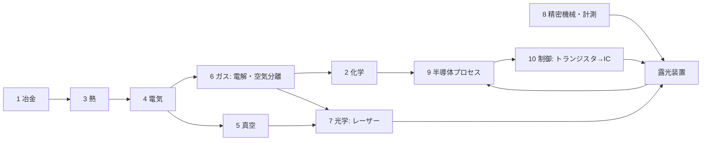

# TECH_TREE.md — 何もない世界から EUV 露光装置までの技術ツリー（依存関係）

ROADMAP は「時間順」、このファイルは「前提→結果」。設計の抜け探し・進捗ツリー・Agent への指示単位に使う。
ノードID: [幹-番号]。状態: ✅実装済 🔧実装中 ❓未着手 ⛔バニラに材料がない（新鉱石等で解決する）

## 10本の幹
1 冶金 ／ 2 化学 ／ 3 熱（炉と温度）／ 4 動力・電気 ／ 5 真空 ／ 6 ガス ／ 7 光学 ／ 8 精密機械・計測 ／ 9 半導体プロセス ／ 10 制御・計算（ブートストラップ）

## 枝（🌿）のルール
- 幹（EUVへのクリティカルパス）で作った部品だけで作れる技術は「枝」としてノード化してよい（白熱電球・電信・写真・X線管・マグネトロン・LED など）
- 枝は EUV への前提にならない。実装は章の仕上げ・息抜き・全章完成後に差し込む。見積もりは幹の +20〜30%
- 幹の部品から派生しないもの（農業・医薬・輸送・建築材）も幹11以降として追加してよい（方針A）。ただし実装は背骨優先
- 枝ノードは [B-番号] 🌿 と書き、前提に幹ノードを列挙する。章ゴールの「製品」は枝として扱う
- 例：[B-01] 白熱電球 🌿 前提: [1-28]W線, [5-01]真空ポンプ, ガラス ／ 本物: 1879エジソン(炭素)→1910クーリッジ(W) ／ へえ: 真空管の1歩手前
      [B-02] 銀塩写真 🌿 前提: 銀(方鉛鉱副産物), [6-11]硝酸, ガラス ／ 本物: 1839ダゲール ／ へえ: フォトリソグラフィの祖先（第3章の伏線）

## 判明している「抜け」（バニラにない前提）⛔
- 塩素：岩塩鉱 → 電解（クロルアルカリ）→ Cl2/HCl/NaOH。Si精製・GeCl4蒸留・洗浄に必須
- フッ素：蛍石 CaF2 + 硫酸 → フッ酸[2-10] → KF·HF 電解でF2[6-14]。エッチング・石英加工・エキシマレーザーに必須
- 空気分離：圧縮＋冷却で液体空気 → N2/O2/Ar/Kr。エキシマレーザー・パージ・雰囲気
- 硝酸：硝石 or アンモニア（ハーバー法=H2+N2+高圧+鉄触媒）→ 硝酸。CP-4エッチング液
- アルミニウム：ボーキサイト + 電解（ホール・エルー法、氷晶石=フッ素）。配線・装置筐体
- スズ：錫石。EUV光源（Snプラズマ）・はんだ
- モリブデン：輝水鉛鉱。EUV多層膜ミラー（Mo/Si）
- 希土類・ネオジム：強力磁石（リニアモーターステージ）。⚠️ 範囲を決める
- ヘリウム：天然ガス由来。検漏・冷却。⚠️ 代替可否を議論

## EUV までのクリティカルパス（幹をまたぐ最短の鎖）
鉱石→鉄・銅 → 水車/蒸気 → 発電 → 電解(H2, Cl2) → 電気炉 → Si(シーメンス法, 塩素が必要) → CZ結晶 → ウェハー
→ 真空ポンプ → 真空管 → トランジスタ → IC → マイコン（制御）
→ ガラス→溶融石英→研磨→干渉計（計測）→ ステージ
→ 空気分離(Ar/Ne/Kr) + 蛍石→フッ酸→F2 → エキシマレーザー[7-20] → ArF液浸
→ CO2レーザー + Sn + 多層膜ミラー(Mo/Si) + ターボ分子ポンプ(超高真空) → EUV

## ノードの書式（厳守。1ノード＝SDKへの1指示）
### [幹-番号] 名前 状態
前提: [..] 状態, [..] 状態   （全部✅で実装可）
本物: 原理・反応式・年・人名
入力/出力: ゲーム内の材料 → 生成物（電力は W で）
ゲーム: クラス名・パッケージ・既存テンプレの何を参考にするか
省略: 本物との差（ガイドブックに書く内容）
へえ: lang の .note に入れる一言
テスト: TEST_QUEUE に書く確認項目

## ノード一覧（章ごとに追記していく）
### [1-01] 石炭灰からのゲルマニウム ✅
前提: かまど ／ 入力: 石炭 ／ 原理: 一部の石炭にGeが濃縮 ／ ゲーム: coal_ash → germanium_concentrate ／ 省略: 産地限定

## 幹2 化学
### [2-10] フッ酸（フッ化水素）❓
前提: [1-21]蛍石 ⛔→❓, [2-01]硫酸✅（本物は濃硫酸＝[6-13]）, 加熱（かまど系）, 耐フッ酸容器＝[1-27]鉛 ❓ ／ 本物: CaF2 + H2SO4 → 2HF↑ + CaSO4（副産物は石こう）。1771 シェーレが蛍石を硫酸で処理して「フッ素酸」を得た（ガラスのレトルトが侵食されたことで性質に気付いた）。工業では200〜250℃のロータリーキルン。HF気体を水に吸わせたものがフッ酸 ／ 入力/出力: 蛍石+硫酸+熱 → フッ酸×1 + 石こう(CaSO4)×1 ／ ゲーム: 加熱型の反応ブロック（既存の炉 BE を参考、クラス構成は着手時に決定）。フッ酸はガラス瓶に入れられない→鉛の容器アイテム（[1-27]が前提）／ 省略: 濃硫酸と希硫酸の区別、HFガスの吸収塔 ／ へえ: フッ酸はガラスを溶かすので、ガラス瓶には入れられない ／ テスト: 蛍石+硫酸+熱でフッ酸と石こうが出る、熱なしでは止まる
用途: SiO2エッチング（[9-xx]、BHF=緩衝フッ酸）、[6-14]フッ素ガスの原料、石英加工

## 幹3 熱（炉と温度）
### [3-10] アチソン炉 ❓
前提: [4-12], [4-06], [1-07]黒鉛✅ ／ 本物: 炭素に直接大電流を流し、炭素そのものを発熱体にする抵抗炉。約2500℃。アチソンが1896年に人造黒鉛の製法として特許化（1891年に同じ炉で SiC=カーボランダムを発見）／ 入力/出力: 炭素+砂 → 人造黒鉛（電力 W は実装時に決定）／ ゲーム: 粘土黒鉛ボート（仮、CHEMISTRY #18）を高純度黒鉛ボートに置換 ／ 省略: （実装時に記入）／ へえ: 炉の中身そのものが電熱線になる ／ テスト: （実装時に記入）

## 幹4 動力・電気
### [4-01] 水車発電機 ✅
前提: [4-04]（磁鉄鉱→磁石, 銅コイル）／ 本物: ファラデー電磁誘導。流量×落差。初期の発電所は水力 ／ ゲーム: 流水1面500W
### [4-02] 蒸気機関発電機 ✅（GUIは🔧）
前提: [4-04], 鉄 ／ 本物: ワット1776。熱効率は約2〜5%（ニューコメン機関は約1%、ワットの分離凝縮器で数倍に改善）／ ゲーム: 石炭+水→50kW
### [4-03] 銅ケーブル ✅
本物: I²R損失。太線と高電圧で減らす ／ ゲーム: 1ホップ1%（簡易）
### [4-04] ダイナモ・天然磁石 ✅
本物: ファラデー1831。整流子付きダイナモは直流を出す（電解に直流が要る点で重要）
### [4-05] 自励式発電機 ❓
前提: [4-04]✅, [1-26]鋼 ／ 本物: ジーメンス1866。鉄心の残留磁気で自分を励磁、永久磁石不要 ／ 入力/出力: 鉄心+コイル×4 → 発電機部品（出力2倍）／ ゲーム: dynamo の上位アイテム ／ へえ: 磁石なしで発電できる
### [4-06] 蒸気タービン ❓
前提: [4-02]✅, [1-26]鋼, [8-01]旋盤 ／ 本物: パーソンズ1884。回転が速く発電に最適、MW級。現代の復水式蒸気タービン火力で熱効率30%級（最新鋭は40%超）／ 入力/出力: 石炭+水 → 500kW ／ 省略: 多段タービン・復水器 ／ テスト: アチソン炉が動く
### [4-07] 鉛蓄電池 ❓
前提: [1-27]鉛(方鉛鉱), [2-01]硫酸✅ ／ 本物: プランテ1859。Pb+PbO2+H2SO4 ／ ゲーム: 蓄電ブロック(1MJ)。energy/SimpleEnergyStorage ／ へえ: 車のバッテリーと同じ
### [4-08] 電動モーター ✅
本物: ダイナモの逆。アイテムとして実装済み
### [4-09] 高周波発振器 ❓
前提: [5-02]真空管 ／ 本物: 真空管発振回路（1910年代）。誘導加熱の電源 ／ ゲーム: hf_power_supply（仮）を置換 ／ へえ: トランジスタを作る装置が真空管で動いていた
### [4-10] 変圧器 ❓（v0.4〜）
前提: [4-05], 鉄心 ／ 本物: 交流で電圧を変える。送電損失を減らす ／ ゲーム: voltage 欄を使い始める
### [4-11] 整流器 ❓（v0.4〜）
前提: [5-02]真空管 or [9-05]Geダイオード ／ 本物: 交流→直流。電解・イオン注入の高電圧直流に必要
### [4-12] 電気炉（抵抗加熱）❓
前提: [4-06], [1-07]黒鉛✅ ／ 本物: 黒鉛棒に電流を流し、ジュール熱（電気抵抗で出る熱）で加熱する抵抗炉。ニクロム線は Ni/Cr が要るので使わない。1500℃級に届き、Si の融点 1414℃ を超えられる ／ ゲーム: 1500℃級の汎用炉。[3-10]アチソン炉の前提 ／ 省略: 黒鉛は高温の空気中で燃える（酸化する）ので、本物は不活性ガスや真空中で使う ／ へえ: ニクロムなしでも黒鉛の棒で発熱体が作れる

## 幹6 ガス・電解
### [6-01] 電解槽（水→H2+O2）✅
前提: [4-01]✅, [1-07]黒鉛✅, [2-01]硫酸✅（電解質）／ 本物: 2H2O→2H2+O2。純水は絶縁体なので電解質を入れる。黒鉛電極。直流が必要（ダイナモは直流）／ 入力/出力: 水バケツ+硫酸(消耗せず)+5kW → H2×2, O2×1（[6-02]に貯める）／ ゲーム: energy/ 消費側テンプレ（新規）。ElectrolyzerBlock BE/Menu/Screen ／ 省略: 隔膜 ／ へえ: 純水は電気を通さない ／ テスト: 電気なしで止まる、水を入れるとH2が溜まる
実装メモ: energy/ConsumerBlockEntity（消費側の共通土台）＋ block/Electrolyzer*。1回=水2mol相当=約572kJ（5kW×115秒）。H2/O2 は仮アイテム hydrogen_gas/oxygen_gas → [6-02][6-03] で容器に置換
### [6-02] ガスホルダー（低圧貯蔵）❓
前提: 鉄 ／ 本物: 19世紀のガス灯用ガスタンク（水封式）。圧縮不要 ／ ゲーム: ガスを種類別に貯めるブロック。ボンベの前段階
### [6-03] 圧縮機 ❓
前提: [4-08]✅, [1-26]鋼 ／ 本物: ピストン圧縮（1880年代に高圧ボンベ実用化）／ 入力/出力: ガス+電力 → ボンベ（鉄×6の空ボンベに充填）／ ゲーム: 容器システムの本体。[6-07]空気分離の前提
### [6-04] 岩塩鉱 ⛔→❓
本物: 蒸発岩層（古い海の跡）。地下の塩層・砂漠 ／ ゲーム: 新鉱石。乾燥バイオーム地下 ／ へえ: 岩塩は「石になった海」
### [6-05] クロルアルカリ電解 ❓
前提: [6-01], [6-04] ／ 本物: 2NaCl+2H2O→Cl2+H2+2NaOH（1890年代）。隔膜で分ける ／ 入力/出力: 塩水+電力 → 塩素ボンベ, 水素, 水酸化ナトリウム ／ 省略: 隔膜/水銀/イオン交換膜の違い ／ へえ: 塩から塩素と苛性ソーダが同時にできる
### [6-06] 塩酸 ❓
前提: [6-05] ／ 本物: クロルアルカリ法で得た Cl2 と H2 を H2+Cl2→2HCl（燃焼）→水に溶かす ／ 入力/出力: 塩素+水素（[6-05]の生成物）+水 → 塩酸 ／ ゲーム: Ge精鉱の浸出を硫酸→塩酸に置換可、GeCl4蒸留[1-xx]の前提 ／ 省略: 隔膜法/水銀法の違い（[6-05]側）
### [6-07] 空気分離（リンデ法）❓
前提: [6-03], 銅の熱交換器 ／ 本物: 1895 リンデが空気の液化に成功（圧縮→膨張で冷却＝ジュール・トムソン効果）。1902〜 リンデの精留塔（何段も蒸留を繰り返す塔）で O2/N2 を分離。Ar の実用的な取り出しは1910年頃。Kr(1.1ppm)・Ne(18ppm) は微量なので[6-08]で大型装置が要る ／ 入力/出力: 電力 → N2, O2, Ar（Kr/Ne は[6-08]）／ ゲーム: 段階解禁にするなら 液化→精留(O2/N2)→Ar の順 ／ へえ: 空気を液体にして「蒸留」する
### [6-08] 希ガス精製（Kr・Ne）❓（v0.4）
前提: [6-07]大型化 ／ 本物: Kr は空気の1.1ppm（KrFレーザーの発光ガス）、Ne は18ppm（ArF/KrFレーザーの緩衝ガス＝発光ガスを薄めて放電を安定させる役）。どちらも空気分離装置の副産物として取る ／ 入力/出力: 電力（大量）→ Kr, Ne ／ へえ: エキシマレーザーのガスの大半はネオン
### [6-09] ハーバー・ボッシュ法（アンモニア）❓
前提: [6-01]H2, [6-07]N2, [6-03]高圧, 磁鉄鉱触媒✅ ／ 本物: N2+3H2→2NH3、200気圧400℃、触媒は磁鉄鉱を還元した鉄（1913）／ へえ: 触媒の原料が磁鉄鉱
### [6-10] 硝石床（硝酸カリウム）❓
前提: 骨粉/腐肉, 石灰 ／ 本物: 有機物+石灰を数か月堆積、細菌の硝化でKNO3（18世紀の火薬原料）／ ゲーム: 堆肥ブロックが時間で硝石に ／ へえ: 硝石は細菌が作る
### [6-11] 硝酸 ❓
前提: [6-10]+[2-01]硫酸（グラウバー法1648）or [6-09]+白金触媒（オストワルト法）／ 本物: KNO3+H2SO4→HNO3 ／ ゲーム: 最初はグラウバー法。CP-4エッチング液の材料
### [6-12] 鉛室法硫酸 ❓
前提: [1-27]鉛, [6-11]硝酸, SO2✅ ／ 本物: 1746ロバック。鉛張りの部屋でSO2+NO2+H2O→H2SO4。最初の工業的硫酸 ／ ゲーム: 現在の「SO2+水」の省略を置換 ／ へえ: 硫酸工場が鉛でできていた理由
### [6-13] 接触法硫酸（濃硫酸）❓
前提: SO2✅, [1-20]白金（※[6-12]は技術的な前提ではないので外した。歴史順では鉛室法1746が先、接触法1831が後）／ 本物: SO2→SO3 を白金触媒（1831）、後にV2O5（1915）。濃硫酸・発煙硫酸 ／ 省略: V2O5（バナジウムは範囲外→白金で統一）
### [6-14] フッ素ガス（F2）❓
前提: [2-10]フッ酸 ❓, [2-02]カリ ❓（KOH/K2CO3 + HF → KF）, [1-07]黒鉛✅（陽極）, [4-04]ダイナモ✅（直流）, [6-02]ガスホルダー ❓ ／ 本物: HF そのものは電気をほぼ通さないので、KF を溶かして電解する。1886 モアッサンが無水HF+KHF2 を白金のU字管で低温電解して単離（1906 ノーベル化学賞）。現代は溶融 KF·2HF（約100℃）を炭素陽極・鋼/モネル製セルで電解：陽極 2F⁻→F2、陰極 2H⁺→H2 ／ 入力/出力: フッ酸+KF+電力（W は実装時に決定）→ F2×1, H2×1 ／ ゲーム: [6-01]電解槽（energy/ConsumerBlockEntity）を参考にした別ブロック ／ 省略: セル材質（モネル=Ni-Cu合金は範囲外）、陽極効果、F2の不動態化した配管 ／ へえ: フッ素は単離するまでに何人もの化学者が中毒になった「最も危険な元素」 ／ テスト: 電気なしで止まる、KF がないと動かない
用途: [7-20]エキシマレーザーの発光ガス（ArF・KrF）

## 仮ノード（参照されているが未記述。1行だけ。着手時に正式な書式へ展開する）
### [1-07] 黒鉛 ✅  本物: 変成岩中の天然黒鉛（脈状黒鉛、19世紀からるつぼ材）／ ゲーム: 黒鉛鉱石 → 黒鉛（CHEMISTRY #17）／ 用途: 電極[6-01]、黒鉛ボート、発熱体[4-12]
### [2-01] 硫酸 ✅  本物: 接触法 2SO2+O2→2SO3, SO3+H2O→H2SO4 ／ ゲーム: SO2+水 → 硫酸（SO3酸化を省略、CHEMISTRY #4b）／ 置換予定: [6-12]鉛室法 → [6-13]接触法
### [5-01] 真空ポンプ ❓  前提: 未定（シュプレンゲル式は水銀が要る→バニラにないので要相談）／ 本物: ゲーリケ1650のピストン式 → シュプレンゲル水銀ポンプ1865（電球・真空管の真空）／ 用途: [5-02]真空管、[B-01]白熱電球
### [5-02] 真空管 ❓  前提: [5-01], [1-28]W線, ガラス ／ 本物: フレミング二極管1904、ド・フォレスト三極管1906 ／ 用途: [4-09]高周波発振器、[4-11]整流器
### [7-20] エキシマレーザー（KrF 248nm → ArF 193nm）❓  前提: [6-14]F2, [6-08]Ne（緩衝ガス）・Kr（KrF用）, [6-07]Ar（ArF用）, [1-21]蛍石（CaF2 窓。193nm の紫外線を通す数少ない結晶）, 高電圧パルス放電（[4-10]変圧器）／ 本物: 希ガス+F2 を放電で励起すると、励起状態でだけ結合する ArF*/KrF* ができ、壊れるときに紫外線を出す。ArF のガスは Ar 数%・F2 約0.1%・残りの大半が Ne。1975 希ガスハライドエキシマレーザー発振、1982 IBM のジェインが露光に応用 ／ 用途: ステッパー光源（KrF→ArF→ArF液浸）
### [8-01] 旋盤 ❓  前提: [1-26]鋼 ／ 本物: モーズリーのねじ切り旋盤1800頃（精密機械の母）／ 用途: [4-06]蒸気タービン

## 新たに必要な鉱石ノード（輸入品なしのため）
### [1-20] 白金（砂白金）⛔→❓  前提: 砂鉄✅ ／ 本物: 漂砂鉱床に自然白金が微量（ウラル・コロンビア）／ ゲーム: 砂鉄のドロップに低確率で白金粒 ／ 用途: 触媒[6-13][6-11]、電極、熱電対
### [1-21] 蛍石 CaF2 ⛔→❓  本物: 熱水鉱脈（方鉛鉱・閃亜鉛鉱と共生）／ ゲーム: 方鉛鉱と同じ帯 ／ 用途: フッ酸[2-10]（蛍石+硫酸）、氷晶石、エキシマレーザーの CaF2 窓[7-20]
### [1-22] 錫石 SnO2 ⛔→❓  本物: 花崗岩系の熱水・漂砂（コーンウォール、マレーシア）／ ゲーム: 鉄マンガン重石と同じ花崗岩帯 ／ 用途: はんだ、EUV光源
### [1-23] 輝水鉛鉱 MoS2 ⛔→❓  本物: 斑岩銅鉱床の副産物 ／ ゲーム: 銅鉱石の近く ／ 用途: EUV多層膜ミラー
### [1-24] ボーキサイト ⛔→❓  本物: 熱帯の風化残留土 ／ ゲーム: ジャングル/サバンナの地表付近 ／ 用途: アルミ（ホール・エルー法=電解+氷晶石）
### [1-25] モナザイト（希土類）⛔→❓  本物: 漂砂鉱床（砂鉄と共産）／ ゲーム: 砂鉄の副産物 ／ 用途: ネオジム磁石（ステージ）。分離は溶媒抽出を簡略化
### [1-26] 鋼 ❓  前提: 鉄, [4-02] ／ 本物: ベッセマー法1856（銑鉄に空気を吹き込み炭素を抜く）／ 用途: タービン・圧力容器・旋盤
