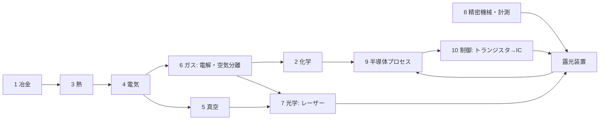

# TECH_TREE.md — 何もない世界から EUV 露光装置までの技術ツリー（依存関係）

ROADMAP は「時間順」、このファイルは「前提→結果」。設計の抜け探し・進捗ツリー・Agent への指示単位に使う。
ノードID: [幹-番号]。状態: ✅実装済 🔧実装中 ❓未着手 ⛔バニラに材料がない（新鉱石等で解決する）

## 10本の幹（＋幹0）
0 生存・道具 ／ 1 冶金 ／ 2 化学 ／ 3 熱（炉と温度）／ 4 動力・電気 ／ 5 真空 ／ 6 ガス ／ 7 光学 ／ 8 精密機械・計測 ／ 9 半導体プロセス ／ 10 制御・計算（ブートストラップ）

## 枝（🌿）のルール
- 幹（EUVへのクリティカルパス）で作った部品だけで作れる技術は「枝」としてノード化してよい（白熱電球・電信・写真・X線管・マグネトロン・LED など）
- 枝は EUV への前提にならない。実装は章の仕上げ・息抜き・全章完成後に差し込む。見積もりは幹の +20〜30%
- 幹の部品から派生しないもの（農業・医薬・輸送・建築材）も幹11以降として追加してよい（方針A）。ただし実装は背骨優先
- 枝ノードは [B-番号] 🌿 と書き、前提に幹ノードを列挙する。章ゴールの「製品」は枝として扱う
- 例：[B-01] 白熱電球 🌿 前提: [1-28]W線, [5-01]真空ポンプ, ガラス ／ 本物: 1879エジソン(炭素)→1910クーリッジ(W) ／ へえ: 真空管の1歩手前
      [B-02] 銀塩写真 🌿（2段）／ へえ: フォトリソグラフィの祖先（第3章の伏線）
        [B-02a] ダゲレオタイプ 🌿 前提: 銀(方鉛鉱副産物)＋銅板（銀メッキ板）, ヨウ素(海藻灰から・1811クールトア), 水銀(辰砂を焙焼・26.2にあり) ／ 本物: 1839ダゲール。銀板をヨウ素蒸気でAgI化→露光→水銀蒸気で現像（Hgが感光部にアマルガム）→食塩水で定着 ／ 省略: 定着剤の詳細、水銀蒸気の毒性は警告のみ ／ へえ: 1枚きりで複製できない（ネガがない）
        [B-02b] 湿板写真 🌿 前提: [B-02a], 銀＋[6-11]硝酸→硝酸銀AgNO3, ガラス, ヨウ化物(ヨウ素から) ／ 本物: 1851スコット・アーチャー（コロジオン湿板）。ガラス板にヨウ化物入りコロジオン→AgNO3浴でAgI→濡れたまま露光・現像 ／ 省略: コロジオン（ニトロセルロース＝綿＋硝酸＋硫酸）は仮 ／ へえ: ガラスのネガから何枚も焼ける＝マスクから何枚も転写するフォトリソの考え方

## 判明している「抜け」（バニラにない前提）⛔
- 塩素：岩塩鉱 → 電解（クロルアルカリ）→ Cl2/HCl/NaOH。Si精製・GeCl4蒸留・洗浄に必須
- フッ素：蛍石 CaF2 + 硫酸 → フッ酸[2-10] → KF·HF 電解でF2[6-14]。エッチング・石英加工・エキシマレーザーに必須
- 空気分離：圧縮＋冷却で液体空気 → N2/O2/Ar/Kr。エキシマレーザー・パージ・雰囲気
- 硝酸：硝石 or アンモニア（ハーバー法=H2+N2+高圧+鉄触媒）→ 硝酸。CP-4エッチング液
- アルミニウム：ボーキサイト + 電解（ホール・エルー法、氷晶石=フッ素）。配線・装置筐体 → [1-24][1-29]
- スズ：錫石。EUV光源（Snプラズマ）・はんだ → [1-22][1-30]
- モリブデン：輝水鉛鉱。EUV多層膜ミラー（Mo/Si）→ [1-23][1-31]
- 銀：方鉛鉱の副産物（灰吹法）。写真・接点 → [1-32]
- ホウ素：ホウ砂（砂漠の蒸発岩）。Si の p型ドーパント（背骨）・耐熱ガラス → [1-33]→[1-36]（Mg還元。Mg は[1-39]）
- 希土類・ネオジム：強力磁石（リニアモーターステージ）。実装は v1.0 → [1-19][1-35]
- ヘリウム：天然ガス由来。検漏・冷却。→ 不要な設計で回避 [6-15]

## EUV までのクリティカルパス（幹をまたぐ最短の鎖）
鉱石→鉄・銅 → 水車/蒸気 → 発電 → 電解(H2, Cl2) → 電気炉 → Si(シーメンス法, 塩素が必要) → CZ結晶 → ウェハー
→ 真空ポンプ → 真空管 → トランジスタ → IC → マイコン（制御）
→ ガラス→溶融石英→研磨→干渉計（計測）→ ステージ
→ 空気分離(Ar/Ne/Kr) + 蛍石→フッ酸→F2 → エキシマレーザー[7-20] → ArF液浸
→ CO2レーザー + Sn + 多層膜ミラー(Mo/Si) + ターボ分子ポンプ(超高真空) → EUV

## 2段階の執筆
- ① 骨格：全16幹の依存関係を先に。1ノード5〜7行、へえは1つでよい。全体がそろったら検査（切れ・循環・抜け）
- ② 肉付け：幹ごと・何度でも。へえを4段階に、ミニ実験、人物エピソード。実装でそのノードを触るときに一緒にやるのが基本
- へえの4段階（lang: .note1〜.note4 ／ 表示: 通常 / Shift / ガイドブック / ガイドタブ深掘り）
  へえ①子ども：1文、身近な物とつなぐ ／ へえ②学生：原理＋数字 ／ へえ③大人：歴史・人物・産業のつながり ／ へえ④ガチ：式・論文・反例・「本当はもっと複雑」

## ノードの書式（厳守。1ノード＝SDKへの1指示）
### [幹-番号] 名前 状態
前提: [..] 状態, [..] 状態   （全部✅で実装可）
本物: 原理・反応式・年・人名
入力/出力: ゲーム内の材料 → 生成物（電力は W で）
ゲーム: クラス名・パッケージ・既存テンプレの何を参考にするか
省略: 本物との差（ガイドブックに書く内容）
へえ: ①子ども ②学生 ③大人 ④ガチ（骨格段階は①だけでよい。肉付けで4つそろえる）
テスト: TEST_QUEUE に書く確認項目
（任意）実験: ゲーム内で試せる小さな失敗 ／ 人物: 名前・年・ゆかりの品 ／ 間違い: 当時の誤った説

## ノード一覧（章ごとに追記していく）
### [1-01] 石炭灰からのゲルマニウム ✅
前提: かまど ／ 入力: 石炭 ／ 原理: 一部の石炭にGeが濃縮 ／ ゲーム: coal_ash → germanium_concentrate ／ 省略: 産地限定

## 幹2 化学
### [2-02] カリ（炭酸カリウム K2CO3 → 水酸化カリウム KOH）❓
前提: 原木（燃やして木灰）, 水, かまど系（煮詰め）, 石灰（[0-10]生石灰 CaO に水→[0-11]消石灰 Ca(OH)2）／ 本物: 木灰を水に浸して上澄み（灰汁＝あく）を取り、鍋で煮詰めると K2CO3（"pot ash"＝鍋の灰、potassium の語源）。古代から石けん・ガラスの原料。これに消石灰を加えると K2CO3 + Ca(OH)2 → 2KOH + CaCO3↓（苛性化）で KOH ができ、古代〜中世の石けん作りでも使われた ／ 入力/出力: 木灰+水+熱 → 炭酸カリウム ／ 炭酸カリウム+消石灰+水 → 水酸化カリウム + 方解石(CaCO3) ／ ゲーム: 2段のレシピ（煮詰めは炉系、苛性化はクラフトか反応ブロック。クラス構成は着手時に決定）／ 省略: 灰汁の濃度管理、木の種類による収率差、KOH が空気中の CO2 を吸って K2CO3 に戻る現象 ／ へえ: カリウム（potassium）の名前は「鍋の灰（pot ash）」から ／ テスト: 木灰+水+熱で炭酸カリウム、消石灰を足すと KOH と方解石が出る
用途: [6-01]電解槽のアルカリ電解質（KOH）、[6-14]フッ素ガスの KF 原料（KOH/K2CO3 + HF → KF）
### [2-10] フッ酸（フッ化水素）❓
前提: [1-21]蛍石 ⛔→❓, [2-01]硫酸✅（本物は濃硫酸＝[6-13]）, 加熱（かまど系）, 耐フッ酸容器＝[1-27]鉛 ❓ ／ 本物: CaF2 + H2SO4 → 2HF↑ + CaSO4（副産物は石こう）。1771 シェーレが蛍石を硫酸で処理して「フッ素酸」を得た（ガラスのレトルトが侵食されたことで性質に気付いた）。工業では200〜250℃のロータリーキルン。HF気体を水に吸わせたものがフッ酸 ／ 入力/出力: 蛍石+硫酸+熱 → フッ酸×1 + 石こう(CaSO4)×1 ／ ゲーム: 加熱型の反応ブロック（既存の炉 BE を参考、クラス構成は着手時に決定）。フッ酸はガラス瓶に入れられない→鉛の容器アイテム（[1-27]が前提）／ 省略: 濃硫酸と希硫酸の区別、HFガスの吸収塔 ／ へえ: フッ酸はガラスを溶かすので、ガラス瓶には入れられない ／ テスト: 蛍石+硫酸+熱でフッ酸と石こうが出る、熱なしでは止まる
用途: SiO2エッチング（[9-06]、BHF=緩衝フッ酸）、[6-14]フッ素ガスの原料、石英加工

## 幹3 熱（炉と温度）
### [3-10] アチソン炉 ❓
前提: [4-12], [4-06], [1-07]黒鉛✅ ／ 本物: 炭素に直接大電流を流し、炭素そのものを発熱体にする抵抗炉。約2500℃。アチソンが1896年に人造黒鉛の製法として特許化（1891年に同じ炉で SiC=カーボランダムを発見）／ 入力/出力: 炭素+砂 → 人造黒鉛（電力 W は実装時に決定）／ ゲーム: 粘土黒鉛ボート（仮、CHEMISTRY #18）を高純度黒鉛ボートに置換 ／ 省略: （実装時に記入）／ へえ: 炉の中身そのものが電熱線になる ／ テスト: （実装時に記入）

## 幹4 動力・電気
### [4-01] 水車発電機 ✅
前提: [4-04]（磁鉄鉱→磁石, 銅コイル）／ 本物: ファラデー電磁誘導。流量×落差。初期の発電所は水力 ／ ゲーム: 流水1面500W
### [4-02] 蒸気機関発電機 ✅
前提: [4-04], 鉄 ／ 本物: ワット1776。熱効率は約2〜5%（ニューコメン機関は約1%、ワットの分離凝縮器で数倍に改善）／ ゲーム: 石炭+水→50kW
### [4-03] 銅ケーブル ✅
本物: I²R損失。太線と高電圧で減らす ／ ゲーム: 1ホップ1%（簡易）
### [4-04] ダイナモ・天然磁石 ✅
本物: ファラデー1831。整流子付きダイナモは直流を出す（電解に直流が要る点で重要）
### [4-05] 自励式発電機 ❓
前提: [4-04]✅, [1-26]鋼 ／ 本物: ジーメンス1866。鉄心の残留磁気で自分を励磁、永久磁石不要 ／ 入力/出力: 鉄心+コイル×4 → 発電機部品（出力2倍）／ ゲーム: dynamo の上位アイテム ／ へえ: 磁石なしで発電できる
### [4-06] 蒸気タービン ❓
前提: [4-02]✅, [1-26]鋼, [8-01]旋盤 ／ 本物: パーソンズ1884。回転が速く発電に最適、MW級。現代の復水式蒸気タービン火力で熱効率30%級（最新鋭は40%超）／ 入力/出力: 石炭+水 → 500kW ／ 省略: 多段タービン・復水器 ／ テスト: アチソン炉が動く
### [4-07] 鉛蓄電池 ❓
前提: [1-27]鉛(方鉛鉱), [2-01]硫酸✅ ／ 本物: プランテ1859。Pb+PbO2+H2SO4 ／ ゲーム: 蓄電ブロック(1MJ)。energy/SimpleEnergyStorage ／ へえ: 車のバッテリーと同じ
### [4-08] 電動モーター ✅
本物: ダイナモの逆。アイテムとして実装済み
### [4-09] 高周波発振器 ❓
前提: [5-02]真空管 ／ 本物: 真空管発振回路（1910年代）。誘導加熱の電源 ／ ゲーム: hf_power_supply（仮）を置換 ／ へえ: トランジスタを作る装置が真空管で動いていた
### [4-10] 変圧器 ❓（v0.4〜）
前提: [4-05], 鉄心 ／ 本物: 交流で電圧を変える。送電損失を減らす ／ ゲーム: voltage 欄を使い始める
### [4-11] 整流器 ❓（v0.4〜）
前提: [5-02]真空管 or [9-05]Geダイオード ／ 本物: 交流→直流。電解・イオン注入の高電圧直流に必要
### [4-12] 電気炉（抵抗加熱）❓
前提: [4-06], [1-07]黒鉛✅ ／ 本物: 黒鉛棒に電流を流し、ジュール熱（電気抵抗で出る熱）で加熱する抵抗炉。ニクロム線は Ni/Cr が要るので使わない。1500℃級に届き、Si の融点 1414℃ を超えられる ／ ゲーム: 1500℃級の汎用炉。[3-10]アチソン炉の前提 ／ 省略: 黒鉛は高温の空気中で燃える（酸化する）ので、本物は不活性ガスや真空中で使う ／ へえ: ニクロムなしでも黒鉛の棒で発熱体が作れる

## 幹6 ガス・電解
### [6-01] 電解槽（水→H2+O2）✅
前提: [4-01]✅, [1-07]黒鉛✅, 電解質＝[2-01]硫酸✅ or [2-02]KOH ❓（どちらか一方で可）／ 本物: 2H2O→2H2+O2。純水はほぼ電気を通さない（イオンが少ない）ので電解質を入れる。電解質は硫酸 or KOH（アルカリなら黒鉛陽極の消耗が少ない）。黒鉛電極。直流が必要（ダイナモは直流）／ 入力/出力: 水バケツ+硫酸 or KOH(消耗せず)+5kW → H2×2, O2×1（[6-02]に貯める）。現在の実装は硫酸のみ、KOH は [2-02] 実装後に電解質スロットへ追加 ／ ゲーム: energy/ 消費側テンプレ（新規）。ElectrolyzerBlock BE/Menu/Screen ／ 省略: 隔膜、黒鉛陽極の消耗（本物は陽極で出た酸素が黒鉛を酸化して CO2 にし、電極が少しずつ減る。ゲームでは電極は減らない）／ へえ: 純水は電気をほとんど通さない ／ テスト: 電気なしで止まる、水を入れるとH2が溜まる
実装メモ: energy/ConsumerBlockEntity（消費側の共通土台）＋ block/Electrolyzer*。1回=水2mol相当=約572kJ（5kW×115秒）。H2/O2 は仮アイテム hydrogen_gas/oxygen_gas → [6-02][6-03] で容器に置換
### [6-02] ガスホルダー（低圧貯蔵）❓
前提: 鉄 ／ 本物: 19世紀のガス灯用ガスタンク（水封式）。圧縮不要 ／ ゲーム: ガスを種類別に貯めるブロック。ボンベの前段階
### [6-03] 圧縮機 ❓
前提: [4-08]✅, [1-26]鋼 ／ 本物: ピストン圧縮（1880年代に高圧ボンベ実用化）／ 入力/出力: ガス+電力 → ボンベ（鉄×6の空ボンベに充填）／ ゲーム: 容器システムの本体。[6-07]空気分離の前提
### [6-04] 岩塩鉱 ⛔→❓
本物: 蒸発岩層（古い海の跡）。地下の塩層・砂漠 ／ ゲーム: 新鉱石。乾燥バイオーム地下 ／ へえ: 岩塩は「石になった海」
### [6-05] クロルアルカリ電解 ❓
前提: [6-01], [6-04] ／ 本物: 2NaCl+2H2O→Cl2+H2+2NaOH（1890年代）。隔膜で分ける ／ 入力/出力: 塩水+電力 → 塩素ボンベ, 水素, 水酸化ナトリウム ／ 省略: 隔膜/水銀/イオン交換膜の違い ／ へえ: 塩から塩素と苛性ソーダが同時にできる
### [6-06] 塩酸 ❓
前提: [6-05] ／ 本物: クロルアルカリ法で得た Cl2 と H2 を H2+Cl2→2HCl（燃焼）→水に溶かす ／ 入力/出力: 塩素+水素（[6-05]の生成物）+水 → 塩酸 ／ ゲーム: Ge精鉱の浸出を硫酸→塩酸に置換可、GeCl4蒸留[1-34]の前提 ／ 省略: 隔膜法/水銀法の違い（[6-05]側）
### [6-07] 空気分離（リンデ法）❓
前提: [6-03], 銅の熱交換器 ／ 本物: 1895 リンデが空気の液化に成功（圧縮→膨張で冷却＝ジュール・トムソン効果）。1902〜 リンデの精留塔（何段も蒸留を繰り返す塔）で O2/N2 を分離。Ar の実用的な取り出しは1910年頃。Kr(1.1ppm)・Ne(18ppm) は微量なので[6-08]で大型装置が要る ／ 入力/出力: 電力 → N2, O2, Ar（Kr/Ne は[6-08]）／ ゲーム: 段階解禁にするなら 液化→精留(O2/N2)→Ar の順 ／ へえ: 空気を液体にして「蒸留」する
### [6-08] 希ガス精製（Kr・Ne）❓（v0.4）
前提: [6-07]大型化 ／ 本物: Kr は空気の1.1ppm（KrFレーザーの発光ガス）、Ne は18ppm（ArF/KrFレーザーの緩衝ガス＝発光ガスを薄めて放電を安定させる役）。どちらも空気分離装置の副産物として取る ／ 入力/出力: 電力（大量）→ Kr, Ne ／ へえ: エキシマレーザーのガスの大半はネオン
### [6-09] ハーバー・ボッシュ法（アンモニア）❓
前提: [6-01]H2, [6-07]N2, [6-03]高圧, 磁鉄鉱触媒✅ ／ 本物: N2+3H2→2NH3、200気圧400℃、触媒は磁鉄鉱を還元した鉄（1913）／ へえ: 触媒の原料が磁鉄鉱
### [6-10] 硝石床（硝酸カリウム）❓
前提: 骨粉/腐肉, 石灰 ／ 本物: 有機物+石灰を数か月堆積、細菌の硝化でKNO3（18世紀の火薬原料）／ ゲーム: 堆肥ブロックが時間で硝石に ／ へえ: 硝石は細菌が作る
### [6-11] 硝酸 ❓
前提: [6-10]+[2-01]硫酸（グラウバー法1648）or [6-09]+白金触媒（オストワルト法）／ 本物: KNO3+H2SO4→HNO3 ／ ゲーム: 最初はグラウバー法。CP-4エッチング液の材料
### [6-12] 鉛室法硫酸 ❓
前提: [1-27]鉛, [6-11]硝酸, SO2✅ ／ 本物: 1746ロバック。鉛張りの部屋でSO2+NO2+H2O→H2SO4。最初の工業的硫酸 ／ ゲーム: 現在の「SO2+水」の省略を置換 ／ へえ: 硫酸工場が鉛でできていた理由
### [6-13] 接触法硫酸（濃硫酸）❓
前提: SO2✅, [1-20]白金（※[6-12]は技術的な前提ではないので外した。歴史順では鉛室法1746が先、接触法1831が後）／ 本物: SO2→SO3 を白金触媒（1831）、後にV2O5（1915）。濃硫酸・発煙硫酸 ／ 省略: V2O5（バナジウムは範囲外→白金で統一）
### [6-14] フッ素ガス（F2）❓
前提: [2-10]フッ酸 ❓, [2-02]カリ ❓（KOH/K2CO3 + HF → KF）, [1-07]黒鉛✅（陽極）, [4-04]ダイナモ✅（直流）, [6-02]ガスホルダー ❓ ／ 本物: HF そのものは電気をほぼ通さないので、KF を溶かして電解する。1886 モアッサンが無水HF+KHF2 を白金のU字管で低温電解して単離（1906 ノーベル化学賞）。現代は溶融 KF·2HF（約100℃）を炭素陽極・鋼/モネル製セルで電解：陽極 2F⁻→F2、陰極 2H⁺→H2 ／ 入力/出力: フッ酸+KF+電力（W は実装時に決定）→ F2×1, H2×1 ／ ゲーム: [6-01]電解槽（energy/ConsumerBlockEntity）を参考にした別ブロック ／ 省略: セル材質（モネル=Ni-Cu合金は範囲外）、陽極効果、F2の不動態化した配管 ／ へえ: フッ素は単離するまでに何人もの化学者が中毒になった「最も危険な元素」 ／ テスト: 電気なしで止まる、KF がないと動かない
用途: [7-20]エキシマレーザーの発光ガス（ArF・KrF）

## 仮ノード（参照されているが未記述。1行だけ。着手時に正式な書式へ展開する）
### [1-07] 黒鉛 ✅  本物: 変成岩中の天然黒鉛（脈状黒鉛、19世紀からるつぼ材）／ ゲーム: 黒鉛鉱石 → 黒鉛（CHEMISTRY #17）／ 用途: 電極[6-01]、黒鉛ボート、発熱体[4-12]
### [2-01] 硫酸 ✅  本物: 接触法 2SO2+O2→2SO3, SO3+H2O→H2SO4 ／ ゲーム: SO2+水 → 硫酸（SO3酸化を省略、CHEMISTRY #4b）／ 置換予定: [6-12]鉛室法 → [6-13]接触法
### [5-01] 真空ポンプ ❓  前提: 幹5（後日定義。シュプレンゲル式は水銀が要る→26.2 の辰砂の扱いと合わせて決める）／ 本物: ゲーリケ1650のピストン式 → シュプレンゲル水銀ポンプ1865（電球・真空管の真空）／ 用途: [5-02]真空管、[B-01]白熱電球
### [5-02] 真空管 ❓  前提: [5-01], [1-28]W線, ガラス ／ 本物: フレミング二極管1904、ド・フォレスト三極管1906 ／ 用途: [4-09]高周波発振器、[4-11]整流器
### [7-20] エキシマレーザー（KrF 248nm → ArF 193nm）❓  前提: [6-14]F2, [6-08]Ne（緩衝ガス）・Kr（KrF用）, [6-07]Ar（ArF用）, [1-21]蛍石（CaF2 窓。193nm の紫外線を通す数少ない結晶）, 高電圧パルス放電（[4-10]変圧器）／ 本物: 希ガス+F2 を放電で励起すると、励起状態でだけ結合する ArF*/KrF* ができ、壊れるときに紫外線を出す。ArF のガスは Ar 数%・F2 約0.1%・残りの大半が Ne。1975 希ガスハライドエキシマレーザー発振、1982 IBM のジェインが露光に応用 ／ 用途: ステッパー光源（KrF→ArF→ArF液浸）
### [8-01] 旋盤 ❓  前提: [1-26]鋼 ／ 本物: モーズリーのねじ切り旋盤1800頃（精密機械の母）／ 用途: [4-06]蒸気タービン
### [9-05] Geダイオード（点接触）❓  前提: [1-01]Ge✅（Ge結晶化は幹9・後日定義）, [1-28]W線（針）／ 本物: Ge結晶に細い金属針を立てた点接触ダイオード。1940年代のレーダー検波器として量産、点接触トランジスタ(1947)の直接の祖先 ／ 用途: [4-11]整流器
### [9-06] 酸化膜エッチング（HF）❓  前提: [2-10]フッ酸 ❓ ／ 本物: SiO2+6HF→H2SiF6+2H2O。Si 本体はほぼ溶かさず酸化膜だけ溶かす（選択性）。実務は NH4F で緩衝した BHF ／ ゲーム: 第3章のウェハー状態機械の1工程（酸化→レジスト→露光→現像→**エッチング**）／ へえ: 酸化膜が溶けきると表面が水をはじく（撥水）ので、終わりが目で分かる

## 新たに必要な鉱石ノード（輸入品なしのため）
### [1-20] 白金（砂白金）⛔→❓  前提: 砂鉄✅ ／ 本物: 漂砂鉱床に自然白金が微量（ウラル・コロンビア）／ ゲーム: 砂鉄のドロップに低確率で白金粒 ／ 用途: 触媒[6-13][6-11]、電極、熱電対
### [1-21] 蛍石 CaF2 ⛔→❓  本物: 熱水鉱脈（方鉛鉱・閃亜鉛鉱と共生）／ ゲーム: 方鉛鉱と同じ帯 ／ 用途: フッ酸[2-10]（蛍石+硫酸）、氷晶石、エキシマレーザーの CaF2 窓[7-20]
### [1-22] 錫石 SnO2 ⛔→❓  本物: 花崗岩系の熱水・漂砂（コーンウォール、マレーシア）／ ゲーム: 鉄マンガン重石と同じ花崗岩帯 ／ 用途: はんだ、EUV光源
### [1-23] 輝水鉛鉱 MoS2 ⛔→❓  本物: 斑岩銅鉱床の副産物 ／ ゲーム: 銅鉱石の近く ／ 用途: EUV多層膜ミラー
### [1-24] ボーキサイト ⛔→❓  本物: 熱帯の風化残留土 ／ ゲーム: ジャングル/サバンナの地表付近 ／ 用途: アルミ（ホール・エルー法=電解+氷晶石）
### [1-25] モナザイト（希土類）⛔→❓  本物: 漂砂鉱床（砂鉄と共産）／ ゲーム: 砂鉄の副産物 ／ 用途: ネオジム磁石（ステージ）。分離は溶媒抽出を簡略化
### [1-26] 鋼 ❓  前提: 鉄, [4-02] ／ 本物: ベッセマー法1856（銑鉄に空気を吹き込み炭素を抜く）／ 用途: タービン・圧力容器・旋盤
### [1-27] 鉛（方鉛鉱）❓  前提: 方鉛鉱✅（CHEMISTRY #27）, かまど系 ／ 本物: 焙焼 2PbS+3O2→2PbO+2SO2 → 炭素還元 PbO+C→Pb+CO。融点327℃で古代から製錬 ／ 用途: [4-07]鉛蓄電池、[6-12]鉛室、[2-10]フッ酸容器、[1-32]銀
### [1-28] タングステン線 ❓  前提: 鉄マンガン重石✅（CHEMISTRY #26）, [6-01]H2✅ ／ 本物: (Fe,Mn)WO4→WO3→H2還元でW粉→焼結→線引き（1910 クーリッジの延性W）／ 用途: [5-02]真空管、[B-01]白熱電球、[9-05]針
### [1-29] アルミニウム（ホール・エルー法）❓  前提: [1-24]ボーキサイト, [6-05]NaOH（バイヤー法1888でアルミナ Al2O3 を取り出す）, 氷晶石 Na3AlF6（天然はグリーンランドのみ→合成＝[2-10]HF+Al(OH)3+NaOH）, [1-07]黒鉛電極, 直流の大電流 ／ 本物: 1886 ホール（米）とエルー（仏）が独立に発明。約960℃で溶かした氷晶石にアルミナを溶かして電解 2Al2O3+3C→4Al+3CO2（陽極の炭素が燃えて減る）。1kg に約15kWh ／ 用途: 配線（初期IC）、装置筐体、蒸着源 ／ へえ: それまでアルミは金より高く、ナポレオン3世が来賓用の食器にした
### [1-30] 錫（スズ）製錬 ❓  前提: [1-22]錫石 ⛔→❓, 木炭 or 石炭, かまど系 ／ 本物: SnO2+2C→Sn+2CO。青銅器時代（紀元前3000年頃）から。融点232℃と低い ／ 用途: はんだ（Sn-Pb）、EUV光源（Sn液滴にレーザーを当ててプラズマ化）／ へえ: 5000年前の青銅の材料が、最先端の EUV の光源になる
### [1-31] モリブデン製錬 ❓  前提: [1-23]輝水鉛鉱 ⛔→❓, [6-01]H2✅, 焙焼炉（かまど系）／ 本物: 焙焼 2MoS2+7O2→2MoO3+4SO2 → 水素還元 MoO3+3H2→Mo+3H2O。1781 イェルムが初めて金属を得た。粉末を固める（W[1-28]と同じ粉末冶金）／ 用途: EUV 多層膜ミラー（Mo/Si を約40対）／ 省略: 粉末冶金の焼結条件 ／ へえ: 焙焼で出る SO2 は硫酸[2-01]の原料に回せる
### [1-32] 銀（方鉛鉱の副産物）❓  前提: [1-27]鉛(方鉛鉱) ❓, かまど系 ／ 本物: 銀を含む方鉛鉱から鉛を製錬 → 灰吹法（キューペレーション、紀元前3000年頃〜）：溶けた鉛に空気を当てて PbO にし、骨灰の皿に吸わせると銀だけ残る。1850 パークス法（亜鉛で銀を抜き出す）／ 用途: [B-02]写真（AgI・AgNO3）、接点・導電ペースト ／ へえ: 石見銀山も灰吹法で銀を取り出していた
### [1-33] ホウ素（ホウ砂）⛔→❓  前提: 新鉱石ホウ砂（砂漠の干上がった塩湖の蒸発岩。ゲーム: 砂漠バイオームの地表付近）, [2-01]硫酸✅ ／ 本物: ホウ砂 Na2B4O7·10H2O + H2SO4 → ホウ酸 H3BO3 → 加熱で B2O3。単体は1808 ゲイ=リュサック/テナールとデービー ／ 用途: p型ドーパント（Si に B を入れると正孔ができる）、ホウケイ酸ガラス（耐熱ガラス・実験器具）／ 単体ホウ素は[1-36]で作る（背骨）／ へえ: ホウ砂は昔から金属のろう付けの「フラックス」として使われた
### [6-15] ヘリウム 回避（実装しない）  本物: 天然ガスに数%含まれるものを液化分離（1903 カンザスで発見）。用途は検漏（He リークディテクター）・極低温冷却 ／ ゲーム: バニラに天然ガスがないため不要な設計にする。検漏は「圧力上昇（ビルドアップ）法」、冷却は水・液体窒素[6-07]で代替 ／ へえ: ヘリウムは太陽で先に見つかった（1868 日食の分光）。地球では放射性崩壊で地下に溜まったものしか取れない

## 幹0 生存・道具（下書き。1行書式。着手時に正式な書式へ展開する）
年代は「おおよそ」。MC＝マインクラフトでの対応（バニラで足りるか／新規が必要か）
### [0-01] 打製石器 ❓  前提: なし ／ 本物: 約330万年前（ロメクウィ）〜260万年前（オルドワン）。石を石で打ち欠き、貝殻状に割れる鋭い縁を作る（フリント・黒曜石はガラス質で割れ口が鋭い）／ MC: バニラの石の道具でそのまま可（新規不要）
### [0-02] 火起こし ❓  前提: [0-01] ／ 本物: 火の利用は約100万年前⚠️（ワンダーワーク洞窟）。摩擦熱（弓錐）で木を発火点（約300℃）へ／火打石で鋼を削り、飛んだ鉄粉が空気中で酸化発熱する ／ MC: バニラの火打ち石と打ち金で可（※黄鉄鉱式はバニラに黄鉄鉱がないので扱わない）
### [0-03] 土器 ❓  前提: [0-02], 粘土 ／ 本物: 約2万年前（中国・仙人洞）、縄文土器 約1万6500年前。粘土鉱物（カオリナイト等）は約500〜600℃で結晶水が抜け、二度と水で戻らない（不可逆な脱水）／ MC: バニラの粘土玉→レンガ・植木鉢・飾り壺で可
### [0-04] 農耕（麦）❓  前提: [0-01] ／ 本物: 約1万1500年前、肥沃な三日月地帯でヒトツブコムギ・エンマーコムギ・大麦を栽培化（穂が落ちない変異株を選び続けた）／ MC: バニラの小麦で可
### [0-05] 豆（窒素固定）❓  前提: [0-04] ／ 本物: レンズ豆・エンドウも麦と同時期・同地域で栽培化。根粒菌が N2→NH3 に変え、畑が痩せにくい（輪作の根拠）／ MC: バニラに豆類なし → 新規作物（エンドウ等）が必要 ／ 伏線: [6-09]ハーバー法＝人工の窒素固定
### [0-06] 織物（亜麻）❓  前提: [0-04] ／ 本物: 亜麻布は約9000年前（ナハル・ヘマル）、亜麻繊維自体は約3万年前の痕跡⚠️。茎を水に浸けて腐らせ（レッティング＝ペクチンを微生物が分解）繊維を取り出す ／ MC: バニラの糸はクモ由来なので代用不可 → 新規作物「亜麻」＋亜麻繊維・リネン
### [0-07] 羊毛と紡錘車 ❓  前提: [0-06] ／ 本物: 羊の家畜化は約1万年前、羊毛用の品種は紀元前4000年頃⚠️。紡錘車＝はずみ車の慣性で撚り（より）をかけ続ける ／ MC: バニラの羊・羊毛で可。紡錘車は新規アイテム（任意）
### [0-08] 木工（石斧・ほぞ組み）❓  前提: [0-01] ／ 本物: 新石器時代の磨製石斧（研いだ刃は欠けにくい）、ほぞ組みの木製井戸枠 約7000年前（ドイツ）⚠️ ／ MC: バニラの作業台・板材・木の道具で可
### [0-09] 車輪 ❓  前提: [0-08] ／ 本物: 約紀元前3500年メソポタミア。現存最古級はリュブリャナ湿原の車輪（紀元前3150年頃⚠️）。ろくろ（陶工の回転台）が先行したとされる ／ MC: 新規アイテム「木の車輪」
### [0-10] 石灰焼成（生石灰）❓  前提: [0-02], [0-15]窯 ／ 本物: CaCO3→CaO+CO2（約900℃）。石灰しっくいは紀元前9000〜7000年頃（ギョベクリ・テペ、チャタル・ヒュユク）⚠️。貝殻も CaCO3 ／ MC: バニラの方解石（calcite）を焼く→新規アイテム「生石灰」。貝殻はバニラにオウムガイの殻しかないので使わない
### [0-11] 消石灰・漆喰 ❓  前提: [0-10] ／ 本物: CaO+H2O→Ca(OH)2（強く発熱）、空気中で Ca(OH)2+CO2→CaCO3 に戻って固まる。ローマはポッツォラーナ（火山灰）を混ぜて水中でも固まるコンクリートに ／ MC: 新規アイテム「消石灰」「漆喰」。用途: [2-02]苛性化、[6-10]硝石床
### [0-12] 木炭（炭焼き）❓  前提: [0-02] ／ 本物: 木を空気を絞って加熱（乾留、約400〜700℃）すると水分・揮発分が抜け炭素80〜90%に。洞窟壁画の顔料として約3万年前から、製錬用の大量生産は紀元前4000年頃⚠️ ／ MC: バニラの木炭で可（炭窯の酸欠は省略）。冶金[1-03]以降の還元剤・燃料
### [0-13] 荷車 ❓  前提: [0-09], 家畜（牛）／ 本物: 紀元前3500〜3000年、牛に引かせる四輪車（メソポタミア・中欧）。車軸と車輪の摩擦が課題（獣脂で潤滑）／ MC: **決定：進捗（アドバンスメント）のみ。エンティティは作らない**（車輪[0-09]を作ると達成）
### [0-14] 水運（丸木舟・帆）❓  前提: [0-08] ／ 本物: 丸木舟 約紀元前8000年（オランダ・ペッセ）、帆は紀元前3500年頃エジプト⚠️。重い鉱石・石材は陸より水で運ぶ方が桁違いに楽 ／ MC: **決定：バニラのボートを「本物」として認める**（丸木舟・帆の近似。新規不要）
### [0-15] 窯（高温の焼成炉）❓  前提: [0-03] ／ 本物: 野焼き（〜800℃）→ 囲った窯で 1000℃超。焼成レンガは紀元前3500年頃⚠️。窯の高温が銅製錬（約1085℃で溶融）を可能にした ／ MC: バニラのかまど・溶鉱炉ブロックを「窯」として可。幹3[熱]の起点

## 幹1 冶金（下書き。1行書式。既存ノード [1-01][1-07][1-20]〜[1-33] はそのまま。番号は空きを使用）
既存の対応：鉛=[1-27] 銀(灰吹法)=[1-32] 錫=[1-30] 錫石=[1-22] アルミ=[1-29] ボーキサイト=[1-24] W=[1-28] Mo=[1-31] 白金=[1-20] モナザイト=[1-25] ホウ素=[1-33] 鋼(ベッセマー)=[1-26] Ge=[1-01]
### [1-02] 自然銅 ❓  前提: [0-01] ／ 本物: 紀元前8000年頃（アナトリア）。地表に金属のまま出る銅を叩いて成形。叩くと硬くなり（加工硬化）、加熱すると柔らかく戻る（焼きなまし）／ MC入手: **決定：バニラ銅鉱石を掘ると低確率で「自然銅」がドロップ**（鉱床上部の酸化帯に出る自然銅の表現）。新規の鉱石生成はしない
### [1-03] 銅の製錬（孔雀石）❓  前提: [0-15]窯, [0-12]木炭 ／ 本物: 紀元前5000年頃（セルビア・ベロヴォデ）。孔雀石 Cu2CO3(OH)2 →加熱→ 2CuO+CO2+H2O、CuO+C→Cu+CO（炭素還元、約1100℃）／ MC入手: 新規鉱石「孔雀石」（浅い層・銅鉱石の上部＝酸化帯）
### [1-04] 銅の製錬（黄銅鉱）❓  前提: [1-03] ／ 本物: CuFeS2 を焙焼→硫化銅の「マット」→空気を吹いて Fe を酸化しスラグへ、S を SO2 へ（1880 マネス転炉）。現代の銅の大半はこの硫化鉱から ／ MC入手: **決定：バニラ銅鉱石＝黄銅鉱 CuFeS2 の近似**（CHEMISTRY #34）。副産物 SO2 → [2-01]硫酸
### [1-05] 青銅 ❓  前提: [1-03], [1-30]錫 ❓ ／ 本物: 紀元前3000年頃。Cu+Sn約10%。融点が下がり（約950℃）鋳造しやすく、純銅よりずっと硬い（合金化で原子の並びが乱れ、すべりにくい）。それ以前はヒ素銅⚠️ ／ MC入手: 合金化（銅インゴット+錫）
### [1-06] 塊鉄炉（ブルーマリー）❓  前提: [0-12]木炭, [0-15]窯, ふいご ／ 本物: 紀元前1200年頃（ヒッタイト周辺⚠️）。Fe2O3+3CO→2Fe+3CO2 を約1200℃で。鉄の融点1538℃に届かないので、溶けないスポンジ状の鉄（海綿鉄＝ブルーム）にスラグが混じる ／ MC入手: **決定：バニラ鉄鉱石＝赤鉄鉱 Fe2O3 の近似**（CHEMISTRY #35）、砂鉄✅（たたら製鉄も同系統）
### [1-08] 鍛鉄（錬鉄）❓  前提: [1-06] ／ 本物: 赤熱したブルームを叩いてスラグを絞り出す。炭素0.1%未満で柔らかく粘る。浸炭（木炭と加熱して表面に炭素を入れる）＋焼入れで刃物に ／ MC入手: ブルーム→ハンマー作業→鍛鉄
### [1-09] 高炉（銑鉄）❓  前提: [1-06], 水車ふいご ／ 本物: 中国は紀元前5世紀頃、欧州は14世紀。炉を高くし強く送風すると、炭素が溶け込んで融点が約1150℃に下がり鉄が液体で出る（銑鉄、C約4%）。硬いが脆い→鋳物 ／ MC入手: マルチブロック炉（幹3）。石灰石[0-10]をフラックス（スラグ化剤）に
### [1-10] コークス高炉 ❓  前提: [1-09] ／ 本物: 1709 エイブラハム・ダービー1世。石炭を蒸し焼きにしたコークスで木炭を置換（森林枯渇の解決）／ MC入手: バニラ石炭→新規「コークス」。副産物コールタール → [2-20]（回収には[3-19]副産物回収式コークス炉）
### [1-11] るつぼ鋼 ❓  前提: [1-08], [1-10], 粘土/黒鉛るつぼ[1-07]✅ ／ 本物: 1740頃 ベンジャミン・ハンツマン（シェフィールド）。鉄を密閉るつぼで完全に溶かし、炭素量の均一な鋼に（時計ばね用）。それ以前のウーツ鋼（インド）も同系統 ／ MC入手: 少量・高品質の鋼。精密部品（幹8）向け
### [1-12] 平炉（ジーメンス・マルタン法）❓  前提: [1-09]銑鉄, 蓄熱式炉 ／ 本物: 1856 シーメンス兄弟の蓄熱式炉（排ガスの熱でレンガを温め、次の空気を予熱）、1864 ピエール・マルタンが鋼の製造に応用。くず鉄も溶かせ、成分を時間をかけて調整できる ／ MC入手: 大量・成分調整可能な鋼。[1-26]の上位
### [1-13] 亜鉛（蒸留法）❓  前提: 閃亜鉛鉱✅（CHEMISTRY #15 仮）, [0-12]木炭 ／ 本物: ZnO+C→Zn+CO の温度（約1000℃）が亜鉛の沸点907℃より高く、普通の炉では蒸気で逃げる→冷やして凝縮させる「蒸留製錬」。インド・ザワール12世紀頃⚠️、中国（明）、欧州は1738 ウィリアム・チャンピオンの特許 ／ MC入手: 既存の閃亜鉛鉱→亜鉛（#15 の「2段を1段に」を解消する工程）
### [1-14] バイヤー法（アルミナ）❓  前提: [1-24]ボーキサイト ❓, [6-05]NaOH ❓ ／ 本物: 1888 カール・ヨーゼフ・バイヤー。Al(OH)3+NaOH→NaAl(OH)4 で溶かし、鉄分（赤泥）をろ過、冷やして Al(OH)3 を析出→焼いて Al2O3 ／ MC入手: ボーキサイト+NaOH → アルミナ+赤泥。[1-29]の前段
### [1-15] 金属シリコン（アーク炉）❓  前提: [3-15]アーク炉 ❓, [4-06]蒸気タービン ❓, [1-07]黒鉛電極✅, 石英, [0-12]木炭 ／ 本物: SiO2+2C→Si+2CO、約2000℃のアーク炉。純度98〜99%（冶金グレード）。電気炉による工業生産は1900年頃〜⚠️ ／ MC入手: バニラの石英（ネザー）を SiO2 源に。半導体には純度不足→[1-16][1-17]へ
### [1-16] トリクロロシラン合成・蒸留 ❓  前提: [1-15], [6-06]塩酸(HCl) ❓ ／ 本物: Si+3HCl→SiHCl3+H2（約300℃）。SiHCl3 は沸点32℃の液体なので、蒸留を繰り返して不純物（B・P の塩化物）を分ける。これが超高純度の鍵 ／ MC入手: 蒸留塔ブロック（[1-34]と共通化を検討）
### [1-17] シーメンス法（多結晶シリコン）❓  前提: [1-16], [6-01]H2✅, [6-05]塩素 ❓, 電力 ／ 本物: 1950年代 シーメンス社（特許1953年頃⚠️）。通電で約1100℃にした細いSi棒の上で SiHCl3+H2→Si+3HCl、棒が太っていく。純度 11N（99.999999999%）級 ／ MC入手: 多結晶シリコン → CZ結晶・ウェハー（幹9、後日定義）へ。副産物 HCl は[1-16]に戻せる
### [1-18] 白金精製（王水）❓  前提: [1-20]砂白金 ❓, [6-06]塩酸 ❓, [6-11]硝酸 ❓ ／ 本物: 王水（HCl:HNO3=3:1）で溶かし H2PtCl6 に→NH4Cl で (NH4)2PtCl6 を沈殿→加熱で白金スポンジ。1800年頃 ウォラストンが粉末を圧縮・鍛造して加工可能に（粉末冶金の始まり）／ MC入手: 砂白金→白金インゴット
### [1-19] 希土類分離 ❓  前提: [1-25]モナザイト ❓, [2-01]硫酸✅ or [6-05]NaOH ❓ ／ 本物: モナザイト (Ce,La,Nd,Th)PO4 を濃硫酸 or NaOH で分解→希土類は化学的性質がそっくりなので、溶媒抽出（有機溶媒と水の間の分配のわずかな差を何百段も繰り返す）で分離。1940〜50年代 アイオワ州立大エイムズ研究所（スペディング）のイオン交換・溶媒抽出 ⚠️ ／ MC入手: モナザイト→Nd酸化物 ほか ＋ **副産物「放射性廃棄物（トリウム含有残渣）」**アイテム。燃料にはしない・捨て場所を考えさせる（鉛容器[1-27]に入れて保管、素手で持つとツールチップで警告）／ へえ④: モナザイトは Th を数%含み、Th-232（半減期約140億年）の娘核種ラジウム・ラドンが出る。マレーシア・ブキメラ（1980年代、三菱化成系の工場）の残渣問題、今も続くライナス社の残渣保管問題のように「希土類は取れても放射性の残りものをどうするか」が本物の未解決課題⚠️。中国が希土類の大半を担う理由の一つでもある
### [1-34] 四塩化ゲルマニウム蒸留精製 ❓  前提: [6-06]塩酸 ❓, 石英ガラス器具 ／ 本物: GeO2+4HCl→GeCl4+2H2O。GeCl4 は沸点83℃の液体なので蒸留で他の塩化物から分け、水で加水分解 GeCl4+2H2O→GeO2+4HCl して高純度 GeO2 に ／ ゲーム: CHEMISTRY #2・#5 の「精製炉が肩代わり／硫酸で代替」の省略を解消する工程 ／ ※タスクでは [1-29] 指定だったが、[1-29]はアルミで使用済みのため [1-34] に変更
### [1-35] ネオジム磁石 ❓（実装は v1.0＝EUVステージ）  前提: [1-19], 鉄, [1-33]ホウ素 ❓ ／ 本物: 1982〜84 佐川眞人（住友特殊金属）と GM が独立に発明。Nd2Fe14B。Nd 金属はフッ化物/酸化物の溶融塩電解で得る ／ MC入手: 露光装置ステージのリニアモーター用。磁鉄鉱の天然磁石[4-04]で足りるなら省略可
### [1-36] 単体ホウ素（Mg還元）❓【背骨】  前提: [1-33]ホウ素(B2O3) ❓, [1-39]マグネシウム ❓ ／ 本物: B2O3+3Mg→2B+3MgO（1892 モアッサン、純度約90%）。高純度は BCl3 の水素還元 2BCl3+3H2→2B+6HCl ／ 用途: **Si の p型ドーパント（第2章で必須）**。B は III族で価電子が1つ足りず、Si に入ると正孔（ホール）ができる。Ge の p型[CHEMISTRY #10]はインジウムだが、Si ではホウ素が主役 ／ ゲーム: 第2章の Si ドーピングの入力
### [1-37] ニッケル ❓⚠️（範囲要検討）  前提: 新鉱石（ペントランド鉱 or ガーニエライト）, [1-10]コークス ／ 本物: 1751 クロンステットが単離。1890 モンド法 Ni+4CO→Ni(CO)4（約50℃で気体化）→約200℃で分解して純Ni ／ 用途候補: モネル（F2セル[6-14]）、ステンレス、ニクロム。**優先度低**。ステンレス（Fe-Cr-Ni）は幹5の真空容器で必要になったら着手（[1-40]と同時）
### [1-38] 氷晶石の合成 ❓  前提: [2-10]フッ酸 ❓, [1-14]アルミナ/Al(OH)3, [6-05]NaOH ❓ ／ 本物: 天然氷晶石はグリーンランド・イヴィグトゥートのみ（1987枯渇）。合成: 6HF+Al(OH)3+3NaOH→Na3AlF6+6H2O ／ MC入手: [1-29]ホール・エルー法の電解浴
### [1-39] マグネシウム ❓  前提: (a) ピジョン法＝ドロマイト（⛔新鉱石）＋フェロシリコン（[3-15]アーク炉で Si+Fe）＋[5-01]真空（後日）, または (b) ダウ法＝海水＋[0-11]消石灰＋[6-06]塩酸＋電解 ／ 本物: (a) 1941 ロイド・ピジョン（カナダ）：2(MgO·CaO)+Si→2Mg↑+Ca2SiO4、約1200℃・真空で Mg を蒸気として取り出し凝縮 ／ (b) 1916 ダウ社がかん水から、1941 テキサス州フリーポートで海水から：Mg2++Ca(OH)2→Mg(OH)2↓+Ca2+ → Mg(OH)2+2HCl→MgCl2+2H2O → 溶融塩電解 MgCl2→Mg+Cl2（Cl2 は HCl に戻して再利用）／ MC入手: (b) を先に推奨（海の水源ブロック＋石灰＋塩酸、真空不要）⚠️「海水」をどう区別するか要相談 ／ 用途: [1-36]ホウ素の還元剤、Al合金（ジュラルミン系）、[3-12]マグネシアれんが(MgO) ／ へえ: 海水 1L に Mg は約1.3g。第二次大戦の航空機用 Mg は海から取った
### [1-40] クロム ❓（優先度低）  前提: クロム鉄鉱 FeCr2O4（⛔新鉱石：かんらん岩・蛇紋岩帯）, [2-07]重クロム酸, [1-29]アルミニウム ❓ ／ 本物: 1797 ヴォークランが紅鉛鉱から発見。テルミット法（1895特許 ハンス・ゴルトシュミット、1898頃に炭素を含まない Cr を製造⚠️）Cr2O3+2Al→2Cr+Al2O3（約2000℃まで自己発熱、外部の炉不要）／ MC入手: クロム鉄鉱→[2-07]→Cr2O3→Al粉と点火 ／ 用途: ステンレス（Fe-18Cr-8Ni）、ニクロム線 ／ 注記: [1-37]と同じく「ステンレス＝幹5の真空容器で必要になったら」着手 ／ へえ: テルミットは線路のレールを現場で溶接するのに今も使われる

## 幹2 化学（下書き。1行書式。既存 [2-01]硫酸 [2-02]カリ [2-10]フッ酸 はそのまま。番号は空きを使用）
酸の参照先：硫酸＝[2-01]→[6-12]鉛室法→[6-13]接触法 ／ 塩酸＝[6-06] ／ 硝酸＝[6-11]（幹6の既存ノードを使い、幹2には作らない）
系譜の背骨は2本：①フォトレジスト（[2-20]→[2-25]→[2-28]→[2-32]、祖先は[2-31]）＝第3章 ／ ②洗浄（[2-16]→[2-17]→[2-18] ＋ [2-19][2-21] で RCA 洗浄）＝第3章〜

### 無機：ソーダ・石けん・硫黄・石灰
### [2-03] 天然ソーダ（トロナ・ナトロン）⛔→❓  前提: なし ／ 本物: 干上がった塩湖の蒸発岩。トロナ Na2CO3·NaHCO3·2H2O を加熱 2(Na2CO3·NaHCO3·2H2O)→3Na2CO3+CO2+5H2O。古代エジプトはナトロンをミイラ作り（紀元前2500年頃⚠️）とガラスに使い、大プリニウス『博物誌』（77年）が記録 ／ MC入手: 新鉱石「トロナ」（砂漠の地表付近。[1-33]ホウ砂と同じ蒸発岩帯にまとめる）
### [2-04] 海藻灰ソーダ（ケルプ・バリラ）❓  前提: [0-02]火 ／ 本物: 海藻や塩生植物（オカヒジキ類）の灰は Na2CO3 を多く含む（陸の木灰は K2CO3＝[2-02]）。18世紀スペインのバリラ、スコットランドのケルプ産業。1811 クールトアが海藻灰の母液からヨウ素を発見 ／ MC入手: バニラの昆布→乾燥昆布→燃やす→新規「海藻灰」→水で溶かして煮詰め→炭酸ナトリウム（不純）。副産物ヨウ素は[B-02a]へ
### [2-05] ルブラン法（炭酸ナトリウム）❓  前提: [6-04]岩塩 ⛔→❓, [2-01]硫酸✅, [0-10]方解石 CaCO3, [0-12]木炭 ／ 本物: 1791 ニコラ・ルブラン。2NaCl+H2SO4→Na2SO4+2HCl↑、Na2SO4+2C+CaCO3→Na2CO3+CaS+2CO2。HCl は当初垂れ流し→1863 英国アルカリ法（初期の大気汚染規制）で回収義務 ／ MC入手: 2段の加熱反応。副産物 HCl→[6-06]、CaS（硫化カルシウムのかす）→[2-11]
### [2-06] ソルベー法（アンモニアソーダ法）❓  前提: [6-04]岩塩, [2-21]アンモニア, [0-10]石灰 ／ 本物: 1861 エルネスト・ソルベー特許、1865 本格操業。NaCl+NH3+CO2+H2O→NaHCO3↓+NH4Cl、2NaHCO3→Na2CO3+CO2+H2O、2NH4Cl+Ca(OH)2→2NH3+CaCl2+2H2O（NH3 は循環）／ MC入手: 塔型ブロック（[1-16]の蒸留塔と見た目を共通化）。ルブラン法の上位。副産物 CaCl2→[2-13]
### [2-07] 重クロム酸カリウム ⛔→❓（優先度低）  前提: クロム鉄鉱（⛔新鉱石）, [2-05]or[2-06]炭酸ナトリウム, [2-01]硫酸✅ ／ 本物: ソーダ焙焼 4FeCr2O4+8Na2CO3+7O2→8Na2CrO4+2Fe2O3+8CO2 → 酸性化 2Na2CrO4+H2SO4→Na2Cr2O7+Na2SO4+H2O → KCl で K2Cr2O7。1797 ヴォークランがクロムを発見（chroma＝色）。6価クロムは発がん性⚠️ ／ MC入手: [1-40]クロムと[2-31]重クロム酸ゼラチンの原料
### [2-08] 苛性ソーダ（石灰ソーダ法）❓  前提: [2-04]or[2-05]or[2-06]炭酸ナトリウム, [0-11]消石灰 ／ 本物: Na2CO3+Ca(OH)2→2NaOH+CaCO3↓（KOH の苛性化[2-02]と同じ反応）。1892 カストナー・ケルナー法（[6-05]クロルアルカリ電解）が広まるまでの主流 ／ MC入手: [6-05]より前に NaOH を得る道（[1-14]バイヤー法を前倒しできる）
### [2-09] 石けん ❓  前提: 獣脂（⛔バニラになし→生肉を煮て新規「獣脂」⚠️）or 油脂, [2-02]KOH or [2-08]NaOH ／ 本物: けん化 (C17H35COO)3C3H5+3NaOH→3C17H35COONa+C3H5(OH)3（グリセリン）。紀元前2800年頃バビロニアの粘土板に処方⚠️、1823 シュヴルールが油脂＝脂肪酸＋グリセリンと解明 ／ MC入手: 鍋で煮る。KOH なら軟らかい石けん、NaOH なら固い石けん ／ 用途: 装置の洗浄（洗浄の入口）、副産物グリセリン
### [2-11] 硫化水素と硫黄回収 ❓  前提: [2-05]の CaS かす or FeS（鉄＋硫黄）, [6-06]塩酸 ❓ ／ 本物: 1777 シェーレが記述。FeS+2HCl→FeCl2+H2S（1844頃 キップの装置で実験室の定番）。クラウス法（1883 カール・フリードリッヒ・クラウス）2H2S+O2→2S+2H2O でルブラン法のかすから硫黄を回収 ／ MC入手: ガスアイテム（[6-02]ガスホルダー行き）。用途: 金属の分析（硫化物の沈殿色）、硫黄の再生 ／ 注意: 腐った卵の臭いだが高濃度では嗅覚がまひして気付けない（ゲーム内警告）
### [2-12] 硫酸塩（石こう・硫酸銅）と銅めっき ❓  前提: [2-01]硫酸✅, 銅, 電気（[4-03]✅）／ 本物: 石こう CaSO4 は[2-10]の副産物。CuO+H2SO4→CuSO4+H2O（濃硫酸なら Cu+2H2SO4→CuSO4+SO2+2H2O）。硫酸銅水溶液の電解で陰極に Cu が析出：1838 ヤコビの電鋳 ／ MC入手: 硫酸銅→めっき槽（[6-01]電解槽と同系統の BE）／ 伏線: 1997 IBM が IC 配線を Al から Cu の電気めっき（ダマシン法）に替えた
### [2-13] 石灰サイクルと塩化カルシウム（乾燥剤）❓  前提: [0-10][0-11], [2-06]の副産物 CaCl2 ／ 本物: CaCO3→CaO+CO2→(+H2O)Ca(OH)2→(+CO2)CaCO3 の循環を[0-10][0-11][2-02][2-08]で使い回す。CaCl2 は吸湿性が強く CaCl2+6H2O→CaCl2·6H2O。ソルベー法の大量の副産物が乾燥剤・融雪剤に。1808 デービーが Ca を単離 ／ MC入手: 乾燥剤アイテム（H2・HCl などガスの水分除去）
### [2-14] ソーダ石灰ガラス原料（→幹7）❓⚠️  前提: [2-03]or[2-04]or[2-05]炭酸ナトリウム, [0-10]方解石, 砂 ／ 本物: SiO2+Na2CO3→Na2SiO3+CO2（融点を約1700℃→約1000℃に下げる）＋CaO（水に溶けなくする）。紀元前2500年頃メソポタミア⚠️、大プリニウスがナトロンでガラスができた伝説を記録 ／ MC入手: ⚠️ バニラは「砂を焼くとガラス」。ソーダ＋石灰を必須にするか要相談（砂だけなら本当は石英ガラス＝約1700℃が必要）／ 用途: 幹7（ガラス・レンズ・溶融石英）

### 水と洗浄の薬品（半導体洗浄の背骨）
### [2-16] 蒸留水 ❓  前提: かまど系, ガラス or 銅の蒸留器 ／ 本物: H2O(液)→H2O(気)→凝縮。塩類は蒸発しないので残る。アレクサンドリアのマリア（1〜3世紀⚠️）の装置、8〜9世紀ジャービル・イブン・ハイヤーンのアランビック⚠️ ／ MC入手: 水入りガラス瓶＋熱 → 蒸留水。[2-39]の蒸留と同じ装置 ／ 用途: 電解槽[6-01]（純水はほぼ電気を通さない、の実演）、洗浄の第1段
### [2-17] イオン交換 ❓  前提: [2-28]フェノール樹脂, [2-01]硫酸✅（スルホン化・再生）, [2-08]or[6-05]NaOH（再生）／ 本物: 1935 アダムスとホームズ（英）がフェノール・ホルムアルデヒド樹脂でイオン交換体を合成。陽イオン交換 R-SO3H+Na+→R-SO3Na+H+、陰イオン交換 R-OH+Cl-→R-Cl+OH-、出た H+ と OH- が水になる ／ MC入手: 樹脂を詰めた塔ブロック。使うと飽和→酸・アルカリで再生 ／ へえ: ベークライトの親戚が水をきれいにする
### [2-18] 超純水 ❓  前提: [2-16], [2-17], 逆浸透膜（1960 ローブとスリラージャン⚠️、膜材料は後日）, 紫外線殺菌（放電管＝幹5以降）／ 本物: 理論上の上限 18.2 MΩ·cm（25℃）。水自身の電離 H2O⇌H++OH-（各 10^-7 mol/L）で決まり、これ以上は上がらない。1970年代から IC 工場で必須⚠️ ／ MC入手: 多段ブロック（蒸留→イオン交換→RO→UV）、抵抗率の表示 ／ 用途: 第3章のウェハー洗浄・リンス
### [2-19] 過酸化水素 ❓  前提: [2-01]硫酸✅, [6-01]電解槽✅（流用）／ 本物: 1818 テナールが BaO2 を酸で処理して発見（バリウムはバニラになし⛔のため不採用）。1908 ヴァイセンシュタインの電解法：2HSO4-→S2O8^2-+2H++2e-、S2O8^2-+2H2O→2HSO4-+H2O2。現在は1936頃 リードルとプフライデラーのアントラキノン法 ／ MC入手: 硫酸の電解 → 過酸化水素 ／ 用途: RCA洗浄（1965 ヴェルナー・カーン、RCA社。1970発表）SC-1/SC-2、ピラニア液（H2SO4+H2O2）
### [2-21] アンモニア水 ❓  前提: [2-20]の安水 or [6-09]ハーバー法 ／ 本物: NH3+H2O⇌NH4++OH-。19世紀はコークス炉・ガス工場の副産物（安水を石灰で処理 2NH4Cl+Ca(OH)2→2NH3↑+CaCl2+2H2O）、1913 以降はハーバー・ボッシュ法 ／ MC入手: [3-19]副産物回収式コークス炉の出力が先、ハーバー法で量産 ／ 用途: RCA SC-1（NH4OH:H2O2:H2O＝1:1:5、有機物と微粒子を除く）、[2-06]ソルベー法
### [2-22] 王水 ❓  前提: [6-06]塩酸 ❓, [6-11]硝酸 ❓ ／ 本物: HCl:HNO3＝3:1。Au+HNO3+4HCl→HAuCl4+NO+2H2O（硝酸が酸化し、塩化物イオンが錯イオンにして溶かし込む。片方だけでは金は溶けない）。13世紀ごろの偽ゲベル文書に記述⚠️ ／ MC入手: 混ぜるだけ（時間で分解する＝作り置き不可のアイテム）／ 用途: [1-18]白金精製、金の回収 ／ へえ: 1940 ヘヴェシーがナチスから守るため、ラウエとフランクのノーベル賞メダルを王水に溶かして棚に置き、戦後に金を取り出して作り直した

### 有機：コールタール→樹脂→フォトレジスト（第3章の背骨）
### [2-20] コールタール ❓  前提: [1-10]コークス, [3-19]副産物回収式コークス炉 ❓ ／ 本物: 石炭の乾留（空気なしで約1000℃）→コークス＋石炭ガス＋コールタール＋安水。1792 マードックのガス灯、1812 ロンドンのガス会社で大量に出たタールの使い道として1850年頃から化学工業化 ／ MC入手: コークス炉の副産物（タール・安水→[2-21]・石炭ガス）→ 分留でベンゼン[2-24]・フェノール[2-25]・ナフタレン（[2-32]）・キシレン（[2-30]）
### [2-23] 木材乾留（木酢液・木タール）❓  前提: [0-12]木炭（炭焼きの煙を冷やして回収）／ 本物: 木を乾留すると木炭のほかに木酢液（酢酸 CH3COOH 数%、メタノール 1〜3%程度⚠️）と木タール。1661 ボイルが木精（メタノール）を記述 ／ MC入手: 炭窯に凝縮器を付けると副産物が出る ／ 用途: [2-26]メタノール、[2-40]アセトン（酢酸カルシウム経由）
### [2-24] ベンゼン ❓  前提: [2-20] ／ 本物: 1825 ファラデーがガス灯の油から発見、1845 ホフマンがコールタール中に確認（1849 マンスフィールドが分留法）。1865 ケクレの環状構造。C6H6 ／ MC入手: タール分留の軽油留分 ／ 注意: 白血病の原因物質（ゲーム内警告。溶剤は後に[2-39][2-40]へ置換）／ へえ: 1856 パーキンがタールからモーブ（初の合成染料）を作り、化学工業が始まった（枝 [B-xx] 候補）
### [2-25] フェノール ❓  前提: [2-20] or ([2-24]+[2-01]+[2-08]) ／ 本物: 1834 ルンゲがコールタールから「石炭酸」として発見、1867 リスターが手術の消毒に使用。合成：C6H6+H2SO4→C6H5SO3H+H2O → C6H5SO3Na+2NaOH→C6H5ONa+Na2SO3+H2O（1890年代〜）、現在はクメン法（1944 ホック⚠️）／ MC入手: タールの中油留分（先）、ベンゼンのスルホン化（後）
### [2-26] メタノール ❓  前提: [2-23]木酢液 ／（後）[6-01]H2＋CO ／ 本物: 木酢液の蒸留で木精。1923 BASF（ピア、ミッタシュら⚠️）が CO+2H2→CH3OH（高圧・触媒）を工業化 ／ MC入手: 木酢液の蒸留 → メタノール ／ 注意: 飲むと失明（ゲーム内警告）
### [2-27] ホルムアルデヒド ❓  前提: [2-26], 銅 or 銀の触媒 ／ 本物: 2CH3OH+O2→2HCHO+2H2O（加熱した Cu/Ag 網）。1859 ブートレロフが発見、1867 ホフマンがメタノール酸化で確立 ／ MC入手: 触媒ブロック（銅網）／ 用途: [2-28]
### [2-28] フェノール樹脂（ベークライト）❓  前提: [2-25], [2-27], 酸 or 塩基触媒, 加圧加熱釜 ／ 本物: 1907 ベークランド（特許1909）。フェノール＋ホルムアルデヒドの縮合。酸触媒・フェノール過剰→ノボラック（熱で溶ける線状）／塩基触媒→レゾール（硬化する）。世界初の完全合成プラスチック ／ MC入手: 加圧釜ブロック ／ 用途: 絶縁材・ラジオの筐体（第1章のラジオ外装の本物化）、[2-17]イオン交換、**ノボラックは[2-32]ポジ型レジストの主成分**
### [2-29] ゴム（天然・合成）⛔→❓⚠️  前提: ゴムの木（⛔新規の木）or 合成（[2-36]系） ／ 本物: 天然ゴム＝ポリイソプレン (C5H8)n。1839 グッドイヤーが加硫を発見。合成ポリイソプレンは1950年代（チーグラー・ナッタ触媒）／ MC入手: 要相談（新規の木を足すか、[2-36]系の合成待ちか）／ 用途: [2-30]環化ゴム系レジスト、パッキン
### [2-30] ネガ型フォトレジスト ❓⚠️  前提: [2-29]ゴム（KTFR）or ポリビニルアルコール系（KPR）, 感光剤（ビスアジド：合成経路は後日⚠️）, 溶剤キシレン（[2-20]）／ 本物: 1954頃 コダックのミンスク：KPR＝ポリケイ皮酸ビニル（光で [2+2] 二量化して橋かけ）。1957〜 KTFR＝環化ゴム＋ビスアジド（光で N2 が抜けたナイトレンがゴム鎖を橋かけ）が1960年代の IC の主力 ／ ※タスク文の「ゴム系＝KPR」は正しくは KTFR。KPR はケイ皮酸系 ／ MC入手: 感光液アイテム ／ 省略: 現像液でレジストが膨潤し、約2μm より細い線が引けない（→[2-32]に交代した理由）
### [2-31] 光で固まる膜：アスファルトと重クロム酸ゼラチン（レジストの祖先）❓  前提: アスファルト（⛔→[2-35]原油の残り）or ゼラチン（バニラの骨・革を煮る）＋[2-07]K2Cr2O7 ／ 本物: 1826頃 ニエプス：ユダヤのアスファルトは光で硬くなり、未露光部をラベンダー油で洗い流す＝現存最古の写真は「フォトレジスト」だった。1852 タルボット：重クロム酸ゼラチンは光で Cr(VI)→Cr(III) に還元され、Cr(III) がゼラチンを橋かけして水に溶けなくなる（写真製版）／ MC入手: ゼラチン＋重クロム酸 → 感光膜（枝[B-02]写真と共通）／ へえ: 最初の写真と IC の作り方は同じ原理
### [2-32] ポジ型フォトレジスト（ノボラック/DNQ）❓  前提: [2-28]ノボラック, DNQ（ジアゾナフトキノン：[2-20]ナフタレン＋亜硝酸（[6-11]系）でジアゾ化⚠️）, アルカリ現像液（[2-02]KOH or [2-08]NaOH）／ 本物: 1940年代 カレ社のオスカー・ズース（複写用ジアゾ感光紙）、1970年代にシップレー社の AZ 系などが IC の主力に⚠️。光で DNQ→（ヴォルフ転位）→インデンカルボン酸、アルカリに溶けるようになる。露光部が溶けるので膨潤せず解像度が高い ／ MC入手: 感光液アイテム（第3章の露光→現像で使う）
### [2-33] 化学増幅レジスト ❓（v0.4〜、KrF/ArF 用）  前提: [2-32], 光酸発生剤, [7-20]エキシマレーザー ／ 本物: 1982 IBM の伊藤洋・ウィルソン・フレシェ。光で出た酸1個が加熱中に何百もの保護基を外す（触媒）→感度が桁違い。t-BOC 保護ポリヒドロキシスチレン ／ MC入手: 幹7・幹9 で詳細化（ここは参照先だけ）

### 石油化学・溶剤 ⚠️範囲
### [2-35] 原油と蒸留 ⛔⚠️（範囲要検討）  前提: 原油（⛔バニラになし）／ 本物: 1859 ドレークがペンシルベニアで機械掘りの油井。常圧蒸留でガス・ナフサ・灯油・軽油・重油・アスファルトに分ける ／ MC入手: 要相談。案A：新規の液体「原油」の湧出、案B：入れずに[2-36]をエタノール経由・[2-31]はゼラチン系で代替（**推奨B**）
### [2-36] エチレン ❓  前提: [2-39]エタノール（案B）or [2-35]ナフサ分解（案A）／ 本物: C2H5OH→C2H4+H2O（アルミナ触媒、約350℃）。初期の工業エチレンはこの経路、現在はナフサの熱分解。1795 オランダの化学者4人組が「油生ガス」として記述⚠️ ／ MC入手: ガスアイテム → [2-37]
### [2-37] ポリエチレン ❓  前提: [2-36], [6-03]圧縮機 ❓ ／ 本物: 1933 ICI のフォーセットとギブソン：約1400気圧＋微量の O2 で偶然発見。n C2H4→(C2H4)n。第二次大戦のレーダーケーブルの絶縁 ／ MC入手: 高圧釜 ／ 用途: 薬品容器・絶縁
### [2-38] PTFE（テフロン）❓  前提: [2-10]HF, クロロホルム（[2-39]エタノール＋さらし粉＝[6-05]塩素）, 加熱分解炉 ／ 本物: 1938 デュポンのプランケット（冷媒 TFE のボンベが空なのに重く、中で白い粉＝重合していた）。CHCl3+2HF→CHClF2+2HCl、2CHClF2→C2F4+2HCl（約700℃）、n C2F4→(C2F4)n ／ MC入手: HF に侵されない容器・配管 → [2-10]鉛容器の上位 ／ へえ: マンハッタン計画で UF6（腐食性ガス）を扱うのに使われた
### [2-39] エタノール（発酵＋蒸留）❓  前提: バニラのサトウキビ（砂糖）or 小麦, 酵母（⛔→新規「酵母」⚠️入手法は要相談）, [2-16]蒸留器 ／ 本物: C6H12O6→2C2H5OH+2CO2。1857 パスツールが酵母の働きと証明、1897 ブフナーが細胞なしの抽出液で発酵（酵素の発見）。蒸留しても 95.6% で止まる（共沸）／ MC入手: 発酵樽ブロック → 蒸留 ／ 用途: 溶剤・洗浄、[2-36]エチレン、[2-38]クロロホルム
### [2-40] アセトン ❓  前提: [2-23]木酢液＋[0-11]消石灰（酢酸カルシウム）or ABE発酵 ／ 本物: Ca(CH3COO)2→CaCO3+(CH3)2CO（乾留）。1915 ワイツマンがクロストリジウム菌の ABE 発酵を開発（英国の無煙火薬コルダイト用）／ MC入手: 酢酸カルシウムの乾留 ／ 用途: レジスト除去・器具洗浄の溶剤 ／ へえ: ワイツマンは後にイスラエルの初代大統領になった

## 幹3 熱（下書き。1行書式。既存 [3-10]アチソン炉・[4-12]電気炉 はそのまま。番号は空きを使用）

### 温度の階層表（何℃で何ができるか）
| 温度 | できること | 装置（ノード） |
|---|---|---|
| 232 / 327 | 錫・鉛が溶ける | たき火 [3-01] |
| 約300 | 木が発火 | 火起こし [0-02] |
| 400〜700 | 炭焼き（乾留） | 炭窯 [0-12] |
| 500〜600 | 粘土が不可逆に焼き固まる | 野焼き [0-03] |
| 約900 | 石灰焼成 CaCO3→CaO、亜鉛の沸点907 | 窯 [0-15] |
| 938 / 962 | Ge・銀が溶ける | かまど [3-02] |
| 1085 | 銅が溶ける | 窯＋ふいご [3-04] |
| 約1150 | 銑鉄（C 4%）が溶ける | 高炉 [3-05] |
| 約1200 | 塊鉄炉（鉄は溶けず海綿鉄） | 塊鉄炉 [1-06] |
| 1414 | Si が溶ける（CZ 結晶） | 誘導炉 [3-14] |
| 1538 | 純鉄が溶ける（鋼を液体で扱う） | 転炉 [3-08]・平炉 [3-18] |
| 約1600 | 耐火粘土れんがの限界、白金熱電対の上限 | [3-12][3-09] |
| 1713 | 石英が溶ける（溶融石英） | アーク炉 [3-15]・酸水素炎 |
| 約2000 | 金属 Si・カーバイド、テルミット | アーク炉 [3-15] |
| 約2500 | 人造黒鉛・SiC | アチソン炉 [3-10] |
| 3422 | タングステンが溶ける（だから粉末冶金 [1-28]） | — |

### [3-01] たき火 ❓  前提: [0-02] ／ 本物: 開放燃焼で約600〜900℃。C+O2→CO2（放射で熱が逃げる）。火の利用は約100万年前⚠️ ／ MC入手: バニラのたき火で可（調理・低温加熱の表現）
### [3-02] かまど ❓  前提: [3-01], 丸石 ／ 本物: 火を囲うと放射が壁で戻り約1000℃。土器窯・鍛冶炉の原型 ／ MC入手: **バニラのかまど（furnace）で可**。このMODでは「約1000℃まで」と定義し、1085℃以上（銅の溶融など）はふいご[3-04]が必要、とツールチップで示す⚠️（バニラの鉱石精錬との整合は要相談）
### [3-03] 窯 → [0-15] を参照（ここにはノードを作らない）
### [3-04] ふいご（送風）❓  前提: [0-07]羊毛 or 革, [0-08]木工 ／ 本物: 送風で O2 を増やすと燃焼が速まり約1200〜1300℃に。エジプトの足踏みふいご（紀元前15世紀頃のレクミラの墓の壁画⚠️）、31年 後漢の杜詩が水車ふいご、日本のたたらの「踏鞴」はふいごそのもの ／ MC入手: かまど/窯の横に置く新ブロック。手押し→水車駆動（[4-01]の軸）で連続
### [3-05] 高炉（バニラ溶鉱炉の扱い）❓⚠️  前提: [3-04]（水車ふいご）, [3-12]耐火れんが ／ 本物: [1-09][1-10] を参照（炉が高い・強い送風・銑鉄が液体で出る）。1709 ダービーのコークス高炉 ／ MC入手: ⚠️ 要相談：バニラの溶鉱炉（blast furnace＝鉱石を2倍速で精錬）を「高炉の近似」と認めるか、[1-09] のマルチブロック炉を別に作るか。案：バニラ溶鉱炉は「塊鉄炉＋ふいご」相当とし、銑鉄はマルチブロック
### [3-06] 反射炉 ❓  前提: [3-12]耐火れんが, 石炭 ／ 本物: 燃焼室と炉床を分け、炎と熱を天井で反射させて加熱。燃料の硫黄が金属に入らない。1690年代 英国で鉛・銅の製錬⚠️、1784 コートのパドル法（銑鉄→錬鉄）。1857 江川英龍（英敏が完成）の韮山反射炉（大砲鋳造、世界遺産）／ MC入手: マルチブロック。[1-27]鉛・[1-04]銅マットの上位設備
### [3-07] るつぼ炉 ❓  前提: [1-07]黒鉛✅ or 粘土るつぼ, [3-04] ／ 本物: [1-11] を参照（1740頃 ハンツマン）。中身を燃料・炎から隔てて溶かす＝不純物が入らない ／ MC入手: 少量高純度の溶解（[1-11]るつぼ鋼、ガラス）
### [3-08] 転炉（ベッセマー）❓  前提: [1-09]銑鉄, 強送風（[4-02]✅蒸気駆動）, [3-12] ／ 本物: 1856 ヘンリー・ベッセマー。溶けた銑鉄に空気を吹き込むと Si+O2→SiO2、2C+O2→2CO の発熱だけで温度が上がる（燃料なし）。1878 トーマスとギルクリストが塩基性の内張り（ドロマイト）でリンも除去 ／ MC入手: [1-26]鋼の設備
### [3-09] 熱電対（温度計測）❓  前提: 異なる2種の金属（低温用は銅＋鉄、高温用は[1-18]白金＋ロジウム⚠️）, [4-03]✅ ／ 本物: 1821 ゼーベック：2種の金属の接点に温度差があると電圧が出る（ゼーベック効果）。1886 ル・シャトリエの白金−白金ロジウム熱電対（約1600℃まで）／ MC入手: 炉に付けると温度を表示する計器アイテム（以後の炉の「目盛り」の土台）／ へえ: それ以前は1782 ウェッジウッドが粘土の縮み具合で窯の温度を測っていた
### [3-11] 光高温計 ❓  前提: [1-28]W線, レンズ（幹7・後日）, [4-07]鉛蓄電池 ／ 本物: 1901 ホルボルンとクルルバウム（消失フィラメント型）。熱い物の色と、電流で光らせたフィラメントの色を重ね、フィラメントが見えなくなる電流から温度を読む。根拠は1900 プランクの放射則 ／ MC入手: 熱電対が溶ける 1600℃超の炉用（アーク炉・CZ炉・アチソン炉）
### [3-12] 耐火れんが ❓  前提: 粘土（カオリナイト Al2Si2O5(OH)4）, [0-15]窯 ／ 本物: 耐火粘土れんがは約1600℃まで。珪石れんが（ディナス、1822 W・W・ヤング⚠️）は平炉の天井に、マグネシアれんが（MgO、[1-39]）は塩基性の炉に ／ MC入手: ⚠️ バニラの「レンガ」は普通れんがとし、新規「耐火れんが」を別に作る。高温炉（[3-05]以上）の外壁の条件にする
### [3-13] 断熱材（ロックウール・珪藻土・石綿）❓⚠️  前提: [3-12], 玄武岩（バニラにあり）／ 本物: 珪藻土＝珪藻の殻（微小な穴だらけの SiO2）、1867 ノーベルがニトログリセリンを吸わせてダイナマイトに。石綿（アスベスト、Mg3Si2O5(OH)4 など）は優れた断熱材だったが中皮腫・肺がんの原因で、日本は2006年に原則禁止⚠️。代替のロックウールは玄武岩を約1500℃で溶かして繊維にしたもの（ハワイの火山の「ペレの毛」が天然の例）／ MC入手: **石綿は作れない（歴史の解説と警告のみ）**、ロックウール（玄武岩→溶融→繊維）を採用。珪藻土は⛔新鉱石が要るので保留
### [3-14] 誘導加熱炉 ❓  前提: [4-09]高周波発振器 ❓, [4-03]銅コイル✅ ／ 本物: 1831 ファラデーの電磁誘導 → 渦電流で導体そのものが発熱。1900頃 キェリン（スウェーデン）の低周波誘導炉⚠️、1916頃 ノースラップの高周波炉 ／ ゲーム: 既存の帯域精製炉（ZoneRefiningFurnace）＝誘導加熱の実例。CHEMISTRY #22 の「仮の高周波電源」を本物の発振器に置き換えるノード ／ 用途: Ge/Si の溶融、CZ 炉（幹9・後日）
### [3-15] アーク炉 ❓  前提: [1-07]黒鉛電極✅, 大電流（[4-06]蒸気タービン ❓・[4-10]変圧器 ❓）／ 本物: 1802 ペトロフ、1808頃 デービーのアーク放電⚠️、1892 モアッサンの電気炉と同年ウィルソンのカーバイド CaO+3C→CaC2+CO、1900頃 エルーの製鋼アーク炉。約2000〜3000℃ ／ MC入手: マルチブロック。用途: [1-15]金属Si、フェロシリコン（[1-39]ピジョン法）、カーバイド→アセチレン CaC2+2H2O→C2H2+Ca(OH)2（[2-36]エチレンの別ルート、アセチレンランプの枝候補）
### [3-16] 真空炉 ❓  前提: [5-01]真空ポンプ（幹5・後日）, [3-14] or [4-12] ／ 本物: 空気を抜いて加熱すると酸化せず、気体が出る反応が進む（Mg 蒸留[1-39]、W/Mo の焼結[1-28][1-31]、ウェハーのアニール）。工業化は1920年代〜⚠️ ／ MC入手: 幹5 で詳細化（参照先だけ）
### [3-18] 蓄熱式炉と平炉 ❓  前提: [3-12]珪石れんが, 石炭ガス（[3-19]）／ 本物: 1856 シーメンス兄弟：排ガスでれんがの格子を温め、流れを切り替えて次の空気とガスを予熱 → 炎だけで鉄の融点を超える。1864 マルタンが製鋼に応用＝[1-12] ／ MC入手: [1-12]の設備
### [3-19] 副産物回収式コークス炉 ❓  前提: [1-10]コークス, [3-12] ／ 本物: C(石炭)→コークス＋揮発分。初期の蜂の巣炉（ビーハイブ炉）はガスとタールを燃やして捨てた。1881頃 ドイツのオットーとホフマン⚠️が副産物回収式を実用化し、タール・安水・ガスを回収 ／ MC入手: マルチブロック。出力: コークス＋コールタール[2-20]＋安水[2-21]＋石炭ガス（[3-18]の燃料・ガス灯）
