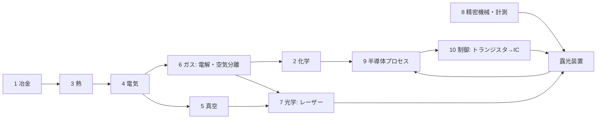

# TECH_TREE.md — 何もない世界から EUV 露光装置までの技術ツリー（依存関係）

ROADMAP は「時間順」、このファイルは「前提→結果」。設計の抜け探し・進捗ツリー・Agent への指示単位に使う。
ノードID: [幹-番号]。状態: ✅実装済 🔧実装中 ❓未着手 ⛔バニラに材料がない（新鉱石等で解決する）

## 10本の幹
1 冶金 ／ 2 化学 ／ 3 熱（炉と温度）／ 4 動力・電気 ／ 5 真空 ／ 6 ガス ／ 7 光学 ／ 8 精密機械・計測 ／ 9 半導体プロセス ／ 10 制御・計算（ブートストラップ）

## 判明している「抜け」（バニラにない前提）⛔
- 塩素：岩塩鉱 → 電解（クロルアルカリ）→ Cl2/HCl/NaOH。Si精製・GeCl4蒸留・洗浄に必須
- フッ素：蛍石 CaF2 + 硫酸 → フッ酸。エッチング・石英加工に必須
- 空気分離：圧縮＋冷却で液体空気 → N2/O2/Ar/Kr。エキシマレーザー・パージ・雰囲気
- 硝酸：硝石 or アンモニア（ハーバー法=H2+N2+高圧+鉄触媒）→ 硝酸。CP-4エッチング液
- アルミニウム：ボーキサイト + 電解（ホール・エルー法、氷晶石=フッ素）。配線・装置筐体
- スズ：錫石。EUV光源（Snプラズマ）・はんだ
- モリブデン：輝水鉛鉱。EUV多層膜ミラー（Mo/Si）
- 希土類・ネオジム：強力磁石（リニアモーターステージ）。⚠️ 範囲を決める
- ヘリウム：天然ガス由来。検漏・冷却。⚠️ 代替可否を議論

## EUV までのクリティカルパス（幹をまたぐ最短の鎖）
鉱石→鉄・銅 → 水車/蒸気 → 発電 → 電解(H2, Cl2) → 電気炉 → Si(シーメンス法, 塩素が必要) → CZ結晶 → ウェハー
→ 真空ポンプ → 真空管 → トランジスタ → IC → マイコン（制御）
→ ガラス→溶融石英→研磨→干渉計（計測）→ ステージ
→ 空気分離(Ar/Kr) → エキシマレーザー → ArF液浸
→ CO2レーザー + Sn + 多層膜ミラー(Mo/Si) + ターボ分子ポンプ(超高真空) → EUV

## ノードの書式（厳守。1ノード＝SDKへの1指示）
### [幹-番号] 名前 状態
前提: [..] 状態, [..] 状態   （全部✅で実装可）
本物: 原理・反応式・年・人名
入力/出力: ゲーム内の材料 → 生成物（電力は W で）
ゲーム: クラス名・パッケージ・既存テンプレの何を参考にするか
省略: 本物との差（ガイドブックに書く内容）
へえ: lang の .note に入れる一言
テスト: TEST_QUEUE に書く確認項目

## ノード一覧（章ごとに追記していく）
### [1-01] 石炭灰からのゲルマニウム ✅
前提: かまど ／ 入力: 石炭 ／ 原理: 一部の石炭にGeが濃縮 ／ ゲーム: coal_ash → germanium_concentrate ／ 省略: 産地限定
### [4-01] 水車発電機 ✅
前提: 磁鉄鉱→磁石, 銅コイル ／ 原理: ファラデー電磁誘導 ／ ゲーム: 流水1面500W
### [2-05] 塩酸 ⛔
前提: [4-06]電解, 岩塩鉱 ／ 入力: NaCl→電解→Cl2+H2, H2+Cl2→HCl ／ 原理: クロルアルカリ法 ／ ゲーム: 岩塩鉱＋電解槽の第2モード ／ 省略: 隔膜法/水銀法の違い

## 幹4 動力・電気
### [4-01] 水車発電機 ✅
前提: [4-04] ／ 本物: 流量×落差。初期の発電所は水力 ／ ゲーム: 流水1面500W
### [4-02] 蒸気機関発電機 ✅（GUIは🔧）
前提: [4-04], 鉄 ／ 本物: ワット1776。熱効率〜30% ／ ゲーム: 石炭+水→50kW
### [4-03] 銅ケーブル ✅
本物: I²R損失。太線と高電圧で減らす ／ ゲーム: 1ホップ1%（簡易）
### [4-04] ダイナモ・天然磁石 ✅
本物: ファラデー1831。整流子付きダイナモは直流を出す（電解に直流が要る点で重要）
### [4-05] 自励式発電機 ❓
前提: [4-04]✅, [1-xx]鋼 ／ 本物: ジーメンス1866。鉄心の残留磁気で自分を励磁、永久磁石不要 ／ 入力/出力: 鉄心+コイル×4 → 発電機部品（出力2倍）／ ゲーム: dynamo の上位アイテム ／ へえ: 磁石なしで発電できる
### [4-06] 蒸気タービン ❓
前提: [4-02]✅, [1-xx]鋼, [8-01]旋盤 ／ 本物: パーソンズ1884。回転が速く発電に最適、MW級 ／ 入力/出力: 石炭+水 → 500kW ／ 省略: 多段タービン・復水器 ／ テスト: アチソン炉が動く
### [4-07] 鉛蓄電池 ❓
前提: [1-xx]鉛(方鉛鉱), [2-01]硫酸✅ ／ 本物: プランテ1859。Pb+PbO2+H2SO4 ／ ゲーム: 蓄電ブロック(1MJ)。energy/SimpleEnergyStorage ／ へえ: 車のバッテリーと同じ
### [4-08] 電動モーター ✅
本物: ダイナモの逆。アイテムとして実装済み
### [4-09] 高周波発振器 ❓
前提: [5-02]真空管 ／ 本物: 真空管発振回路（1910年代）。誘導加熱の電源 ／ ゲーム: hf_power_supply（仮）を置換 ／ へえ: トランジスタを作る装置が真空管で動いていた
### [4-10] 変圧器 ❓（v0.4〜）
前提: [4-05], 鉄心 ／ 本物: 交流で電圧を変える。送電損失を減らす ／ ゲーム: voltage 欄を使い始める
### [4-11] 整流器 ❓（v0.4〜）
前提: [5-02]真空管 or [9-xx]Geダイオード ／ 本物: 交流→直流。電解・イオン注入の高電圧直流に必要
### [4-12] 電気炉（抵抗加熱）❓
前提: [4-06], [1-07]黒鉛✅ ／ 本物: ニクロム線はNi/Crが要るので、炭素/SiC発熱体を使う（アチソン炉も炭素抵抗体）／ ゲーム: 1000℃級の汎用炉。[3-xx]アチソン炉の前提 ／ へえ: ニクロムなしでも炭素で発熱体が作れる

## 幹6 ガス・電解
### [6-01] 電解槽（水→H2+O2）✅
前提: [4-01]✅, [1-07]黒鉛✅, [2-01]硫酸✅（電解質）／ 本物: 2H2O→2H2+O2。純水は絶縁体なので電解質を入れる。黒鉛電極。直流が必要（ダイナモは直流）／ 入力/出力: 水バケツ+硫酸(消耗せず)+5kW → H2×2, O2×1（[6-02]に貯める）／ ゲーム: energy/ 消費側テンプレ（新規）。ElectrolyzerBlock BE/Menu/Screen ／ 省略: 隔膜 ／ へえ: 純水は電気を通さない ／ テスト: 電気なしで止まる、水を入れるとH2が溜まる
実装メモ: energy/ConsumerBlockEntity（消費側の共通土台）＋ block/Electrolyzer*。1回=水2mol相当=約572kJ（5kW×115秒）。H2/O2 は仮アイテム hydrogen_gas/oxygen_gas → [6-02][6-03] で容器に置換
### [6-02] ガスホルダー（低圧貯蔵）❓
前提: 鉄 ／ 本物: 19世紀のガス灯用ガスタンク（水封式）。圧縮不要 ／ ゲーム: ガスを種類別に貯めるブロック。ボンベの前段階
### [6-03] 圧縮機 ❓
前提: [4-08]✅, [1-xx]鋼 ／ 本物: ピストン圧縮（1880年代に高圧ボンベ実用化）／ 入力/出力: ガス+電力 → ボンベ（鉄×6の空ボンベに充填）／ ゲーム: 容器システムの本体。[6-06]空気分離の前提
### [6-04] 岩塩鉱 ⛔→❓
本物: 蒸発岩層（古い海の跡）。地下の塩層・砂漠 ／ ゲーム: 新鉱石。乾燥バイオーム地下 ／ へえ: 岩塩は「石になった海」
### [6-05] クロルアルカリ電解 ❓
前提: [6-01], [6-04] ／ 本物: 2NaCl+2H2O→Cl2+H2+2NaOH（1890年代）。隔膜で分ける ／ 入力/出力: 塩水+電力 → 塩素ボンベ, 水素, 水酸化ナトリウム ／ 省略: 隔膜/水銀/イオン交換膜の違い ／ へえ: 塩から塩素と苛性ソーダが同時にできる
### [6-06] 塩酸 ❓
前提: [6-05] ／ 本物: H2+Cl2→2HCl（燃焼）→水に溶かす ／ ゲーム: Ge精鉱の浸出を硫酸→塩酸に置換可、GeCl4蒸留[1-xx]の前提
### [6-07] 空気分離（リンデ法）❓
前提: [6-03], 銅の熱交換器 ／ 本物: リンデ1895。圧縮→膨張で冷却（ジュール・トムソン）→液体空気→蒸留で N2/O2/Ar。Kr/Xe は1ppm以下なので大規模装置が要る ／ 入力/出力: 電力 → N2, O2, Ar（Kr は[6-08]）／ へえ: 空気を液体にして「蒸留」する
### [6-08] 希ガス精製（Kr）❓（v0.4）
前提: [6-07]大型化 ／ 本物: Kr は空気の1.1ppm。KrFレーザー用
### [6-09] ハーバー・ボッシュ法（アンモニア）❓
前提: [6-01]H2, [6-07]N2, [6-03]高圧, 磁鉄鉱触媒✅ ／ 本物: N2+3H2→2NH3、200気圧400℃、触媒は磁鉄鉱を還元した鉄（1913）／ へえ: 触媒の原料が磁鉄鉱
### [6-10] 硝石床（硝酸カリウム）❓
前提: 骨粉/腐肉, 石灰 ／ 本物: 有機物+石灰を数か月堆積、細菌の硝化でKNO3（18世紀の火薬原料）／ ゲーム: 堆肥ブロックが時間で硝石に ／ へえ: 硝石は細菌が作る
### [6-11] 硝酸 ❓
前提: [6-10]+[2-01]硫酸（グラウバー法1648）or [6-09]+白金触媒（オストワルト法）／ 本物: KNO3+H2SO4→HNO3 ／ ゲーム: 最初はグラウバー法。CP-4エッチング液の材料
### [6-12] 鉛室法硫酸 ❓
前提: [1-xx]鉛, [6-11]硝酸, SO2✅ ／ 本物: 1746ロバック。鉛張りの部屋でSO2+NO2+H2O→H2SO4。最初の工業的硫酸 ／ ゲーム: 現在の「SO2+水」の省略を置換 ／ へえ: 硫酸工場が鉛でできていた理由
### [6-13] 接触法硫酸（濃硫酸）❓
前提: [6-12], [1-xx]白金 ／ 本物: SO2→SO3 を白金触媒（1831）、後にV2O5（1915）。濃硫酸・発煙硫酸 ／ 省略: V2O5（バナジウムは範囲外→白金で統一）

## 新たに必要な鉱石ノード（輸入品なしのため）
### [1-20] 白金（砂白金）⛔→❓  前提: 砂鉄✅ ／ 本物: 漂砂鉱床に自然白金が微量（ウラル・コロンビア）／ ゲーム: 砂鉄のドロップに低確率で白金粒 ／ 用途: 触媒[6-13][6-11]、電極、熱電対
### [1-21] 蛍石 CaF2 ⛔→❓  本物: 熱水鉱脈（方鉛鉱・閃亜鉛鉱と共生）／ ゲーム: 方鉛鉱と同じ帯 ／ 用途: フッ酸（蛍石+硫酸）、氷晶石
### [1-22] 錫石 SnO2 ⛔→❓  本物: 花崗岩系の熱水・漂砂（コーンウォール、マレーシア）／ ゲーム: 鉄マンガン重石と同じ花崗岩帯 ／ 用途: はんだ、EUV光源
### [1-23] 輝水鉛鉱 MoS2 ⛔→❓  本物: 斑岩銅鉱床の副産物 ／ ゲーム: 銅鉱石の近く ／ 用途: EUV多層膜ミラー
### [1-24] ボーキサイト ⛔→❓  本物: 熱帯の風化残留土 ／ ゲーム: ジャングル/サバンナの地表付近 ／ 用途: アルミ（ホール・エルー法=電解+氷晶石）
### [1-25] モナザイト（希土類）⛔→❓  本物: 漂砂鉱床（砂鉄と共産）／ ゲーム: 砂鉄の副産物 ／ 用途: ネオジム磁石（ステージ）。分離は溶媒抽出を簡略化
### [1-26] 鋼 ❓  前提: 鉄, [4-02] ／ 本物: ベッセマー法1856（銑鉄に空気を吹き込み炭素を抜く）／ 用途: タービン・圧力容器・旋盤
