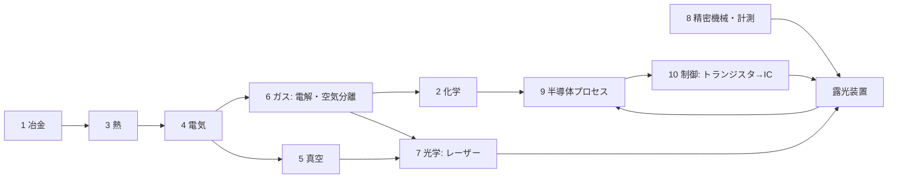

# TECH_TREE.md — 何もない世界から EUV 露光装置までの技術ツリー（依存関係）

ROADMAP は「時間順」、このファイルは「前提→結果」。設計の抜け探し・進捗ツリー・Agent への指示単位に使う。
ノードID: [幹-番号]。状態: ✅実装済 🔧実装中 ❓未着手 ⛔バニラに材料がない（新鉱石等で解決する）

## 10本の幹
1 冶金 ／ 2 化学 ／ 3 熱（炉と温度）／ 4 動力・電気 ／ 5 真空 ／ 6 ガス ／ 7 光学 ／ 8 精密機械・計測 ／ 9 半導体プロセス ／ 10 制御・計算（ブートストラップ）

## 判明している「抜け」（バニラにない前提）⛔
- 塩素：岩塩鉱 → 電解（クロルアルカリ）→ Cl2/HCl/NaOH。Si精製・GeCl4蒸留・洗浄に必須
- フッ素：蛍石 CaF2 + 硫酸 → フッ酸。エッチング・石英加工に必須
- 空気分離：圧縮＋冷却で液体空気 → N2/O2/Ar/Kr。エキシマレーザー・パージ・雰囲気
- 硝酸：硝石 or アンモニア（ハーバー法=H2+N2+高圧+鉄触媒）→ 硝酸。CP-4エッチング液
- アルミニウム：ボーキサイト + 電解（ホール・エルー法、氷晶石=フッ素）。配線・装置筐体
- スズ：錫石。EUV光源（Snプラズマ）・はんだ
- モリブデン：輝水鉛鉱。EUV多層膜ミラー（Mo/Si）
- 希土類・ネオジム：強力磁石（リニアモーターステージ）。⚠️ 範囲を決める
- ヘリウム：天然ガス由来。検漏・冷却。⚠️ 代替可否を議論

## EUV までのクリティカルパス（幹をまたぐ最短の鎖）
鉱石→鉄・銅 → 水車/蒸気 → 発電 → 電解(H2, Cl2) → 電気炉 → Si(シーメンス法, 塩素が必要) → CZ結晶 → ウェハー
→ 真空ポンプ → 真空管 → トランジスタ → IC → マイコン（制御）
→ ガラス→溶融石英→研磨→干渉計（計測）→ ステージ
→ 空気分離(Ar/Kr) → エキシマレーザー → ArF液浸
→ CO2レーザー + Sn + 多層膜ミラー(Mo/Si) + ターボ分子ポンプ(超高真空) → EUV

## ノード一覧（章ごとに追記していく）
### [1-01] 石炭灰からのゲルマニウム ✅
前提: かまど ／ 入力: 石炭 ／ 原理: 一部の石炭にGeが濃縮 ／ ゲーム: coal_ash → germanium_concentrate ／ 省略: 産地限定
### [4-01] 水車発電機 ✅
前提: 磁鉄鉱→磁石, 銅コイル ／ 原理: ファラデー電磁誘導 ／ ゲーム: 流水1面500W
### [2-05] 塩酸 ⛔
前提: [4-06]電解, 岩塩鉱 ／ 入力: NaCl→電解→Cl2+H2, H2+Cl2→HCl ／ 原理: クロルアルカリ法 ／ ゲーム: 岩塩鉱＋電解槽の第2モード ／ 省略: 隔膜法/水銀法の違い