# TECH_TREE_VIEW.md（自動生成：tools/gen_tree_views.py。手で編集しない）

## 1. 状態ダッシュボード

| 幹 | 名前 | ✅ | 🔧 | ❓ | ⛔ | 計 | 進捗 |
|---|---|---|---|---|---|---|---|
| 0 | 生存・道具 | 6 | 0 | 11 | 0 | 17 | 35% |
| 1 | 冶金 | 12 | 0 | 35 | 0 | 47 | 25% |
| 2 | 化学 | 3 | 0 | 39 | 1 | 43 | 6% |
| 3 | 熱 | 6 | 0 | 12 | 0 | 18 | 33% |
| 4 | 動力・電気 | 11 | 0 | 3 | 0 | 14 | 78% |
| 5 | 真空 | 5 | 0 | 10 | 0 | 15 | 33% |
| 6 | ガス | 7 | 0 | 8 | 0 | 16 | 43% |
| 7 | 光学 | 1 | 0 | 19 | 0 | 20 | 5% |
| 8 | 精密・計測 | 0 | 0 | 18 | 0 | 18 | 0% |
| 9 | 半導体プロセス | 6 | 1 | 33 | 0 | 40 | 15% |
| 10 | 制御・計算 | 0 | 0 | 16 | 0 | 16 | 0% |
| 11 | 農業・食 | 0 | 0 | 16 | 0 | 16 | 0% |
| 12 | 建築・土木 | 0 | 0 | 15 | 0 | 15 | 0% |
| 13 | 医薬・衛生 | 0 | 0 | 15 | 0 | 15 | 0% |
| 14 | 輸送 | 0 | 0 | 15 | 0 | 15 | 0% |
| 15 | 通信・情報 | 1 | 0 | 14 | 0 | 15 | 6% |
| B | 枝 | 0 | 0 | 19 | 0 | 19 | 0% |
| 計 | | 58 | 1 | 298 | 1 | 359 | 16% |

**今すぐ作れる（前提が全部✅の❓）: 52 個**

- 幹0 生存・道具: [0-01] 打製石器、[0-03] 土器
- 幹1 冶金: [1-03] 銅の製錬、[1-06] 塊鉄炉、[1-13] 亜鉛、[1-20] 白金、[1-21] 蛍石 CaF2、[1-22] 錫石 SnO2、[1-23] 輝水鉛鉱 MoS2、[1-24] ボーキサイト、[1-25] モナザイト、[1-32] 銀、[1-39] マグネシウム、[1-43] アンチモン、[1-47] 天然磁石
- 幹2 化学: [2-02] カリ、[2-04] 海藻灰ソーダ、[2-05] ルブラン法、[2-12] 硫酸塩、[2-16] 蒸留水、[2-19] 過酸化水素、[2-23] 木材乾留、[2-29] ゴム、[2-43] ばん油、[2-44] 赤リン
- 幹3 熱: [3-01] たき火、[3-13] 断熱材
- 幹4 動力・電気: [4-10] 変圧器、[4-11] 整流器
- 幹5 真空: [5-03] 水銀柱と圧力の単位、[5-09] クライオポンプ → 液体窒素コールドトラップ
- 幹6 ガス: [6-08] 希ガス精製、[6-09] ハーバー・ボッシュ法、[6-10] 硝石床、[6-16] 天然硝石の採取
- 幹7 光学: [7-01] 光学ガラス
- 幹8 精密・計測: [8-01] 旋盤
- 幹9 半導体プロセス: [9-05] Geダイオード、[9-09] FZ 法
- 幹10 制御・計算: [10-01] 電磁石、[10-07] 真空管フリップフロップと計算機
- 幹11 農業・食: [11-06] 過リン酸石灰、[11-11] 塩蔵・乾燥・燻製、[11-12] 缶詰
- 幹12 建築・土木: [12-01] ローマンコンクリート、[12-04] 鉄骨構造、[12-15] 避雷針
- 幹13 医薬・衛生: [13-13] 体温計、[13-15] 医療用酸素
- 幹14 輸送: [14-14] 電気鉄道
- 幹15 通信・情報: [15-09] 真空管ラジオ
- 幹B 枝: [B-14] アセチレンランプ

## 2. 背骨（石器→EUV→AI）

最短の鎖（[0-01] から [10-16] AI まで 7 ノード）

律速の鎖（[10-16] から最も深い前提をたどる、31 ノード）

## 3. 幹ごとの依存図（幹内の辺のみ。31ノード以上は次数の上位30）

### 幹0 生存・道具

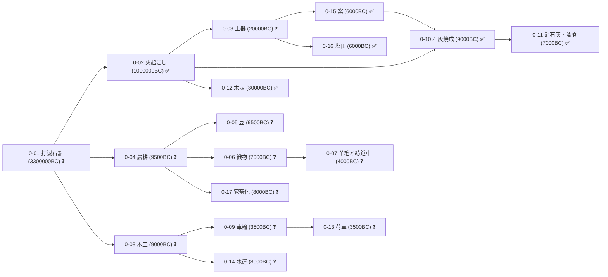

### 幹1 冶金

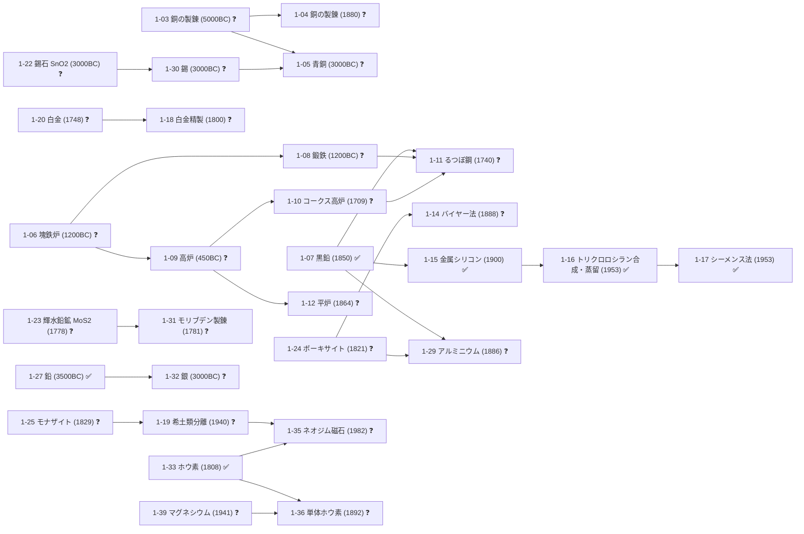

### 幹2 化学

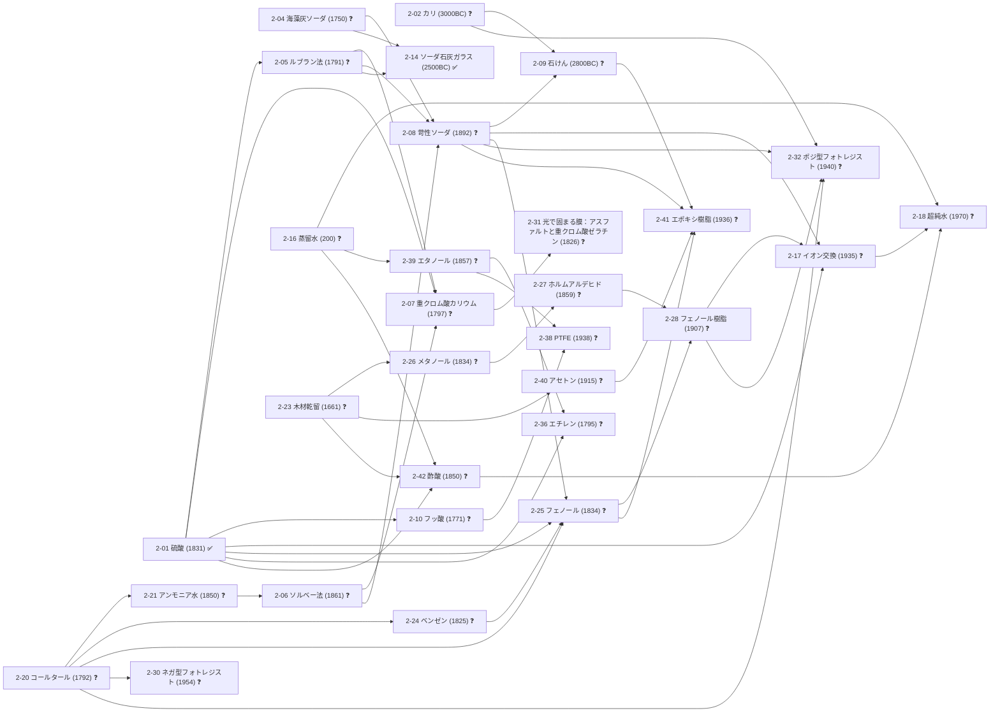

### 幹3 熱

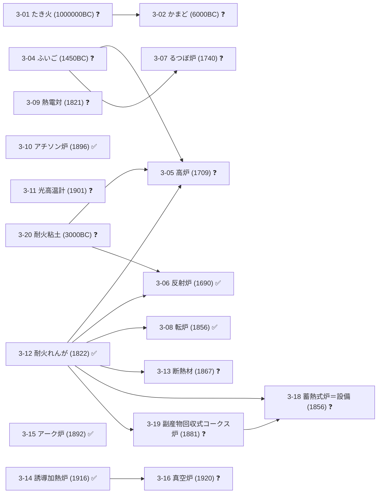

### 幹4 動力・電気

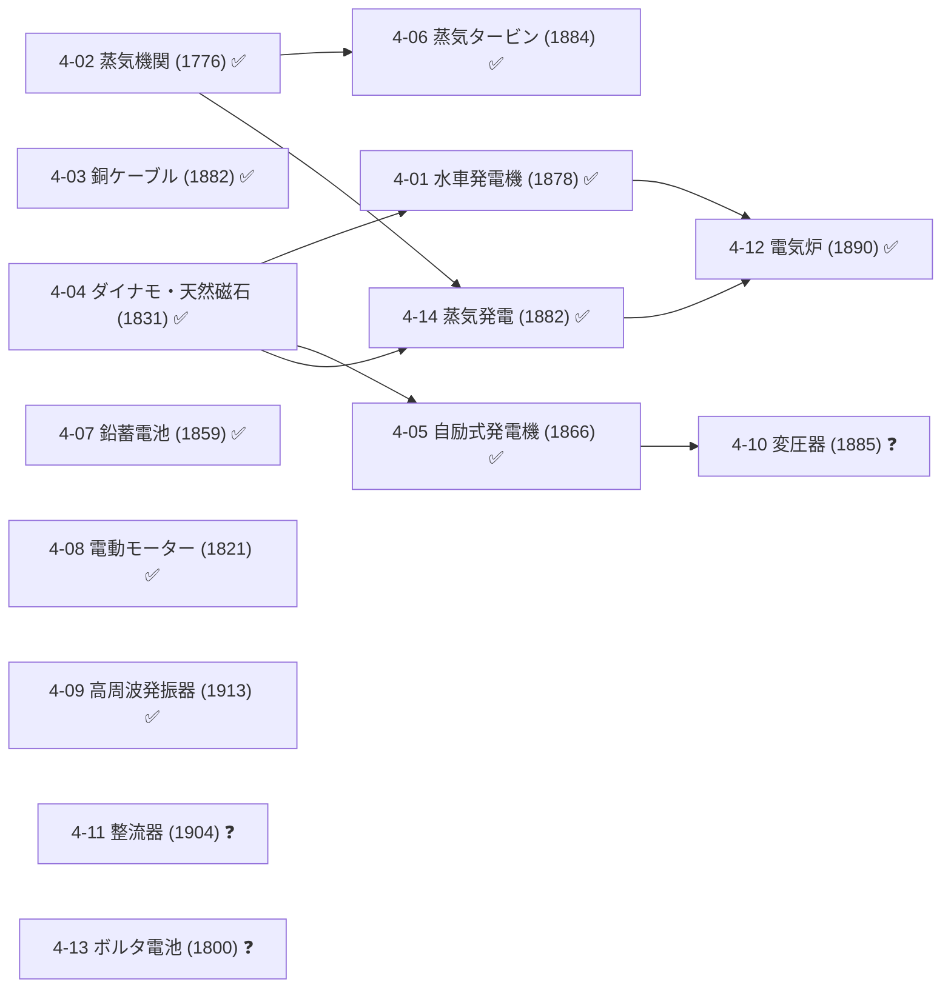

### 幹5 真空

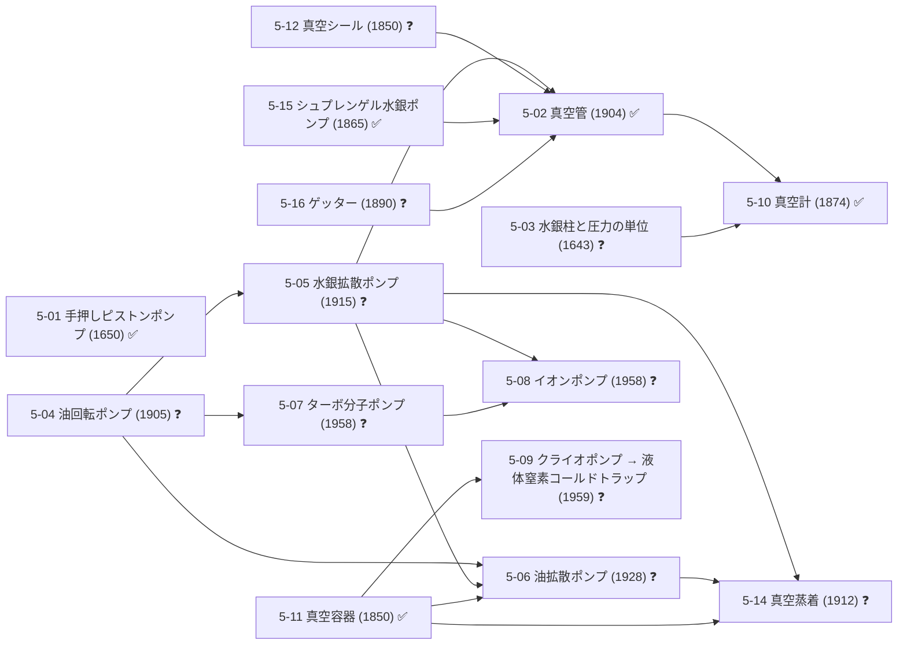

### 幹6 ガス

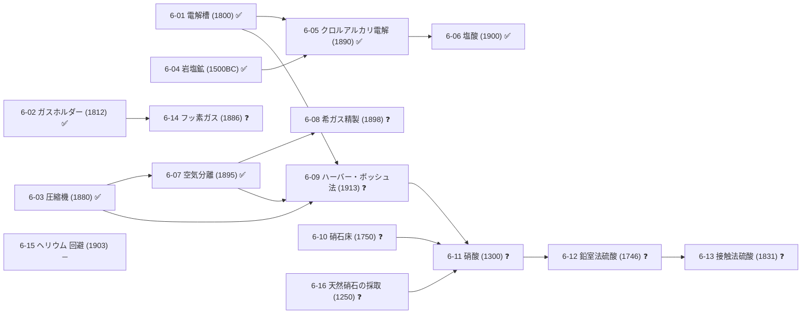

### 幹7 光学

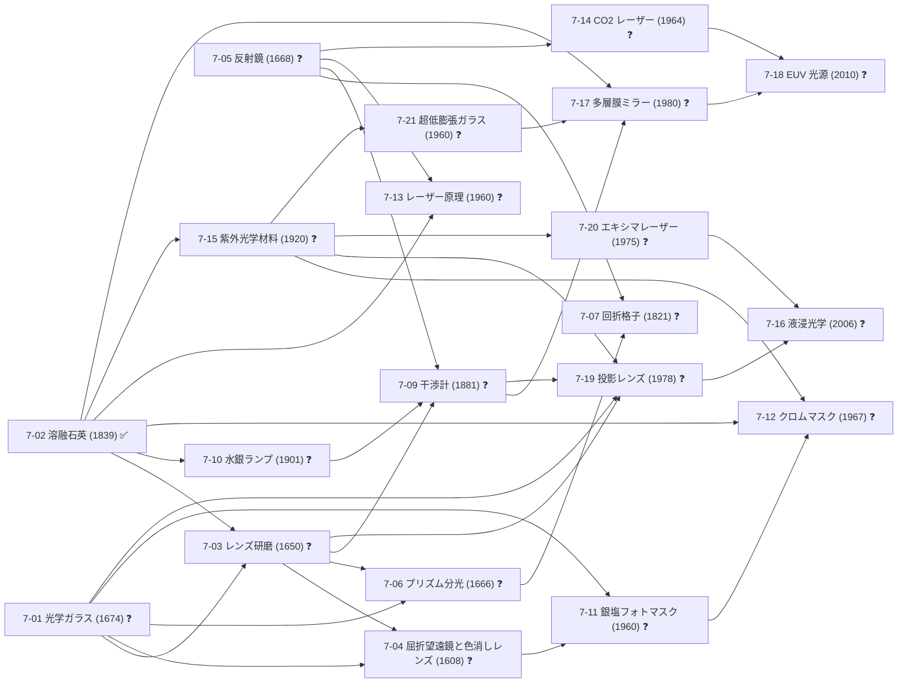

### 幹8 精密・計測

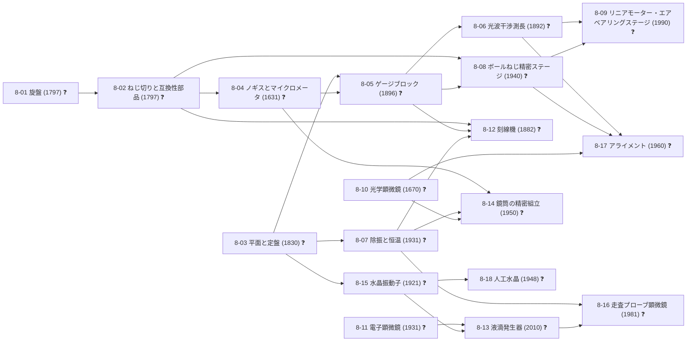

### 幹9 半導体プロセス

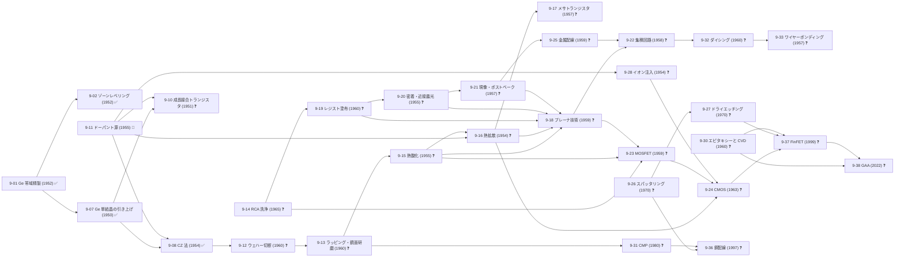

### 幹10 制御・計算

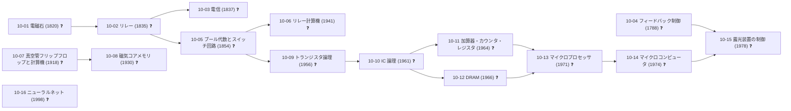

### 幹11 農業・食

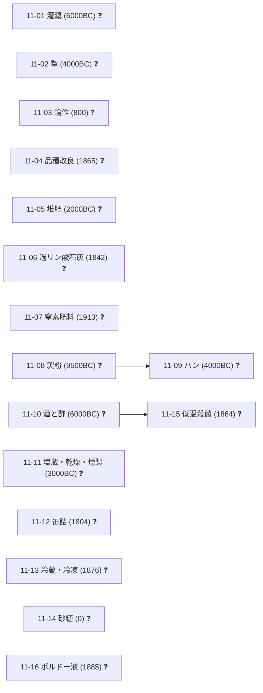

### 幹12 建築・土木

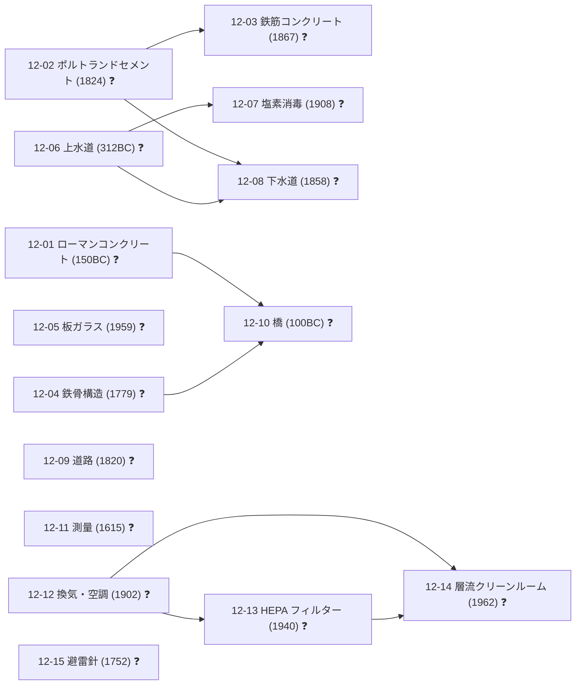

### 幹13 医薬・衛生

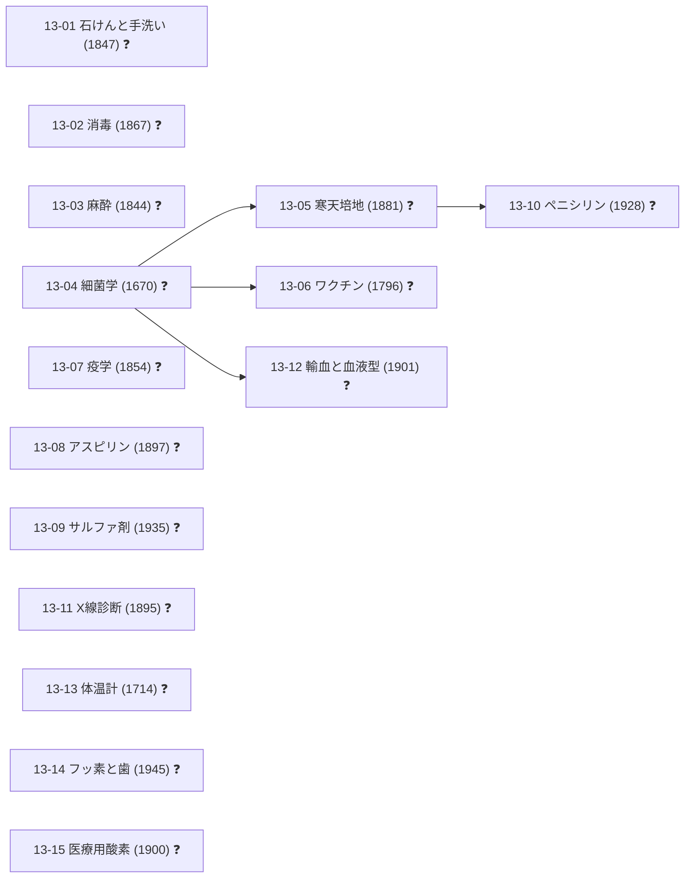

### 幹14 輸送

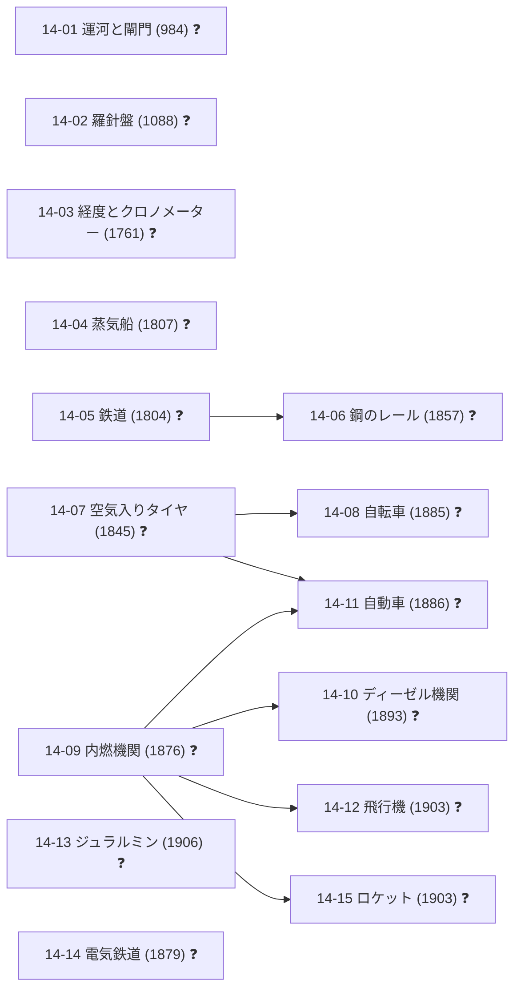

### 幹15 通信・情報

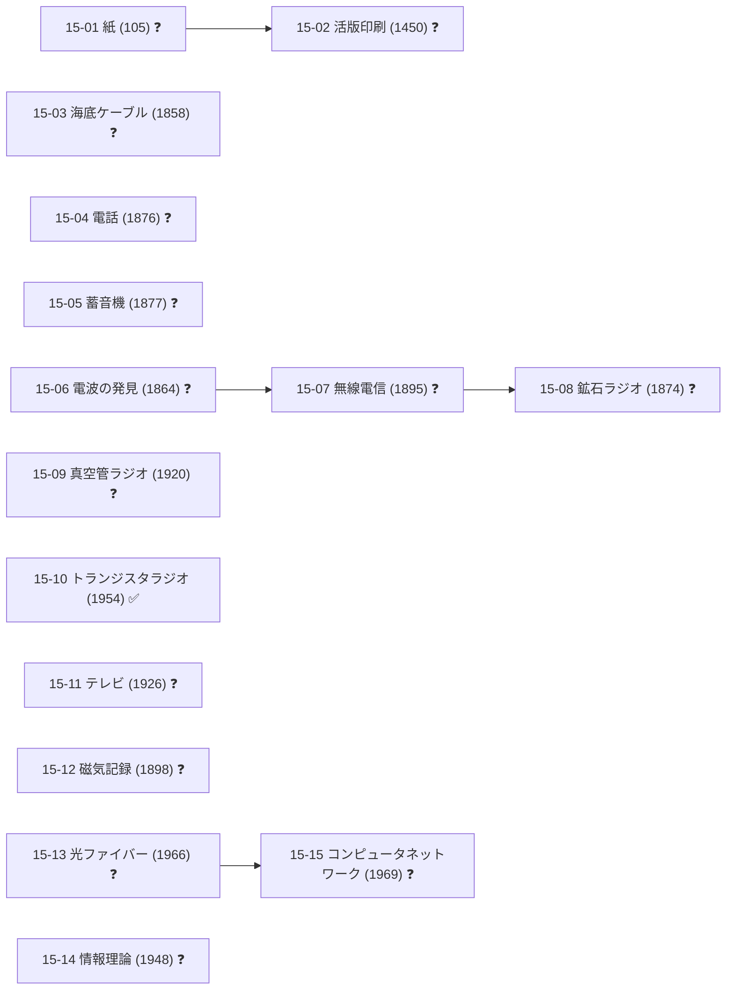

### 幹B 枝

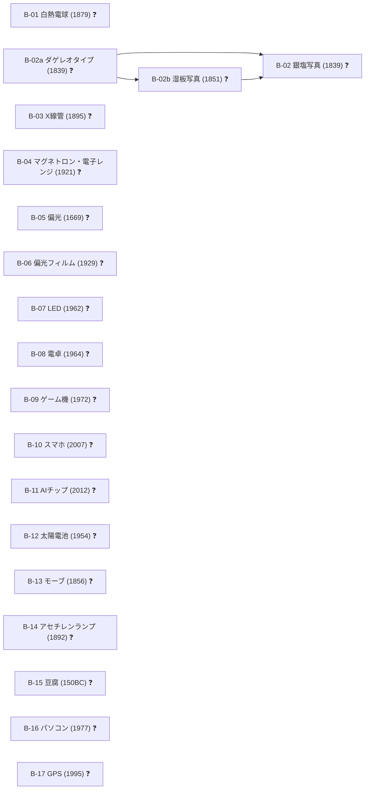

## 4. 年表マトリクス（本物の欄の最初の年。年なしは除外）

| 幹 | 〜BC | 1〜1500 | 1500〜1800 | 1800〜1900 | 1900〜1950 | 1950〜 |
|---|---|---|---|---|---|---|
| 0 生存・道具 | 0-01 0-02 0-03 0-04 0-05 0-06 0-07 0-08 0-09 0-10 0-11 0-12 0-13 0-14 0-15 0-16 0-17 |  |  |  |  |  |
| 1 冶金 | 1-02 1-03 1-05 1-06 1-08 1-09 1-22 1-27 1-30 1-32 1-43 1-45 1-46 1-47 | 1-13 | 1-10 1-11 1-18 1-20 1-21 1-23 1-31 1-37 1-40 | 1-04 1-07 1-12 1-14 1-15 1-24 1-25 1-26 1-29 1-33 1-36 1-38 1-42 1-44 | 1-01 1-19 1-28 1-34 1-39 1-41 | 1-16 1-17 1-35 |
| 2 化学 | 2-02 2-03 2-09 2-14 | 2-16 2-22 2-43 | 2-04 2-05 2-07 2-10 2-11 2-20 2-23 2-36 | 2-01 2-06 2-08 2-12 2-13 2-15 2-19 2-21 2-24 2-25 2-26 2-27 2-29 2-31 2-35 2-39 2-42 2-44 | 2-17 2-28 2-32 2-37 2-38 2-40 2-41 | 2-18 2-30 2-33 |
| 3 熱 | 3-01 3-02 3-04 3-20 |  | 3-05 3-06 3-07 | 3-08 3-09 3-10 3-12 3-13 3-15 3-18 3-19 | 3-11 3-14 3-16 |  |
| 4 動力・電気 |  |  | 4-02 4-13 | 4-01 4-03 4-04 4-05 4-06 4-07 4-08 4-10 4-12 4-14 | 4-09 4-11 |  |
| 5 真空 |  |  | 5-01 5-03 | 5-10 5-11 5-12 5-15 5-16 | 5-02 5-04 5-05 5-06 5-14 | 5-07 5-08 5-09 |
| 6 ガス | 6-04 | 6-11 6-16 | 6-01 6-10 6-12 | 6-02 6-03 6-05 6-06 6-07 6-08 6-13 6-14 | 6-09 6-15 |  |
| 7 光学 |  |  | 7-01 7-03 7-04 7-05 7-06 | 7-02 7-07 7-09 | 7-10 7-15 | 7-11 7-12 7-13 7-14 7-16 7-17 7-18 7-19 7-20 7-21 |
| 8 精密・計測 |  |  | 8-01 8-02 8-04 8-10 | 8-03 8-05 8-06 8-12 | 8-07 8-08 8-11 8-14 8-15 8-18 | 8-09 8-13 8-16 8-17 |
| 9 半導体プロセス |  |  |  |  | 9-03 9-05 9-07 | 9-01 9-02 9-04 9-06 9-08 9-09 9-10 9-11 9-12 9-13 9-14 9-15 9-16 9-17 9-18 9-19 9-20 9-21 9-22 9-23 9-24 9-25 9-26 9-27 9-28 9-29 9-30 9-31 9-32 9-33 9-34 9-35 9-36 9-37 9-38 9-39 9-40 |
| 10 制御・計算 |  |  | 10-04 | 10-01 10-02 10-03 10-05 | 10-06 10-07 10-08 | 10-09 10-10 10-11 10-12 10-13 10-14 10-15 10-16 |
| 11 農業・食 | 11-01 11-02 11-05 11-08 11-09 11-10 11-11 11-14 | 11-03 |  | 11-04 11-06 11-12 11-13 11-15 11-16 | 11-07 |  |
| 12 建築・土木 | 12-01 12-06 12-10 |  | 12-04 12-11 12-15 | 12-02 12-03 12-08 12-09 | 12-07 12-12 12-13 | 12-05 12-14 |
| 13 医薬・衛生 |  |  | 13-04 13-06 13-13 | 13-01 13-02 13-03 13-05 13-07 13-08 13-11 13-15 | 13-09 13-10 13-12 13-14 |  |
| 14 輸送 |  | 14-01 14-02 | 14-03 | 14-04 14-05 14-06 14-07 14-08 14-09 14-10 14-11 14-14 | 14-12 14-13 14-15 |  |
| 15 通信・情報 |  | 15-01 15-02 |  | 15-03 15-04 15-05 15-06 15-07 15-08 15-12 | 15-09 15-11 15-14 | 15-10 15-13 15-15 |
| B 枝 | B-15 |  | B-05 | B-01 B-02 B-02a B-02b B-03 B-13 B-14 | B-04 B-06 | B-07 B-08 B-09 B-10 B-11 B-12 B-16 B-17 |

## 5. AI までの残り ToDo（[10-16] の祖先のうち未完成、トポロジカル順）

162 / 212 ノードが未完成

1. [0-01] 打製石器 ❓
2. [0-03] 土器 ❓
3. [0-04] 農耕 ❓
4. [0-06] 織物 ❓
5. [0-07] 羊毛と紡錘車 ❓
6. [0-08] 木工 ❓
7. [1-03] 銅の製錬 ❓
8. [1-04] 銅の製錬 ❓
9. [1-06] 塊鉄炉 ❓
10. [1-08] 鍛鉄 ❓
11. [1-09] 高炉 ❓
12. [1-10] コークス高炉 ❓
13. [1-11] るつぼ鋼 ❓
14. [1-13] 亜鉛 ❓
15. [1-20] 白金 ❓
16. [1-21] 蛍石 CaF2 ❓
17. [1-22] 錫石 SnO2 ❓
18. [1-23] 輝水鉛鉱 MoS2 ❓
19. [1-24] ボーキサイト ❓
20. [1-25] モナザイト ❓
21. [1-30] 錫 ❓
22. [1-05] 青銅 ❓
23. [1-32] 銀 ❓
24. [1-37] ニッケル ❓
25. [1-43] アンチモン ❓
26. [2-04] 海藻灰ソーダ ❓
27. [2-16] 蒸留水 ❓
28. [2-23] 木材乾留 ❓
29. [2-26] メタノール ❓
30. [2-27] ホルムアルデヒド ❓
31. [2-29] ゴム ❓
32. [2-39] エタノール ❓
33. [2-43] ばん油 ❓
34. [2-44] 赤リン ❓
35. [3-01] たき火 ❓
36. [2-02] カリ ❓
37. [3-04] ふいご ❓
38. [3-19] 副産物回収式コークス炉 ❓
39. [2-20] コールタール ❓
40. [2-24] ベンゼン ❓
41. [2-30] ネガ型フォトレジスト ❓
42. [4-10] 変圧器 ❓
43. [4-13] ボルタ電池 ❓
44. [1-31] モリブデン製錬 ❓
45. [2-19] 過酸化水素 ❓
46. [2-05] ルブラン法 ❓
47. [2-15] ホウケイ酸ガラス ❓
48. [1-19] 希土類分離 ❓
49. [1-35] ネオジム磁石 ❓
50. [6-08] 希ガス精製 ❓
51. [6-09] ハーバー・ボッシュ法 ❓
52. [2-21] アンモニア水 ❓
53. [2-06] ソルベー法 ❓
54. [2-07] 重クロム酸カリウム ❓
55. [2-08] 苛性ソーダ ❓
56. [2-09] 石けん ❓
57. [2-25] フェノール ❓
58. [2-28] フェノール樹脂 ❓
59. [2-17] イオン交換 ❓
60. [5-12] 真空シール ❓
61. [6-10] 硝石床 ❓
62. [6-16] 天然硝石の採取 ❓
63. [6-11] 硝酸 ❓
64. [2-32] ポジ型フォトレジスト ❓
65. [6-12] 鉛室法硫酸 ❓
66. [2-10] フッ酸 ❓
67. [1-29] アルミニウム ❓
68. [1-40] クロム ❓
69. [2-38] PTFE ❓
70. [6-14] フッ素ガス ❓
71. [7-01] 光学ガラス ❓
72. [8-01] 旋盤 ❓
73. [1-39] マグネシウム ❓
74. [1-36] 単体ホウ素 ❓
75. [1-41] チタン ❓
76. [5-04] 油回転ポンプ ❓
77. [5-05] 水銀拡散ポンプ ❓
78. [5-06] 油拡散ポンプ ❓
79. [5-14] 真空蒸着 ❓
80. [5-16] ゲッター ❓
81. [3-16] 真空炉 ❓
82. [7-03] レンズ研磨 ❓
83. [7-04] 屈折望遠鏡と色消しレンズ ❓
84. [7-05] 反射鏡 ❓
85. [7-10] 水銀ランプ ❓
86. [7-09] 干渉計 ❓
87. [7-14] CO2 レーザー ❓
88. [7-15] 紫外光学材料 ❓
89. [7-20] エキシマレーザー ❓
90. [2-33] 化学増幅レジスト ❓
91. [7-21] 超低膨張ガラス ❓
92. [8-02] ねじ切りと互換性部品 ❓
93. [8-03] 平面と定盤 ❓
94. [8-04] ノギスとマイクロメータ ❓
95. [8-05] ゲージブロック ❓
96. [5-07] ターボ分子ポンプ ❓
97. [7-17] 多層膜ミラー ❓
98. [8-06] 光波干渉測長 ❓
99. [8-07] 除振と恒温 ❓
100. [8-08] ボールねじ精密ステージ ❓
101. [8-10] 光学顕微鏡 ❓
102. [8-14] 鏡筒の精密組立 ❓
103. [7-19] 投影レンズ ❓
104. [8-15] 水晶振動子 ❓
105. [8-17] アライメント ❓
106. [9-06] 酸化膜エッチング ❓
107. [9-05] Geダイオード ❓
108. [4-11] 整流器 ❓
109. [8-11] 電子顕微鏡 ❓
110. [8-13] 液滴発生器 ❓
111. [7-18] EUV 光源 ❓
112. [9-11] ドーパント源 🔧
113. [9-12] ウェハー切断 ❓
114. [9-13] ラッピング・鏡面研磨 ❓
115. [9-15] 熱酸化 ❓
116. [9-16] 熱拡散 ❓
117. [9-17] メサトランジスタ ❓
118. [9-26] スパッタリング ❓
119. [9-27] ドライエッチング ❓
120. [9-30] エピタキシーと CVD ❓
121. [10-01] 電磁石 ❓
122. [9-28] イオン注入 ❓
123. [10-02] リレー ❓
124. [10-04] フィードバック制御 ❓
125. [10-05] ブール代数とスイッチ回路 ❓
126. [10-09] トランジスタ論理 ❓
127. [11-10] 酒と酢 ❓
128. [2-42] 酢酸 ❓
129. [11-13] 冷蔵・冷凍 ❓
130. [12-12] 換気・空調 ❓
131. [12-13] HEPA フィルター ❓
132. [12-14] 層流クリーンルーム ❓
133. [15-01] 紙 ❓
134. [2-18] 超純水 ❓
135. [7-16] 液浸光学 ❓
136. [9-14] RCA 洗浄 ❓
137. [9-19] レジスト塗布 ❓
138. [B-02a] ダゲレオタイプ ❓
139. [B-02b] 湿板写真 ❓
140. [B-02] 銀塩写真 ❓
141. [7-11] 銀塩フォトマスク ❓
142. [7-12] クロムマスク ❓
143. [9-20] 密着・近接露光 ❓
144. [9-21] 現像・ポストベーク ❓
145. [9-18] プレーナ技術 ❓
146. [9-23] MOSFET ❓
147. [9-24] CMOS ❓
148. [9-25] 金属配線 ❓
149. [9-22] 集積回路 ❓
150. [9-37] FinFET ❓
151. [9-38] GAA ❓
152. [10-10] IC 論理 ❓
153. [10-11] 加算器・カウンタ・レジスタ ❓
154. [10-12] DRAM ❓
155. [10-13] マイクロプロセッサ ❓
156. [10-14] マイクロコンピュータ ❓
157. [10-15] 露光装置の制御 ❓
158. [8-09] リニアモーター・エアベアリングステージ ❓
159. [9-39] 縮小投影露光 ❓
160. [9-40] EUV 露光装置 ❓
161. [B-11] AIチップ ❓
162. [10-16] ニューラルネット ❓

## 6. 自動検査

- 未定義の前提ID: 0 
- 循環: 0 
- ノード0個の幹: なし
- 重複定義: なし
- 背骨 [0-01]→[10-16]: つながっている
- 「年:」の項目: 359 / 359（⚠️ 105）

### 年の逆転（ノードの年が、必ず要る前提の年より古い：87 件。直さずに報告だけ）

| ノード | 年 | 前提（いちばん新しい） | 前提の年 | 差 |
|---|---|---|---|---|
| [2-13] 石灰サイクルと塩化カルシウム | 1808 | [2-06] ソルベー法 | 1861 | 53 |
| [1-36] 単体ホウ素 | 1892 | [1-39] マグネシウム | 1941 | 49 |
| [8-12] 刻線機 | 1882 | [8-07] 除振と恒温 | 1931 | 49 |
| [10-03] 電信 | 1837 | [4-03] 銅ケーブル | 1882 | 45 |
| [1-42] リチウム | 1817 | [2-06] ソルベー法 | 1861 | 44 |
| [2-12] 硫酸塩 | 1838 | [4-03] 銅ケーブル | 1882 | 44 |
| [B-13] モーブ | 1856 | [6-06] 塩酸 | 1900 | 44 |
| [7-04] 屈折望遠鏡と色消しレンズ | 1608 | [7-03] レンズ研磨 | 1650 | 42 |
| [2-05] ルブラン法 | 1791 | [2-01] 硫酸 | 1831 | 40 |
| [14-03] 経度とクロノメーター | 1761 | [8-02] ねじ切りと互換性部品 | 1797 | 36 |
| [B-01] 白熱電球 | 1879 | [5-05] 水銀拡散ポンプ | 1915 | 36 |
| [14-13] ジュラルミン | 1906 | [1-39] マグネシウム | 1941 | 35 |
| [15-12] 磁気記録 | 1898 | [2-37] ポリエチレン | 1933 | 35 |
| [2-07] 重クロム酸カリウム | 1797 | [2-01] 硫酸 | 1831 | 34 |
| [2-31] 光で固まる膜：アスファルトと重クロム酸ゼラチン | 1826 | [2-35] 原油と蒸留 | 1859 | 33 |
| [7-15] 紫外光学材料 | 1920 | [1-16] トリクロロシラン合成・蒸留 | 1953 | 33 |
| [7-09] 干渉計 | 1881 | [5-14] 真空蒸着 | 1912 | 31 |
| [B-01] 白熱電球 | 1879 | [1-28] タングステン線 | 1910 | 31 |
| [5-10] 真空計 | 1874 | [5-02] 真空管 | 1904 | 30 |
| [8-16] 走査プローブ顕微鏡 | 1981 | [8-13] 液滴発生器 | 2010 | 29 |
| [3-18] 蓄熱式炉＝設備 | 1856 | [3-19] 副産物回収式コークス炉 | 1881 | 25 |
| [7-03] レンズ研磨 | 1650 | [7-01] 光学ガラス | 1674 | 24 |
| [1-33] ホウ素 | 1808 | [2-01] 硫酸 | 1831 | 23 |
| [13-02] 消毒 | 1867 | [6-05] クロルアルカリ電解 | 1890 | 23 |
| [15-08] 鉱石ラジオ | 1874 | [15-07] 無線電信 | 1895 | 21 |
| [10-16] ニューラルネット | 1998 | [9-40] EUV 露光装置 | 2019 | 21 |
| [7-09] 干渉計 | 1881 | [7-10] 水銀ランプ | 1901 | 20 |
| [B-03] X線管 | 1895 | [5-05] 水銀拡散ポンプ | 1915 | 20 |
| [1-31] モリブデン製錬 | 1781 | [6-01] 電解槽 | 1800 | 19 |
| [15-06] 電波の発見 | 1864 | [4-03] 銅ケーブル | 1882 | 18 |
| [1-44] ガリウム | 1871 | [1-14] バイヤー法 | 1888 | 17 |
| [12-11] 測量 | 1615 | [8-04] ノギスとマイクロメータ | 1631 | 16 |
| [B-03] X線管 | 1895 | [1-28] タングステン線 | 1910 | 15 |
| [1-42] リチウム | 1817 | [2-01] 硫酸 | 1831 | 14 |
| [2-11] 硫化水素と硫黄回収 | 1777 | [2-05] ルブラン法 | 1791 | 14 |
| [8-12] 刻線機 | 1882 | [8-05] ゲージブロック | 1896 | 14 |
| [9-35] テスト | 1960 | [10-14] マイクロコンピュータ | 1974 | 14 |
| [2-19] 過酸化水素 | 1818 | [2-01] 硫酸 | 1831 | 13 |
| [13-03] 麻酔 | 1844 | [2-39] エタノール | 1857 | 13 |
| [14-10] ディーゼル機関 | 1893 | [5-04] 油回転ポンプ | 1905 | 12 |
| [B-02] 銀塩写真 | 1839 | [B-02b] 湿板写真 | 1851 | 12 |
| [5-02] 真空管 | 1904 | [5-05] 水銀拡散ポンプ | 1915 | 11 |
| [7-03] レンズ研磨 | 1650 | [2-23] 木材乾留 | 1661 | 11 |
| [9-05] Geダイオード | 1940 | [9-07] Ge 単結晶の引き上げ | 1950 | 10 |
| [B-11] AIチップ | 2012 | [9-38] GAA | 2022 | 10 |
| [3-11] 光高温計 | 1901 | [1-28] タングステン線 | 1910 | 9 |
| [7-10] 水銀ランプ | 1901 | [1-28] タングステン線 | 1910 | 9 |
| [8-06] 光波干渉測長 | 1892 | [7-10] 水銀ランプ | 1901 | 9 |
| [10-04] フィードバック制御 | 1788 | [8-01] 旋盤 | 1797 | 9 |
| [B-03] X線管 | 1895 | [4-11] 整流器 | 1904 | 9 |
| [5-10] 真空計 | 1874 | [4-03] 銅ケーブル | 1882 | 8 |
| [7-06] プリズム分光 | 1666 | [7-01] 光学ガラス | 1674 | 8 |
| [15-08] 鉱石ラジオ | 1874 | [4-03] 銅ケーブル | 1882 | 8 |
| [9-37] FinFET | 1999 | [7-16] 液浸光学 | 2006 | 7 |
| [B-11] AIチップ | 2012 | [9-40] EUV 露光装置 | 2019 | 7 |
| [5-02] 真空管 | 1904 | [1-28] タングステン線 | 1910 | 6 |
| [9-23] MOSFET | 1959 | [9-14] RCA 洗浄 | 1965 | 6 |
| [B-09] ゲーム機 | 1972 | [9-39] 縮小投影露光 | 1978 | 6 |
| [9-03] 点接触トランジスタ | 1947 | [9-02] ゾーンレベリング | 1952 | 5 |
| [9-14] RCA 洗浄 | 1965 | [2-18] 超純水 | 1970 | 5 |
| [9-15] 熱酸化 | 1955 | [9-13] ラッピング・鏡面研磨 | 1960 | 5 |
| [9-19] レジスト塗布 | 1960 | [9-14] RCA 洗浄 | 1965 | 5 |
| [9-20] 密着・近接露光 | 1955 | [9-19] レジスト塗布 | 1960 | 5 |
| [9-20] 密着・近接露光 | 1955 | [7-11] 銀塩フォトマスク | 1960 | 5 |
| [9-20] 密着・近接露光 | 1955 | [8-17] アライメント | 1960 | 5 |
| [15-15] コンピュータネットワーク | 1969 | [10-14] マイクロコンピュータ | 1974 | 5 |
| [B-12] 太陽電池 | 1954 | [9-25] 金属配線 | 1959 | 5 |
| [1-29] アルミニウム | 1886 | [6-05] クロルアルカリ電解 | 1890 | 4 |
| [1-38] 氷晶石の合成 | 1886 | [6-05] クロルアルカリ電解 | 1890 | 4 |
| [7-10] 水銀ランプ | 1901 | [5-04] 油回転ポンプ | 1905 | 4 |
| [8-06] 光波干渉測長 | 1892 | [8-05] ゲージブロック | 1896 | 4 |
| [9-10] 成長接合トランジスタ | 1951 | [9-11] ドーパント源 | 1955 | 4 |
| [11-13] 冷蔵・冷凍 | 1876 | [6-03] 圧縮機 | 1880 | 4 |
| [5-14] 真空蒸着 | 1912 | [5-05] 水銀拡散ポンプ | 1915 | 3 |
| [9-33] ワイヤーボンディング | 1957 | [9-32] ダイシング | 1960 | 3 |
| [1-14] バイヤー法 | 1888 | [6-05] クロルアルカリ電解 | 1890 | 2 |
| [1-38] 氷晶石の合成 | 1886 | [1-14] バイヤー法 | 1888 | 2 |
| [9-07] Ge 単結晶の引き上げ | 1950 | [9-01] Ge 帯域精製 | 1952 | 2 |
| [1-41] チタン | 1940 | [1-39] マグネシウム | 1941 | 1 |
| [9-08] CZ 法 | 1954 | [9-11] ドーパント源 | 1955 | 1 |
| [9-09] FZ 法 | 1952 | [1-17] シーメンス法 | 1953 | 1 |
| [9-16] 熱拡散 | 1954 | [9-15] 熱酸化 | 1955 | 1 |
| [9-16] 熱拡散 | 1954 | [9-11] ドーパント源 | 1955 | 1 |
| [9-18] プレーナ技術 | 1959 | [9-19] レジスト塗布 | 1960 | 1 |
| [9-22] 集積回路 | 1958 | [9-18] プレーナ技術 | 1959 | 1 |
| [9-22] 集積回路 | 1958 | [9-25] 金属配線 | 1959 | 1 |
| [9-28] イオン注入 | 1954 | [9-11] ドーパント源 | 1955 | 1 |
